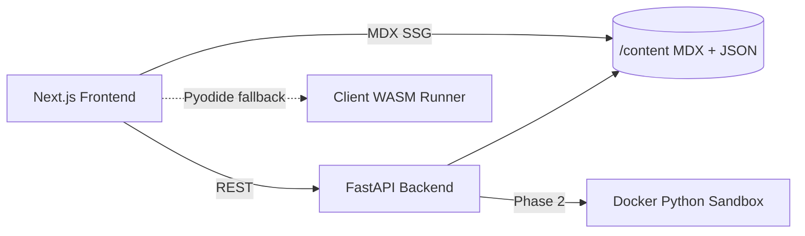

# CodeCraft Academy

A LinkedIn Learning–style platform for going from zero to job-ready in **Python**, **DSA**, **System Design**, **Cloud/DevOps**, and **AI/ML** — with textbook-depth MDX lessons, Mermaid diagrams, practice problems, and a live in-browser Python compiler.

No accounts. No progress tracking. No gamification. Content and practice only.

## Architecture



| Layer | Stack |
| --- | --- |
| Frontend | Next.js 14 App Router, TypeScript, Tailwind, shadcn/ui, Monaco, Mermaid, Fuse.js |
| Backend | Python 3.12, FastAPI, Pydantic v2, slowapi, structlog |
| Content | MDX lessons + JSON problems under `/content` |
| Infra | Docker Compose, Makefile, GitHub Actions |

## Quick start

```bash
cp .env.example .env
docker compose up --build
```

- Frontend: http://localhost:3000
- API docs: http://localhost:8000/docs
- Health: http://localhost:8000/health

### Local development (without Docker)

```bash
# Backend
cd backend
pip install -r requirements.txt -r requirements-dev.txt
set CONTENT_DIR=../content   # PowerShell: $env:CONTENT_DIR="..\content"
uvicorn app.main:app --reload --port 8000

# Frontend (separate terminal)
cd frontend
npm install
set CONTENT_DIR=../content
npm run dev
```

Or use the Makefile: `make install`, `make backend`, `make frontend`.

## API endpoints

| Method | Path | Description |
| --- | --- | --- |
| GET | `/health` | Liveness |
| GET | `/api/courses` | Course list |
| GET | `/api/courses/{slug}` | Course + curriculum |
| GET | `/api/lessons/{slug}` | Lesson MDX + nav |
| GET | `/api/problems` | Problem list (filters) |
| GET | `/api/problems/{slug}` | Problem detail |
| POST | `/api/run` | Execute Python (sandbox Phase 2) |
| POST | `/api/submit` | Run against test cases (Phase 2) |
| GET | `/api/search?q=` | Search courses/lessons/problems |

## Repository layout

```
├── frontend/          Next.js app
├── backend/           FastAPI app
├── content/           MDX lessons + problem JSON
├── sandbox/           Minimal Python execution image
├── docker-compose.yml
├── Makefile
└── .github/workflows/ci.yml
```

## Security note (code execution)

`/api/run` and `/api/submit` are rate-limited per IP and size-capped. Phase 2 runs untrusted code in an isolated Docker sandbox (no network, memory/CPU/pids limits, non-root). Never expose an unrestricted interpreter to the public internet. See Phase 2 docs for abuse-protection guidance. Set `NEXT_PUBLIC_USE_PYODIDE=true` for a client-side WASM fallback on hosts without Docker.

## Deployment

Full AWS (ECS Fargate / EC2) and Vercel + Render/Railway guides land in **Phase 8**. For now:

- Frontend builds with `output: "standalone"` for container deploys.
- Backend is a standard Uvicorn ASGI app.
- Mount `/content` read-only into both services.

## Phased roadmap

1. **Foundation** (this phase) — shell, design system, MDX, search, API skeleton  
2. Execution engine + playground hardening  
3. Full Python course  
4. Full DSA course + 300+ problems  
5. System Design course  
6. Cloud / DevOps course  
7. AI / ML + SageMaker course  
8. Polish, SEO, a11y, CI/CD, deployment docs  

## License

Course platform code: MIT (unless otherwise noted). Lesson text and problem statements are original instructional material for this project.
