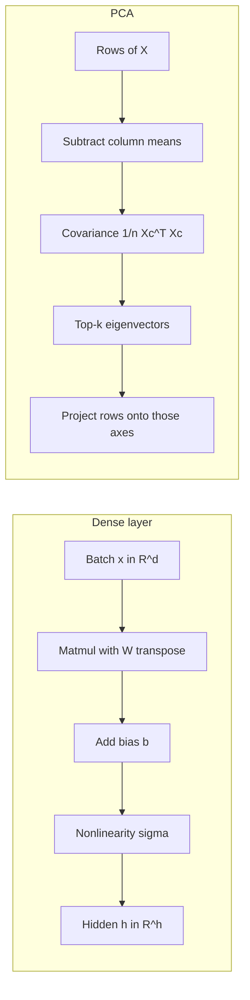

## Why this matters

Every model you will train in this course is a stack of linear maps plus a few nonlinearities. A linear regressor is one dot product. A dense layer is a matrix-vector product plus a bias. A Transformer attention head is a batch of dot products, a softmax, and a weighted sum of value vectors. Principal component analysis is an eigenvalue problem on a covariance matrix. If those sentences feel like slogans, the rest of the curriculum will feel like API memorization. If they feel like geometry, you can debug a wrong shape, a collapsed embedding, or a singular design matrix from first principles.

Linear algebra is also the language of cost. Dense matrix multiplication dominates GPU time in deep learning. Knowing that an m by n times n by p product costs on the order of m·n·p multiply-adds tells you why a 4096-wide layer is expensive, why low-rank adapters exist, and why attention is quadratic in sequence length. You do not need to become a numerical analyst, but you do need to see a weight matrix as a machine that moves vectors, not as a rectangle of randomly initialized floats.

This lesson builds that picture from scratch in pure Python, then connects it to the shapes you will meet in NumPy and PyTorch. Later lessons on calculus, classical models, and Transformers all assume you can track dimensions and interpret a dot product as signed alignment.

## Intuition

A vector in ℝⁿ is an arrow: a direction and a length, or equivalently a point whose coordinates are the arrow's tip when the tail sits at the origin. The vector (3, 4) in the plane has length 5 by the Pythagorean theorem. Scaling it by 2 produces (6, 8), same direction, twice as long. Adding two vectors is the parallelogram rule: walk along the first, then along the second.

A matrix is a machine that eats a vector and returns another vector, and the machine is linear: it respects scaling and addition. Stretching the plane, rotating it, shearing it, or squashing it flat onto a line are all linear maps, and every linear map between finite-dimensional spaces can be written as a matrix once you pick bases. The columns of the matrix are the images of the basis vectors. Multiplying the matrix by a vector builds a weighted sum of those columns. That single sentence is the whole of a dense neural layer before the activation.

The dot product asks a different question: how much does one vector point along another? It is large and positive when they agree, zero when they are perpendicular, and negative when they oppose. Cosine similarity divides by the lengths so only the angle remains. Embeddings use this constantly. Two sentences about the same fact land in nearby directions even if one paragraph is longer, and retrieval finds them with a dot product after both vectors have been normalized.

## Core concept in depth

### Vector spaces, bases, and coordinates

Fix a dimension n. The standard basis of ℝⁿ is the set of vectors that have a 1 in one coordinate and 0 elsewhere. Any vector x is the unique linear combination of those basis vectors with coefficients x₁ through xₙ. Changing basis rewrites the same geometric arrow with different numbers. In machine learning we almost always stay in the standard basis, but the idea matters: an embedding is a choice of coordinates for a discrete object, and two embedding tables can describe similar geometry with completely different numbers.

The span of a set of vectors is every weighted sum of them. If those vectors are linearly independent — none is a weighted sum of the others — they form a basis for their span. The number of vectors in any basis of a subspace is the dimension of that subspace. A dataset with 10 features but only 3 independent directions of variation lives, for practical purposes, in a 3-dimensional subspace. PCA and low-rank factorization are tools for naming that subspace.

### Norms and the dot product

The Euclidean norm is ‖x‖ = √(x · x). It is the length. The dot product expands as

u · v = Σᵢ uᵢ vᵢ = ‖u‖ ‖v‖ cos θ

where θ is the angle between the arrows. From this identity you can read off three facts used every day:

- Cauchy–Schwarz: |u · v| ≤ ‖u‖ ‖v‖, so cosine stays inside −1 to 1.
- Orthogonal vectors contribute nothing to each other's expansion. That is why an orthonormal basis is pleasant: coordinates are just dot products.
- The squared distance ‖u − v‖² = ‖u‖² + ‖v‖² − 2 u · v. When vectors are unit length, nearest neighbors under Euclidean distance are exactly the largest dot products.

Other norms show up as regularizers. The L1 norm is the sum of absolute coordinates and encourages sparse weights. The L∞ norm is the largest absolute coordinate. The Euclidean norm is the L2 norm, and penalizing ‖w‖₂² is ridge regression.

### Matrices as linear maps

Let A be m by n. Then A maps ℝⁿ to ℝᵐ. The entry Aᵢⱼ is the contribution of input coordinate j to output coordinate i. The product y = A x has

yᵢ = Σⱼ Aᵢⱼ xⱼ

which is the dot product of row i with x. Equivalently, y is a linear combination of the columns of A, with coefficients taken from x. Composition of maps is matrix multiplication, and it is associative but not commutative: AB and BA are different maps when both products exist, and they may not even have the same shape.

The identity matrix I leaves every vector unchanged. A matrix is invertible when it is square and its columns form a basis, equivalently when only the zero vector maps to zero. The inverse undoes the map. Most matrices in learning are not square and not invertible; we use pseudoinverses and least squares instead.

Rank is the dimension of the column space, which equals the dimension of the row space. A rank-r matrix can be written as a product of an m by r matrix and an r by n matrix. That factorization is the algebraic reason LoRA and other low-rank adapters can adapt a huge weight matrix by training two thin ones. Multiplying a 4096 by 16 matrix by a 16 by 4096 matrix yields a 4096 by 4096 update whose rank is at most 16, at a fraction of the parameter cost.

### Projections and least squares

Suppose we want weights w so that X w is as close as possible to a target y, with X an n by d design matrix of n examples. If y is not in the column space, no exact solution exists. The least-squares choice is the orthogonal projection of y onto that column space. The residual y − X w is perpendicular to every column, which is the statement Xᵀ (y − X w) = 0. Rearrangement gives the normal equations

Xᵀ X w = Xᵀ y

When Xᵀ X is invertible, w = (Xᵀ X)⁻¹ Xᵀ y. When features are collinear, Xᵀ X is singular or nearly singular and the solution is unstable. Ridge regression replaces Xᵀ X with Xᵀ X + λ I, which shifts every eigenvalue up by λ and restores invertibility. You will derive the same formula from calculus in the next lesson; the geometry and the derivative are the same fact.

A projection matrix P satisfies P² = P. Applying it twice does nothing new because the vector is already in the subspace. Orthogonal projectors are also symmetric. PCA projections are orthogonal projectors onto the leading eigenvectors of the covariance.

### Eigenvalues, covariance, and SVD

For a square matrix A, an eigenvector v ≠ 0 and eigenvalue λ satisfy A v = λ v. The map only stretches that direction; it does not rotate it. Symmetric matrices, and covariance matrices are symmetric, have real eigenvalues and an orthonormal basis of eigenvectors. Writing the covariance as Q Λ Qᵀ is the spectral theorem. The diagonal of Λ holds the variance captured by each principal axis. Keeping the largest few eigenvalues is PCA: you rotate into the eigenbasis and drop the noisy coordinates.

The singular value decomposition generalizes this to rectangular matrices. Any A factors as U Σ Vᵀ, with U and V orthogonal and Σ diagonal and non-negative. The diagonal entries are singular values. The number of positive singular values is the rank. Truncating to the largest r singular values gives the best rank-r approximation in Frobenius norm, which is the Eckart–Young theorem and the justification for compressing a weight matrix or a term-document matrix. The pseudoinverse is obtained by inverting the nonzero singular values, and it yields the minimum-norm least-squares solution when the normal equations are singular.

Numerical libraries do not form Aᵀ A and then compute its eigenvalues when they want singular vectors, because squaring the matrix squares the condition number. They run a stable SVD. From scratch, a useful teaching algorithm is power iteration: repeatedly multiply a vector by a symmetric matrix and renormalize. The direction converges to the leading eigenvector when a unique largest-magnitude eigenvalue exists. The matching eigenvalue is the Rayleigh quotient v · A v / v · v, which equals v · A v once v is unit length.

### Shapes you must be able to say out loud

Let a minibatch contain B rows and d features. A weight matrix W of shape h by d produces hidden states of shape B by h via X Wᵀ, or of shape h if you left-multiply a single column vector. Bias is a vector of length h, added to every row. Attention with sequence length T and head dimension d computes scores of shape T by T. That quadratic block is why long-context models spend so much memory on the score matrix. None of this is optional bookkeeping. A silent transpose is the most common bug in handwritten layers, and it is invisible if you only stare at the loss.

## Diagram / flowchart

Two pipelines share the same primitives. The top path is one dense layer. The bottom path is a PCA compression of a centered data matrix.



### Dry-run table

Take the diagonal map A = [[2, 0], [0, 3]] and the vector x = [1, 1]. Separately, project u = [3, 1] onto v = [1, 0], the x-axis.

| Step | Action | Result |
| --- | --- | --- |
| 1 | Row 0 of A dotted with x | 2·1 + 0·1 = 2 |
| 2 | Row 1 of A dotted with x | 0·1 + 3·1 = 3 |
| 3 | A x | [2, 3] |
| 4 | u · v | 3 |
| 5 | v · v | 1 |
| 6 | Coefficient (u · v) / (v · v) | 3 |
| 7 | Projection | [3, 0] |
| 8 | Residual u minus projection | [0, 1], orthogonal to v |

The residual's dot product with v is 0, which is the geometric definition of an orthogonal projection. The same check, Xᵀ residual = 0, is how you verify a least-squares fit on a tiny matrix before you trust a solver.

## Code

Pure Python, no NumPy. The routines below are the ones you should be able to re-derive on a whiteboard: dot product, norm, cosine, matrix-vector and matrix-matrix products, an orthogonal projection onto a single vector, and power iteration for the dominant eigenpair of a symmetric matrix.

```python
import math


def dot(u: list[float], v: list[float]) -> float:
    if len(u) != len(v):
        raise ValueError("vectors must match length")
    return sum(a * b for a, b in zip(u, v))


def norm(u: list[float]) -> float:
    return math.sqrt(dot(u, u))


def cosine_similarity(u: list[float], v: list[float]) -> float:
    denom = norm(u) * norm(v)
    if denom == 0.0:
        raise ValueError("zero vector has no direction")
    return dot(u, v) / denom


def matvec(A: list[list[float]], x: list[float]) -> list[float]:
    return [dot(row, x) for row in A]


def matmul(A: list[list[float]], B: list[list[float]]) -> list[list[float]]:
    if len(A[0]) != len(B):
        raise ValueError("inner dimensions must match")
    bt = [list(col) for col in zip(*B)]
    return [[dot(row, col) for col in bt] for row in A]


def project_onto(u: list[float], v: list[float]) -> list[float]:
    vv = dot(v, v)
    if vv == 0.0:
        raise ValueError("cannot project onto the zero vector")
    scale = dot(u, v) / vv
    return [scale * vi for vi in v]


def power_iteration(A: list[list[float]], iters: int = 40) -> tuple[float, list[float]]:
    n = len(A)
    v = [1.0 / math.sqrt(n)] * n
    for _ in range(iters):
        w = matvec(A, v)
        nw = norm(w)
        if nw == 0.0:
            raise ValueError("matrix annihilated the iterate")
        v = [wi / nw for wi in w]
    lam = dot(v, matvec(A, v))
    return lam, v


if __name__ == "__main__":
    A = [[2.0, 0.0], [0.0, 3.0]]
    print("Ax", matvec(A, [1.0, 1.0]))
    print("proj", project_onto([3.0, 1.0], [1.0, 0.0]))
    lam, vec = power_iteration(A)
    print("lambda", round(lam, 6), "v", [round(c, 6) for c in vec])
    print("cosine", round(cosine_similarity([1.0, 0.0], [0.6, 0.8]), 4))
```

Running the dry-run confirms A x = [2, 3] and the projection [3, 0]. Power iteration on this diagonal matrix recovers eigenvalue 3 and a vector concentrated on the second coordinate, because 3 is strictly larger than 2. If you need all eigenpairs, use a library SVD or a full symmetric eigensolver; power iteration is a lens, not a replacement for LAPACK.

When you move to NumPy, the same operations are `np.dot`, `@`, `np.linalg.norm`, and `np.linalg.svd`. Broadcasting will happily add a bias of shape (h,) to an array of shape (B, h). It will also happily do the wrong thing if a singleton dimension sneaks in. Print shapes before you print losses.

## Complexity analysis

| Operation | Time | Space | Where it shows up |
| --- | --- | --- | --- |
| Dot product in ℝⁿ | Θ(n) | Θ(1) extra | Logits, cosine, Gram entries |
| Dense m by n matvec | Θ(m n) | Θ(m) output | One layer, one example |
| Dense m by n times n by p | Θ(m n p) | Θ(m p) | Minibatch matmul, attention values |
| Naive Gram matrix Xᵀ X for n by d | Θ(n d²) | Θ(d²) | Closed-form least squares |
| Power iteration, k steps, n by n | Θ(k n²) | Θ(n) | Teaching solver for the top eigenpair |
| Full SVD of m by n, m ≥ n | roughly O(m n²) | O(m n) | PCA, pseudoinverse, compression |

The constant factors in front of dense matmul are why GPUs exist: the work is regular multiply-adds with excellent cache reuse. Sparse or structured maps (convolutions, Fourier features, low-rank factors) win when the matrix would otherwise be huge and mostly redundant. Attention scores for sequence length T cost Θ(T² d) to form and materialize a T by T matrix, which is the memory wall long-context kernels try to avoid by recomputing or blocking.

Least squares via the normal equations is fast for moderate d and numerically worse than a QR or SVD solve. Prefer a stable solver when features are correlated. The asymptotic win of forming Xᵀ X, which is d by d rather than touching an n by d QR factor, is real for n much larger than d, and it is what ridge regression implementations often do — plus the λ I shift.

## Tricks, tips and patterns

- Say the shape of every tensor out loud before you write the product. Columns of W must match the dimension of x. If you cannot state the output shape, you do not yet understand the layer.
- Prefer cosine, or an explicit L2 normalization followed by a dot product, when magnitude is a nuisance. Prefer Euclidean distance when magnitude carries the signal, as in whitened tabular features.
- Center features before PCA. The leading eigenvector of an uncentered scatter matrix often just points at the mean.
- Replace a nearly singular Xᵀ X with Xᵀ X + λ I before you invent a more complicated model. Many "unstable training" stories in linear models are multicollinearity.
- A projection you will reuse is a matrix P. Check P² = P on a tiny example before applying it to real data.
- Orthonormal columns can be dropped or added without disturbing the others. That is the practical payoff of SVD over an arbitrary basis of the same subspace.
- Initialize deep-network weights so that fan-in and fan-out do not explode the variance of activations. That rule is linear algebra plus a variance calculation, and it is why Xavier and He initialization scale by 1/√d.
- Low-rank is a compression hypothesis: if a layer's update lives in a thin subspace, store the factors, not the full matrix.

## Common mistakes and edge cases

- Treating row vectors and column vectors as interchangeable when reading a paper. The product wᵀ x is a scalar; x wᵀ is an outer product, a rank-1 matrix. Those are different objects that look similar in sloppy notation.
- Dividing by a zero norm in cosine similarity, or projecting onto the zero vector. Empty and constant embedding rows appear in real retrieval indexes.
- Assuming matrix multiplication commutes, or that (AB)ᵀ equals Aᵀ Bᵀ. The identity is (AB)ᵀ = Bᵀ Aᵀ. Forgetting the swap breaks backprop through a linear layer.
- Forming a covariance without centering, then interpreting the top component as "the signal."
- Using power iteration on a matrix whose leading eigenvalue is tied in magnitude, or whose leading eigenvalue is negative and you forgot absolute value. On a covariance everything is non-negative, so the teaching version is safe.
- Ignoring conditioning. Subtracting two large, nearly equal Gram entries can wipe out the true small difference. Stable solvers exist for a reason.
- Broadcasting a bias of the wrong rank and training anyway because the loss still decreases. Check shapes in the forward pass, not after a week of tuning.

## Interview notes

Be ready to define a linear layer as a matrix-vector product plus bias plus nonlinearity, and to compute its parameter count: h·d weights and h biases, ignoring the optimizer state. Be ready to explain cosine similarity as a normalized dot product and to say when you would not use it.

A common follow-up is the least-squares derivation. Either finish at the normal equations from the orthogonality argument above, or take the derivative of ‖X w − y‖² and set it to zero. Mention that the same normal equations become unstable under collinearity and that ridge adds λ I.

Another follow-up is attention as linear algebra: queries, keys, and values are three linear maps of the tokens; scores are a scaled Gram matrix; the output is a convex combination of values. If you can also say why the scale is √d, you are ahead of most candidates. The dot product of two random unit-variance vectors in dimension d has variance d, so unscaled logits grow and softmax saturates.

For PCA, state the optimization view: the first principal component maximizes projected variance subject to unit norm, and subsequent components do the same inside the orthogonal complement. You do not need to recite a full SVD proof.

## Practice problems

1. [Dot Product](/practice/ml-dot) — the reduction inside every linear layer (easy).
2. [Cosine Similarity](/practice/ml-cosine) — normalize, then measure angle, and think about the zero-vector case (easy).
3. [Euclidean Distance](/practice/ml-euclidean) — relate it back to the expanded square ‖u − v‖² (easy).
4. On paper, multiply a 2 by 3 matrix by a 3 by 2 matrix and verify that the result's rank is at most 2.
5. Build a tiny projection matrix onto the x-axis in ℝ² and check that applying it twice matches applying it once.

## Summary / cheat sheet

- A vector is an arrow. A matrix is a linear machine. The columns are where the basis goes.
- The dot product measures signed alignment. Cosine drops magnitude. Euclidean distance is the norm of the difference.
- y = A x is a mix of the columns of A. Shape errors are conceptual errors.
- Least squares projects y onto the column space of X. Normal equations: Xᵀ X w = Xᵀ y. Ridge adds λ I.
- Symmetric matrices have orthonormal eigenbases. PCA keeps the large-variance axes of the covariance.
- SVD writes any matrix as a sum of rank-1 pieces ordered by singular value. Truncation is optimal low-rank approximation.
- Dense matmul cost is the product of the three dimensions. Attention scores are quadratic in sequence length.
- (AB)ᵀ = Bᵀ Aᵀ. Projection matrices satisfy P² = P. Zero vectors have no cosine.

## Further reading

- [3Blue1Brown — Essence of Linear Algebra](https://www.3blue1brown.com/topics/linear-algebra)
- [Deep Learning Book, Chapter 2 — Linear Algebra](https://www.deeplearningbook.org/contents/linear_algebra.html)
- [NumPy linear algebra routines](https://numpy.org/doc/stable/reference/routines.linalg.html)
- [MIT 18.06, Gilbert Strang — Linear Algebra](https://ocw.mit.edu/courses/18-06-linear-algebra-spring-2010/)
- [Vaswani et al., Attention Is All You Need](https://arxiv.org/abs/1706.03762)
