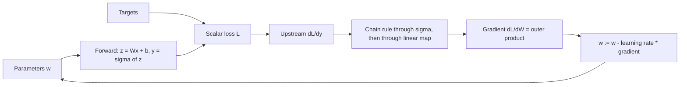

## Why this matters

Training is the search for parameters that make a scalar loss small. Calculus is the local description of that search. A derivative says which way the loss moves if you nudge one weight. A gradient stacks those answers into a vector. The chain rule is why a 100-layer network is trainable at all: you do not differentiate the whole composition from scratch, you multiply local Jacobians from the output backward. Every optimizer you will meet — batch gradient descent, SGD, momentum, Adam — is a policy for walking downhill using that gradient, sometimes with a running estimate of curvature.

Without this picture, backprop looks like a magic autograd call. With it, you can explain vanishing gradients, why ReLU replaced sigmoid in deep stacks, why a learning rate of 1.0 explodes a quadratic bowl, and why the Hessian of a loss tells you whether a critical point is a minimum. This lesson derives the scalar facts, lifts them to vectors, and implements finite differences plus a tiny gradient step you can check by hand.

## Intuition

Imagine the loss as a hillside and the weights as your position. The derivative is the slope under your feet along one trail. If the slope is positive, walking forward (increasing the weight) goes uphill, so you step backward. The steeper the slope, the larger the step you are tempted to take, which is why a learning rate exists: the raw slope is a direction and a suggested scale, not a command to jump.

For a function of many weights the hillside has a slope in every direction. The gradient is the vector of those partial slopes. It points in the direction of steepest ascent. Descent walks the opposite way. The chain rule is the hike version of "the slope of the whole trail is the product of the slopes of each switchback." If three functions are composed, you multiply three local derivatives. That product is backpropagation written in one dimension. In many dimensions the product becomes a chain of Jacobian matrices, which is why the linear-algebra lesson had to come first.

## Core concept in depth

### Derivatives and partial derivatives

Let f map a real number to a real number. The derivative at w, when it exists, is

f′(w) = limit as h approaches 0 of (f(w + h) − f(w)) / h

It is the best linear approximation to the change in f: f(w + h) ≈ f(w) + f′(w) h. Rules you should have as reflexes:

- Power rule: the derivative of wⁿ is n wⁿ⁻¹. In particular, w² has derivative 2w, and a constant has derivative 0.
- Sum rule: derivative of a sum is the sum of derivatives. Scaling by a constant pulls out of the derivative.
- Product rule: (uv)′ = u′ v + u v′.
- Quotient rule is the product rule applied to u · v⁻¹. You rarely need it in learning code because losses are built from sums, products, and compositions.

A function of several variables has a partial derivative for each coordinate: pretend the others are constant and differentiate. Write ∂L/∂wᵢ. The gradient ∇L is the column of all partials. For L(w) = ‖w‖² = Σᵢ wᵢ², the partial with respect to wᵢ is 2 wᵢ, so ∇L = 2 w. Gradient descent on this loss from any start walks straight toward the origin, which is the unique minimum.

### The chain rule, including the logistic sigmoid

If y = f(g(w)), then dy/dw = f′(g(w)) · g′(w). The outer function does not see w; it sees the inner value, so you differentiate the outer function at the inner value and multiply by how fast the inner value moves.

The logistic sigmoid σ(z) = 1 / (1 + e^(−z)) is the classic composition. Let u = e^(−z) and σ = (1 + u)⁻¹. Differentiating and simplifying yields the identity every interviewer wants:

σ′(z) = σ(z) (1 − σ(z))

It is always non-negative, it peaks at 1/4 when z = 0, and it collapses toward 0 when σ saturates near 0 or near 1. That collapse is the vanishing-gradient problem of deep sigmoid networks: a chain of many factors each around 0.01 wipes out the signal before it reaches early layers. ReLU, whose slope is 1 on the positive side, was adopted largely to keep those factors from shrinking.

Binary cross-entropy composed with a sigmoid has a gradient with respect to the logit that simplifies to σ(z) − y. The σ′ in the denominator of the loss derivative cancels the σ′ from the chain rule. You should be able to sketch that cancellation. It is why "sigmoid + BCE" is numerically better implemented as a fused log-sum-exp loss on logits than as two separate unstable stages.

### Jacobians and a single linear layer

When the output is a vector, the derivative is a Jacobian matrix J with Jᵢⱼ = ∂yᵢ/∂xⱼ. For y = W x, the Jacobian with respect to x is W itself. Backpropagating a row vector of output gradients gᵀ through the layer multiplies gᵀ W, or equivalently applies Wᵀ to g if you keep column vectors. The gradient with respect to the weights is the outer product of the upstream gradient and the input: each weight Wᵢⱼ only affects output i, and it affects it with coefficient xⱼ, so ∂L/∂Wᵢⱼ = gᵢ xⱼ. That outer product is the entire parameter gradient of a dense layer. Minibatch training sums or averages it over rows.

### Taylor's theorem and what a learning rate means

The second-order expansion is

f(w + Δ) ≈ f(w) + ∇f · Δ + (1/2) Δᵀ H Δ

where H is the Hessian of second partials. At a local minimum the gradient is zero and the Hessian is positive semidefinite: every direction curves upward. At a saddle the gradient is also zero but the Hessian has both positive and negative eigenvalues, so some directions descend. Deep networks have many saddles; stochastic gradients and momentum help step off them because a minibatch gradient is not the true gradient and does not vanish at the same places.

For the one-dimensional bowl f(w) = (1/2) a (w − w*)² with a > 0, the gradient is a (w − w*) and a gradient step is

w ← w − η a (w − w*)

The error multiplies by (1 − η a) each step. If η = 1/a the error dies in one step. If η is between 0 and 2/a the error shrinks. If η > 2/a the iteration diverges, oscillating with growing amplitude. This is the whole story of "learning rate too high," told on a quadratic. Adaptive methods like Adam estimate a per-coordinate curvature scale so that a single global η is less brittle.

### Finite differences as a debugging tool

You almost never train with finite differences, because each coordinate costs an extra forward pass. You do use them to test analytic gradients. The central difference

(f(w + h eᵢ) − f(w − h eᵢ)) / (2 h)

approximates ∂f/∂wᵢ with error proportional to h². Pick h around 1e-5 for double-ish floats, compare to your backprop, and demand relative agreement around 1e-4 or better on a tiny random model. A sign error in the loss, a forgotten transpose, or a detached tensor shows up immediately. This check, called a gradcheck, is the professional habit that separates "the loss went down so it must be right" from "the gradient matches the definition."

## Diagram / flowchart



### Dry-run table

Minimize f(w) = (w − 3)² starting at w = 0 with learning rate η = 0.25. The derivative is f′(w) = 2(w − 3).

| Step | w before | f′(w) | Update w − η f′ | w after |
| --- | --- | --- | --- | --- |
| 1 | 0 | 2(0 − 3) = −6 | 0 − 0.25·(−6) | 1.5 |
| 2 | 1.5 | 2(1.5 − 3) = −3 | 1.5 − 0.25·(−3) | 2.25 |
| 3 | 2.25 | 2(2.25 − 3) = −1.5 | 2.25 + 0.375 | 2.625 |
| 4 | 2.625 | −0.75 | 2.625 + 0.1875 | 2.8125 |

The error is halved every step because the multiplier (1 − η a) with a = 2 is (1 − 0.5) = 0.5. Four steps move from error 3 to error 0.1875. A learning rate of 1.0 would be exactly 1/a and would land on 3 in one step. A learning rate of 1.1 would overshoot and diverge, since 2/a = 1.

## Code

```python
import math


def sigmoid(z: float) -> float:
    if z >= 0:
        ez = math.exp(-z)
        return 1.0 / (1.0 + ez)
    ez = math.exp(z)
    return ez / (1.0 + ez)


def sigmoid_grad(z: float) -> float:
    s = sigmoid(z)
    return s * (1.0 - s)


def finite_diff(f, w: float, h: float = 1e-5) -> float:
    return (f(w + h) - f(w - h)) / (2.0 * h)


def gd_quadratic(start: float, target: float, lr: float, steps: int) -> list[float]:
    """Minimize (w - target)^2. Derivative is 2(w - target)."""
    w = start
    path = [w]
    for _ in range(steps):
        grad = 2.0 * (w - target)
        w = w - lr * grad
        path.append(w)
    return path


def linreg_step(w: list[float], x: list[float], y: float, lr: float) -> list[float]:
    pred = sum(wi * xi for wi, xi in zip(w, x))
    err = pred - y  # d/d(pred) of 0.5 (pred - y)^2
    return [wi - lr * err * xi for wi, xi in zip(w, x)]


if __name__ == "__main__":
    path = gd_quadratic(0.0, 3.0, 0.25, 4)
    print([round(v, 4) for v in path])
    z = 0.7
    analytic = sigmoid_grad(z)
    numeric = finite_diff(sigmoid, z)
    print("gradcheck", round(analytic, 6), round(numeric, 6))
    print("step", linreg_step([0.0, 0.0], [1.0, 2.0], 1.0, 0.1))
```

The path prints 0, 1.5, 2.25, 2.625, 2.8125, matching the table. The sigmoid gradcheck should agree to several decimals. The linear step is the same update derived in the practice problem: the gradient of half squared error with respect to w is the residual times x.

## Complexity analysis

| Procedure | Cost | Notes |
| --- | --- | --- |
| Analytic gradient of a dense layer, batch B, input d, hidden h | Θ(B d h) | Same order as the forward matmul |
| Finite-difference gradcheck, P parameters | Θ(P) forward passes | Debug only, on a tiny model |
| Full Hessian of a loss with P parameters | Θ(P²) entries, often Θ(P²) work or worse | Rarely formed explicitly |
| One SGD step | Θ(cost of gradient) plus Θ(P) to apply it | The apply step is cheap next to backprop |
| Hessian-vector product via finite differences on the gradient | About two backward passes | Used by some second-order methods |

Backpropagation is efficient because it reuses the forward values and computes every parameter's partial in a constant factor times one forward and one backward sweep. Finite differences throw that sharing away. Forming the Hessian explicitly is quadratic memory, which for a model with 10⁸ parameters is impossible. Practical second-order methods only approximate curvature with diagonal statistics (Adam, RMSProp) or with Hessian-vector products.

The quadratic example also gives a convergence trade-off. A well-conditioned bowl (largest and smallest curvature close together) tolerates a large stable learning rate and converges in few steps. An ill-conditioned bowl forces a tiny learning rate set by the sharpest direction, so the flat directions crawl. Preconditioning — multiplying the gradient by an approximate inverse Hessian — is the systematic fix, and it is what adaptive optimizers crudely attempt per coordinate.

## Tricks, tips and patterns

- Gradcheck a new layer on random tiny inputs before you trust a training curve. Use central differences and a relative tolerance.
- Watch the scale of activations. If a sigmoid input is routinely outside −4 to 4, the local derivative is nearly zero and you are not learning, even if the code is correct.
- Prefer fused "logits to loss" implementations. Computing softmax and log as separate stages underflows. The mathematically identical log-sum-exp form does not.
- The learning rate and the loss scaling are the same knob. If you multiply the loss by 100 and divide the learning rate by 100, gradient descent traces the same path. Averaging a batch versus summing it is this knob in disguise.
- Initialize weights at a scale that keeps the gradient factors near 1. A chain of k Jacobians each of norm 1.1 explodes; each of norm 0.9 vanishes.
- Momentum is not a different derivative. It is a filter on the sequence of gradients: a velocity that averages recent steps so a noisy hillside does not jitter.
- If the loss is NaN on step 1, suspect a log of zero, an exp overflow, or a learning rate that jumped to infinity, not a subtle modeling idea.

## Common mistakes and edge cases

- Using a one-sided difference with a huge h and concluding the analytic gradient is wrong. Central differences with a modest h are the fair test. Too small an h is also wrong: subtraction cancellation eats the numerator.
- Forgetting the factor of 2 when differentiating a square, or mixing the "half square loss" convention with the "full square loss" convention. Pick one and keep the learning rate consistent.
- Applying the chain rule in the wrong order, especially through a transpose. The upstream gradient is a linear map; it must be pulled back by the Jacobian transpose.
- Stopping at a zero gradient and declaring victory. Check that you are not at a saddle, and check that the training loss being zero is not memorization. Calculus finds critical points; statistics decides whether they generalize.
- Differentiating through a non-differentiable kink without a policy. ReLU is not differentiable at 0. Subgradients conventionally take the slope as 0 or 1 there; the single point does not matter in practice, but an interview answer should mention the subgradient.
- Diverging SGD and "fixing" it by clipping the loss instead of clipping the gradient or lowering the step size. The loss value is not the object being added to the weights; the gradient is.

## Interview notes

Derive σ′(z) = σ(z)(1 − σ(z)) on the board, slowly. Then state the logit-gradient of binary cross-entropy: prediction minus label. If you blank, re-derive it from the chain rule rather than reciting.

Be ready for "what does a gradient mean?" The honest answer is the vector of partial derivatives, the direction of steepest ascent for the Euclidean norm. Mention that a different norm gives a different steepest direction; that remark is the doorway to natural gradients and to why parameter scaling matters.

A standard design question: your deep sigmoid network trains the last layer and ignores the first. Diagnosis: saturated units, vanishing products of σ′. Remedies: residual connections, better initialization, non-saturating activations, batch or layer normalization, or a shorter path for gradients. You are not expected to implement batch norm in the interview; you are expected to locate the product that vanished.

For optimization, explain divergence on a quadratic with the (1 − η a) multiplier. That one-line recurrence is more convincing than "the learning rate was too big."

## Practice problems

1. [Stable Sigmoid](/practice/ml-sigmoid) — implement the forward map you just differentiated (easy).
2. [One Linear Regression Step](/practice/ml-linreg-step) — apply ∇ of half-square loss to a single row (medium).
3. [Softmax](/practice/ml-softmax) — the vector generalization of the sigmoid, and the start of the cross-entropy cancellation (medium).
4. On paper, take four gradient steps on (w − 3)² from 0 with learning rate 0.25 and match the table in this lesson.
5. Gradcheck your sigmoid derivative at z = −3, 0, and 3. Confirm the slope is tiny at the extremes and 0.25 at zero.

## Summary / cheat sheet

- The derivative is the slope of the best local linear approximation. The gradient stacks partial slopes.
- Chain rule: multiply local derivatives. Backprop is the chain rule on a computation graph, applied from the loss backward.
- σ′(z) = σ(z)(1 − σ(z)). It vanishes when the unit saturates.
- A dense layer's weight gradient is an outer product of upstream gradient and input.
- On a quadratic bowl of curvature a, the error multiplies by (1 − η a) each step. Stable learning rates lie strictly between 0 and 2/a.
- Finite differences audit analytic gradients. They are too expensive to train with.
- Zero gradient means a critical point, not automatically a minimum. Look at curvature or just keep training with noise.

## Further reading

- [Deep Learning Book, Chapter 4 — Numerical Computation](https://www.deeplearningbook.org/contents/numerical.html)
- [Deep Learning Book, Chapter 6 — Deep Feedforward Networks](https://www.deeplearningbook.org/contents/mlp.html)
- [3Blue1Brown — Essence of Calculus](https://www.3blue1brown.com/topics/calculus)
- [Paul's Online Notes — Partial Derivatives](https://tutorial.math.lamar.edu/Classes/CalcIII/PartialDerivatives.aspx)
- [Stanford CS231n — Backpropagation notes](https://cs231n.github.io/optimization-2/)
