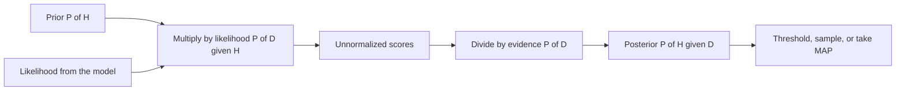

## Why this matters

A trained model does not "know" a label. It encodes a belief. Logistic regression emits a probability. A language model emits a distribution over the next token. A Bayesian model keeps a distribution over weights. Even a hard classifier is usually a probability that someone thresholded. If you cannot say what that number means, you will mis-calibrate a fraud system, misread a softmax, and treat a likelihood as a prior.

Probability is also the derivation engine for losses. Squared error is maximum likelihood under a Gaussian. Binary cross-entropy is maximum likelihood under a Bernoulli. The KL divergence between the data distribution and the model distribution is cross-entropy up to a constant the model cannot change. Once you see losses as negative log likelihoods, regularization becomes a prior, and dropout, label smoothing, and weight decay stop looking like unrelated tricks.

This lesson builds the minimal probability you need before statistics, classical models, and language-model evaluation. The code is pure Python: a Bayes update, a Gaussian log-density, and Shannon entropy of a discrete distribution.

## Intuition

A probability is a weight you assign to an outcome before you see it, with the weights of a complete set of mutually exclusive outcomes summing to 1. A fair coin puts weight 1/2 on heads. A language model puts a weight on every token in the vocabulary, and those weights sum to 1 because exactly one token will be next.

Conditional probability P(A given B) is the weight of A after you restrict the world to cases where B happened. Bayes' rule runs the conditioning backward. You start with a prior P(hypothesis), observe data, and obtain a posterior proportional to prior times likelihood. Training a discriminative model often skips the prior and just maximizes the likelihood. Training with weight decay puts a Gaussian prior back in. The algebra is the same theorem either way.

Entropy measures how spread out a distribution is, in bits. A deterministic outcome has entropy 0: you are not surprised. A fair coin has entropy 1 bit. Cross-entropy measures how surprised you are when the true process emits events and you score them with a different distribution — your model's. Minimizing cross-entropy is teaching the model to be less surprised by the data.

## Core concept in depth

### Events, random variables, and expectation

A sample space is the set of outcomes you are willing to consider. An event is a subset you might ask about. A random variable is a function from outcomes to numbers, or to tokens, or to vectors. Writing X for the variable and x for a particular value is the convention; the probability mass function p(x) is P(X = x) for discrete X.

Expectation is the probability-weighted average: E[X] = Σ x p(x) in the discrete case, and an integral in the continuous case. It is linear even when the variables are dependent: E[X + Y] = E[X] + E[Y]. Variance is Var(X) = E[(X − E[X])²] = E[X²] − (E[X])². Variance is not linear unless the variables are uncorrelated, in which case variances add. The standard deviation is the square root of variance and has the same units as X.

Independence means p(x, y) = p(x) p(y). It is stronger than zero correlation. Two variables can be uncorrelated and still dependent; a classic example is a variable symmetric around zero and its square. Naive Bayes bets on conditional independence of features given the class. The bet is often false and the classifier is still useful, because the decision boundary can be right even when the probabilities are miscalibrated.

### Bayes' rule

P(H given D) = P(D given H) P(H) / P(D)

The likelihood P(D given H) scores how expected the data are if the hypothesis is true. The prior P(H) is what you believed before this dataset. The evidence P(D) is the marginal probability of the data, summing likelihood times prior over hypotheses. It normalizes the posterior so the hypotheses still sum to 1.

In a spam filter, H is "spam" or "not spam," and D is the set of tokens. The prior is the base rate of spam. The likelihood under naive Bayes is a product of per-token probabilities estimated from counts, with smoothing so an unseen token does not zero out the whole product. Taking logs turns the product into a sum and prevents underflow. You classify by comparing log posterior scores, and the evidence cancels when both classes see the same message, so you often skip computing P(D) explicitly.

A continuous version is the posterior over weights: p(w given data) ∝ p(data given w) p(w). If the prior is an isotropic Gaussian on w, the log prior is a constant minus ‖w‖² / (2 σ²). Maximizing the log posterior is then maximum likelihood plus an L2 penalty. Ridge regression and weight decay are Bayes with a Gaussian prior, whether or not the author mentions it.

### Distributions you will actually use

Bernoulli(p): a single coin. P(X = 1) = p, P(X = 0) = 1 − p. Expectation p, variance p(1 − p). The negative log likelihood of a label y is −(y log p + (1 − y) log(1 − p)), which is binary cross-entropy.

Binomial(n, p): the count of successes in n independent Bernoulli trials. Useful as a mental model for "k positives out of n," less often as a training loss.

Categorical, or Multinoulli: one draw from K classes with probabilities that sum to 1. A softmax produces the parameter of this distribution. The negative log likelihood is −log p_y, the cross-entropy loss used by classifiers and by next-token training.

Gaussian, or normal, N(μ, σ²): the continuous bell curve. The density is

(1 / √(2 π σ²)) exp( −(x − μ)² / (2 σ²) )

Maximizing the likelihood of independent observations is the same as minimizing the mean squared error when σ is fixed, because the exponent contains the square residual and the rest does not depend on μ. If you also learn σ, the loss gains a log-variance term and a residual scaled by 1/σ². Heteroscedastic regression is that model. Multivariate Gaussians add a covariance matrix; their log-density contains the Mahalanobis distance (x − μ)ᵀ Σ⁻¹ (x − μ), which is why whitening and PCA show up in generative models.

### Entropy, cross-entropy, and KL

For a discrete distribution p,

H(p) = − Σₖ pₖ log pₖ

Using log base 2 gives bits. Cross-entropy of p under a model q is

H(p, q) = − Σₖ pₖ log qₖ

KL divergence is the gap: KL(p ‖ q) = H(p, q) − H(p). It is always ≥ 0, and zero only when p = q. It is not symmetric. Training usually minimizes cross-entropy, which minimizes KL, because H(p) does not depend on the model. On a finite dataset, p is the empirical distribution that puts mass on the observed labels, and the cross-entropy average collapses to the familiar mean of −log q(yᵢ).

Label smoothing replaces a one-hot p with a slightly softer target so the model is punished for being infinitely confident. In KL language, you stop asking the model to match a zero-entropy target it can only match by overfitting.

### Continuous densities and a warning about "probability zero"

A continuous random variable assigns probability zero to every exact point. What exists is a density, and probabilities come from integrals over regions. You can compare densities, and a higher density means a more plausible neighborhood, but a density is allowed to exceed 1. Quoting a Gaussian density as "the probability of this measurement" is a category error. Log-densities are the right object for training and for outlier scores.

## Diagram / flowchart



### Dry-run table

A disease has prior 0.01. A test is positive in 90 percent of sick patients and in 5 percent of healthy patients. You observe a positive test. Compute the posterior that the patient is sick.

| Step | Quantity | Value |
| --- | --- | --- |
| 1 | P(sick) | 0.01 |
| 2 | P(healthy) | 0.99 |
| 3 | P(positive given sick) | 0.90 |
| 4 | P(positive given healthy) | 0.05 |
| 5 | Joint sick and positive | 0.01 · 0.90 = 0.009 |
| 6 | Joint healthy and positive | 0.99 · 0.05 = 0.0495 |
| 7 | P(positive) | 0.009 + 0.0495 = 0.0585 |
| 8 | Posterior P(sick given positive) | 0.009 / 0.0585 ≈ 0.1538 |

The test is "90 percent accurate" in a colloquial sense and the patient is still probably healthy, because the base rate is tiny. This is the single most useful numerical habit in applied machine learning: always multiply by the base rate before you celebrate a high recall detector.

## Code

```python
import math


def bayes_binary(prior_pos: float, likelihood_pos: float, likelihood_neg: float) -> float:
    """Posterior of the positive hypothesis given a single observed outcome."""
    joint_pos = prior_pos * likelihood_pos
    joint_neg = (1.0 - prior_pos) * likelihood_neg
    evidence = joint_pos + joint_neg
    return joint_pos / evidence


def gaussian_logpdf(x: float, mu: float, sigma: float) -> float:
    if sigma <= 0:
        raise ValueError("sigma must be positive")
    z = (x - mu) / sigma
    return -0.5 * math.log(2.0 * math.pi) - math.log(sigma) - 0.5 * z * z


def entropy(probs: list[float]) -> float:
    total = 0.0
    for p in probs:
        if p < 0:
            raise ValueError("probability cannot be negative")
        if p > 0:
            total -= p * math.log2(p)
    return total


def bernoulli_nll(y: float, p: float) -> float:
    eps = 1e-12
    p = min(max(p, eps), 1.0 - eps)
    return -(y * math.log(p) + (1.0 - y) * math.log(1.0 - p))


if __name__ == "__main__":
    post = bayes_binary(0.01, 0.90, 0.05)
    print("posterior", round(post, 4))
    print("entropy fair coin", entropy([0.5, 0.5]))
    print("entropy certain", entropy([1.0, 0.0]))
    print("nll confident correct", round(bernoulli_nll(1.0, 0.9), 4))
    print("logpdf at mean", round(gaussian_logpdf(0.0, 0.0, 1.0), 4))
```

The posterior prints about 0.1538, matching the table. A fair coin has entropy 1 bit and a certain outcome has entropy 0. The Gaussian log-density at the mean of a standard normal is −0.5 log(2 π), about −0.9189, not a probability.

## Complexity analysis

| Object | Time | Space | Comment |
| --- | --- | --- | --- |
| Discrete expectation, support size K | Θ(K) | Θ(1) | Exact on a small support |
| Naive Bayes score, V tokens observed, K classes | Θ(K V) | Θ(K · vocabulary) for the count tables | Logs turn products into sums |
| Entropy of a length-n label multiset | Θ(n) | Θ(classes) | One pass to count, one pass over classes |
| Diagonal Gaussian log-density, dimension d | Θ(d) | Θ(d) for the parameters | Full covariance is Θ(d²) memory and Θ(d³) to invert |
| Exact evidence over H hypotheses | Θ(H) likelihoods | Θ(H) | Intractable when H is a continuous weight space |

The trade-off that dominates later courses is exact posterior versus a point estimate. Summing the evidence over all weight vectors is impossible for a neural net. Maximum likelihood, MAP, variational inference, and sampling are four different refusals to compute that integral, with different costs and different promises. Know which refusal you are using.

KL(p ‖ q) and KL(q ‖ p) penalize different mistakes. The forward KL used in maximum likelihood is mean-seeking: q tries to cover every mode of p. The reverse KL is mode-seeking and can ignore secondary modes. Variational autoencoders and knowledge distillation inherit this choice. It is not a cosmetic swap of arguments.

## Tricks, tips and patterns

- Work in log space as soon as you multiply more than a handful of probabilities. Add log probabilities; subtract the max before exponentiating if you need to normalize.
- State the base rate before you quote precision. The medical table in this lesson is the template.
- Smooth discrete estimates. Add-one (Laplace) smoothing is a Dirichlet prior with concentration 1. It stops unseen tokens from making a document probability exactly zero.
- If you need a probability from a model that was trained for ranking, calibrate it. Platt scaling and isotonic regression are post-hoc maps from scores to frequencies. A high AUC does not imply a meaningful 0.7.
- Entropy of the predictive distribution is a built-in uncertainty score. High entropy means "the model is unsure," which is different from "the model is confidently wrong." Use both.
- Generative classifiers model p(x given y) p(y). Discriminative classifiers model p(y given x) directly. The second usually wins on accuracy when data are plentiful; the first wins when you must handle missing features or tiny data.

## Common mistakes and edge cases

- Treating a softmax output as a calibrated probability without checking reliability diagrams. Modern neural nets are often overconfident.
- Calling a density a probability, or being shocked that a density exceeds 1.
- Dropping the prior in a rare-event detector and shipping a high false-positive rate to production.
- Computing a product of thousands of token probabilities in linear space and underflowing to zero. The log-likelihood was finite.
- Assuming uncorrelated features are independent and then trusting naive Bayes probabilities rather than its argmax.
- Using KL the wrong direction and wondering why a distilled student collapsed onto one mode.
- Estimating a Gaussian variance with a single sample. The maximum likelihood variance formula divides by n and is zero for n = 1; a prior or a floor belongs on any production variance.

## Interview notes

Be able to update the disease-test numbers live if the interviewer changes the base rate. The arithmetic is four lines and it signals that you will not deploy a 99 percent accurate detector on a 0.1 percent event without doing this math.

Connect a loss to a likelihood: squared error and the Gaussian, logistic loss and the Bernoulli, softmax cross-entropy and the categorical. Mention that an L2 penalty is a Gaussian prior. That trio answers "why this loss?" better than "it worked in the paper."

Define entropy and cross-entropy, and say why minimizing one minimizes KL to the empirical distribution. If the role is LLM-shaped, add that perplexity is the exponential of the mean negative log likelihood, in the same base as the log. Bits or nats must be stated.

A good stretch question is calibration versus discrimination. AUC can be excellent while predicted probabilities are useless as risks. Say how you would check: bin the predictions and compare each bin's mean prediction to its observed frequency.

## Practice problems

1. [Shannon Entropy](/practice/ml-entropy) — bits of an empirical label distribution (medium).
2. [Binary Cross-Entropy](/practice/ml-bce) — Bernoulli negative log likelihood, with clipping (medium).
3. [Softmax](/practice/ml-softmax) — the categorical distribution a classifier emits (medium).
4. Recompute the disease posterior if the prior is 0.2 instead of 0.01. The same test becomes much more convincing.
5. Show on paper that a constant σ Gaussian NLL differs from MSE by an additive constant.

## Summary / cheat sheet

- Probabilities of a complete exclusive set sum to 1. Conditional probability restricts that set.
- Bayes: posterior ∝ likelihood × prior. The base rate can dominate an accurate test.
- Expectation is linear always. Variances add when variables are uncorrelated.
- Bernoulli NLL is binary cross-entropy. Categorical NLL is −log p_y. Gaussian NLL is squared error plus constants when σ is fixed.
- Entropy is expected surprise. Cross-entropy is surprise under your model. KL is the gap, and it is not symmetric.
- Multiply probabilities in log space. Smooth counts. Do not quote an uncalibrated softmax as a risk.
- A density is not a probability. Integrate it if you need a probability of a region.

## Further reading

- [Deep Learning Book, Chapter 3 — Probability and Information Theory](https://www.deeplearningbook.org/contents/prob.html)
- [Seeing Theory](https://seeing-theory.brown.edu/)
- [MacKay, Information Theory, Inference, and Learning Algorithms (selected chapters)](https://www.inference.org.uk/mackay/itila/)
- [scikit-learn probability calibration guide](https://scikit-learn.org/stable/modules/calibration.html)
- [Stanford CS229 probability review notes](https://cs229.stanford.edu/section/cs229-prob.pdf)
