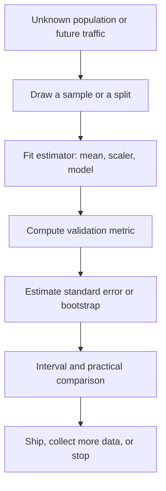

## Why this matters

A validation score is a random variable. It depends on which rows landed in the fold, which minibatch order you drew, and which seed initialized the weights. Shipping the model with the highest single-split accuracy is how teams fool themselves. Statistics is the discipline that asks how large a gap has to be before you believe it, how biased an estimator is, and what a confidence interval is actually claiming.

It is also the discipline behind the preprocessing you will code next. The mean and variance you subtract in a z-score are estimators fit on a sample. Fit them on the test set and you leak information. The central limit theorem is why averages of batch metrics look Gaussian long before the underlying clicks do. Hypothesis tests and bootstrap intervals are how you compare two rankers without pretending a 0.002 AUC bump is a product decision.

This lesson stays practical: bias and variance of estimators, the central limit theorem, a confidence interval you can compute from scratch, and the difference between a statistically significant lift and a useful one.

## Intuition

You never see the true data-generating process. You see a sample. An estimator is a function of the sample that aims at some true number: a mean, a rate, a model weight. A good estimator is close on average (low bias) and does not swing wildly across samples (low variance). Those are the same two words as the bias-variance trade-off for predictors, applied here to the act of measurement itself.

Imagine weighing the same model on many different validation splits. The scores form a cloud. The center of the cloud might sit above or below the true generalization error (bias from a leaky pipeline, a tiny test set drawn from the wrong month, or an optimistic default). The width of the cloud is the standard error. A confidence interval is a recipe that, across many imaginary repetitions of the whole experiment, covers the true number a stated fraction of the time. It is not a probability that the true number sits in the particular interval you just computed, even though that is how people talk. Knowing the difference keeps you honest in a design review.

## Core concept in depth

### Estimators, bias, and the two variances

Let θ be a fixed unknown, and let θ̂ be a function of a sample of size n. The bias is E[θ̂] − θ. The sampling variance is Var(θ̂). Mean squared error decomposes exactly as

MSE(θ̂) = bias² + variance

The sample mean x̄ = (1/n) Σ xᵢ is unbiased for the population mean: its expectation equals μ for any distribution with a finite mean, assuming independent draws. Its variance is σ²/n, so the standard error is σ/√n. Quadrupling the data halves the standard error. That square-root law is why "collect more logs" has diminishing returns, and why a metric estimated on 200 events cannot support a 1 percent decision no matter how pretty the dashboard is.

The maximum-likelihood variance that divides by n is biased slightly downward. The sample variance that divides by n − 1 is unbiased for σ² under independent identically distributed draws. Feature scalers in machine learning almost always divide by n, because they are transforming a finite column, not claiming an unbiased estimate of a super-population variance. Say which one you computed. For large n the two agree; for a 10-row debug set they do not.

### The central limit theorem

If you average independent draws with finite variance, the distribution of the average approaches a Gaussian as n grows, centered at μ with standard deviation σ/√n, regardless of whether each draw is Gaussian. Bernoulli clicks, heavy-tailed latencies (if the variance really exists), and per-example losses all fall under versions of this theorem. This is why a confidence interval built from mean ± 1.96 standard errors is often reasonable for a metric that is itself an average, once n is large and the observations are not wildly dependent.

Dependence breaks the naive formula. A time series of daily revenue is not 365 independent Gaussian draws if a holiday shifts a whole week. A user-level experiment analyzed at the event level understates the standard error, because events inside a user move together. Cluster or randomize at the unit you care about, and compute the standard error at that unit. This single mistake has launched more false product wins than any exotic model bug.

### Confidence intervals

For a large-sample mean, an approximate 95 percent interval is

x̄ ± 1.96 · s / √n

where s is the sample standard deviation. The 1.96 is the standard Gaussian quantile: about 95 percent of a N(0, 1) mass lies between −1.96 and 1.96. Use 1.645 for a 90 percent interval and 2.576 for 99 percent. For small n, replace 1.96 with a Student-t quantile with n − 1 degrees of freedom; the interval gets wider, which is the procedure admitting that s itself is noisy.

The interval is random. The parameter is not. "95 percent" refers to the hit rate of the recipe. A common abuse is to compute twenty metrics, highlight the one interval that excludes zero, and tell a causal story. Twenty independent 95 percent tests produce about one false alarm on average. Correct for multiplicity, or predeclare the metric.

### Hypothesis tests without the ritual

A test starts with a null hypothesis, often "the two models have the same expected metric." You compute a statistic, such as the difference of means divided by its standard error. The p-value is the probability, if the null were true, of a statistic at least as extreme as the one you saw. It is not the probability that the null is true. A p-value of 0.04 does not mean a 96 percent chance the new ranker is better.

Statistical significance is also not practical significance. With a hundred million users, a worthless 0.01 percent lift will be "significant." Report the interval on the lift in product units, compare it to the cost of the more expensive model, and decide. Conversely, a tiny experiment that fails to reject the null has not proved the models are equal; it has proved your experiment was too small to see the difference you care about. Power is the probability of detecting a lift of a stated size, and you should sketch it before you run the test, not after.

### Bootstrap

When the metric is not a mean — a median, an F1 score, a quantile of latency — the Gaussian formula does not apply directly. The nonparametric bootstrap redraws the validation set with replacement, recomputes the metric, and repeats. The 2.5 and 97.5 percentiles of that cloud form a 95 percent interval. It assumes the validation rows are a reasonable stand-in for future rows, and it assumes you recompute the whole statistic, including any threshold you tuned. Bootstrapping the test set while keeping a threshold that was fit on it still lies. It is honest about sampling noise and blind to distribution shift, which is a later lesson.

### What this changes in a training loop

Split before you fit anything that looks at labels or even at feature ranges: scalers, vocabulary, feature selection, early stopping. The test set is a single-use estimator of generalization. Reusing it for a dozen model choices turns it into a training set and makes the final number optimistically biased, which is a form of estimator bias you created on purpose. Cross-validation averages several such estimators and also gives you a standard deviation across folds — a poor man's standard error that, while not independent, is infinitely better than one number.

## Diagram / flowchart



### Dry-run table

Eight independent losses: 2, 4, 4, 4, 5, 5, 7, 9. Compute the mean, the population-style variance used by a scaler (divide by n), the sample variance (divide by n − 1), and a rough 95 percent interval for the mean using the sample standard deviation.

| Step | Calculation | Result |
| --- | --- | --- |
| 1 | Sum | 40 |
| 2 | Mean x̄ | 40/8 = 5 |
| 3 | Sum of squared deviations from 5 | 9+1+1+1+0+0+4+16 = 32 |
| 4 | Population variance | 32/8 = 4 |
| 5 | Sample variance | 32/7 ≈ 4.571 |
| 6 | Sample sd s | √4.571 ≈ 2.138 |
| 7 | Standard error s/√n | 2.138/√8 ≈ 0.756 |
| 8 | Approximate 95 percent interval | 5 ± 1.96·0.756 ≈ 3.52 to 6.48 |

The interval is wide because n = 8. Anyone who declares model A (mean loss 5.2) better than model B (mean loss 4.7) from eight points has not looked at this table.

## Code

```python
import math
import random


def mean(xs: list[float]) -> float:
    return sum(xs) / len(xs)


def variance(xs: list[float], unbiased: bool = True) -> float:
    n = len(xs)
    mu = mean(xs)
    sse = sum((x - mu) ** 2 for x in xs)
    denom = n - 1 if unbiased else n
    if denom <= 0:
        raise ValueError("need more points to estimate variance")
    return sse / denom


def mean_interval(xs: list[float], z: float = 1.96) -> tuple[float, float]:
    n = len(xs)
    mu = mean(xs)
    se = math.sqrt(variance(xs, unbiased=True) / n)
    return mu - z * se, mu + z * se


def bootstrap_mean_interval(xs: list[float], reps: int = 2000, seed: int = 0) -> tuple[float, float]:
    rng = random.Random(seed)
    n = len(xs)
    stats = []
    for _ in range(reps):
        sample = [xs[rng.randrange(n)] for _ in range(n)]
        stats.append(mean(sample))
    stats.sort()
    lo = stats[int(0.025 * (reps - 1))]
    hi = stats[int(0.975 * (reps - 1))]
    return lo, hi


if __name__ == "__main__":
    data = [2, 4, 4, 4, 5, 5, 7, 9]
    print("mean", mean(data))
    print("var_n", round(variance([float(x) for x in data], unbiased=False), 3))
    print("var_unbiased", round(variance([float(x) for x in data], unbiased=True), 3))
    lo, hi = mean_interval([float(x) for x in data])
    print("gaussian interval", round(lo, 2), round(hi, 2))
    blo, bhi = bootstrap_mean_interval([float(x) for x in data])
    print("bootstrap interval", round(blo, 2), round(bhi, 2))
```

Both intervals are wide and will not match each other exactly. That disagreement is a feature: with eight points the Gaussian approximation and the bootstrap are answering the same question with different assumptions, and neither is magic.

## Complexity analysis

| Procedure | Time | Space | When to use it |
| --- | --- | --- | --- |
| Mean and variance, one pass variants exist | Θ(n) | Θ(1) | Any scalar metric that is an average |
| Gaussian interval | Θ(n) | Θ(1) | Large n, weak dependence, metric is a mean |
| Bootstrap, B resamples | Θ(B · cost of metric) | Θ(B) or Θ(n) | Medians, F1, tuned thresholds |
| Paired bootstrap of a model difference | Θ(B · n) | Θ(B) | Comparing two models on the same rows |
| Exact permutation test | Binomial in n, so use sampling | Θ(n) | Small experiments, sharp nulls |

A paired comparison is the important trade-off against an unpaired one. If both models are scored on the same validation rows, the variance of the difference is Var(A) + Var(B) − 2 Cov(A, B). The covariance is usually positive, so the difference is much less noisy than either score. Teams that compare two leaderboard numbers without pairing throw that covariance away and then demand enormous test sets. Bootstrap the per-row difference instead.

Cross-validation is not B independent samples of the whole dataset. Folds overlap in the training portion, so the standard deviation across folds underestimates or misestimates the true sampling variance. Use it as a directional uncertainty, and keep a final untouched test set for the number you will quote externally.

## Tricks, tips and patterns

- Report intervals, not naked leaderboard cells. A 0.81 with a ±0.05 band is a different claim from 0.81.
- Pair model comparisons on the same examples. The variance of the difference is the quantity you care about.
- Convert lifts into counts. "Precision up 2 points" at 200 positive cases is four extra true positives. That may not pay for the review meeting.
- Fix the analysis unit. Users, sessions, and requests are not interchangeable sample sizes.
- Fit scalers, imputers, and vocabularies inside the training fold only. Leakage is optimistic bias.
- Predeclare the primary metric. Exploratory slicing is allowed; it is not a confirmatory p-value.
- When n is small, prefer the bootstrap or a t interval, and prefer collecting more data over a cleverer test.
- Seed control reduces variance across runs but does not remove variance across data splits. Report both if you vary them.

## Common mistakes and edge cases

- Dividing a standard deviation by n instead of √n. The interval becomes absurdly narrow and people ship noise.
- Interpreting a confidence interval as a posterior probability. You can do Bayesian intervals; this recipe is not one.
- Running a test on accuracy for a 99 percent negative class and missing that the model predicts all negatives. The interval on accuracy will look great and the interval on recall will run from 0 to 0.
- Bootstrapping after tuning a threshold on the same rows, then claiming the interval accounts for model selection. It does not, unless the tuning is inside the resample.
- Treating cross-validation fold scores as independent samples in a t-test. They share training data.
- Using the unbiased variance formula on a constant debug column and dividing by n − 1, then feeding a zero or NaN scale into a model when n = 1. Guard degenerate columns.
- Quoting p less than 0.05 as a business case. Ask for the width of the interval in the unit the user feels.

## Interview notes

Derive the standard error of the mean as σ/√n from Var(sum) = n σ² under independence, then dividing by n. State the square-root law in words: four times the data, half the error bar.

Define a p-value in one sentence without saying "the probability the null is true." Then give the base-rate-style caveat: with enough data every worthless lift is significant, and with too little data every useful lift is invisible.

Explain leakage as bias of the generalization estimator. Examples that land well: fitting a scaler on all rows before splitting, picking features by correlation with the full-data target, and early-stopping on the test set.

If the conversation turns to experimentation, mention clustered errors and the unit of randomization. Interviewers who have run online tests use this to separate candidates who have trained models from candidates who have made shipping decisions.

## Practice problems

1. [Compute Mean](/practice/ml-mean) — the unbiased-for-μ estimator and the baseline under squared error (easy).
2. [Z-Score Standardization](/practice/ml-zscore) — population standard deviation, the one scalers use (easy).
3. [Mean Squared Error](/practice/ml-mse) — an estimator of expected squared prediction error on the rows you hand it (easy).
4. Recompute the dry-run interval if the eight losses had been identical. The standard error collapses, and so should your humility about variance you have not seen.
5. Write a paired comparison: two length-n lists of per-row losses, interval for the mean difference. Check it on a case where both models are noisy but the difference is stable.

## Summary / cheat sheet

- An estimator has bias and sampling variance. MSE of the estimator equals bias squared plus variance.
- The sample mean is unbiased and its standard error shrinks like 1/√n.
- Divide variance by n − 1 for an unbiased σ² estimate; divide by n inside most ML scalers. Say which.
- A large-sample 95 percent interval for a mean is x̄ ± 1.96 s/√n. The 95 percent is a property of the recipe.
- A p-value assumes the null and scores extremeness. It is not a posterior and not a product decision.
- Bootstrap metrics that are not means. Keep threshold tuning inside the resample if you tuned a threshold.
- Pair comparisons, respect dependence, and never fit preprocessing on the split you will quote.

## Further reading

- [An Introduction to Statistical Learning, Chapters 2 and 5](https://www.statlearning.com/)
- [Think Stats](https://allendowney.github.io/ThinkStats/)
- [Deep Learning Book, Chapter 5 — Machine Learning Basics](https://www.deeplearningbook.org/contents/ml.html)
- [NIST engineering statistics handbook, confidence intervals](https://www.itl.nist.gov/div898/handbook/prc/section1/prc14.htm)
- [Efron and Tibshirani, An Introduction to the Bootstrap (overview via Stanford notes)](https://hastie.su.domains/CASI/order.html)
