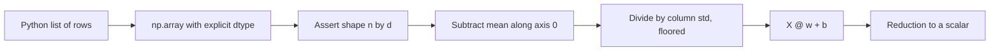

## Why this matters

The pure-Python loops in the math lessons are how you learn an algorithm. They are not how you train on a million rows. NumPy stores numbers in a contiguous typed buffer and runs the loops in compiled code, which is typically ten to a hundred times faster than a Python `for` and, more importantly, matches the way every ML library thinks: shapes, dtypes, and broadcasts. PyTorch tensors are a GPU-aware cousin of the same idea. If broadcasting still surprises you, both NumPy and PyTorch will silently build the wrong tensor and your loss will still be a number.

This lesson covers the array object, the broadcasting rules you must be able to recite, views versus copies, and the small set of linear-algebra calls that replace the handmade dot products from the first module. The code is runnable NumPy. When you later implement logistic regression and PCA, you will call these primitives instead of re-nesting three Python loops.

## Intuition

A Python list of lists is a list of pointers to row objects that each hold pointers to Python float objects. A NumPy array of shape (n, d) and dtype float64 is one block of 8·n·d bytes plus a small header that records the shape and the stride — how many bytes to skip to reach the next row or the next column. Arithmetic walks that block. The mental model is "a tensor with a shape," not "a list of lists that happens to be faster."

Broadcasting is the rule that lets you add a bias of shape (d,) to a batch of shape (n, d) without writing a tile yourself. NumPy pretends the missing leading dimension is 1 and then stretches it, as long as every dimension is either equal or 1. The stretch is conceptual: a well-written kernel does not allocate the tiled copy. The same rule will happily add a (n, 1) column to a (n,) vector and produce a (n, n) outer-sum if you forgot a reshape. Shape assertions are part of the implementation, not a debugging luxury.

## Core concept in depth

### Construction, dtype, and layout

`np.array` copies data into a new buffer and guesses a dtype. Integers become an integer dtype; a single float promotes the array to float. Mixing types you did not intend — a label column of 0/1 stored as float64, or an identifier stored as float and rounded — is a classic silent bug. Pass `dtype=` explicitly on data that crosses a system boundary.

`np.zeros`, `np.ones`, and `np.full` allocate a shaped buffer. `np.arange` and `np.linspace` build coordinates. `np.eye` builds an identity. Random generators should come from `np.random.default_rng(seed)`, not the legacy global `np.random.seed`, so two experiments do not share a hidden stream.

An array has `ndim`, `shape`, `size`, and `dtype`. `reshape` reinterprets the same buffer in C order by default, the last index moving fastest. `reshape(-1, d)` infers the remaining dimension. A reshape that cannot tile the size raises; it does not guess. `ravel` flattens, preferring a view. `flatten` always copies. Prefer reshape when you mean "I know this is a view-compatible layout."

### Indexing, views, and copies

Basic slicing returns a view: `X[:, 0]` is a column that writes through to `X`. Boolean masks and integer-array "fancy" indexes return copies. This split causes more aliasing bugs than any API quirk in pandas. If you meant to detach a subset before mutating it, call `.copy()`. If a downstream function modifies its input, do not pass it a slice of your training matrix.

Reductions such as `sum`, `mean`, `std`, `min`, and `max` take an `axis`. Axis 0 walks rows and collapses them, so a mean along axis 0 of an (n, d) matrix is a (d,) vector of column means — exactly the centering vector for standardization. Forgetting `axis` reduces the entire array to a scalar and then broadcasts that scalar, which "works" and trains a nonsense model. `keepdims=True` preserves a length-1 axis so the result still broadcasts against the original matrix.

The sample standard deviation in NumPy defaults to `ddof=0`, the population formula, which matches the z-score exercise in this course. Pass `ddof=1` when you truly want the unbiased sample variance. Again: say which one.

### Broadcasting rules

Align shapes on the right. Walk from the trailing dimension leftward. For each axis, the sizes must be equal, or one of them must be 1, or one of them must be missing. The output size at that axis is the larger of the two. Examples that should be instant:

- (n, d) plus (d,) → (n, d). Bias add.
- (n, d) plus (n, 1) → (n, d). Per-row shift.
- (n, 1) plus (1, d) → (n, d). Outer sum, often an accident.
- (n, d) plus (n,) → error. The trailing dimensions d and n disagree. Reshape the vector to (n, 1) if you meant per-row.

Multiplication follows the same alignment. `X * w` with w shaped (d,) scales columns. `X @ w` is a matrix-vector product and demands the inner dimensions match; it does not broadcast in the same way. Mixing `*` and `@` is the difference between scaling features and computing logits.

### Vectorization and a warning about premature cleverness

A vectorized standardization is center then scale:

Xc = X - X.mean(axis=0)
Z = Xc / X.std(axis=0)

Both lines allocate. For a textbook dataset that is irrelevant. For a transformation you will run inside a tight custom loop, you may want an output buffer and `out=` arguments, or you may want to stay in PyTorch and avoid copies between frameworks. The rule is: write the vectorized form first, assert shapes, and only then profile. A Python loop over a million rows of a three-line formula is slow. A Python loop over a hundred training steps that each call a vectorized BLAS product is fine, because the BLAS call dominates.

Not every algorithm vectorizes cleanly. A Python loop over trees, over epochs, or over variable-length documents is honest. Forcing it into a giant padded tensor can use more memory than it saves. NumPy is the right tool when the same arithmetic hits every element.

### Linear algebra in np.linalg

Prefer `@` for matmul. `np.dot` on two 2D arrays is matmul, but on higher dimensions its contract is easier to misuse; `@` and `np.matmul` are clearer. `np.linalg.norm` computes vector and matrix norms. `np.linalg.svd` returns U, singular values, and Vh such that A ≈ U @ diag(S) @ Vh. `np.linalg.lstsq` solves least squares without you forming the normal equations. `np.linalg.eig` on a covariance is the long way to PCA; an SVD of the centered data matrix is more stable and gives the same directions.

A numerically polite standardization also guards zero variance. Divide by `np.maximum(std, eps)` or skip constant columns. A column of identical values has standard deviation 0, and a naive divide yields NaNs that poison every later dot product.

## Diagram / flowchart



### Dry-run table

Let X be two rows and three columns: [[1, 2, 3], [3, 4, 5]]. Column means are [2, 3, 4]. A weight vector w = [1, 0, −1] and bias b = 0.5.

| Step | Operation | Result |
| --- | --- | --- |
| 1 | shape of X | (2, 3) |
| 2 | mean along axis 0 | [2, 3, 4] |
| 3 | centered row 0 | [−1, −1, −1] |
| 4 | centered row 1 | [1, 1, 1] |
| 5 | row 0 dotted with w, raw X | 1·1 + 2·0 + 3·(−1) = −2 |
| 6 | row 1 dotted with w | 3·1 + 4·0 + 5·(−1) = −2 |
| 7 | logits X @ w + b | [−1.5, −1.5] |
| 8 | (2, 3) + (3,) broadcast | legal, bias per feature if you add a length-3 vector |

Notice that both raw rows produce the same logit here. Centering would change the numbers; do not center, fit, and then score uncentered production rows with those weights. The affine map was learned in one coordinate system.

## Code

```python
import numpy as np


def standardize(X: np.ndarray, eps: float = 1e-8) -> tuple[np.ndarray, np.ndarray, np.ndarray]:
    if X.ndim != 2:
        raise ValueError("expected a 2D design matrix")
    mu = X.mean(axis=0)
    sigma = X.std(axis=0)
    sigma_safe = np.maximum(sigma, eps)
    Z = (X - mu) / sigma_safe
    return Z, mu, sigma_safe


def logits(X: np.ndarray, w: np.ndarray, b: float) -> np.ndarray:
    if X.shape[1] != w.shape[0]:
        raise ValueError("features and weights disagree")
    return X @ w + b


def mse(y: np.ndarray, yhat: np.ndarray) -> float:
    err = yhat - y
    return float(np.mean(err * err))


if __name__ == "__main__":
    rng = np.random.default_rng(0)
    X = np.array([[1.0, 2.0, 3.0], [3.0, 4.0, 5.0]])
    Z, mu, sigma = standardize(X)
    print("mu", mu)
    print("centered row0", Z[0] * sigma)
    w = np.array([1.0, 0.0, -1.0])
    print("logits", logits(X, w, 0.5))
    y = np.array([-1.5, -1.5])
    print("mse", mse(y, logits(X, w, 0.5)))
    A = rng.normal(size=(4, 3))
    u, s, vh = np.linalg.svd(A, full_matrices=False)
    print("singular values", np.round(s, 4), "shapes", u.shape, vh.shape)
```

The logits print [−1.5, −1.5] and the MSE against that target is 0, which is a useful sanity check that `@` and the bias broadcast did what the table claims. The SVD call returns singular values in descending order and the thin factors, which is the decomposition you will reuse for PCA.

## Complexity analysis

| Operation | Time | Memory traffic | Note |
| --- | --- | --- | --- |
| Elementwise add, n elements | Θ(n) | Read both inputs, write output | Bandwidth bound |
| Reductions along an axis | Θ(n) | One pass | mean and std may be two passes |
| Matrix-vector, n by d | Θ(n d) | Input plus output of size n | BLAS gemv |
| Matrix-matrix, m·n·p | Θ(m n p) | Often compute bound when dimensions are large | BLAS gemm |
| Thin SVD, n by d with n ≥ d | roughly O(n d²) | Factors plus singular values | Prefer this to eig of Gram matrix |
| Boolean mask copy | Θ(n) | A copy, not a view | Can surprise you inside a loop |

The practical trade-off is allocation versus arithmetic. A training step that standardizes by allocating three temporary arrays can be slower than the matmul it was meant to support, if the matrix is small and you do it every step from Python. Fuse small elementwise chains, or let a framework fuse them. Conversely, pulling a GPU tensor to NumPy every batch to compute a metric copies across the bus and will dominate training time. Compute the metric where the data already lives.

Views are free and dangerous. Copies are honest and expensive. Fancy indexing a few rows out of a huge array still materializes those rows. Slicing a time window is a view and mutates the parent. Choose on purpose.

## Tricks, tips and patterns

- Assert `X.ndim`, `X.shape[1]`, and `X.dtype` at the boundary of every function you will call from a training loop.
- Use `axis=0` for "across the batch" on a conventional (n, d) layout. Write the layout down in the docstring so the next person does not store rows as columns.
- Seed `np.random.default_rng`. Do not rely on global state surviving a notebook reorder.
- Guard zero standard deviations before a divide.
- Prefer `lstsq` or SVD over an explicit inverse of Xᵀ X.
- When a broadcast surprises you, print both shapes and align them on the right on paper. The rule is short; the accident is always a missing axis.
- `np.argmax` on a softmax row gives the predicted class. `keepdims` matters if you will scatter that choice back into a mask.
- Copy a slice before you hand it to code that writes in place, unless you measured that the copy hurts.

## Common mistakes and edge cases

- A list of numeric lists becomes a 2D array only if every row has the same length. A ragged list becomes an object array and then fails inside `@` with an opaque error.
- Integer division and an integer dtype: `np.array([1, 2, 3]) / 2` promotes in modern NumPy, but `np.array([1, 3]) // 2` truncates. Labels should stay integers; features should be floating.
- In-place operators like `+=` on a view mutate the parent. On a broadcast temporary they error. Both outcomes surprise people.
- Comparing floats with `==` after a reduction. Use `np.allclose` in tests.
- Calling `std` without noticing `ddof`. A unit test with three points will not match a hand calculation that divided by n − 1.
- Reshaping a Fortran-ordered or transposed array and assuming C order. If you just transposed, the memory is not contiguous and a later C extension may copy anyway. `np.ascontiguousarray` makes the contract explicit.
- Letting NaNs into a mean. One missing feature turns the column mean into NaN and then every centered row into NaN. Impute or mask before the reduction.

## Interview notes

Explain broadcasting with the bias-add example and with the accidental outer-sum example. Interviewers use this to see whether you have been bitten in real code or only read a blog.

State the memory layout story in two sentences: contiguous typed buffer, strides, slice is a view, fancy index is a copy. Then say how you would standardize a minibatch without leaking test statistics: store training mean and scale, apply those constants at inference.

For numerical work, say why you call `lstsq` instead of inverting the Gram matrix, and why a zero-variance column must be guarded. If the role is performance-shaped, mention that elementwise work is bandwidth bound and gemm is compute bound, so fusing the cheap stuff and not round-tripping through Python matters more than a clever comprehension.

## Practice problems

1. [Z-Score Standardization](/practice/ml-zscore) — the pure-Python contract NumPy's `std` (ddof 0) implements (easy).
2. [Dot Product](/practice/ml-dot) — what `@` reduces to for a single row (easy).
3. [Min-Max Scale](/practice/ml-minmax) — an affine broadcast with a divide-by-zero guard (easy).
4. Take a (4, 3) array and predict the result shape of adding vectors shaped (3,), (4, 1), and (4,). Confirm in a REPL.
5. Replace an explicit inverse solution of a tiny least-squares problem with `np.linalg.lstsq` and compare coefficients.

## Summary / cheat sheet

- An ndarray is a typed buffer plus shape and strides. Slices view; fancy indexes copy.
- Reductions take an axis. Axis 0 on (n, d) collapses the batch.
- Broadcasting aligns shapes on the right. Dimensions must match or be 1.
- Use `@` for matmul and `*` for elementwise scaling. They are not interchangeable.
- `std` defaults to dividing by n. Guard zeros. Persist training mean and scale for inference.
- Prefer SVD or `lstsq` to an explicit inverse of a Gram matrix.
- Seed `default_rng`. Assert shapes at function boundaries. Keep NaNs out of reductions.

## Further reading

- [NumPy absolute beginners](https://numpy.org/doc/stable/user/absolute_beginners.html)
- [NumPy broadcasting rules](https://numpy.org/doc/stable/user/basics.broadcasting.html)
- [NumPy linear algebra](https://numpy.org/doc/stable/reference/routines.linalg.html)
- [SciPy lecture notes — NumPy](https://lectures.scientific-python.org/intro/numpy/index.html)
- [BLAS background, via NumPy's linear algebra docs](https://numpy.org/doc/stable/reference/routines.linalg.html)
