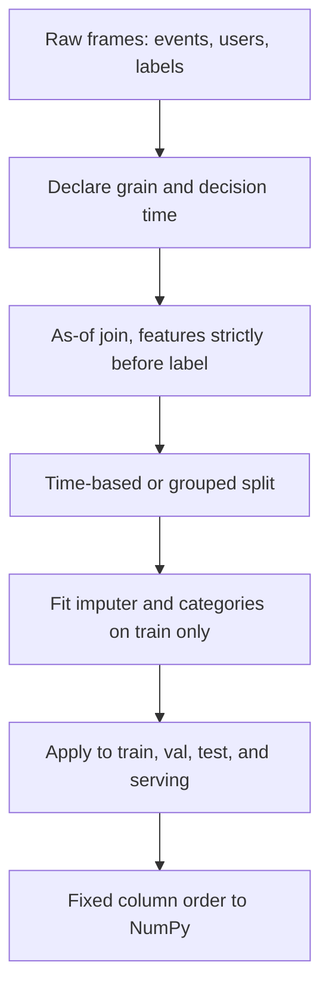

## Why this matters

Models do not read CSV files. They read numeric arrays whose columns mean the same thing at training time and at serving time. Pandas is the workshop where that contract is built: types are fixed, keys are joined, categories are encoded, missing values are made explicit, and the row order of features is written down. Most "the model worked in the notebook and failed in production" stories are pandas stories. A column shifted by one, a category that appeared only in production, a mean that was computed on the full frame before the split.

This lesson treats a DataFrame as a schema with an index, not as a spreadsheet. You will build a small tabular pipeline in pandas, export a NumPy design matrix, and see exactly where leakage sneaks in. Later feature-store and SageMaker lessons assume you can already do this on one machine.

## Intuition

A Series is a NumPy array with an index and a name. A DataFrame is a dictionary of Series that share an index, presented as a table. The index aligns rows during arithmetic and joins. If two Series add and their indexes differ, pandas reindexes and inserts missing values rather than pairing "row 0 with row 0" the way NumPy would. That alignment is a gift when you combine daily metrics from different sources and a trap when you assumed positional pairing.

Missing data is a value, not a blank to be dropped on reflex. Dropping every row with any null can delete the rare class you care about. Filling nulls with a constant computed on the whole dataset leaks the future into the past. The disciplined pattern is: split first, fit the imputer on the training rows, apply it to every later split, and persist the filled value next to the model.

## Core concept in depth

### Loading, dtypes, and schema

`read_csv` guesses dtypes. A column of user ids that look like integers may be read as int64, then fail when a non-numeric sentinel appears next week. An id that exceeds 2⁵³ cannot round-trip through float64. Dates stay strings until you pass `parse_dates`. Categories that should be a finite set are worth an explicit `Categorical` dtype so a typo becomes a visible new level instead of a silent extra string.

After load, print `dtypes`, `shape`, and a few rows, then assert the columns you require. Rename to a stable snake_case schema immediately. Everything downstream — feature stores, batch jobs, endpoints — should speak those names. Display names belong in a report, not in a join key.

Selection: `df["col"]` is a Series, `df[["col"]]` is a one-column DataFrame. `df.loc[rows, cols]` selects by label. `df.iloc` selects by position. Chained assignment (`df[mask]["col"] = value`) sometimes writes to a copy and silently does nothing. Set values with a single `.loc` call.

### Missing data, duplicates, and types of wrongness

`isna` detects both None and NaN. A sentinel like -1 in an age column is not detected; it is a data bug you must name. Duplicates on the entity key inflate metrics and leak across splits if two copies of the same user land on both sides. Decide the grain: one row per user, per order, per day. `drop_duplicates` without a subset drops only fully identical rows and will not save you from two orders by the same user.

Imputation strategies you should be able to defend:

- Numeric measure with a meaningful zero (counts): fill 0, and add a missingness indicator if "absent" is different from "zero times."
- Numeric measure with a typical level (income): fill the training median, which resists outliers better than the mean.
- Category: fill a dedicated level such as `"missing"`, never the training mode if that would erase the signal that the field was blank.
- Target: do not impute the thing you are trying to predict in order to keep the row in training. Drop unlabeled training rows. Unlabeled serving rows are a product question, not a `fillna` question.

### Joins and leakage through time

`merge` is a SQL join. Specify `on`, `how`, and `validate`. `validate="many_to_one"` turns a fan-out bug — a lookup table that accidentally duplicates keys and multiplies your training rows — into an exception. Left joins from the label table to feature snapshots keep users who lack a feature row, with nulls you then impute. Inner joins silently change the population.

Time leakage is the tabular failure mode that metrics will not catch in a random split. If you predict churn on Tuesday using a feature that includes Wednesday's tickets, a random row split still looks brilliant. Join features as-of the decision time: the latest snapshot whose timestamp is strictly earlier than the label timestamp. In pandas that is a sort plus `merge_asof` on the key. In a warehouse it is the same idea with a different verb. A random `train_test_split` is appropriate only when rows are exchangeable. For anything with a clock, split by time.

Target leakage is the cousin: a column that is a restatement of the label, such as "refund issued" when you are predicting "will this order be refunded," or a feature computed with the label inside the aggregation. The diagnostic is an absurdly high offline score and a flat online test. The cure is a data dictionary that says, for every column, when it becomes known.

### Encoding and the design matrix

Linear models and neural nets need numbers. A binary column can be 0/1. An unordered category needs one-hot encoding or a model that accepts categories natively (trees can, linear models generally cannot). One-hot columns for a level unseen at training time must be a row of zeros or an explicit `"other"` bucket you reserved; they must not grow a new column at inference and shift every weight.

Ordinal encodings imply order. Using them on color names such as red, green, and blue tells the model that green is between red and blue. Do that only when the order is real, as with a rating. High-cardinality identifiers (user id) do not belong as one-hot columns in a linear model; they belong in a tree as a categorical, in an embedding table, or not in the model at all if the id will not recur.

Once columns are numeric and ordered, `to_numpy()` yields the array the previous lesson standardized. Save the column order in the artifact. An alphabetized production frame and a hand-ordered training frame are different models that share a filename.

### Group-bys as features, with a clock

Aggregations such as "orders in the last 30 days" are the highest-leverage tabular features and the easiest to leak. The window must end at the decision time. Compute them with a filter on the timestamp, or precompute snapshots. A group-by over the user's entire history, including the order you are scoring, peeks. Count, sum, and recency (time since last event) are usually enough to start. Averages of a handful of well-defined windows beat a hundred correlated variants you will not be able to explain.

## Diagram / flowchart



### Dry-run table

Two users. Labels decided on day 10. Events table includes a day-12 event for user 1 that must not enter the feature "event count."

| Step | Action | Result |
| --- | --- | --- |
| 1 | Events for user 1 | days 3, 8, 12 |
| 2 | Events for user 2 | day 9 |
| 3 | Keep events with day strictly before 10 | user 1 keeps days 3 and 8; user 2 keeps day 9 |
| 4 | Count | user 1 → 2, user 2 → 1 |
| 5 | Naive group-by with no clock | user 1 → 3, which leaks day 12 |
| 6 | Train/test if split at random after the leak | both sides look smarter than production |

The one-row difference is the whole lesson. Production will not see day 12 at decision time. The leaked feature advertises a pattern you cannot use.

## Code

```python
import numpy as np
import pandas as pd


def event_counts_asof(events: pd.DataFrame, labels: pd.DataFrame) -> pd.DataFrame:
    """Count events with timestamp strictly before each label's decision_day."""
    ev = events.copy()
    lab = labels.copy()
    merged = lab.merge(ev, on="user_id", how="left")
    before = merged["day"].lt(merged["decision_day"])
    # Rows with no events produce a null day; they must count as 0, not as 1.
    counts = (
        merged.loc[before]
        .groupby("user_id")
        .size()
        .rename("event_count")
    )
    out = lab.merge(counts, on="user_id", how="left")
    out["event_count"] = out["event_count"].fillna(0).astype(int)
    return out


def fit_median(train: pd.Series) -> float:
    value = train.median()
    if np.isnan(value):
        raise ValueError("cannot fit a median on an empty or all-null column")
    return float(value)


def apply_median(series: pd.Series, fill: float) -> pd.Series:
    return series.fillna(fill)


if __name__ == "__main__":
    events = pd.DataFrame(
        {"user_id": [1, 1, 1, 2], "day": [3, 8, 12, 9]}
    )
    labels = pd.DataFrame(
        {"user_id": [1, 2], "decision_day": [10, 10], "churn": [0, 1]}
    )
    feats = event_counts_asof(events, labels)
    print(feats[["user_id", "event_count"]].to_dict(orient="list"))
    income = pd.Series([10.0, None, 30.0, None])
    fill = fit_median(income.iloc[:3])
    print("fill", fill, "applied", apply_median(income, fill).tolist())
```

The printed counts are 2 and 1, not 3 and 1. The median is fit on a prefix standing in for the training split and then applied, including to later rows. That is the full imputer contract in miniature: a fit object, then a pure apply.

## Complexity analysis

| Operation | Time | Memory | Failure mode if you ignore it |
| --- | --- | --- | --- |
| Column scan, n rows | Θ(n) | The column dtype | Object columns of strings are much heavier than categoricals |
| Hash join, n and m rows | Θ(n + m) expected | Hash table of the key | Many-to-many fan-out can be Θ(n · m) |
| `merge_asof` after sorting | Θ(n log n) to sort, then linear | Sorted copies | Unsorted input is silently wrong unless you check |
| Group-by aggregation | Θ(n) expected | One row per group | Grouping at the wrong grain duplicates labels |
| One-hot encode, cardinality C | Θ(n C) dense | Dense block | High C blows memory; use sparse or embeddings |
| `to_numpy` on a homogeneous frame | Θ(n d) copy typically | A contiguous array | Mixed dtypes force an object array |

The trade-off against doing this in SQL or Spark is scale, not principle. The as-of join, the fit/apply split, and the frozen column order are identical in a warehouse. Pandas is the right workshop up to a few million rows on one machine. Past that, the same pipeline should move without changing the definitions. If a definition only works because a frame fits in RAM and you sorted it by accident, you do not have a definition.

Wide one-hot frames are a memory trade-off against target or hashing encodings. Trees can split on a categorical column without expanding it. Linear models cannot. Pick the encoder for the model, and persist it.

## Tricks, tips and patterns

- Write the grain and the decision time at the top of the notebook. Refuse to add a feature you cannot timestamp.
- `merge(..., validate="many_to_one")` on lookup tables. Let it throw.
- Fit every statistic on training rows only. Store the fit object. Apply it. Test the apply on a frame that contains a new category.
- Keep a missingness indicator when "blank" might mean something.
- Sort only as part of an algorithm that requires it, and assert the sort. Do not depend on a CSV happening to be ordered.
- Save `feature_columns` in the model artifact and build the serving frame with that list, not with `df.columns` in whatever order the query returned.
- Use small assert frames — the four-row example in this lesson — as unit tests of the pipeline. They catch leakage more reliably than a full training run.
- Prefer categoricals and nullable integer dtypes (`Int64`) over object and over sentinel floats.

## Common mistakes and edge cases

- Chained assignment that does not write. Use `.loc`.
- `fillna` with a mean computed on the frame you are filling, including the validation rows.
- Inner-joining away the users who lack features, then discovering production traffic is full of them and your model has no "unknown user" behavior.
- One-hot encoding train and test separately, so column sets differ.
- Parsing dates as strings and filtering with string comparison that happens to work only for ISO-8601.
- Treating a random split as honest on a time-ordered problem.
- Deduping after the split so the same entity sits in train and test as two slightly different rows.
- Forgetting that `groupby.size()` drops empty groups. Users with zero events disappear unless you left-join back to the label table.

## Interview notes

Walk through an as-of join on a whiteboard with three timestamps. Interviewers for applied ML roles use this more than they use a novel architecture question, because it is where candidates actually fail on the job.

Explain fit versus apply for an imputer and a one-hot encoder. Mention unseen levels. Mention that you store the category list.

Define target leakage and give one example that is not the famous "using the label as a feature" cartoon: a rolling aggregate that includes the current row, or a feature only filled in after the outcome. Say how you would notice: an offline metric that is implausibly high, a slice that includes post-outcome fields, a ship that does nothing online.

If the interviewer pushes on scale, say which parts of this pipeline move to Spark or SQL unchanged, and which parts (in-memory row order, notebook-only fill values) do not survive the move.

## Practice problems

1. [Min-Max Scale](/practice/ml-minmax) — fit the min and max on training rows only, then apply (easy).
2. [Z-Score Standardization](/practice/ml-zscore) — same contract, different statistic (easy).
3. [Compute Mean](/practice/ml-mean) — the statistic people accidentally fit on the wrong split (easy).
4. Extend the dry-run: add a user with no events and confirm the count is 0 after a left join, not a dropped row.
5. Build a one-hot encoder that maps an unseen category to a zero row and does not append a new column.

## Summary / cheat sheet

- A DataFrame is aligned Series sharing an index. Loc by label, iloc by position, assign with a single `.loc`.
- Declare grain and decision time before features. Join as-of, strictly before the label.
- Fit imputers and encoders on train only. Persist them. Handle unseen categories.
- Do not one-hot an unordered high-cardinality id into a linear model. Do not ordinal-encode colors.
- Freeze column order in the artifact. Build serving matrices from that list.
- Random splits assume exchangeable rows. Time series and user histories do not.
- Unit-test leakage with a handful of rows you can compute by hand.

## Further reading

- [pandas user guide — indexing](https://pandas.pydata.org/docs/user_guide/indexing.html)
- [pandas merge and merge_asof](https://pandas.pydata.org/docs/reference/api/pandas.merge_asof.html)
- [pandas missing data](https://pandas.pydata.org/docs/user_guide/missing_data.html)
- [scikit-learn ColumnTransformer](https://scikit-learn.org/stable/modules/compose.html)
- [Rules of Machine Learning (Google) — features and leakage](https://developers.google.com/machine-learning/guides/rules-of-ml)
