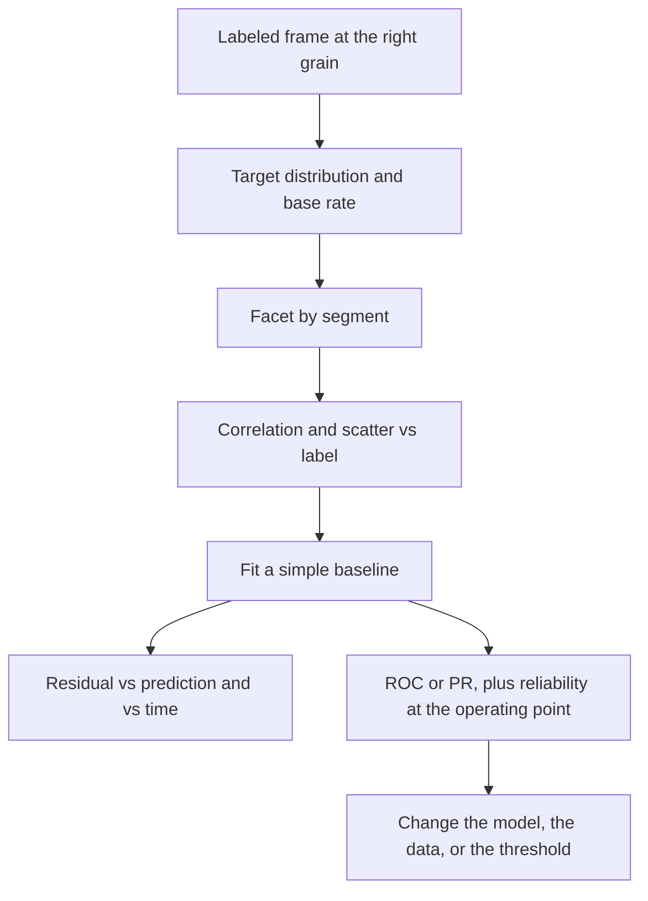

## Why this matters

A scalar metric hides the failure mode. Accuracy of 0.97 can be a model that never predicts the rare class. A low MSE can be a model that is perfect on the bulk and wildly wrong on the tail you bill for. Charts are how you see the slice, the residual shape, the calibration gap, and the feature that is secretly a copy of the label. Matplotlib gives you control of the axes. Seaborn gives you statistical defaults — histograms with a kernel density, box plots by class, heatmaps of correlations — so you spend time on the question rather than on boilerplate.

This lesson is not a gallery. It is a short list of plots that change a modeling decision, with the data computed in Python so you can regenerate them without a GUI. Display backends differ across machines; the code uses the non-interactive Agg backend and checks the numbers the plot would encode. That is the right test: a figure is an argument, and the argument should be reproducible.

## Intuition

Every chart encodes a claim about a distribution or a relationship. A histogram claims "this is how the mass sits." A scatter claims "this is how y moves with x, including the outliers the correlation hid." A reliability curve claims "when the model says 0.8, the event happens about 80 percent of the time." If you cannot finish the sentence "this chart would change my mind if it looked like …," do not add the chart to the report.

Color and position are not decoration. Position along a common axis is the honest comparison; dual axes and truncated bars are how dashboards lie. For class imbalance, a bar of raw counts and a bar of error rates answer different questions. Show both. For residuals, a cloud centered at zero with constant width is the Gaussian-MSE assumption. A fan shape means the noise grows with the prediction and a single σ is the wrong model.

## Core concept in depth

### Distributions before models

Start with the target. If it is a count of the positive class over n, plot the rate and print n. A bar chart of a 1 percent base rate, annotated with the count, stops you from optimizing accuracy. If the target is continuous, a histogram plus a log-scaled histogram tells you whether a few whales dominate squared error. Seaborn's `histplot` with `kde=True` is fine for a first look; the KDE bandwidth can invent smoothness the sample does not have, so treat the curve as a hint and the bins as the data.

Split the same histogram by a segment you might ship to: country, device, plan. A feature with a beautiful global correlation and a reversed correlation inside one country is Simpson's paradox, and a single scatter of all points will talk you into the global story. Facet the plot. In seaborn that is `col` or `hue`. In matplotlib it is a loop of axes. Either way, the unit of the facet should match the unit of the decision.

### Relationships and leakage you can see

A correlation heatmap of numeric columns is a map of redundancy and of accidents. Two features at 0.99 correlation will split importance arbitrarily in a tree and inflate variance in an unregularized linear model. A feature correlated 0.99 with the target is either the product breakthrough or leakage. Sort the column next to the label and ask when it becomes known. Plots do not prove leakage; they tell you which column to interrogate first.

Scatter residuals after a first model. Residual = y − ŷ, plotted against ŷ. Structure in that cloud is signal you left on the table: a curve means a missing nonlinearity or a missing transform, stripes mean a feature that should have been categorical, a fan means heteroscedastic noise. A residuals-versus-index plot that drifts over time means the world moved and a random split lied.

### Ranking, calibration, and confusion

For a binary scorer, two curves carry the decision. The ROC curve plots true positive rate against false positive rate as you sweep the threshold. It is threshold-free and flattering on rare events, because the x-axis is dominated by the huge negative class. The precision-recall curve plots precision against recall and is the one to show when positives are rare. Area under the ROC and average precision summarize them and can still hide a threshold you would never ship. Mark the operating point you can afford.

A reliability diagram bins predictions, say 0–0.1, 0.1–0.2, and so on, and plots the observed frequency against the bin center. A calibrated model sits on the diagonal. Neural nets often bow below it in the high bins: they say 0.9 when the event happens 0.7 of the time. If a downstream system treats the output as a price or a risk, this chart is more important than AUC.

A confusion matrix at the chosen threshold is the count version of the same story. Row-normalize it to see recall by class. Column-normalize it to see precision. A raw-count matrix on imbalanced data is a picture of the base rate, not of the model.

### Rules of a chart you are willing to defend

Title the claim, not the chart type. "Weekend fraud rate is triple weekday" beats "Bar chart of fraud." Label axes with units. Start bar axes at zero. Do not use a dual axis unless you have already shown the two series separately. Prefer direct labels to a legend that forces the eye to bounce, when the series count is small. Red and green together fail for many colorblind readers; seaborn's default categorical palettes are safer than a traffic-light scheme you invented.

Keep the code that built the frame next to the figure. A screenshot pasted into slides with no script is a number you cannot regenerate after the join changes. The pipeline from the pandas lesson should end in a plotting function that takes a frame and returns the axes, with the Agg backend in batch jobs so a server without a display still writes the png.

## Diagram / flowchart



### Dry-run table

Ten binary outcomes and scores. Bin the scores into low (under 0.5) and high (at least 0.5) and estimate the observed positive rate. Separately count true positives at threshold 0.5.

| Score | Label | Bin |
| --- | --- | --- |
| 0.1 | 0 | low |
| 0.2 | 0 | low |
| 0.3 | 1 | low |
| 0.4 | 0 | low |
| 0.6 | 1 | high |
| 0.7 | 0 | high |
| 0.8 | 1 | high |
| 0.85 | 1 | high |
| 0.9 | 1 | high |
| 0.95 | 1 | high |

| Summary | Value |
| --- | --- |
| Low bin: positives / count | 1/4 = 0.25, while scores average 0.25 |
| High bin: positives / count | 5/6 ≈ 0.83, while scores average about 0.80 |
| Threshold 0.5 true positives | 5 |
| Threshold 0.5 false positives | 1 |
| Precision at 0.5 | 5/6 |
| Recall at 0.5 | 5/6, because one positive sat in the low bin |

The model is roughly calibrated and still misses a positive at 0.3. A reliability chart would look acceptable; a recall requirement of "catch them all" would not be met at this threshold. Both pictures are necessary.

## Code

```python
import numpy as np

# Agg is a non-interactive backend: safe in notebooks and on servers.
import matplotlib
matplotlib.use("Agg")
import matplotlib.pyplot as plt


def reliability(scores: np.ndarray, labels: np.ndarray, edges: np.ndarray) -> list[tuple[float, float, int]]:
    rows = []
    for lo, hi in zip(edges[:-1], edges[1:]):
        if hi == edges[-1]:
            mask = (scores >= lo) & (scores <= hi)
        else:
            mask = (scores >= lo) & (scores < hi)
        n = int(mask.sum())
        if n == 0:
            continue
        obs = float(labels[mask].mean())
        pred = float(scores[mask].mean())
        rows.append((pred, obs, n))
    return rows


def confusion_at(scores: np.ndarray, labels: np.ndarray, threshold: float) -> dict[str, int]:
    pred = scores >= threshold
    y = labels.astype(bool)
    tp = int(np.sum(pred & y))
    fp = int(np.sum(pred & ~y))
    fn = int(np.sum(~pred & y))
    tn = int(np.sum(~pred & ~y))
    return {"tp": tp, "fp": fp, "fn": fn, "tn": tn}


def save_score_hist(scores: np.ndarray, labels: np.ndarray, path: str) -> None:
    fig, ax = plt.subplots(figsize=(6, 4))
    ax.hist(scores[labels == 0], bins=5, alpha=0.7, label="negative")
    ax.hist(scores[labels == 1], bins=5, alpha=0.7, label="positive")
    ax.set_xlabel("score")
    ax.set_ylabel("count")
    ax.set_title("Score overlap by class")
    ax.legend()
    fig.tight_layout()
    fig.savefig(path)
    plt.close(fig)


if __name__ == "__main__":
    scores = np.array([0.1, 0.2, 0.3, 0.4, 0.6, 0.7, 0.8, 0.85, 0.9, 0.95])
    labels = np.array([0, 0, 1, 0, 1, 0, 1, 1, 1, 1])
    print("reliability", reliability(scores, labels, np.array([0.0, 0.5, 1.0])))
    print("confusion", confusion_at(scores, labels, 0.5))
    save_score_hist(scores, labels, "_score_overlap.png")
```

The reliability rows come back near (0.25, 0.25) and (0.80, 0.83), and the confusion counts are tp 5, fp 1, fn 1, tn 3. The histogram file is a side effect for humans; the printed counts are the regression test. Delete the png when you are done looking. Seaborn can replace the histogram call with `sns.histplot(x=scores, hue=labels, ax=ax)` once `import seaborn as sns` succeeds; the bin arithmetic you assert stays the same.

## Complexity analysis

| Plot or summary | Time | Memory | What you give up |
| --- | --- | --- | --- |
| Histogram, n points, B bins | Θ(n + B) | Θ(B) | Bin edges you chose can hide or invent modes |
| Scatter of n points | Θ(n) to draw | Θ(n) | Overplotting past about 1e5 points; switch to a hex bin |
| Correlation of d numeric columns | Θ(n d²) | Θ(d²) | Only linear association; a U-shape can correlate at 0 |
| ROC sweep, n scored rows | Θ(n log n) to sort | Θ(n) | Flatters rare-event models relative to precision-recall |
| Reliability, B bins | Θ(n + B) | Θ(B) | Empty bins and a bad bin count both lie |
| Facet by K segments | K times one plot | K axes | Too many facets become unread; sort by volume and keep the top |

The trade-off against a live BI dashboard is provenance. A dashboard is better for monitoring a metric you have already defined. A notebook figure tied to a hash of the training frame is better for a one-time modeling argument. Do not accept a screenshot as evidence in a model review if the query is not in version control.

Overplotting is a complexity issue disguised as a style issue. Drawing a million translucent points is slow and still hides density. Hexbin or a sample with a stated sampling rate keeps the figure honest. If you sample, write the rate on the chart.

## Tricks, tips and patterns

- Plot the target and the base rate before you plot a prediction. You need the denominator in your head.
- Facet by the segment you will be graded on. A global AUC can conceal a failing country.
- Use precision-recall when positives are rare, ROC when the classes are closer to balanced and false positives and false negatives trade more evenly.
- Put the operating point on the curve. Area under a curve does not ship; a threshold does.
- Plot residuals against prediction and against time. Structure is a to-do list for features, not a cosmetic.
- Title the claim. Label units. Start bar charts at zero.
- Assert the counts behind the chart in a unit test, and render the png only for people.
- Prefer a colorblind-safe palette. Do not encode the only signal as red versus green.

## Common mistakes and edge cases

- A histogram with one bin, or with so many bins that every bar is 0 or 1. Match bin width to the decision, and try a second width before you believe a mode.
- KDE bandwidth that smooths a two-point mixture into a single hill.
- Correlation heatmaps on columns that include the row id or a timestamp encoded as an integer, producing a meaningless "trend."
- ROC charts for a 0.1 percent positive rate presented as the success metric to a team that pays per false positive. Show precision at the recall they need.
- Reliability diagrams with bins that contain four points. Print n on the bar or the point.
- Dual-axis charts that imply a relationship because two series were scaled to the same picture.
- `plt.show()` on a server with no display, hanging the job. Use Agg and `savefig`.
- Comparing two models' histograms of scores without fixing the axis limits. Autoscaling will make both look centered.

## Interview notes

Be ready to say which chart you would demand before trusting a binary model on a rare event: base rate, precision-recall with an operating point, and a reliability diagram if the score is used as a probability. Explain why ROC alone is a weak slide in that setting.

Describe residual-versus-fitted as a check on the loss's assumptions. A fan shape challenges homoscedastic MSE. A curve challenges linearity.

Mention one way charts catch leakage: a feature whose scatter against the label is implausibly tight, followed by a timestamp audit, not by a victory lap. Interviewers like the sequence "see, doubt, verify" more than a tour of seaborn APIs.

If asked about monitoring, connect this lesson to a later one: the same reliability and score-distribution plots, computed on this week's traffic versus the training week, are a drift detector you can explain to a non-ML on-call.

## Practice problems

1. [Classification Accuracy](/practice/ml-accuracy) — compute the scalar the confusion matrix summarizes, and notice what it hides (easy).
2. [Binary F1 Score](/practice/ml-f1) — the harmonic mean behind a single operating point (medium).
3. [Binary Cross-Entropy](/practice/ml-bce) — what a reliability gap costs in log loss even when ranking is unchanged (medium).
4. Rebuild the dry-run confusion counts at threshold 0.85 and describe the precision-recall trade you just made.
5. Plot residuals for a one-feature linear fit on a quadratic truth and point at the leftover curve.

## Summary / cheat sheet

- A chart is a claim. Title the claim, label units, and keep the code with the figure.
- Start with the target distribution and the base rate. Facet by the segment that can veto a launch.
- Correlation and residual plots tell you where features are redundant, leaked, or incomplete.
- Prefer precision-recall for rare positives. Mark the threshold you can afford. Check calibration if you will price the score.
- Confusion matrices should be read as rates, not only as counts, when classes are imbalanced.
- Use the Agg backend in batch. Assert the numbers behind the png.
- Truncated axes, dual axes, and red-green encodings are ways of arguing in bad faith. Do not.

## Further reading

- [Matplotlib usage guide and backends](https://matplotlib.org/stable/users/explain/figure/backends.html)
- [Seaborn tutorial](https://seaborn.pydata.org/tutorial.html)
- [scikit-learn reliability diagrams](https://scikit-learn.org/stable/modules/calibration.html)
- [scikit-learn precision-recall curves](https://scikit-learn.org/stable/auto_examples/model_selection/plot_precision_recall.html)
- [Fundamentals of Data Visualization — Claus Wilke](https://clauswilke.com/dataviz/)
