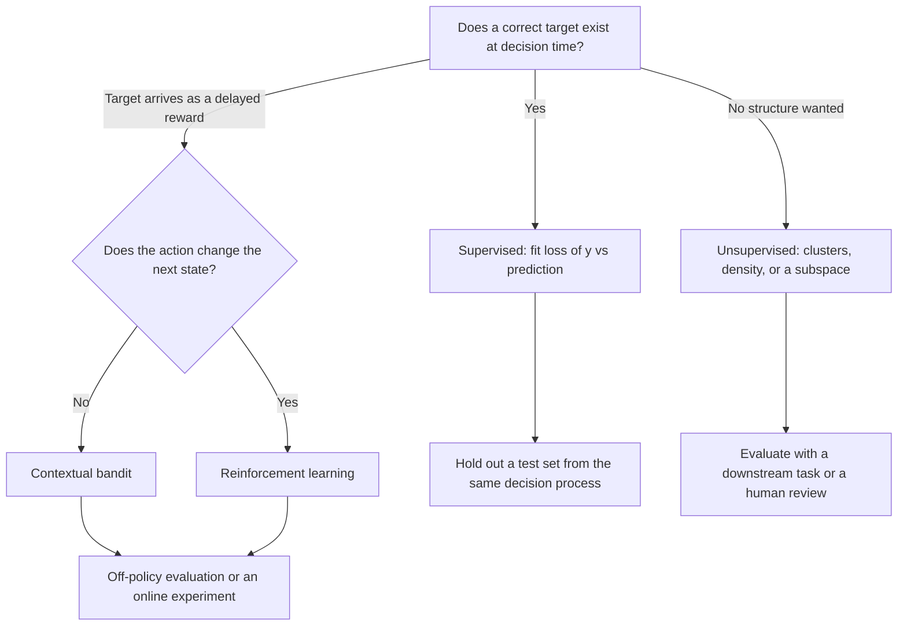

## Why this matters

Most project failures start before the first epoch, when someone names the wrong problem. "Find fraud" might be supervised classification if you have confirmed cases, anomaly detection if you do not, or a policy problem if the action you take changes the next week's fraud. The math, the data contract, and the metric all change with that name. This lesson draws the three classical settings — supervised, unsupervised, and reinforcement learning — plus the hybrids you will actually be offered, and it ties each one to a loss or an objective you can write down.

The rest of the course is mostly supervised learning, because that is where labels, cross-entropy, and SageMaker training jobs line up. You still need the other two clearly enough to say "this is not a supervised problem yet" in a design review.

## Intuition

Supervised learning is apprenticeship with an answer key. Each example arrives as an input x and a target y, and the model learns a function from x to y. Unsupervised learning has only x. It looks for structure: clusters, dense regions, low-dimensional subspaces, co-occurrence. Nobody hands you the "right" cluster id, so evaluation is about usefulness and stability, not accuracy against a hidden label that does not exist. Reinforcement learning has no fixed dataset of correct actions. An agent takes actions in a state, receives a reward, and the data it sees next depends on what it just did. The objective is a sum of future rewards, and the hardest part is that the reward may arrive long after the action that caused it.

A useful test: if you can freeze a table of (x, y) pairs before training and the rows do not depend on the model's outputs, you are in supervised or unsupervised land. If the model's choice changes which row appears next, you are in reinforcement learning, or in the online-decision cousin called a bandit.

## Core concept in depth

### Supervised learning

You observe pairs drawn from some joint distribution of X and Y. You pick a hypothesis class — linear functions, trees, neural nets — and a loss ℓ(y, ŷ). Empirical risk minimization finds parameters that make the average loss on the training pairs small, usually plus a regularizer. Classification has a discrete Y. Regression has a numeric Y. Ranking has an order. The loss must match the type: cross-entropy or a surrogate for classification, squared or absolute error for regression, a pairwise or listwise loss for ranking. Using squared error on a 0/1 label trains something, and it is usually the wrong something.

Generalization is the expected loss on new draws from the same joint distribution. A train loss that is far below the validation loss means the hypothesis memorized the sample. The next lessons quantify that gap. The assumption hiding in the word "same" is identical distribution. Shift breaks it, which is why time-based splits existed in the pandas lesson.

Self-supervised learning is supervised learning with a target you manufactured from the input: the next token, a masked word, a contrastive pair. It is not unsupervised in the classical sense, because there is a loss against a target. It is how large language models get a pretraining signal without rented human labels. Fine-tuning then switches the target to a human one.

### Unsupervised learning

Clustering partitions x into groups. K-Means assumes blobs around centroids and asks you for K. Density-based methods like DBSCAN assume clusters are dense regions separated by sparse ones and can mark outliers instead of forcing every point into a blob. Dimensionality reduction — PCA, autoencoders — builds a lower-dimensional representation. Association rules and topic models look for co-occurrence. Density estimation builds p(x) itself, which gives you a generative model and an anomaly score.

Evaluation is the uncomfortable part. If you invent labels and compute accuracy, you have changed the problem. Internal scores such as silhouette or a reconstruction error are hints. The real test is whether a downstream supervised model, a human workflow, or a compression budget improves. Stability under bootstrap — do the clusters come back on a resample? — catches partitions that are accidents of one sample.

Anomaly detection is unsupervised or one-class supervised, depending on whether you possess confirmed anomalies. Training a classifier on a handful of confirmed fraud cases and a mountain of unlabeled "probably fine" rows is not quite either textbook setting. Techniques like positive-unlabeled learning exist because the real problem refused the textbook.

### Reinforcement learning

A Markov decision process has states, actions, a transition rule, and a reward. A policy maps states to actions. The return is the discounted sum of rewards from now on, with discount γ in (0, 1) so that a reward far in the future counts less and the sum stays finite. The action-value Q(s, a) is the expected return of taking a now and then following the policy. Bellman's equation says the optimal Q satisfies

Q(s, a) = expected immediate reward + γ · expected best Q at the next state

Q-learning estimates that table, or a neural approximation of it, from transitions (s, a, r, s′). Policy gradient methods optimize a parameterized policy directly by ascending the expected return. The credit-assignment problem is that r may depend on actions taken many steps ago. The exploration problem is that a policy that never tries an action never learns its value, so you must sometimes act at random and accept worse short-term reward.

Contextual bandits are the one-step special case: you see a context, pick an action, get a reward, and the next context does not depend on your action. Many "reinforcement learning" product proposals — which ad to show, which notification to send — are bandits. Using a full RL stack for a bandit adds variance and off-policy headaches you do not need. Using a supervised model trained on logged clicks for a bandit ignores the fact that the log only contains actions the old policy chose. That bias has a name, off-policy evaluation, and it will humble a naive replay.

### How to refuse a mis-specified project

Ask four questions. What is the decision? What is known at decision time? What would a correct answer have looked like, and who labels it? Does the decision change the future data? If the correct answer exists in a warehouse but nobody has joined it, you have a supervised problem blocked on data engineering, not an unsupervised problem. If no correct answer exists because the goal is "group similar tickets," you have a clustering problem and you owe the team a human evaluation plan, not an accuracy number. If the goal is "learn which discount to offer, knowing that today's discount changes whether the customer comes back," you have a sequential decision problem and a random split of historical receipts will overstate what you know.

Semi-supervised learning sits between the first two: a little labeled data, a lot of unlabeled. It helps when the unlabeled mass tells you the shape of p(x) and the labels are expensive. It does not remove the need for a clean labeled test set. Without that test set you cannot tell a clever representation from a confident hallucination.

## Diagram / flowchart



### Dry-run table

Three product requests, classified by the questions above.

| Request | Target at decision time? | Action changes next row? | Setting | Honest metric |
| --- | --- | --- | --- | --- |
| Predict tomorrow's cancel from today's account features | Yes, once tomorrow arrives | No, if you only score | Supervised classification | Log loss and recall at a fixed alert budget, on a future week |
| Group support tickets so agents see themes | No true theme id | No | Unsupervised clustering | Agent agreement and time-to-resolution, not accuracy |
| Choose a discount, customer may return later | Reward is delayed and policy-dependent | Yes | Reinforcement learning or a bandit if one step | Online experiment, not replay accuracy of last year's policy |

A team that builds a classifier of "customers who received a discount and later bought" is answering a different question from "which discount to offer." The table is the correction.

## Code

```python
import math


def empirical_risk(y_true: list[float], y_pred: list[float]) -> float:
    """Mean squared error, the supervised risk for a numeric target."""
    n = len(y_true)
    return sum((a - b) ** 2 for a, b in zip(y_true, y_pred)) / n


def kmeans_assign(points: list[list[float]], centroids: list[list[float]]) -> list[int]:
    """One unsupervised assignment step. There is no label to compare to."""

    def dist(a: list[float], b: list[float]) -> float:
        return math.sqrt(sum((x - y) ** 2 for x, y in zip(a, b)))

    labels = []
    for p in points:
        best_i, best_d = 0, float("inf")
        for i, c in enumerate(centroids):
            d = dist(p, c)
            if d < best_d:
                best_d, best_i = d, i
        labels.append(best_i)
    return labels


def q_update(q: float, reward: float, next_best: float, lr: float, gamma: float) -> float:
    """One tabular Q-learning step toward Bellman optimality."""
    target = reward + gamma * next_best
    return q + lr * (target - q)


if __name__ == "__main__":
    print("risk", empirical_risk([1.0, 2.0], [1.0, 0.0]))
    pts = [[0.0, 0.0], [5.0, 5.0]]
    print("assign", kmeans_assign(pts, [[0.0, 0.0], [5.0, 5.0]]))
    # State value 1.0, reward 0, next best 2, step toward 0 + 0.9*2.
    print("q", round(q_update(1.0, 0.0, 2.0, lr=0.5, gamma=0.9), 4))
```

The risk is 2.0 because the second residual is −2 and the square averages with a perfect first row. Assignment returns [0, 1]: each point sits on a centroid, which is the unsupervised analogue of zero loss, except there is no external label that made those centroids "correct." The Q update moves from 1.0 halfway toward 1.8, landing at 1.4. That single line is the whole of tabular Q-learning once you also choose how to explore.

## Complexity analysis

| Setting | What you pay at train time | What you pay at decision time | Data appetite |
| --- | --- | --- | --- |
| Linear supervised | Often one pass or a few, plus a d by d solve | One dot product | Moderate if the class is small |
| Deep supervised or self-supervised | Many passes over a large set | One forward pass | High; self-supervision spends compute instead of labeler time |
| K-Means, K clusters, I iterations | Θ(I · n · K · d) | Assign to nearest centroid, Θ(K d) | Needs enough points to fill the blobs |
| Tabular Q-learning | Episodes times steps, table size is states times actions | One table lookup | Painful if the state space is large |
| Deep RL | Unstable, high variance gradients | One policy forward | Often the most sample-hungry of the three |

Self-supervision trades labeler salaries for GPU time. That trade is rational for language and vision, where raw data is cheap and labels are not, and irrational for a 4,000-row internal table where a careful human labeling guide would finish the project. Reinforcement learning trades even more samples, because each label is a noisy return. If you can log a supervised target, do that until it stops working.

Off-policy evaluation is cheaper than an online experiment and more honest than a random split of logged actions, but it is high variance when the new policy disagrees with the logger. Budget for an online test of anything that acts.

## Tricks, tips and patterns

- Write the decision, the information set, and the target in one sentence before you pick a library.
- Match the loss to the target type. Do not square a class index.
- If labels are scarce but inputs are plentiful, consider self-supervision as pretraining, then a small supervised fine-tune, and still keep a labeled test set.
- If there is no target, plan the human or downstream evaluation on day one. Do not invent accuracy.
- Collapse "RL" product ideas to a bandit when the action does not change the next state.
- Beware logged-bandit data. The actions you did not take have no reward in the log.
- A supervised model of "what happened under the old policy" is a description, not a policy, until you argue otherwise.
- Semi-supervised methods still need a clean labeled test set that was not used to shape the representation.

## Common mistakes and edge cases

- Calling a self-supervised language model unsupervised. There is a target. It was just constructed.
- Evaluating K-Means with accuracy against a labeling you peeked at, after choosing K to maximize that accuracy.
- Training on a random split when the decision is sequential. The future leaked, and the setting was misnamed as ordinary supervision.
- Using a classifier's accuracy as the objective for a policy that changes user behavior. The deployment distribution will not match the training joint.
- Forcing every anomaly into a cluster. Sometimes the right output is "this point belongs to no dense region."
- Discount factor γ = 1 with unbounded episode length. The return can be infinite and the Bellman update is no longer a contraction.
- Exploring too little in Q-learning and declaring the first policy optimal because the table stopped changing. Untried actions stay at their optimistic or pessimistic initialization forever.

## Interview notes

Give the three definitions in terms of what the data contains, not in terms of algorithms. Then place logistic regression, PCA, K-Means, next-token prediction, and a recommender bandit into the map. Next-token prediction is self-supervised. A recommender that only replays logged clicks is a biased supervised problem unless the logging policy was random or you correct it.

Be ready for "is this RL?" on a product prompt. Ask whether the action changes the next state. Most marketplace interventions are closer to bandits or to supervised learning with a delayed label.

Define generalization as expected loss on fresh draws from the same joint distribution, and say that the phrase "same joint" is the assumption shift violates. You do not need a full PAC proof. You need to refuse a test set drawn from a different month presented as an i.i.d. score.

## Practice problems

1. [Mean Squared Error](/practice/ml-mse) — empirical risk for a numeric supervised target (easy).
2. [K-Means Assignment](/practice/ml-kmeans-assign) — the unsupervised step that does not consult a label (medium).
3. [Binary Cross-Entropy](/practice/ml-bce) — empirical risk for a Bernoulli supervised target (medium).
4. Classify three projects from your own backlog with the flowchart in this lesson and write the metric you would refuse.
5. Implement one Q update by hand from Q = 0, reward 1, next best 0, γ = 0.5, learning rate 1. The new Q equals the target.

## Summary / cheat sheet

- Supervised: you have (x, y) and you minimize a loss. Generalization assumes new draws from the same joint distribution.
- Self-supervised: you build y from x. It is still a supervised loss. Keep a human-labeled test for the actual task.
- Unsupervised: you have only x. Evaluate with stability and a downstream outcome, not with made-up accuracy.
- Reinforcement learning: actions change future states and rewards. Bandits are the one-step version.
- Q learning backs up reward plus discounted next value. Exploration is part of the algorithm, not a nice-to-have.
- Write the decision and the information set before you name a paradigm. Most "RL" proposals are supervised or bandits.
- Off-policy logs are not a random split. Correct them or run an online test.

## Further reading

- [Deep Learning Book, Chapter 5 — Machine Learning Basics](https://www.deeplearningbook.org/contents/ml.html)
- [Sutton and Barto, Reinforcement Learning: An Introduction](http://incompleteideas.net/book/the-book-2nd.html)
- [scikit-learn unsupervised user guide](https://scikit-learn.org/stable/unsupervised_learning.html)
- [An Introduction to Statistical Learning, Chapter 2](https://www.statlearning.com/)
- [Google Rules of ML](https://developers.google.com/machine-learning/guides/rules-of-ml)
