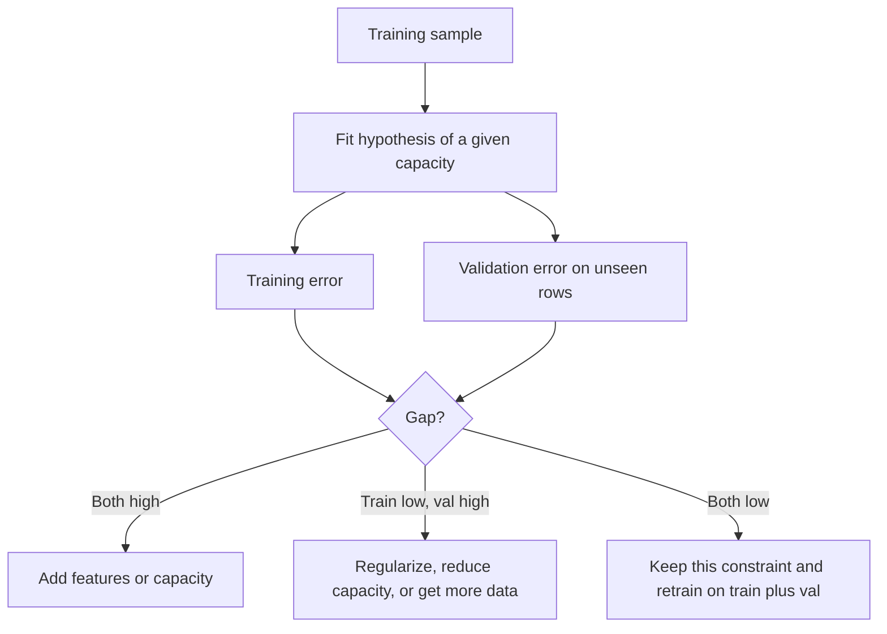

## Why this matters

A training loss that falls while the validation loss rises is the most expensive chart in applied machine learning, and it has a precise decomposition. Part of the error is bias: the hypothesis class cannot represent the true pattern, no matter how much data you bring. Part is variance: the fit swings with the particular sample you drew. Part is irreducible noise: two identical x values can have different y, and no function of x removes that. Regularization — ridge, lasso, dropout, early stopping, data augmentation — is a deliberate increase in bias to buy a larger decrease in variance. If you cannot say which term you are buying down, you will add capacity and add penalties at the same time and learn nothing from the result.

This lesson derives the decomposition for squared error, shows it on a tiny polynomial, and implements ridge and lasso penalties from scratch. Cross-validation, the tool that estimates the variance term honestly, is the next lesson.

## Intuition

Imagine shooting at a target. Bias is a sight that is consistently left of center. Variance is a shaky hand: the shots scatter, and their average might still be on target. A rigid model is a clamped rifle. It cannot track a moving target (high bias) but it barely shakes (low variance). A high-degree polynomial is a free hand. It can thread every training point and will paint a different wild curve for the next sample of the same process.

Regularization clamps the rifle a little. Ridge pulls coefficients toward zero in proportion to their size, so no single feature dominates because of one quirky sample. Lasso can set coefficients to exactly zero, which is a form of feature selection. Early stopping halts gradient descent while the fit is still simple, before it has used its full capacity to memorize. All three refuse some training-set perfection in exchange for stability on the next sample.

## Core concept in depth

### The decomposition

Fix an input x and imagine many training sets drawn from the same process. Let f(x) be the true conditional expectation of Y given X = x, the best possible prediction under squared error. Let ŷ(x) be the prediction of a model trained on one sample; it is random because the sample is random. A standard expansion yields

expected squared error = bias(x)² + variance(x) + noise

where bias is the difference between f(x) and the average prediction across training sets, variance is the scatter of those predictions, and noise is the variance of Y around f(x). You cannot see the three terms separately from one dataset. You infer them from the pattern of train versus validation error as you vary capacity.

Underfit: both train and validation error are high and close. The class is too rigid, or the features do not contain the signal. Add features or capacity. Overfit: train error is low, validation error is high. The model has fit noise. Add data, reduce capacity, or regularize. A small gap with low error is the goal, not zero training error.

The decomposition is exact for squared error under the usual independence assumptions. For 0-1 classification loss the algebra is less tidy, but the same design lever still works: constrain the hypothesis so it cannot memorize, and check the constraint on data it did not train on.

### Capacity, data, and the double descent caveat

Classical U-shaped risk says: raise capacity, watch validation error fall and then rise. Deep networks complicate the picture. In heavily overparameterized regimes, validation error can fall again after the interpolation point where training error hits zero. That "double descent" does not repeal the decomposition. It says the variance of a particular interpolating algorithm, such as gradient descent on a wide net, can be smaller than the variance of a mid-sized model that is just barely able to interpolate. You still select the model by validation error. You do not select it by the slogan that bigger is always safer, and you do not select it by training loss.

### L2, L1, and what they optimize

Ridge regression minimizes squared error plus λ ‖w‖². The penalty is differentiable. In the normal equations it adds λ to every eigenvalue of Xᵀ X, which is why it stabilizes collinear features. Coefficients shrink toward zero but rarely land on it. A large λ is a high-bias, low-variance fit; λ = 0 is ordinary least squares.

Lasso minimizes squared error plus λ ‖w‖₁, the sum of absolute coefficients. The penalty has a kink at zero, and the optimum often sits exactly on that kink, so some coefficients are zero. That sparsity is useful when you believe few features matter and you want a short model. It is unstable when features are correlated: lasso may pick one of a correlated pair arbitrarily. Elastic net mixes L1 and L2 and is the practical default when you want sparsity without that coin flip.

The same penalties appear as weight decay in neural nets. Weight decay on a linear model trained with MSE is ridge. Dropout randomly zeros hidden units during training, which prevents co-adaptation and acts like a data-dependent regularizer. Data augmentation invents extra samples from a symmetry you believe in — cropped images, paraphrased sentences — and reduces variance if the symmetry is real. If the symmetry is false, augmentation adds bias.

### Early stopping is a regularizer

Gradient descent on a typical loss starts near a simple function, if initialization is small, and grows more complex as it fits finer residuals. Stopping when validation loss bottoms out selects a point on that path. It is cheap, it is surprisingly competitive with explicit penalties, and it requires a validation set you do not then forget and reuse for the final boast. The stopped weights are what you deploy, not the weights from the last epoch.

### A numeric sketch

Suppose the truth is y = x, and you fit polynomials on a noisy sample. Degree 1 has a little bias if the truth were curved, and low variance. Degree 8 through ten points can hit every point and will swing between samples. The validation mean squared error, not the training error, tells you where on that ladder to stop. Adding a ridge penalty to the degree-8 fit pulls it back toward a smoother curve and can beat the unpenalized degree-8 without you having to guess the degree perfectly. Capacity and penalty are two knobs on one idea: how many effective directions of the data the model is allowed to use.

## Diagram / flowchart



### Dry-run table

Truth y = 0 for every x. You observe two noisy points, y = 1 and y = −1, and you fit a constant model. Separately imagine an interpolating model that predicts the noise exactly on those two points and something wild elsewhere.

| Model | Prediction on the two train points | Train MSE | Expected behavior on a new x |
| --- | --- | --- | --- |
| Constant 0, the truth | 0 and 0 | (1+1)/2 = 1 | Bias 0 if this constant is always chosen; here one sample's best constant is the mean 0 |
| Constant equal to sample mean 0 | 0 and 0 | 1 | Low variance across samples only if means stay near 0, which they do as n grows |
| Interpolator of this sample | 1 and −1 | 0 | High variance: the next sample's noise pattern is different, and the wild curve misses |

The constant cannot get training MSE below 1 on this sample, because the best constant is the mean and the residuals remain. That leftover is not automatically "bias" in the decomposition — part of it is noise. The interpolator's zero training error is purchased by fitting the noise, and a new draw will not repeat those two residuals. Regularization's job is to refuse that purchase.

## Code

```python
import math


def mse(y: list[float], yhat: list[float]) -> float:
    return sum((a - b) ** 2 for a, b in zip(y, yhat)) / len(y)


def ridge_objective(y: list[float], yhat: list[float], w: list[float], lam: float) -> float:
    penalty = lam * sum(wi * wi for wi in w)
    return mse(y, yhat) + penalty


def lasso_objective(y: list[float], yhat: list[float], w: list[float], lam: float) -> float:
    penalty = lam * sum(abs(wi) for wi in w)
    return mse(y, yhat) + penalty


def soft_threshold(z: float, lam: float) -> float:
    """Proximal map of the L1 penalty. This is the core of a lasso coordinate step."""
    if z > lam:
        return z - lam
    if z < -lam:
        return z + lam
    return 0.0


if __name__ == "__main__":
    y = [1.0, -1.0]
    constant = [0.0, 0.0]
    interpolator = [1.0, -1.0]
    print("constant mse", mse(y, constant))
    print("interpolator mse", mse(y, interpolator))
    w = [0.5, -0.25]
    print("ridge", round(ridge_objective(y, constant, w, lam=1.0), 4))
    print("lasso", round(lasso_objective(y, constant, w, lam=1.0), 4))
    print("soft", [soft_threshold(z, 0.3) for z in (-0.2, 0.3, 0.8)])
```

Constant MSE prints 1.0 and the interpolator prints 0.0, matching the table. Soft-thresholding maps −0.2 and 0.3 to 0 when λ is 0.3, and maps 0.8 to 0.5. That kink is why lasso coefficients land exactly on zero and ridge coefficients, which shrink by a smooth factor, do not.

## Complexity analysis

| Lever | Effect on bias | Effect on variance | Compute |
| --- | --- | --- | --- |
| More independent data | Usually down, if you were data-limited | Down, like 1/n for many estimators | Linear in the extra rows, or worse if you retrain from scratch |
| Higher capacity | Down, until the class can represent f | Up, classically | More parameters, more unstable fits |
| Larger λ for ridge or lasso | Up | Down | Essentially free at train time relative to the unpenalized fit; lasso needs an iterative solver |
| Early stopping | Up versus the fully trained model | Down | Saves epochs if you actually stop |
| Dropout, augmentation | Up if the noise is wrong | Down if the noise matches a true symmetry | Augmentation multiplies effective data and wall time |

Choosing λ on the training loss always picks λ = 0, because the penalty is non-negative. The selection of λ is part of model selection and must see validation data. Nesting that choice inside cross-validation is the next lesson. A final retraining on train plus validation, with λ already chosen, uses the data efficiently and needs a last untouched test set if you will quote a number externally.

Ridge on a dense linear model admits a closed form. Lasso does not, because the absolute value is not differentiable at zero; coordinate descent with the soft-threshold above is the standard algorithm and converges quickly when features are scaled. Unscaled features make λ mean something different per column, which is a silent way to regularize the wrong thing.

## Tricks, tips and patterns

- Plot train and validation loss on the same axes against capacity or against epoch. Read the gap.
- Scale features before L1 or L2 penalties so λ is comparable across columns.
- Use ridge when correlated features should all stay, shrunk. Use lasso or elastic net when you need a short list.
- Treat early stopping as a hyperparameter with a validation curve, not as an interruption because you got bored.
- Add data before you add a cleverer penalty if the gap is variance and more rows are cheap.
- Add features before you add capacity if both errors are high. Capacity cannot invent a signal that is not in the columns.
- After you pick λ, retrain on all non-test data at that λ. Do not ship the model that only saw 80 percent of the rows unless the refit is expensive and you have measured the cost.
- Weight decay, dropout, and augmentation stack. Change one at a time or you will not know which clamp worked.

## Common mistakes and edge cases

- Declaring zero training error a success. For a deterministic exam that is fine. For noisy labels it is memorization.
- Tuning λ, the tree depth, and the early-stopping epoch on the same test set you will publish. Every choice spends a degree of freedom.
- Penalizing the bias term. An unpenalized intercept lets the model fit the mean of y. Penalizing it pulls predictions toward zero and adds bias you rarely wanted. Many libraries exempt the intercept; check yours.
- Lasso on a block of duplicated features, then interpreting the one surviving coefficient as "the cause." It won a coin flip.
- Forgetting to scale. A feature in millimeters gets a tiny coefficient and almost no L2 penalty effect relative to a feature in kilometers, or the opposite, depending on how the penalty is written.
- Using the bias-variance slogan on a single training run's weights. The variance in the theorem is across training sets, not across coordinates of w.
- Double descent as an excuse to skip validation. The second descent is still selected by a validation curve.

## Interview notes

State the three-term decomposition and what you observe under underfitting versus overfitting. Give one lever for each: features or capacity for bias, data or constraints for variance, and a better problem definition for noise you cannot remove.

Derive why ridge adds λ I inside the normal equations if the interviewer is mathematical: the gradient of λ ‖w‖² is 2 λ w, which is the same linear term as λ I, up to the conventional factor of 2 you should mention so it does not look like a sleight of hand.

Explain L1 versus L2 with the geometry in words: L2 balls are round and the level set of the loss usually touches them off-axis, so coefficients are small but nonzero; L1 balls have corners on the axes, and the touch point is often a corner. You do not need to draw it perfectly. You need the consequence: lasso selects.

Mention early stopping and dropout as regularizers that are not penalties in the objective but have the same bias-variance intent. A strong answer connects weight decay on a linear MSE model to ridge exactly.

## Practice problems

1. [Mean Squared Error](/practice/ml-mse) — the training error half of every overfitting plot (easy).
2. [One Linear Regression Step](/practice/ml-linreg-step) — a single step you could stop early (medium).
3. [Z-Score Standardization](/practice/ml-zscore) — do this before you tune λ, or the penalty is incomparable across features (easy).
4. Compute ridge and lasso objectives for w = [0.5, −0.25], predictions of 0, labels 1 and −1, λ = 1, and match the code in this lesson.
5. Soft-threshold the numbers −1, −0.2, 0.2, and 1 at λ = 0.2 and name which coefficients a lasso step would kill.

## Summary / cheat sheet

- Expected squared error decomposes into bias squared, variance, and irreducible noise.
- High train and validation error: underfit. Raise capacity or add features. Low train and high validation: overfit. Constrain or collect data.
- Ridge is squared error plus λ ‖w‖². It shrinks and stabilizes. Lasso uses the L1 norm and can zero coefficients.
- Do not penalize the intercept. Do scale the features. Do not pick λ on the training loss.
- Early stopping, dropout, and truthful augmentation are regularizers even when they do not look like a penalty term.
- Select the constraint with validation error, then refit, and keep a final test set if the number will be quoted.
- Zero training error on noisy labels is not the goal.

## Further reading

- [Deep Learning Book, Chapter 5 — bias and variance, regularization](https://www.deeplearningbook.org/contents/ml.html)
- [Elements of Statistical Learning, Chapters 2, 3, and 7](https://hastie.su.domains/ElemStatLearn/)
- [scikit-learn linear model documentation, ridge and lasso](https://scikit-learn.org/stable/modules/linear_model.html)
- [An Introduction to Statistical Learning, Chapters 2 and 6](https://www.statlearning.com/)
- [Belkin et al., Reconciling modern machine-learning practice and the classical bias–variance trade-off](https://www.pnas.org/doi/10.1073/pnas.1903070116)
