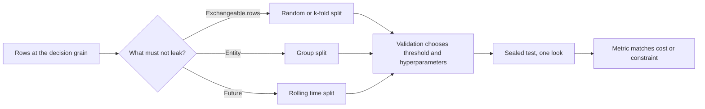

## Why this matters

Every number you will defend in a model review is an estimator of future performance, and the split that produced it is part of the estimator. A random split of shuffled rows estimates performance on more rows from the same bag. It does not estimate next month, and it does not estimate a new hospital. The metric is the other half of the claim. Accuracy on a rare event, RMSE on a skewed revenue, and AUC with no operating point have all authorized models that fail in production while looking excellent in a slide.

This lesson specifies the splits, then the metrics, then the way they fail. You will implement a k-fold partitioner and the core classification counts from scratch. Thresholds, calibration, and the difference between ranking and decision sit in the middle, because a metric without a threshold is not yet a product behavior.

## Intuition

Hold out a slice of data the training procedure cannot see. If you also tune hyperparameters, you need two unseen roles: a validation set that may be looked at many times while you choose depth, λ, or the epoch, and a test set that is looked at once at the end. Every time you react to the test number by changing the model, the test set becomes another validation set and the number turns optimistic. That is not a moral rule. It is the bias of an estimator whose selection was based on itself.

Cross-validation repeats the holdout. In k-fold, you partition the rows into k blocks, train on k − 1 of them, and score the held-out block, rotating until every row has been scored exactly once by a model that did not train on it. The average is more stable than one split. The variance of the k scores is a hint, not an independent sample, because the training sets overlap. Time-series splits respect order: you always train on the past and score the immediate future, then roll forward. Shuffling a time series and k-folding it is a leak with extra steps.

## Core concept in depth

### Splits that match the deployment

Random splits assume rows are exchangeable. Use them for i.i.d. tabular problems and for images drawn from one collection. Grouped splits keep an entity — a user, a patient, a document — entirely on one side, so you do not train on three visits and test on the fourth of the same person when production must score a new person. Time splits train on earlier periods and test on later ones. When both entity and time matter, combine them: no entity from the future, and no future rows of a training entity if the decision is "new users next month."

The size of the test set is a statistics question. A metric estimated on 200 positives has a wide interval no matter how stable your training is. Spend rows on the test set until the decision you need — ship or not, at a given cost — is distinguishable from noise. A huge training set and a tiny test set produces a confident model and an untrustworthy claim.

Nested cross-validation is the honest version of "we tuned a lot." The inner loop chooses hyperparameters. The outer loop estimates the error of that whole selection procedure. Using a single k-fold both to pick the best tree depth and to publish the score of the winning depth double-dips. For a large project, a three-way split (train, validation, test) is easier to explain than nested loops and is enough if the test set stays sealed.

### Classification metrics from one matrix

At a fixed threshold, every binary prediction is a true positive, false positive, true negative, or false negative. From those four counts:

- Accuracy = (TP + TN) / N. Dominated by the majority class.
- Precision = TP / (TP + FP). Of the alerts, how many were real.
- Recall, or sensitivity = TP / (TP + FN). Of the real events, how many you caught.
- Specificity = TN / (TN + FP). Of the non-events, how many you left alone.
- F1 = 2 · precision · recall / (precision + recall), the harmonic mean. It is small if either precision or recall is small.

False-positive rate = FP / (FP + TN) = 1 − specificity. ROC plots recall against false-positive rate as the threshold moves. Precision-recall plots precision against recall. Average precision summarizes the latter. AUC summarizes the former and equals the probability that a random positive scores above a random negative, under a mild tie assumption. AUC can be high while precision at the recall you need is unacceptable, especially when negatives overwhelm the x-axis of the ROC.

Multiclass problems need an averaging policy. Macro-F1 averages the per-class F1 scores and treats a rare class as equal to a common one. Micro-F1 pools the counts and is dominated by common classes. Weighted averages sit in between. State the policy in the same sentence as the number. A top-1 accuracy is micro-style. A system that must be decent on every intent should be judged with macro.

### Regression and ranking metrics

MAE is the mean absolute residual. It treats a miss of 10 the same whether it is one whale or ten small errors of 1, no: MAE charges 10 once and charges ten 1s as 10 as well. It is linear. MSE charges the whale 100. RMSE is the square root, so the unit matches y, and it ranks models the same way MSE does. R² is 1 minus the MSE divided by the variance of y. It is zero for a model that always predicts the mean, and it can be negative for a model worse than that. It is not "the percentage of variance explained" in a causal sense, and it is not comparable across datasets with different variances of y.

For ranking, recall-at-k and precision-at-k match a UI that shows k items. A pairwise accuracy asks how often the preferred item outranks the other. Do not report RMSE on star ratings if the product only shows a top-10. Do not report top-1 accuracy for a medical score that is not a class until someone picks a threshold.

### Log loss and calibration

Binary cross-entropy, or log loss, charges confident mistakes severely. Two models can share an AUC and differ in log loss because one is calibrated and the other is overconfident. If you will rank and then threshold on a validation set, AUC or average precision selects the ranker, and a separate calibration step maps scores to probabilities. If the raw output is shown to a user as a probability, log loss and a reliability diagram belong in the review. Brier score, the MSE between probability and 0/1 outcome, is a proper scoring rule with a similar taste.

### Choosing a metric from costs

Write the cost of a false positive and a false negative in the same unit, even roughly. The threshold that minimizes expected cost is a function of those costs and of the score's calibration. If you cannot name the costs, say so, and pick a constraint you can name: "recall at least 0.9, then maximize precision," or "at most 50 alerts a day." An unnamed F1 is a statement that precision and recall matter equally in harmonic form, which is sometimes true and often a default you did not choose.

## Diagram / flowchart



### Dry-run table

Five rows, labels 1, 0, 1, 0, 1. A 5-fold split is degenerate (one row per test fold) but a 2-fold partition shows the idea. Fold A holds the first two rows out. Fold B holds the last three. Separately, scores 0.2, 0.8, 0.6, 0.4, 0.9 at threshold 0.5.

| Row | Label | Score | Prediction at 0.5 | Count |
| --- | --- | --- | --- | --- |
| 1 | 1 | 0.2 | 0 | FN |
| 2 | 0 | 0.8 | 1 | FP |
| 3 | 1 | 0.6 | 1 | TP |
| 4 | 0 | 0.4 | 0 | TN |
| 5 | 1 | 0.9 | 1 | TP |

| Metric | Value |
| --- | --- |
| Accuracy | 3/5 = 0.6 |
| Precision | 2/3 ≈ 0.667 |
| Recall | 2/3 ≈ 0.667 |
| F1 | 0.667 |

Fold A, if you trained only to predict the majority of the complement, is a reminder that tiny folds are noisy. The metric table is the thing to recompute by hand in an interview before you discuss ROC.

## Code

```python
def kfold_indices(n: int, k: int) -> list[tuple[list[int], list[int]]]:
    if k < 2 or k > n:
        raise ValueError("k must be between 2 and n")
    folds = [[] for _ in range(k)]
    for i in range(n):
        folds[i % k].append(i)
    splits = []
    for hold in range(k):
        test = folds[hold]
        train = [i for j, fold in enumerate(folds) if j != hold for i in fold]
        splits.append((train, test))
    return splits


def counts(y_true: list[int], y_pred: list[int]) -> dict[str, int]:
    tp = fp = fn = tn = 0
    for a, b in zip(y_true, y_pred):
        if a == 1 and b == 1:
            tp += 1
        elif a == 0 and b == 1:
            fp += 1
        elif a == 1 and b == 0:
            fn += 1
        else:
            tn += 1
    return {"tp": tp, "fp": fp, "fn": fn, "tn": tn}


def precision_recall_f1(c: dict[str, int]) -> tuple[float, float, float]:
    tp, fp, fn = c["tp"], c["fp"], c["fn"]
    precision = tp / (tp + fp) if tp + fp else 0.0
    recall = tp / (tp + fn) if tp + fn else 0.0
    if precision + recall == 0:
        return precision, recall, 0.0
    f1 = 2 * precision * recall / (precision + recall)
    return precision, recall, f1


if __name__ == "__main__":
    splits = kfold_indices(5, 2)
    print("fold0 test", splits[0][1], "fold1 test", splits[1][1])
    y_true = [1, 0, 1, 0, 1]
    y_pred = [0, 1, 1, 0, 1]
    c = counts(y_true, y_pred)
    print("counts", c)
    print("prf", tuple(round(v, 3) for v in precision_recall_f1(c)))
```

Fold tests print as the even and odd indexes, a deterministic round-robin rather than a shuffle, which is what you want in a unit test. Counts match the dry-run: one FN, one FP, two TP, one TN. F1 rounds to 0.667.

## Complexity analysis

| Procedure | Time | Data use | Bias risk |
| --- | --- | --- | --- |
| Single holdout | One train | One test slice, high variance | Low if the slice is sealed and large |
| k-fold | k trains | Every row is tested once | Optimistic if you also pick k's winner on these scores |
| Nested CV | Outer times inner trains | Expensive and more honest | The right estimator of a selection pipeline |
| Rolling time split | One train per window | Recent windows matter more | A random shuffle would leak the future |
| Group split | One train | Entities do not cross | A row split would leak the entity |
| ROC AUC | Θ(n log n) after scoring | Uses rank only | Ignores calibration and operating cost |

The compute trade-off is real for deep models. k-fold multiplies training cost by k. A single time-based validation set is often the better spend, with the randomness moved into training seeds rather than into row assignments that violate time. For a linear model on a million rows, k-fold is cheap enough that not doing it is the larger risk.

Leave-one-out is k-fold with k = n. It is almost unbiased for some estimators and very expensive, and the n scores are highly dependent. It is a tool for tiny datasets, not a default.

## Tricks, tips and patterns

- Write the deployment population in a sentence, then pick the split that mimics it. Time, entity, or row.
- Seal the test set. Count how many times you have looked. The count should be one.
- Choose the metric from a cost or a constraint. Name the threshold with the metric.
- Report precision and recall together. Report the positive count so a rate has a denominator.
- Use macro averages when rare classes matter, micro when volume matters.
- Prefer log loss or Brier when the number will be treated as a probability. Prefer AUC when you will retune the threshold later.
- Pair model comparisons on the same test rows. The difference is less noisy than either score.
- Put the split policy and the metric definition in the model card, not only the score.

## Common mistakes and edge cases

- Shuffling a time series before k-fold. Future rows train the past.
- The same user in train and test when the product scores new users.
- Tuning the threshold on the test set.
- Accuracy on a 99 percent negative problem. Always predict negative and celebrate.
- RMSE on a target you will log-transform in production, or the reverse. The metric and the training loss should agree about the scale.
- R² compared across two different outcomes. A 0.4 on a noisy human outcome can be excellent; a 0.4 on a deterministic sensor can be a bug.
- Undefined precision when the model predicts no positives. Return a defined 0 or abstain, but do not throw in a dashboard at 3 a.m.
- Macro-F1 that looks tragic because one class has two examples. Print support per class.

## Interview notes

Compute precision, recall, and F1 from a confusion matrix the interviewer writes down. Do it slowly. Then say what happens to accuracy if the negative class grows by 10x and the model stays the same.

Explain validation versus test in terms of estimator bias, not in terms of "best practice." Every hyperparameter chosen on a set makes that set optimistic.

Sketch a time split and a group split. Give one product example of each. Mention nested CV only if you also mention its cost; a sealed three-way split is an acceptable answer for most roles.

If asked about AUC, define it as a ranking probability and give the rare-event caveat. Offer precision at a fixed recall as the decision metric.

## Practice problems

1. [Classification Accuracy](/practice/ml-accuracy) — and the class imbalance it ignores (easy).
2. [Binary F1 Score](/practice/ml-f1) — harmonic mean of precision and recall, with the zero-positive case (medium).
3. [Root Mean Squared Error](/practice/ml-rmse) — regression error in the units of y (easy).
4. Implement the dry-run counts by hand and confirm F1. Then move the threshold so the false negative at score 0.2 becomes a true positive, and recompute precision.
5. Write a group split that assigns every row of an entity by hashing the entity id, and show that two rows of the same id never separate.

## Summary / cheat sheet

- Validation may be looked at while you choose. Test is for a single final estimate. Looking twice biases it.
- Random, group, and time splits answer different deployment questions. Shuffling is not neutral.
- k-fold averages holdouts. It does not create k independent datasets. Nested CV evaluates the selection itself.
- Accuracy hides rare events. Precision and recall name the two errors. F1 forces both to be decent.
- ROC AUC ranks. It does not set a threshold and it flatters imbalance. Precision-recall is the rarer-event picture.
- RMSE and MAE disagree about whales. R² is relative to predicting the mean on that dataset.
- Log loss punishes confident mistakes. Use it when the output is a probability.
- Put costs or constraints next to the metric, and put the split policy next to the number.

## Further reading

- [scikit-learn model selection and cross-validation](https://scikit-learn.org/stable/modules/cross_validation.html)
- [scikit-learn metric documentation](https://scikit-learn.org/stable/modules/model_evaluation.html)
- [An Introduction to Statistical Learning, Chapter 5](https://www.statlearning.com/)
- [Deep Learning Book, Chapter 5 — hyperparameters and validation](https://www.deeplearningbook.org/contents/ml.html)
- [Saito and Rehmsmeier, The Precision-Recall Plot Is More Informative than the ROC Plot](https://journals.plos.org/plosone/article?id=10.1371/journal.pone.0118432)
