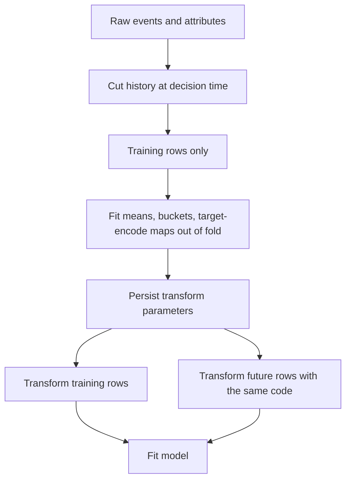

## Why this matters

On images and text, modern networks discover features. On the tables most companies actually predict from — accounts, orders, claims, devices — a careful column still beats a careless network. Feature engineering is the design of those columns: numeric scales, category encodings, time windows, interactions, and the discipline of fitting every statistic on the training fold alone. It is also where target leakage is manufactured. A brilliant feature that is only known after the outcome is a bug with a high AUC.

This lesson walks the transforms you should be able to implement and defend, then ties them to the model class. Trees and linear models do not want the same encoding. A feature store, later in the MLOps module, is this lesson plus a serving contract.

## Intuition

A model can only cut the input space along directions you give it, unless it is deep enough and fed enough data to build new directions internally. A linear model cuts along a weighted sum of the columns you provided. If the truth is "income times employment status," and you pass income and status separately, a linear model cannot form the product unless you add it. A tree can approximate the product with a staircase of splits, at the cost of more data and a jagged function. So feature engineering is partly "write down the interactions and the scales the model class cannot discover cheaply."

The other part is representation of messy reality. Dates are not numbers in a meaningful arithmetic until you extract day-of-week, recency, and a trend. Categories are not points on a line. Missingness is sometimes a signal. Text fields on a tabular row are a counting problem — token indicators, hashing, or a small embedding — not an invitation to paste a foundation model into every pipeline on day one.

## Core concept in depth

### Numeric transforms

Standardization subtracts a training mean and divides by a training standard deviation. It matters for L2 penalties, for k-NN, for PCA, and for neural nets. Trees that split on a threshold are invariant to monotone rescaling of one feature, so z-scoring a column before a random forest changes nothing important and can still be useful for the human reading importances later.

Log transforms compress a long right tail so a whale does not dominate a linear fit. They require positive inputs; log1p of a count is the usual form. Binning a continuous feature helps a linear model approximate a step, and it throws away order inside the bin. Trees already bin by splitting, so pre-binning for a tree is usually wasted. Quantile transforms map a column onto a Gaussian or a uniform grid and tame outliers; fit the quantiles on train only.

Clipping extreme values at a training percentile is a blunt robustifier. Do it when the extremes are sensor glitches. Do not do it when the extremes are the events you are predicting, such as the largest purchases.

### Categories

One-hot encoding gives a linear model a separate weight per level. Reserve an `"other"` bucket for rare levels, decided by a training-set frequency threshold, and map unseen production levels into it. A missing category is its own level.

Target encoding replaces a level by the mean of y among training rows with that level. It is powerful and dangerous. Without smoothing, a level that appeared once with y = 1 encodes the label. Smooth toward the global mean: (count · level mean + m · global mean) / (count + m), with m chosen on validation. Compute the encoding out of fold. If you compute it on all training rows and then train on those rows, the encoding leaks the target into the feature and cross-validation scores become fiction. At inference you apply the stored map and the global mean for unknown levels.

Hashing encodings fix the column count for very high cardinality by hashing levels into B buckets. Collisions mix unrelated levels. That is acceptable for a wide linear model with a regularizer and unacceptable if you needed an interpretable weight per merchant.

### Time and entities

Recency (time since last event), frequency (count in a window), and monetary value (sum in a window) are the classical trio for a reason: they summarize a history at a decision time. The window must end before the decision. Windows of 1 day, 7 days, and 28 days capture different rhythms; they will be correlated, and a linear model with ridge will cope better than an unregularized one. Lags are the value of the series at t − 1, t − 7, and so on, for forecasting. A lag that uses t itself is the label.

Aggregates by entity need the same clock. "User's lifetime order count" including the current order leaks. "User's order count prior to this order" does not. Ratios of recent to lifetime behavior catch a change in habit, and the denominator needs a floor so a new user does not divide by zero. New users should have an explicit cold-start path: zeros, plus a missingness indicator, not a crash.

### Interactions, crosses, and polynomials

A cross of two categoricals is a new categorical: country and device. It lets a linear model learn that the effect of a device differs by country. The cardinality multiplies, so you cross only pairs you have a reason to believe in, and you bucket rare pairs. A product of two numerics is the linear model's way to say "the slope on x depends on z." Polynomial features of degree 2 on d numerics create on the order of d² columns and will overfit unless you regularize or select. Trees search for interactions greedily and do not need the full cross, but an explicit cross of a known structure still speeds them up and stabilizes them.

### Selection is another model

Filtering columns by correlation with y on the full dataset leaks. If you select, do it inside the training fold, or accept that your validation score is part of the selection. L1 penalties and tree importances are selection mechanisms with the same rule. A column that is important only because it proxies a leaked field will look legitimately important. Importance is not a leakage detector. A data dictionary is.

Redundant features hurt k-NN and unregularized linear models, and they clutter explanations. They rarely hurt a boosted tree's accuracy and they do hurt its explanations. Drop a duplicate column you can define as a function of another; do not drop a slightly correlated column because a heatmap made you nervous, unless the sample is small.

### The serving contract

Every transform is a function with parameters fit on train: means, category lists, hash buckets, window definitions, smoothers. The serving code must run that same function. Reimplementing "roughly the log then the one-hot" in a different language without a shared test is how training-serving skew is born. Store the parameters next to the weights. Golden-row tests — a dozen raw inputs and the exact feature vectors — belong in CI.

## Diagram / flowchart



### Dry-run table

Training rows, in order, have levels A, A, A, A, B and labels 1, 1, 0, 1, 0. The global mean is 3/5 = 0.6. Smooth with m = 2.

| Level | Labels | Count | Raw mean | Smoothed mean |
| --- | --- | --- | --- | --- |
| A | 1, 1, 0, 1 | 4 | 0.75 | (3 + 2·0.6) / 6 = 0.70 |
| B | 0 | 1 | 0.00 | (0 + 2·0.6) / 3 = 0.40 |
| unseen | none | 0 | undefined | global 0.60 |

Level B's single zero does not become a hard 0 after smoothing, which is the difference between a feature and a copy of that one label. If you had used the raw mean and then trained on these same rows, the model would see B's label sitting in the feature column.

## Code

```python
def target_encode(
    levels: list[str],
    y: list[float],
    m: float,
) -> dict[str, float]:
    """Smoothed mean of y per level. Fit on training rows only, ideally out of fold."""
    if len(levels) != len(y) or not y:
        raise ValueError("levels and y must be non-empty and aligned")
    global_mean = sum(y) / len(y)
    sums: dict[str, float] = {}
    counts: dict[str, int] = {}
    for level, target in zip(levels, y):
        sums[level] = sums.get(level, 0.0) + target
        counts[level] = counts.get(level, 0) + 1
    encoded = {}
    for level, count in counts.items():
        encoded[level] = (sums[level] + m * global_mean) / (count + m)
    encoded["__global__"] = global_mean
    return encoded


def apply_target_encode(level: str, mapping: dict[str, float]) -> float:
    return mapping.get(level, mapping["__global__"])


def log1p_nonnegative(xs: list[float]) -> list[float]:
    import math
    out = []
    for x in xs:
        if x < 0:
            raise ValueError("log1p feature expects nonnegative counts")
        out.append(math.log1p(x))
    return out


if __name__ == "__main__":
    levels = ["A", "A", "A", "A", "B"]
    y = [1.0, 1.0, 0.0, 1.0, 0.0]
    mapping = target_encode(levels, y, m=2.0)
    print("A", round(mapping["A"], 3), "B", round(mapping["B"], 3))
    print("unseen", apply_target_encode("C", mapping))
    print("log1p", [round(v, 4) for v in log1p_nonnegative([0.0, 9.0])])
```

The map prints A = 0.7 and B = 0.4, and an unseen level falls back to the global mean 0.6, matching the table. log1p(0) is 0 and log1p(9) is the natural log of 10.

## Complexity analysis

| Transform | Fit cost | Apply cost | Leak risk |
| --- | --- | --- | --- |
| Z-score, min-max | Θ(n d) | Θ(d) per row | Fitting on test rows |
| One-hot with an other-bucket | Θ(n) counts | Θ(levels kept) sparse or dense | Separate encoders on train and test |
| Smoothed target encoding | Θ(n) | Θ(1) lookup | In-fold means, tiny counts, no smoothing |
| Hashing trick, B buckets | Θ(1) parameters | Θ(tokens) | Low leak, high collision |
| Rolling window aggregate | Θ(n log n) with a sorted scan | Must be as-of | Window that includes the label time |
| Degree-2 polynomial, d numerics | Θ(d²) columns | Θ(d²) | Overfit if n is not much larger than d² |

Target encoding is the sharp trade-off. It compresses a high-cardinality column into one numeric feature and it can beat one-hot when levels are many and counts are decent. It requires out-of-fold computation and smoothing, or it is leakage. Hashing is safer to serve and harder to explain. One-hot is explainable and wide. Pick based on cardinality, model class, and whether someone must read the weight.

Window features dominate compute in real tabular systems. The model is small; the as-of join is not. Precompute snapshots at a cadence you can serve, rather than scanning a user's entire history inside the request path.

## Tricks, tips and patterns

- Fit on train, apply everywhere, persist the parameters, golden-test the vector.
- Smooth target encodings and compute them out of fold. Unknown levels get the global mean.
- End every window before the decision time. New entities get an explicit cold start.
- Add the interaction you can name. Do not add all of them and hope ridge sorts it out, unless d is small and λ is tuned.
- Log-compress positive heavy tails. Do not log the label in the metric and forget you did it in the model, or the reverse.
- Keep missingness indicators when blank is informative. Do not fill with a value that erases that bit.
- Match the transform to the model. Trees do not need monotone rescaling. Linear models need crosses they should not have to discover.
- Drop exact duplicates. Keep a data dictionary with "known at decision time: yes or no."

## Common mistakes and edge cases

- Target encoding inside the training fold, then a victory lap on cross-validation.
- A frequency threshold for `"other"` computed on train plus test, so the bucket boundary peeks.
- log of zero or of a negative balance. Use log1p on counts, and think before you transform signed money.
- A ratio with a zero denominator for new users, raised as an exception in production only.
- One-hot columns in a different order at serving time. The weights still multiply something.
- Bin edges fit on the full dataset.
- A "lifetime" aggregate that includes the current event.
- Treating feature importance as proof the column is legitimate. Leaked columns look important.

## Interview notes

Explain fit versus apply with a mean and with a one-hot vocabulary. Then explain why target encoding needs an out-of-fold twist that a mean does not: the statistic is a function of y, so using it on the same rows lets y predict y.

Give one time-window example with three timestamps and mark which events are legal. Interviewers remember the candidate who drew the clock.

Say which transforms a tree does not need (monotone rescales) and which a linear model does (interactions, one-hot rather than arbitrary integer codes). Mention training-serving skew as a feature-pipeline bug, not a modeling mystery, and mention golden rows as the test.

## Practice problems

1. [Min-Max Scale](/practice/ml-minmax) — affine numeric transform with a constant-column guard (easy).
2. [Z-Score Standardization](/practice/ml-zscore) — the scaler linear models and k-NN require (easy).
3. [Compute Mean](/practice/ml-mean) — the building block of a target encoding and of a fill value (easy).
4. Recompute the code's smoothed encodings for levels A and B by hand and confirm 0.7 and 0.4.
5. Write an out-of-fold wrapper: for each validation fold, fit the encoding on the other folds only, and apply it to the held-out fold.

## Summary / cheat sheet

- Feature engineering writes the directions a given model class cannot cheaply discover, and it freezes a serving contract.
- Fit every statistic on training data. Apply the saved function later. Test it with golden rows.
- One-hot for modest categories, with an other-bucket. Smooth target encodings out of fold. Hash when the cardinality is extreme.
- Windows and lags end before the decision. Cold-start users need a defined vector, not a missing join.
- Cross features you can explain. Polynomials explode in count and need regularization.
- Trees are invariant to monotone rescales. Linear models are not, and they need explicit interactions.
- A feature that is only known after the outcome will look brilliant and fail in production. Timestamp it.

## Further reading

- [scikit-learn preprocessing](https://scikit-learn.org/stable/modules/preprocessing.html)
- [scikit-learn target encoder](https://scikit-learn.org/stable/modules/generated/sklearn.preprocessing.TargetEncoder.html)
- [Feature Engineering and Selection (Kuhn and Johnson) companion notes](https://bookdown.org/max/FES/)
- [Google Rules of ML — features](https://developers.google.com/machine-learning/guides/rules-of-ml)
- [pandas merge_asof for decision-time joins](https://pandas.pydata.org/docs/reference/api/pandas.merge_asof.html)
