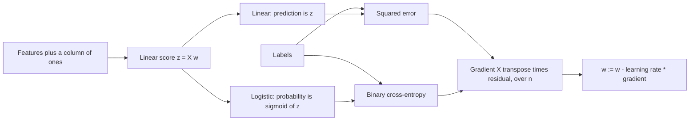

## Why this matters

Linear regression and logistic regression are the smallest models that are still real. They are what you should beat with a tree or a network, they are what you debug a pipeline against, and their gradients are the dense-layer gradients inside a neural net. If you can derive the normal equations, the logistic loss, and the update `prediction minus label`, you can read a modern training loop as the same idea with a fancier function class.

They are also the right production model more often than resumes suggest. A calibrated logistic regression on well-built features is fast, explainable, and hard to break. This lesson fits both models from scratch in NumPy, with a pure-Python single-step update you can audit by hand.

## Intuition

Linear regression draws the straight line (or the flat hyperplane) that minimizes squared vertical error. The prediction is a weighted sum of features plus an intercept. If the residuals are symmetric and the truth is nearly linear, that line is the conditional mean of y.

Logistic regression uses the same weighted sum, then squashes it through a sigmoid so the output lies between 0 and 1 and can be read as a probability of the positive class. You do not minimize squared error on that probability. You minimize the negative log likelihood of the observed Bernoulli labels, which punishes a confident wrong answer far more than a squared residual would. The decision boundary in feature space is still linear. The curve people plot is the probability bending as you slide along one feature, not a curved boundary.

## Core concept in depth

### Linear regression

Given a design matrix X with a column of ones for the intercept, and a target vector y, the prediction is X w. The least-squares objective is the mean of squared residuals. Setting the gradient to zero yields the normal equations

Xᵀ X w = Xᵀ y

When Xᵀ X is invertible, w is the unique minimizer. When columns are collinear it is not invertible, and ridge replaces Xᵀ X with Xᵀ X + λ I on the non-intercept weights. Gradient descent is the alternative when d is large or you want a single code path shared with logistic regression: the gradient of the half-square loss with respect to w is Xᵀ (X w − y) / n, and you step against it.

Assumptions people quote — linearity, independent errors, constant variance, Gaussian noise — are sufficient for some textbook claims about intervals on the coefficients. The point estimate itself is just the projection. If the truth is curved, the straight line is the best straight line and still biased as a model of the curve. Plot residuals. A smile shape means you need a transform or a nonlinear model, not a smaller learning rate.

Coefficients are in units of y per unit of x. They are comparable across features only after scaling. A large coefficient on a collinear feature is not a cause. It is a direction in which the data did not pin the weight down, which is another way of saying the variance of that coefficient is huge.

### Logistic regression

The logit is z = w · x, including the intercept feature. The probability is σ(z) = 1 / (1 + e^(−z)). For labels y in 0 and 1, the mean negative log likelihood is binary cross-entropy. The beautiful cancellation from the calculus lesson remains: the gradient of the loss with respect to w is Xᵀ (p − y) / n, the same shape as linear regression, with the residual replaced by probability minus label. There is no closed form. You iterate gradient descent, or a Newton method that uses the second derivative, which is a weighted Xᵀ X with weights p(1 − p).

A threshold on p, default 0.5, turns the probability into a class. The threshold is a product decision. Moving it trades precision against recall and does not require refitting w. Regularize with an L2 penalty on the non-intercept weights when features outnumber the effective sample or when they are collinear. Unregularized logistic regression on separated data — a feature that perfectly divides the classes — drives the corresponding weight to infinity. The loss approaches zero and the probabilities approach 0 and 1, but the coefficients diverge. A penalty or early stopping keeps them finite.

### Multiclass and generalized linear models

Softmax regression, or multinomial logistic regression, replaces the sigmoid with a softmax over K logits and the loss with categorical cross-entropy. The gradient for each class weight is again an outer product of (predicted probability minus one-hot label) and x. One-versus-rest logistic regression fits K binary models and is a reasonable baseline when K is small; the probabilities will not sum to 1 unless you renormalize, so say which variant you shipped.

Both linear and logistic regression are generalized linear models: a linear predictor, a link function, and an exponential-family likelihood. Poisson regression for counts uses a log link and a Poisson likelihood. Knowing the family exists stops you from forcing squared error onto a count or a probability when you can name the right likelihood. You do not need the full theory to use the two members in this lesson well.

### What to check before you trust a coefficient

Scale the numeric features. Encode categories without implying a fake order. Fit the scaler on train only. Look at a calibration curve for logistic outputs. Look at residual-versus-fitted for linear outputs. Compare to a baseline that predicts the training mean, or the training base rate. If your model does not beat that baseline on the validation metric you actually care about, the features are not earning their keep, and a neural net will waste a week discovering the same fact.

## Diagram / flowchart



### Dry-run table

One feature, no intercept, for a transparent step. Linear: x = 2, y = 4, w = 0, learning rate 0.1, half-square loss. Logistic: x = 1, y = 1, w = 0, learning rate 0.5. Sigmoid(0) = 0.5.

| Model | Score | Residual-like term | Gradient | New w |
| --- | --- | --- | --- | --- |
| Linear | 0 · 2 = 0 | pred − y = −4 | (−4) · 2 = −8 | 0 − 0.1 · (−8) = 0.8 |
| Logistic | sigmoid(0) = 0.5 | p − y = −0.5 | (−0.5) · 1 = −0.5 | 0 − 0.5 · (−0.5) = 0.25 |

The linear weight moved toward the ratio 4/2 = 2, but one aggressive step does not finish the job. The logistic weight increased because the label was positive and the probability was only 0.5, so the model was not confident enough in the observed class.

## Code

```python
import math


def sigmoid(z: float) -> float:
    if z >= 0:
        ez = math.exp(-z)
        return 1.0 / (1.0 + ez)
    ez = math.exp(z)
    return ez / (1.0 + ez)


def linear_step(w: float, x: float, y: float, lr: float) -> float:
    pred = w * x
    grad = (pred - y) * x
    return w - lr * grad


def logistic_step(w: float, x: float, y: float, lr: float) -> float:
    p = sigmoid(w * x)
    grad = (p - y) * x
    return w - lr * grad


def fit_linear_1d(xs: list[float], ys: list[float], lr: float, steps: int) -> float:
    w = 0.0
    for _ in range(steps):
        grad = 0.0
        for x, y in zip(xs, ys):
            grad += (w * x - y) * x
        w -= lr * grad / len(xs)
    return w


def predict_proba(w: list[float], x: list[float]) -> float:
    z = sum(wi * xi for wi, xi in zip(w, x))
    return sigmoid(z)


if __name__ == "__main__":
    print("linear", linear_step(0.0, 2.0, 4.0, 0.1))
    print("logistic", logistic_step(0.0, 1.0, 1.0, 0.5))
    w = fit_linear_1d([1.0, 2.0, 3.0], [2.0, 4.0, 6.0], lr=0.1, steps=50)
    print("slope", round(w, 3))
    print("proba", round(predict_proba([0.25], [1.0]), 4))
```

The one-step prints match the table: 0.8 and 0.25. The 1-D fit on points that truly lie on y = 2x recovers a slope near 2 after 50 small steps. If it does not, the learning rate is too large or too small; this learning rate is safe because the largest x² in the Hessian scale is 9, and 0.1 is well under 2/9 after averaging. The probability at w = 0.25 and x = 1 is σ(0.25), a bit above one half.

## Complexity analysis

| Algorithm | Time | Space | When it struggles |
| --- | --- | --- | --- |
| Normal equations, n by d, d small | Θ(n d² + d³) | Θ(d²) | Collinearity, unscaled columns, d in the tens of thousands |
| Batch gradient descent, T epochs | Θ(T n d) | Θ(d) | Needs a learning rate; ill-conditioned features converge slowly |
| Logistic gradient descent | Θ(T n d) | Θ(d) | Separable data without a penalty sends weights to infinity |
| Newton on logistic regression | Θ(T (n d² + d³)) | Θ(d²) | Fast in iterations, painful in d |
| Prediction | Θ(d) | Θ(d) | A wide one-hot can dominate latency if it is dense |

Stochastic gradient descent replaces the full sum with one row or a minibatch. The gradient is noisier and the cost per update drops from Θ(n d) to Θ(B d). For n in the millions this is the difference between a model you train nightly and a model you cannot. The learning rate then needs a schedule, which the optimizer lesson covers in the deep-learning module. For n of a few thousand and d of a few dozen, the normal equations or a library solver are simpler and more accurate than a hand-rolled step size.

Use a sparse representation when one-hot width dwarfs the number of active categories per row. A dense Θ(d) prediction is the wrong complexity class for a hashed million-dimensional logistic model; the right one is Θ(nonzeros).

## Tricks, tips and patterns

- Always include an intercept, and do not L2-penalize it.
- Standardize numeric columns before comparing coefficients or tuning λ.
- Beat the mean baseline and the majority-class baseline before you celebrate.
- For logistic regression, monitor log loss, not only accuracy. Check calibration if you will show the probability.
- If coefficients diverge and training loss heads toward zero, you have separation. Add L2 or drop the perfect feature and ask why it was perfect.
- Plot residuals for the linear model. Structure means the linear class is the wrong class, or a feature is missing.
- A single learning-rate sweep on a tiny subset tells you whether the implementation is even in the right basin.
- Keep the same prediction code for batch scoring and online scoring. A reimplementation of the sigmoid is a classic skew.

## Common mistakes and edge cases

- Squared error on a hard 0/1 label and a linear output that wanders outside 0 and 1. Use logistic regression if you need a probability.
- Thresholding at 0.5 because it is the default, on a 1 percent base rate, and shipping a model that almost never fires or always fires depending on calibration.
- Interpreting a coefficient as a causal effect in an observational table full of confounders.
- Forgetting the column of ones and then blaming the optimizer because the fit cannot match the mean.
- Updating with the sum of gradients in one code path and the mean in another, which silently rescales the learning rate by n.
- Integer overflow or exp overflow in a naive sigmoid. Use the stable branch.
- One-hot columns that do not sum to a constant, plus an intercept, plus no penalty: a singular design. Drop one level or use a penalty.

## Interview notes

Derive the logistic gradient as (p − y) x on a single row. Interviewers listen for the cancellation of σ′(z), not for a memorized formula. If you blank, start from the chain rule.

Write the normal equations and say what you do when Xᵀ X is singular: ridge, or a pseudoinverse, and an investigation of which columns duplicated each other.

Explain separation. It is the question that distinguishes people who have trained logistic regression on real rare-event data from people who have only used it on toy sets where the optimum is comfortably finite.

Compare the two models in one sentence: same linear score, different likelihood, different residual in an otherwise identical gradient. Then say when you would refuse both: strong interactions you will not engineer, or a signal that lives in raw pixels or tokens where a linear score on hand features will not keep up.

## Practice problems

1. [One Linear Regression Step](/practice/ml-linreg-step) — the vector form of the linear update in the dry-run (medium).
2. [Stable Sigmoid](/practice/ml-sigmoid) — the link function, including the overflow branch (easy).
3. [Binary Cross-Entropy](/practice/ml-bce) — the logistic objective you differentiate (medium).
4. Run the 1-D fit on y = 2x and confirm the slope approaches 2. Then add an outlier and watch the squared-error fit chase it.
5. Compute one logistic step by hand from w = 0, x = 1, y = 0, learning rate 0.5. The weight should move negative.

## Summary / cheat sheet

- Linear regression predicts a weighted sum and minimizes squared error. Normal equations: Xᵀ X w = Xᵀ y.
- Logistic regression runs that sum through a sigmoid and minimizes binary cross-entropy.
- The gradient for both is Xᵀ residual / n. Linear residual is pred − y. Logistic residual is p − y.
- There is no closed form for logistic regression. Separation sends unregularized weights to infinity.
- Do not penalize the intercept. Do scale features. Do beat a mean or base-rate baseline.
- The threshold on a logistic probability is a cost decision, not a property of the likelihood.
- Multiclass extension: softmax and categorical cross-entropy, with the same residual shape.
- Coefficients are associations in the units you gave the model, not causes.

## Further reading

- [scikit-learn linear models](https://scikit-learn.org/stable/modules/linear_model.html)
- [Deep Learning Book, Chapter 5 — logistic regression and maximum likelihood](https://www.deeplearningbook.org/contents/ml.html)
- [Elements of Statistical Learning, Chapters 3 and 4](https://hastie.su.domains/ElemStatLearn/)
- [An Introduction to Statistical Learning, Chapters 3 and 4](https://www.statlearning.com/)
- [NumPy lstsq](https://numpy.org/doc/stable/reference/generated/numpy.linalg.lstsq.html)
