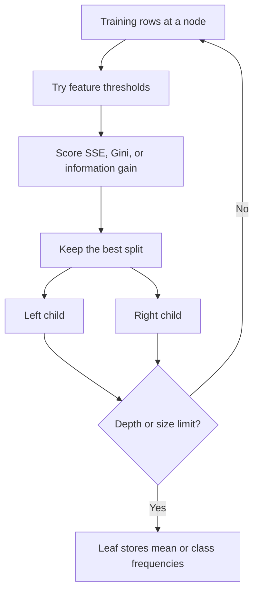

## Why this matters

Trees are the default strong baseline on tabular data. They ignore monotone rescaling, they model interactions by splitting, they tolerate missingness with a little care, and a forest or a boosted ensemble of them wins a surprising fraction of industry problems without a GPU. They also overfit in a way linear models do not: a deep tree can isolate every training row in its own leaf. Understanding the split criterion, the reason a forest averages, and the reason boosting fits residuals tells you which knob — depth, number of trees, learning rate, subsample — you are actually turning.

This lesson builds a one-split regression and classification tree from scratch, then explains random forests and gradient boosting as two different cures for the weakness of that single tree.

## Intuition

A decision tree asks a sequence of yes or no questions about features and ends in a leaf that predicts a constant. Growing the tree is greedy. At each node you try thresholds and pick the one that most improves a purity score. You do not revisit earlier questions. The picture is a staircase: easy to draw, easy to memorize noise with, awkward for a truly linear relationship unless the tree is allowed many steps.

A random forest grows many deep trees on bootstrap samples and, at each split, considers only a random subset of features. The trees are inaccurate in different ways. Averaging their votes cancels some of the noise. Boosting grows shallow trees in sequence. Each new tree tries to correct the errors the sum of the previous trees still makes, and a learning rate keeps any one tree from dominating. Bagging reduces variance. Boosting reduces bias, and it will cheerfully overfit if you let it run.

## Core concept in depth

### Split criteria

For regression, the leaf predicts the mean of its training targets, which is optimal for squared error. The quality of a split is the drop in total squared error: the parent's sum of squares minus the children's. Equivalently, people minimize the weighted variance of the children.

For classification, a leaf predicts the majority class, and it may also store the class frequencies as a crude probability. Purity is measured by Gini impurity, 1 − Σ pₖ², or by entropy, −Σ pₖ log pₖ. Information gain is the entropy of the parent minus the weighted entropy of the children. Gini and entropy usually pick similar splits. Gini is cheaper. Neither criterion knows about your product costs; a split that improves Gini can still be the wrong operating point. You handle costs at the leaf probability or the threshold, or with class weights during training.

A candidate threshold on a numeric feature is any cut between two consecutive distinct values after you sort the column. You do not need to try every real number. Categorical features are tried as membership tests. With many levels the search is expensive, and some implementations use a heuristic ordering.

### When to stop

A tree that splits until every leaf is pure memorizes the sample, including label noise. Stop with a maximum depth, a minimum number of rows to split, a minimum impurity decrease, or cost-complexity pruning that trades a penalty per leaf against training error. Max depth is the knob to explain first. A depth-1 tree is a stump: one question, two leaves, a useful weak learner for boosting and a useful sanity check. A depth-20 tree on a few thousand rows is a lookup table.

Trees extrapolate badly. Outside the range of a feature they have seen, they predict the leaf that caught the extreme training value. A linear model at least continues its slope. If production will see higher prices than training, a tree will go flat. Say so in the review.

### Random forests

Draw a bootstrap sample: n rows sampled with replacement, so some rows repeat and about 37 percent are left out. Those out-of-bag rows are a free validation estimate for that tree, if you are careful not to then tune on them and also publish them as a sealed test. Grow a deep tree, but at each split inspect only m features, often √d for classification and d/3 for regression. Average the predicted probabilities or the regression values. Do not average the hard votes if you still need a probability; average the leaf frequencies.

The feature subsample decorrelates the trees. If one feature is very strong, every unbagged tree would split on it first and the average would not cancel much. Forcing a subset gives other features a chance and the average has something to cancel. More trees reduce variance and do not cause overfitting in the classical plot; they cost training time and prediction time linear in the number of trees. Diminishing returns set in, and prediction latency is the usual reason to stop adding them.

### Gradient boosting

Start with a constant, often the mean or the log-odds of the base rate. Then, for each round, fit a small tree to the negative gradient of the loss at the current prediction — for squared error, that gradient is the residual y − ŷ. Add the tree's prediction times a learning rate η, commonly 0.01 to 0.1. Small η needs more trees and generalizes better. Subsampling rows and columns, as in stochastic gradient boosting, adds a forest-like variance reduction.

The loss is not required to be squared error. Logistic loss boosts on the gradient of log loss, which is a residual in probability space, and the leaf values are then a transformation of that gradient, not a raw average of labels. XGBoost, LightGBM, and CatBoost differ in how they find splits, how they handle categoricals and missing values, and how they regularize leaves. The idea you must own is the sequential residual fit plus a learning rate. The library is an implementation.

Early stopping on a validation set is the standard regularizer. A thousand trees at η = 0.05 with early stopping is a different model from a thousand trees with no validation. The number of trees is not a neutral default.

### Importances are not explanations

A split's impurity decrease, summed over trees, is a common importance. It favors high-cardinality features that offer many cut points, and it will credit a feature that is a proxy for the true driver. Permutation importance — shuffle a column on validation data and measure the metric drop — is harder to fool and still fails when two columns carry the same signal: either one can be shuffled and the other covers. For a local explanation of one prediction, the later SHAP lesson is the honest tool. Do not present a default importance bar chart as a causal diagram.

## Diagram / flowchart



### Dry-run table

Four one-dimensional points. Regression targets, split by a threshold.

| x | y |
| --- | --- |
| 1 | 1 |
| 2 | 1 |
| 3 | 5 |
| 4 | 5 |

| Candidate | Left mean | Right mean | Total SSE |
| --- | --- | --- | --- |
| Cut between 1 and 2 | 1 | (1+5+5)/3 = 3.667 | 0 + (1−3.667)² + two times (5−3.667)² ≈ 12.67 |
| Cut between 2 and 3 | (1+1)/2 = 1 | (5+5)/2 = 5 | 0 |
| Cut between 3 and 4 | (1+1+5)/3 ≈ 2.333 | 5 | (1−2.333)² twice + (5−2.333)² + 0 ≈ 10.67 |

The cut between 2 and 3 drives SSE to 0 on this toy set. A tree that is allowed that split and then stops is the right model for this particular sample. It is also a warning: four noiseless points are not a reason to trust a leaf that contains two rows when the next sample is noisy. The arithmetic of "try every cut" is the whole greedy algorithm.

## Code

```python
def gini(labels: list[int]) -> float:
    n = len(labels)
    if n == 0:
        return 0.0
    counts: dict[int, int] = {}
    for y in labels:
        counts[y] = counts.get(y, 0) + 1
    return 1.0 - sum((c / n) ** 2 for c in counts.values())


def best_threshold_sse(xs: list[float], ys: list[float]) -> tuple[float, float]:
    """Return (threshold, sse) for the best cut: left is x <= threshold."""
    order = sorted(range(len(xs)), key=lambda i: xs[i])
    best_sse = float("inf")
    best_thr = xs[order[0]]
    for cut in range(1, len(order)):
        if xs[order[cut]] == xs[order[cut - 1]]:
            continue
        left = [ys[i] for i in order[:cut]]
        right = [ys[i] for i in order[cut:]]
        def sse(group: list[float]) -> float:
            mu = sum(group) / len(group)
            return sum((v - mu) ** 2 for v in group)
        total = sse(left) + sse(right)
        if total < best_sse:
            best_sse = total
            best_thr = 0.5 * (xs[order[cut - 1]] + xs[order[cut]])
    return best_thr, best_sse


def stump_predict(x: float, threshold: float, left_value: float, right_value: float) -> float:
    return left_value if x <= threshold else right_value


if __name__ == "__main__":
    xs = [1.0, 2.0, 3.0, 4.0]
    ys = [1.0, 1.0, 5.0, 5.0]
    thr, sse = best_threshold_sse(xs, ys)
    print("threshold", thr, "sse", sse)
    print("pred", stump_predict(2.5, thr, 1.0, 5.0))
    print("gini pure", gini([1, 1, 1]))
    print("gini balanced", gini([0, 0, 1, 1]))
```

The best threshold lands at 2.5 and the SSE is 0, matching the only perfect cut in the table. A point at 2.5 falls to the right leaf under a strict `x <= threshold` test only if the threshold is below 2.5; here the midpoint threshold 2.5 sends x = 2.5 to the left because of `<=`. On this dataset no training x equals 2.5, so the training SSE is unchanged. Gini of a pure node is 0 and Gini of a balanced binary node is 0.5.

## Complexity analysis

| Method | Train time | Predict time | Overfit behavior |
| --- | --- | --- | --- |
| One tree, sorts at each node, depth-limited | Roughly O(n d log n) per typical build, worse if naive | O(depth) | High variance if deep |
| Forest of T trees | T times one tree, but each split sees m features, and trees parallelize | O(T · depth) | More trees lower variance, rarely raise bias |
| Boosting, T shallow trees | Sequential, so wall time scales with T | O(T · depth) | Too many rounds, or η too large, overfit |
| Split search on one numeric feature | O(n log n) to sort, then O(n) | — | Ties and duplicate x values must be skipped |

Forests scale with cores because trees are independent. Boosting is sequential, though each tree's split search can still use cores, which is what modern libraries do. Prediction cost matters at serving time: a forest of 500 depth-12 trees is a lot of branches per request. Distill into a smaller model, cache, or use a library's leaf-runtime optimizations if latency is tight. Do not pretend the training metric is the only cost.

Memory is the other axis. A deep tree stores a threshold and a feature index per internal node. A forest multiplies that. Boosted trees are usually shallower and fewer in bytes per tree, but a thousand of them add up. Sparse tabular data does not make the tree sparse in memory; the nodes are dense structs.

## Tricks, tips and patterns

- Start with a depth-1 or depth-3 tree and a mean baseline. If the stump does nothing, the feature set may be empty of signal.
- For forests, grow deep trees and average many of them. For boosting, grow shallow trees, use a small learning rate, and early-stop.
- Tune depth, min leaf size, and learning rate on validation. Do not tune them on the test set.
- Class weights or a custom threshold fix imbalance more honestly than hoping Gini notices your costs.
- Prefer permutation importance or SHAP over raw impurity importance when the story will be read by another team.
- Watch out-of-range features. Trees go flat. If that is unacceptable, transform the feature or use a model that extrapolates.
- Missing values: either an explicit level, or the library's default direction. Know which one you are using, and test it.
- Compare a tuned forest and a tuned booster on the same split. They fail differently; the gap tells you whether bias or variance was your problem.

## Common mistakes and edge cases

- A pure leaf of one noisy row, deployed. Set a minimum leaf size.
- Interpreting a forest's vote fraction as a calibrated probability. It is often too extreme or too moderate. Calibrate it.
- Adding trees to a boosted model until training loss vanishes, with no validation curve.
- Shuffling the whole timeline and then growing a forest that splits on a time proxy.
- Importance charts that crown a leak or a unique id. A high-cardinality id can look important and generalize to nothing.
- Duplicate rows in train and test, so the tree memorizes the duplicate and the score is fiction.
- Comparing a default forest to a heavily tuned booster, or the reverse, and concluding one algorithm is universally better.
- Forgetting that `x <= threshold` and `x < threshold` disagree on ties. Pin the rule down in the implementation and the tests.

## Interview notes

Compute a one-split SSE or a Gini gain on a four-row example the interviewer invents. Narrate the greedy choice. Mention that the algorithm does not backtrack.

Explain bagging versus boosting in terms of bias and variance, not in terms of brand names. Forests: deep, independent, averaged. Boosting: shallow, sequential, residual, small step size.

Say how you would stop a tree from memorizing, and how you would notice that a booster has started to. Validation loss rising while training loss falls is the sentence.

If asked about feature importance, give the cardinality bias of impurity importance and the correlation blindness of permutation importance. Offer a local method as the follow-up, without pretending a bar chart is a cause.

## Practice problems

1. [Gini Impurity](/practice/ml-gini) — the classification purity score (medium).
2. [Shannon Entropy](/practice/ml-entropy) — the information-gain alternative (medium).
3. [Mean Squared Error](/practice/ml-mse) — what a regression leaf minimizes (easy).
4. Recompute the three candidate SSEs in the dry-run by hand and confirm the middle cut wins.
5. Fit a stump on a feature that is pure noise and confirm the training gain is small once you require a minimum leaf size of 2.

## Summary / cheat sheet

- A tree greedily picks the threshold that most reduces SSE, Gini, or entropy, then recurses. It does not backtrack.
- Leaves store a mean or class frequencies. Deep pure leaves memorize noise. Limit depth or leaf size.
- Trees do not extrapolate. Outside the training range they predict the edge leaf.
- Random forests: bootstrap rows, random features per split, average deep trees. Variance falls.
- Boosting: add small trees on the negative gradient, scaled by a learning rate. Bias falls, and so can generalization if you do not stop.
- Impurity importance favors high-cardinality columns. It is not a causal explanation.
- Calibrate leaf fractions before you treat them as probabilities. Early-stop boosting on a validation set.

## Further reading

- [scikit-learn decision trees](https://scikit-learn.org/stable/modules/tree.html)
- [scikit-learn forests and boosting](https://scikit-learn.org/stable/modules/ensemble.html)
- [Elements of Statistical Learning, Chapters 9, 10, and 15](https://hastie.su.domains/ElemStatLearn/)
- [XGBoost documentation, introduction](https://xgboost.readthedocs.io/en/stable/tutorials/model.html)
- [LightGBM documentation](https://lightgbm.readthedocs.io/en/latest/)
