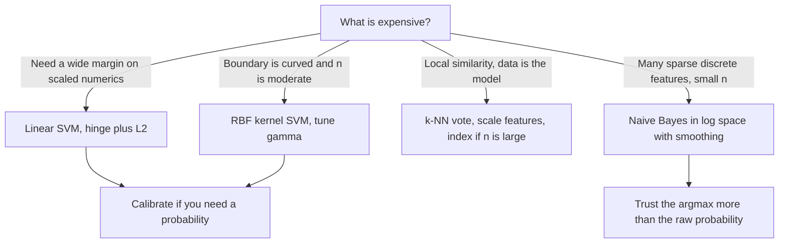

## Why this matters

These three classifiers answer "which class?" with three incompatible stories. A support vector machine looks for the widest street between classes and ignores points that already sit comfortably on the sidewalk. k-nearest neighbors refuses to summarize the data at all and votes among the closest training rows at prediction time. Naive Bayes writes a probability model, multiplies per-feature likelihoods, and is shockingly strong on text when the independence assumption is obviously false. Knowing which story you are in tells you whether to scale features, whether prediction will be slow, and whether the number you get back is a probability.

You should be able to implement a linear hinge-loss step, a brute-force k-NN vote, and a Bernoulli naive Bayes score from scratch. Libraries can fit the kernel SVM. The geometry and the likelihood have to be yours.

## Intuition

Picture two clusters on a plane. The SVM draws the boundary that maximizes the margin, the distance from the line to the nearest points, which are the support vectors. Points far from the boundary do not move it. A kernel SVM first maps the points into a space where a straight street exists, without writing that map down explicitly; the kernel is a similarity that corresponds to some dot product in that space.

k-NN draws no line. To classify a new point you measure distances, take the k closest training labels, and vote. With k = 1 the model memorizes. With large k it approaches the global majority. Every feature unit matters, because a feature in the thousands will dominate Euclidean distance.

Naive Bayes flips the question to "which class would more plausibly have generated these features?" It estimates P(class) and P(feature given class), assumes features are independent given the class so the joint is a product, and applies Bayes. For word indicators in email, the assumption is false — words are not independent — and the ranking is still useful because the errors are shared across classes and the argmax survives.

## Core concept in depth

### Linear SVM and the hinge

For labels y in −1 and +1 and score s = w · x + b, the hinge loss is max(0, 1 − y s). It is zero when the point is on the correct side with margin at least 1. The training objective is the mean hinge plus (λ/2) ‖w‖², or equivalently a hard constraint on the margin with slack variables for points that spill into the street. The subgradient with respect to w is −y x when the margin is violated and 0 when it is satisfied, plus the L2 term λ w. Only violators and points on the margin contribute. Those are the support vectors.

Do not pass 0/1 labels into a hinge. Map 0 to −1. Standardize features first, or the margin will be measured mostly along the largest-scale axis. A linear SVM and a logistic regression often draw similar boundaries. Logistic regression gives a smoother probability; the SVM gives a margin geometry and sparser dependence on the data. If you need calibrated probabilities from an SVM, fit a calibration map on a validation set. The raw distance to the plane is not a probability.

### Kernels, briefly and honestly

A kernel K(x, x′) is a similarity. The linear kernel is the ordinary dot product. A degree-2 polynomial kernel corresponds to all pairwise products of features without you materializing them. The RBF kernel exp(−γ ‖x − x′‖²) corresponds to an infinite-dimensional map and can draw curved boundaries. Prediction sums kernel evaluations against the support vectors, so cost grows with the number of support vectors, not only with the original dimension.

RBF SVMs have two sensitive knobs: the penalty on slack, and γ, which sets how fast similarity decays with distance. Large γ memorizes. Small γ underfits toward a smooth boundary. They also require scaling. On a dataset of tens of thousands of rows, a kernel SVM is often slower and no more accurate than a forest. Use it when the boundary is genuinely curved, n is moderate, and you have tuned γ on validation. Do not use it as a default on a million-row table.

### k-NN

Brute force computes distances to every training row, sorts, and votes. Ties need a rule: this course breaks distance ties by the smaller training index and vote ties by the smaller label, so tests are deterministic. Approximate indexes — ball trees, HNSW — trade exactness for speed when n is large and d is not enormous. In very high dimension, distances concentrate and the nearest neighbor is not meaningfully nearer than the farthest. That is the curse of dimensionality, and it is why k-NN on raw high-d embeddings sometimes disappoints until you reduce dimension or switch to cosine on normalized vectors.

Choose k on validation. Odd k avoids ties in binary problems but is not a substitute for a tie rule. Weighting votes by inverse distance helps when densities vary. A k-NN has essentially no training time and prediction time linear in the training set unless you build an index. It is a superb baseline and a poor serving model for a huge catalog unless the index is the product.

### Naive Bayes

For discrete features, estimate P(xⱼ = v given class) by counts, with Laplace smoothing so a zero count does not zero the whole product. Estimate P(class) by the class frequency. At prediction time add log probabilities; do not multiply them. The predicted class maximizes log prior plus the sum of log likelihoods. The normalized probability you get after a softmax of those scores is often poorly calibrated, because the independence assumption double-counts evidence. The argmax is the part that works. Bernoulli naive Bayes uses binary word indicators. Multinomial naive Bayes uses word counts and is the usual text baseline. Gaussian naive Bayes uses a per-feature, per-class mean and variance and is a reasonable baseline on small numeric tables.

Compare the score to logistic regression on the same bag of words. Logistic regression learns weights that downplay words which co-occur; naive Bayes cannot, because it has no parameter for "these two features are redundant." With very little data, the Bayes bias is a feature. With a lot of data, the logistic regression usually wins.

## Diagram / flowchart



### Dry-run table

Linear hinge, no bias. w = [0, 0], x = [1, 0], y = 1, so the score is 0 and the hinge is max(0, 1 − 1·0) = 1. A subgradient step with learning rate 0.1 and no L2 term adds learning rate · y · x.

| Step | Score y·(w·x) | Hinge | Update | w after |
| --- | --- | --- | --- | --- |
| Start | 0 | 1 | w := w + 0.1 · 1 · x | [0.1, 0] |
| After one step | 0.1 | 0.9 | still violated | would move again |

k-NN dry-run. Training points 0, 1, and 3 with labels 0, 0, and 1. Query 0.1 with k = 1 predicts 0. With k = 3 the votes are two zeros and one one, so the majority is 0.

Naive Bayes dry-run in logs, two binary features, Laplace add-one. Class 1 appears in two of three training rows.

| Quantity | Value |
| --- | --- |
| log prior class 1 | log(2/3) |
| A zero count without smoothing | would contribute log(0) and kill the class |
| Add-one on a binary feature | (count + 1) / (class count + 2) |

The smoothing row is the one that keeps a rare word from deleting a class. You will implement the numeric version in the code, not only the slogan.

## Code

```python
import math


def hinge_step(w: list[float], x: list[float], y: float, lr: float) -> list[float]:
    score = sum(wi * xi for wi, xi in zip(w, x))
    if y * score < 1.0:
        return [wi + lr * y * xi for wi, xi in zip(w, x)]
    return list(w)


def knn_predict(train_x: list[list[float]], train_y: list[int], query: list[float], k: int) -> int:
    def dist(a: list[float]) -> float:
        return math.sqrt(sum((p - q) ** 2 for p, q in zip(a, query)))

    ranked = sorted((dist(row), i, train_y[i]) for i, row in enumerate(train_x))
    votes: dict[int, int] = {}
    for _, _, label in ranked[:k]:
        votes[label] = votes.get(label, 0) + 1
    return sorted(votes.items(), key=lambda kv: (-kv[1], kv[0]))[0][0]


def nb_log_score(presence: list[int], class_count: int, feature_counts: list[int], n_classes_total: int, n_rows: int) -> float:
    """Bernoulli NB log score. feature_counts are positives among this class. Binary features, add-one."""
    log_prior = math.log(class_count / n_rows)
    score = log_prior
    for bit, count in zip(presence, feature_counts):
        p_on = (count + 1) / (class_count + 2)
        score += math.log(p_on if bit else 1.0 - p_on)
    return score


if __name__ == "__main__":
    print("hinge w", hinge_step([0.0, 0.0], [1.0, 0.0], 1.0, 0.1))
    print("knn", knn_predict([[0.0], [1.0], [3.0]], [0, 0, 1], [0.1], 1))
    # Class has 2 rows, feature 0 was on in both, feature 1 was on in neither. n_rows = 3.
    s = nb_log_score([1, 0], class_count=2, feature_counts=[2, 0], n_classes_total=2, n_rows=3)
    print("nb", round(s, 4))
```

The hinge step returns [0.1, 0.0]. k-NN with k = 1 returns label 0. The naive Bayes score is finite, which is the smoothing doing its job: feature 1 was never on, and the query has it off, so you add log of one minus a smoothed small probability rather than log of 1.

## Complexity analysis

| Model | Train | Predict | Memory |
| --- | --- | --- | --- |
| Linear SVM, T epochs, or a dual solver | Θ(T n d) SGD, or worse for a kernel | Θ(d), or Θ(support vectors · d) | Weights, or the support vectors |
| RBF SVM | Quadratic to cubic in n for a naive solver | Θ(support vectors · d) | Can approach storing the training set |
| Brute k-NN | Θ(1) | Θ(n d + n log n) to sort | The entire training set |
| Indexed k-NN | Build cost depends on the index | Sublinear in friendly dimensions | Index plus data |
| Bernoulli NB | Θ(n d) one pass | Θ(d) | One probability per feature per class |

k-NN's asymmetry — free train, expensive predict — is the opposite of a linear model. Serving constraints often rule it out even when the validation accuracy is excellent. Kernel SVMs share the "store a chunk of the training set" fate. Naive Bayes and linear SVMs store a vector per class and are the ones you can score in a tight loop.

The bias-variance reading: k = 1 is high variance, large k is high bias toward the majority. A hard-margin SVM is high variance on noisy labels because a single point can rotate the street; slack variables exist for that reason. Naive Bayes is high bias and low variance, which is why it wins in the tiny-data text regime.

## Tricks, tips and patterns

- Scale features before SVM or k-NN. Do not bother for a purely binary naive Bayes on indicators.
- Map labels to −1 and +1 for hinge loss. Keep 0 and 1 for naive Bayes and logistic regression.
- Smooth every naive Bayes count. Add in log space.
- Calibrate SVM scores and k-NN vote fractions before they leave the building as probabilities.
- Tune k, C, and γ on validation. Large γ and k = 1 are memorization.
- Prefer a linear model or a forest once n reaches hundreds of thousands, unless you have measured a kernel win.
- For text, start with multinomial or Bernoulli naive Bayes and logistic regression on the same bag of words. Keep the winner, not the tradition.
- Define tie breaks in k-NN or your tests will flake.

## Common mistakes and edge cases

- Euclidean k-NN on unscaled features, so the salary column decides every neighbor.
- Feeding 0/1 labels to a hinge and wondering why the geometry looks wrong.
- An RBF SVM with default γ on unscaled data. The distances are meaningless and γ is in the wrong unit.
- A zero count in naive Bayes with no smoothing, so an unseen word erases a class.
- Trusting naive Bayes probabilities as frequencies. Trust the ranking, then calibrate.
- k-NN without an index, scanning a million rows per request, and calling it a serving plan.
- Forgetting that high dimension flattens distances. Normalize and consider cosine, or reduce dimension first.
- Support vectors that include mislabeled points. Slack helps, and so does cleaning the labels.

## Interview notes

State the hinge and the role of support vectors. Mention kernels as similarities that hide a feature map, and mention that prediction cost tracks the number of support vectors.

Contrast k-NN's train/serve costs with a parametric model. Mention scaling and the curse of dimensionality in the same breath so it does not sound like a slogan.

Write the naive Bayes decision rule as a sum of log likelihoods plus a log prior, and say why smoothing exists. Then say the independence assumption hurts calibration more than it hurts argmax on bag-of-words.

A strong comparison question: when would logistic regression beat naive Bayes, and the reverse? Data size and feature redundancy are the axes. Logistic regression can down-weight correlated features. Naive Bayes cannot, and it needs less data to estimate its simpler parameters.

## Practice problems

1. [Mean Hinge Loss](/practice/ml-hinge) — the SVM objective on a batch, labels −1 and +1 (medium).
2. [k-NN Classify](/practice/ml-knn-classify) — distances, index ties, and vote ties (medium).
3. [Euclidean Distance](/practice/ml-euclidean) — the metric inside k-NN and RBF (easy).
4. Map a 0/1 label to −1/+1 and compute the hinge of a score of 0.2 for the positive class. It should be 0.8.
5. Smooth a feature that occurred 0 times in a class of 2 binary rows and confirm the on-probability is 1/4, not 0.

## Summary / cheat sheet

- A linear SVM minimizes hinge loss plus an L2 penalty. Only margin violators pull the weights. Labels are −1 and +1.
- Kernel SVMs draw curved boundaries. RBF γ and the slack penalty need validation. Prediction stores support vectors.
- k-NN votes among the nearest training rows. Scale features. Small k memorizes. Prediction cost tracks n unless you index.
- Distances concentrate in high dimension. Normalize or reduce before you trust a neighbor.
- Naive Bayes multiplies per-feature likelihoods and a prior, in log space, with smoothing. The argmax is more trustworthy than the probability.
- None of the three, except a calibrated model, should be treated as a raw risk without a check.
- On large tabular data a forest or a linear model is often the better engineering choice. On small text, naive Bayes is still a baseline you must beat.

## Further reading

- [scikit-learn SVM](https://scikit-learn.org/stable/modules/svm.html)
- [scikit-learn nearest neighbors](https://scikit-learn.org/stable/modules/neighbors.html)
- [scikit-learn naive Bayes](https://scikit-learn.org/stable/modules/naive_bayes.html)
- [Elements of Statistical Learning, Chapters 12 and 13](https://hastie.su.domains/ElemStatLearn/)
- [Stanford CS229 notes on generative vs discriminative classifiers](https://cs229.stanford.edu/notes2022fall/main_notes.pdf)
