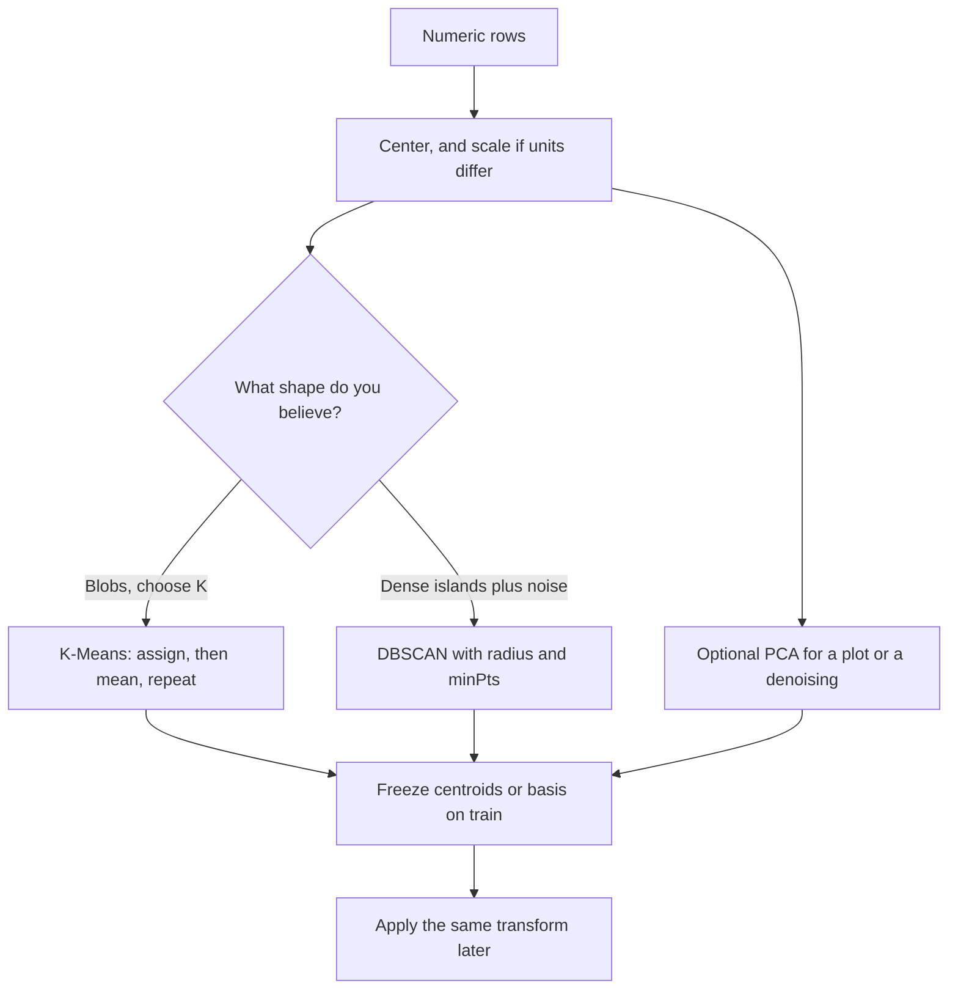

## Why this matters

Unsupervised structure is how you compress a feature space, find segments, and spot outliers before a supervised model exists. K-Means is the algorithm everyone implements and then misuses on non-spherical clusters. DBSCAN is the one that can say "this point is noise." PCA is the rotation that makes the leading axes carry the variance, and it is the linear special case of every autoencoder you will meet later. All three are also preprocessing: a cluster id as a feature, a density outlier filter, a PCA projection before k-NN.

This lesson implements K-Means assignment, a DBSCAN neighborhood check, and a two-dimensional PCA via the covariance eigen-direction you can compute on a tiny matrix. The geometry from the linear-algebra lesson is the whole of PCA. The new part is knowing when the geometry's assumptions are false.

## Intuition

K-Means believes clusters are blobs around centroids. You guess K centers, assign each point to the nearest center, recompute each center as the mean of its points, and repeat. The objective, within-cluster sum of squares, falls at every successful step and can stall in a bad local minimum. The algorithm will happily cut a crescent into two blobs. It will also put a lone outlier in its own cluster or drag a centroid toward it, depending on initialization.

DBSCAN believes clusters are regions where points have enough neighbors, chained together. A point with fewer than a minimum number of neighbors inside a radius is noise, unless it sits next to a dense point, in which case it is a border point. You do not choose K. You choose a distance and a density. Those two numbers are the model.

PCA believes the interesting part of the data is the directions in which it spreads. It subtracts the mean, finds the orthogonal directions of greatest variance, and lets you drop the rest. It does not find clusters. Two well-separated blobs can have a first component that merely points from one blob to the other, which is useful, or a first component dominated by a single high-variance noise feature, which is not, until you scale.

## Core concept in depth

### K-Means and its objective

The within-cluster sum of squares is Σᵢ ‖xᵢ − μ of cluster c(i)‖². Assignment puts each point on the closest centroid, which cannot raise the objective. The update sets each centroid to the mean of its assigned points, which is optimal for squared error and also cannot raise the objective. The loop converges to a local minimum. It does not converge to the global one. Restart from several initializations — k-means++ spreads the initial centers — and keep the lowest objective.

K is not a free parameter you read off a silhouette chart and forget. The elbow of the objective versus K often has no elbow. Choose K for the downstream use: four customer segments a team will actually treat differently, not fourteen because the curve twitched. Empty clusters happen when a centroid loses all its points. Reinitialize that centroid or reduce K. Because the metric is squared Euclidean, scale the features. A column with a huge range becomes the only dimension K-Means sees.

K-Means cannot represent different variances per cluster or elongated ellipses. A Gaussian mixture can, at the cost of a softer assignment and more parameters. If clusters are concentric rings, no amount of restarts will save K-Means. Change the algorithm.

### DBSCAN

Pick a radius ε and a minimum number of points minPts. A core point has at least minPts points inside ε, counting itself. Clusters grow by connecting core points that lie within ε of each other and by attaching border points that are within ε of a core point but are not themselves dense. Everything else is noise, often labeled −1. The same point can be border to two clusters in unlucky geometries; implementations assign it to the first cluster that claims it, so order can matter for border points. Core membership is the stable part.

ε in a standardized space is a density statement. ε in a raw space dominated by one feature is an accident. High dimension makes ε painful for the same reason k-NN suffers: distances concentrate, and a radius that works in two dimensions contains nobody or everybody in fifty. DBSCAN shines on spatial data and on low-d embeddings where "dense versus empty" is visually real. It struggles when clusters have different densities, because one ε cannot describe both. HDBSCAN is the hierarchical response; the idea to remember is "vary the density instead of pretending one radius fits."

### PCA

Center the columns. Optionally scale them to unit variance if the units differ; if you do not, the column with the largest variance wins the first component regardless of importance. The principal directions are the eigenvectors of the covariance matrix, ordered by eigenvalue. Equivalently, they are the right singular vectors of the centered data matrix. The eigenvalue divided by the sum of eigenvalues is the fraction of variance that component carries. Project a row onto the top k directions by a dot product with each.

PCA is a rotation plus a truncation. Distances are approximately preserved if the discarded eigenvalues are small, which is why PCA before k-NN sometimes helps and sometimes destroys the local structure you needed. PCA is not a classifier. Supervised dimension reduction such as linear discriminant analysis uses the labels; PCA ignores them, so a direction of tiny variance can be the direction that separates the classes. Do not feed a model only the top components without checking that the label still varies along them.

Reconstruction from k components is the original mean plus the projection expressed back in the input basis. The reconstruction error is the discarded variance. A sudden rise in reconstruction error on new data is a drift signal: the new points do not live in the subspace you kept.

### How the three work together

A practical unsupervised pass on a numeric table: scale, run PCA to see whether two components tell a story you can plot, run K-Means in the scaled space or in a PCA space if noise dimensions are obvious, and run DBSCAN if you expect outliers and non-convex shapes. Then stop and look. A cluster solution you cannot describe in a sentence will not change a product decision. Use the cluster id as a feature only after you have frozen the centroids or the PCA basis on the training period, and apply that frozen transform later. Refitting clusters on the test set is leakage of a sneaky kind: the test distribution helped define the categories.

## Diagram / flowchart



### Dry-run table

K-Means, one dimension, points 0, 1, and 10. Initial centroids 0 and 10.

| Step | Assignment | New centroids |
| --- | --- | --- |
| Start | centroids 0 and 10 | — |
| Assign | 0→0, 1→0 (closer to 0 than to 10), 10→10 | — |
| Update | cluster 0 mean is 0.5, cluster 1 mean is 10 | 0.5 and 10 |
| Assign again | 0 and 1 stay with 0.5, 10 stays with 10 | unchanged, stop |

PCA dry-run. Two centered points in 2D: (1, 0) and (−1, 0). The variance is entirely on the first axis. The first principal component is (1, 0) or (−1, 0), and the second eigenvalue is 0. Projecting onto the first component keeps all the information. This is the entire spectral story on a matrix you can see.

## Code

```python
import math


def euclidean(a: list[float], b: list[float]) -> float:
    return math.sqrt(sum((x - y) ** 2 for x, y in zip(a, b)))


def kmeans_assign(points: list[list[float]], centroids: list[list[float]]) -> list[int]:
    labels = []
    for p in points:
        best_i, best_d = 0, float("inf")
        for i, c in enumerate(centroids):
            d = euclidean(p, c)
            if d < best_d:
                best_d, best_i = d, i
        labels.append(best_i)
    return labels


def kmeans_update(points: list[list[float]], labels: list[int], k: int) -> list[list[float]]:
    dims = len(points[0])
    sums = [[0.0] * dims for _ in range(k)]
    counts = [0] * k
    for p, lab in zip(points, labels):
        counts[lab] += 1
        for j, value in enumerate(p):
            sums[lab][j] += value
    centroids = []
    for i in range(k):
        if counts[i] == 0:
            raise ValueError("empty cluster; reinitialize this centroid")
        centroids.append([s / counts[i] for s in sums[i]])
    return centroids


def dbscan_core(points: list[list[float]], index: int, eps: float, min_pts: int) -> bool:
    neighbors = sum(euclidean(points[index], other) <= eps for other in points)
    return neighbors >= min_pts


def pca_leading_from_cov(cov: list[list[float]], iters: int = 30) -> tuple[float, list[float]]:
    """Power iteration: top eigenpair of a symmetric  covariance."""
    n = len(cov)
    v = [1.0 / math.sqrt(n)] * n
    for _ in range(iters):
        w = [sum(cov[i][j] * v[j] for j in range(n)) for i in range(n)]
        norm = math.sqrt(sum(x * x for x in w))
        v = [x / norm for x in w]
    lam = sum(v[i] * sum(cov[i][j] * v[j] for j in range(n)) for i in range(n))
    return lam, v


if __name__ == "__main__":
    pts = [[0.0], [1.0], [10.0]]
    labels = kmeans_assign(pts, [[0.0], [10.0]])
    print("assign", labels)
    print("update", kmeans_update(pts, labels, 2))
    cloud = [[0.0, 0.0], [0.1, 0.0], [0.0, 0.1], [5.0, 5.0]]
    print("origin is core", dbscan_core(cloud, 0, eps=0.2, min_pts=3))
    print("far point is core", dbscan_core(cloud, 3, eps=0.2, min_pts=3))
    # Covariance of centered (1,0), (-1,0) is [[1, 0], [0, 0]] if we use the mean of squares with n = 2? 
    # Here we pass the matrix diag(1, 0) directly.
    lam, vec = pca_leading_from_cov([[1.0, 0.0], [0.0, 0.0]])
    print("lambda", round(lam, 4), "v", [round(c, 4) for c in vec])
```

Assignment prints [0, 0, 1] and the update prints centroids 0.5 and 10, matching the table. The origin in the little cloud has two neighbors within 0.2 plus itself, so it is a core point under minPts 3; the far point is not. Power iteration on diag(1, 0) recovers eigenvalue 1 and a vector concentrated on the first coordinate.

## Complexity analysis

| Algorithm | Time | Space | Scales badly when |
| --- | --- | --- | --- |
| K-Means, I iterations | Θ(I · n · K · d) | Θ(K d + n) | K and d are both large; restarts multiply the constant |
| DBSCAN, naive neighbor search | Θ(n² d) | Θ(n) | n is large; use a spatial index in low d |
| DBSCAN with an index | Near Θ(n log n) in low d | Index | Dimension is high and the index degrades |
| Covariance PCA, n by d, d small | Θ(n d² + d³) | Θ(d²) | d is in the thousands; use a randomized or incremental SVD |
| Power iteration, k steps | Θ(k d²) on the covariance | Θ(d) | You need more than the top component; deflate or call a full solver |

The trade-off between K-Means and DBSCAN is not accuracy on a leaderboard. K-Means needs K and prefers blobs, and it is easy to serve: store K vectors. DBSCAN needs a density and produces noise labels, and serving a new point means a neighbor query against the training set or a frozen approximation. PCA serving is a matrix multiply by the stored components plus the stored mean, which is the cheapest of the three to apply and the easiest to get wrong if you forget to subtract the training mean.

Randomized SVD and streaming covariance estimates exist for data that does not fit in memory. The definition of the component does not change. The numerical method does.

## Tricks, tips and patterns

- Scale before K-Means, DBSCAN, and PCA when units differ. PCA without scaling is a statement that raw variance is importance.
- Restart K-Means. Keep the lowest within-cluster sum of squares. Use k-means++ if the library offers it.
- Do not hunt for a mythical elbow. Pick K the product can use, then check stability.
- For DBSCAN, set ε from a k-distance plot: the distance to the minPts-neighbor, sorted, often shows a knee. It is a heuristic, not a theorem.
- Treat noise labels as a feature, not as rows to silently delete, until you know they are glitches.
- Freeze centroids and PCA bases on the training period. Apply them. Do not refit on the test week.
- Check that class separation survives a PCA truncation before you drop components used by a downstream classifier.
- Plot two components. If the picture is a single blob, say so. Not every table has segments.

## Common mistakes and edge cases

- K-Means on a ring, a crescent, or two concentric circles. The objective will look finite and the segments will be nonsense.
- Forgetting to center before PCA, so the first component points at the mean.
- Interpreting principal components as latent causes. They are orthogonal variance directions.
- One ε for clusters of very different density. DBSCAN will call the sparse cluster noise.
- An empty K-Means cluster left as a NaN centroid that poisons the next assignment.
- Distance ties assigned nondeterministically, so two runs differ. Break ties toward the smaller index.
- Using PCA as a filter for "the features that predict y." It never looked at y.
- Serving a PCA model without the training mean, or with a component matrix transposed.

## Interview notes

Walk one K-Means iteration on three points. State the objective and that the algorithm is coordinate descent on it, hence local minima and restarts.

Contrast DBSCAN: density, noise points, no K, sensitive ε, poor behavior under varying density and high dimension.

Define the first principal component as the unit direction of maximum variance of the centered data, and the second as the same inside the orthogonal complement. Mention the equivalence to the top eigenvector of the covariance and to the SVD. Mention scaling.

A good applied question: how do you put a new user into a segment next week? Answer with frozen centroids, not with "we recluster every night and hope the ids mean the same thing." If you recluster, you need a matching step between old and new labels.

## Practice problems

1. [K-Means Assignment](/practice/ml-kmeans-assign) — nearest centroid, smaller index wins ties (medium).
2. [Euclidean Distance](/practice/ml-euclidean) — the metric inside both clustering methods (easy).
3. [Z-Score Standardization](/practice/ml-zscore) — do this before you trust a centroid or a radius (easy).
4. Run the dry-run update by hand and confirm centroids 0.5 and 10.
5. Build the covariance of the centered points (1, 0) and (−1, 0) and name the leading direction without a solver.

## Summary / cheat sheet

- K-Means alternates nearest-centroid assignment and mean updates. It minimizes within-cluster sum of squares locally. Blobs only. Scale features. Restart.
- DBSCAN grows clusters from dense cores defined by ε and minPts, and it can label noise. One radius cannot describe unequal densities.
- PCA rotates centered data onto orthogonal directions of greatest variance. Scale if units differ. It ignores labels.
- Variance explained is the eigenvalue share. Reconstruction error on new data is a drift check.
- Freeze the transform on the training period before you use cluster ids or components as features.
- High dimension hurts distance-based clustering. Reduce, or do not pretend ε still means what it meant in a scatter plot.
- An unsupervised picture you cannot describe will not change a decision. Stop when you can say what the segment is.

## Further reading

- [scikit-learn clustering](https://scikit-learn.org/stable/modules/clustering.html)
- [scikit-learn PCA](https://scikit-learn.org/stable/modules/decomposition.html#pca)
- [Elements of Statistical Learning, Chapter 14](https://hastie.su.domains/ElemStatLearn/)
- [Deep Learning Book, Chapter 2 — eigendecomposition and PCA](https://www.deeplearningbook.org/contents/linear_algebra.html)
- [Ester et al., DBSCAN](https://www.aaai.org/Papers/KDD/1996/KDD96-037.pdf)
