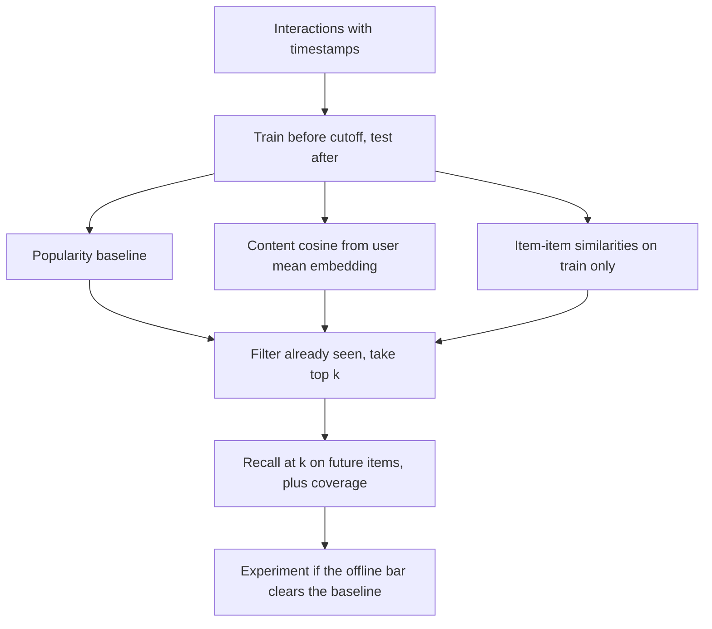

## Why this matters

A recommender is a ranker with a user in the context. It decides which handful of items to show, out of a catalog the user will never scroll through. The classical toolbox — popularity, content similarity, neighborhood collaborative filtering, and matrix factorization — still sits underneath industrial systems that also use neural retrieval. If you cannot build the baselines and explain their biases, a two-tower network is a costume on the same mistakes: leakage from the future, optimizing a click that is not satisfaction, and evaluating on random negatives the user was never going to see.

This lesson implements a popularity baseline, a cosine content match, and a tiny item-item collaborative score. It then spends as much time on splitting and metrics as on the algebra, because that is where recommenders fail review.

## Intuition

There are two sources of signal. Content signal says the item and the user share features: the same author, a similar embedding, a genre the user just consumed. Collaborative signal says nothing about features and everything about co-consumption: people who agreed with you in the past will agree again, so an item loved by your neighbors is a good bet even if you cannot describe it. Popularity is the prior. Most users like a few global hits, and any model that cannot beat "show the hits, filtered by what they already consumed" is not ready.

Matrix factorization writes each user and each item as a vector of latent factors. The predicted affinity is a dot product, the same geometry as the first lesson in this course. Missing entries are the problem: you observe a tiny fraction of user-item pairs, and the missing ones are not a random sample of zeros. People skip things they expect to hate, and they never see most of the catalog. Treating missing as zero trains a model of exposure as much as a model of taste.

## Core concept in depth

### Baselines you must beat

Global popularity ranks items by recent interaction count, with a time decay so last year's hit does not dominate. User-mean and item-mean baselines matter for explicit ratings: predicting "this user's average plus this item's bias" is a serious rating baseline and a weak ranking baseline, because it does not personalize the order beyond a bias. Always filter items the user already consumed if the product is discovery, and do not filter them if the product is repurchase. That one line changes the task.

A content-based score embeds the user as the average of embeddings of items they consumed, then ranks catalog items by cosine similarity to that average. It works in the cold start for items, as long as the new item has features, and it fails when taste is not in the features you have. It also creates a filter bubble: you recommend more of what the user just did, which is sometimes the product and sometimes a trap.

### Neighborhood collaborative filtering

User-user CF finds users with similar histories and recommends what they liked that you have not seen. Item-item CF finds items similar in who consumed them and recommends items similar to the ones you liked. Item-item is usually more stable, because item similarities change more slowly than a single user's neighborhood, and it is easier to precompute. Similarity is cosine on the user-item interaction vector, often with a discount for popular items so that everyone-watched-this-hit does not look like a personalized similarity. A simple discount is to weight an interaction by inverse document frequency: rare co-consumption is more informative than co-consumption of a global hit.

Neighborhood methods are transductive in spirit. Adding a user changes nothing about item-item similarities until that user's interactions enter the item vectors. They are a strong baseline and a bad fit for a catalog of millions unless you truncate similarities to the top neighbors and retrieve with an index.

### Matrix factorization

Learn a user vector p_u and an item vector q_i to minimize a loss on observed pairs, plus L2 penalties on the vectors. For implicit feedback — clicks, watches, not ratings — the loss is usually a weighted squared error on confidence-weighted 0/1 targets, or a pairwise ranking loss that says the observed item should outscore a sampled unobserved item. Alternating least squares solves one side holding the other fixed. Stochastic gradient descent updates both from sampled pairs. The predicted score is p_u · q_i plus biases.

Latent dimensions are not genres, even if a careful rotation sometimes looks like one. Do not narrate factor 7 as "romance" unless you have evidence. Cold-start users have no p_u. Fall back to popularity or content until you have a handful of interactions, or maintain a warm-start that initializes p_u from the average of consumed item vectors and then fine-tunes.

### Evaluation that matches the UI

Split by time. Train on interactions before a cutoff, test on interactions after it, per user. A random split of interactions lets the model see a user's future and then "predict" their past neighbors. That number is not a product metric.

Rank the full candidate set the UI would rank, or a hard negative set drawn from items the user might have been shown, not from random obscure items that any popularity baseline rejects. Report recall-at-k and precision-at-k for the k you show. A hit-rate at 10 with a catalog of 50 random negatives is a different, easier problem. Coverage and novelty matter if the whole catalog collapses onto the top 20 items; a model can have excellent recall-at-10 and still show the same 10 items to everyone. Measure the concentration.

Do not optimize a proxy you do not want. Click-through rewards clickbait. A dwell or a return visit is harder to attribute and closer to value. Offline metrics select candidates. An online experiment decides. The bandit and off-policy caveats from the paradigms lesson apply the moment the logger only recorded clicks on items the old ranker showed.

### Two-tower retrieval, as a bridge

Modern retrieval encodes the user and the item separately and finds nearest items by dot product in an approximate index. Training often uses in-batch negatives. That architecture is matrix factorization with a neural encoder of side features, plus a retrieval constraint. The split, the leakage, and the metric questions do not change. If you cannot debug a factorization baseline, you cannot debug a tower.

## Diagram / flowchart



### Dry-run table

Three users, four items, implicit interactions marked as 1. Item-item cosine uses binary vectors across users. Then score item D for user 1, who has consumed A.

|  | A | B | C | D |
| --- | --- | --- | --- | --- |
| u1 | 1 | 0 | 0 | 0 |
| u2 | 1 | 1 | 0 | 1 |
| u3 | 0 | 1 | 1 | 0 |

| Pair | Dot | Norms | Cosine |
| --- | --- | --- | --- |
| A and B | 1 (only u2) | √2 and √2 | 0.5 |
| A and D | 1 (only u2) | √2 and 1 | 1/√2 ≈ 0.707 |
| A and C | 0 | — | 0 |

User 1's only history is A, so the item-item score for D is the cosine of A and D, about 0.707, and for C is 0. Popularity ranks B and A above D. A personalized list that cannot beat popularity on a larger test is not yet personalized. On this toy, D is a reasonable suggestion precisely because the only other person who touched A also touched D.

## Code

```python
import math


def cosine(a: list[float], b: list[float]) -> float:
    dot = sum(x * y for x, y in zip(a, b))
    na = math.sqrt(sum(x * x for x in a))
    nb = math.sqrt(sum(y * y for y in b))
    if na == 0 or nb == 0:
        return 0.0
    return dot / (na * nb)


def item_vectors(interactions: list[list[int]]) -> list[list[float]]:
    """interactions[user][item] -> column vectors, one per item."""
    n_users = len(interactions)
    n_items = len(interactions[0])
    cols = []
    for j in range(n_items):
        cols.append([float(interactions[u][j]) for u in range(n_users)])
    return cols


def item_item_scores(history: list[int], items: list[list[float]]) -> list[float]:
    """Score each item by mean cosine to items in the user's history. Seen items become -1."""
    liked = [j for j, flag in enumerate(history) if flag]
    scores = []
    for j, col in enumerate(items):
        if history[j]:
            scores.append(-1.0)
            continue
        if not liked:
            scores.append(0.0)
            continue
        sims = [cosine(items[i], col) for i in liked]
        scores.append(sum(sims) / len(sims))
    return scores


def recall_at_k(recommended: list[int], relevant: list[int], k: int) -> float:
    if not relevant:
        return 0.0
    top = set(recommended[:k])
    hits = sum(1 for item in relevant if item in top)
    return hits / len(relevant)


if __name__ == "__main__":
    interactions = [
        [1, 0, 0, 0],
        [1, 1, 0, 1],
        [0, 1, 1, 0],
    ]
    items = item_vectors(interactions)
    print("cos A,D", round(cosine(items[0], items[3]), 3))
    print("scores for u1", [round(s, 3) for s in item_item_scores(interactions[0], items)])
    print("recall", recall_at_k([3, 1, 2], [3], k=2))
```

Cosine of A and D prints about 0.707. User 1's scores mark A as already seen (−1) and rank D above B and C. Recall-at-2 is 1.0 when the single relevant item sits inside the top two. That recall is a unit test of the metric, not a claim about a product. On a real catalog you must also publish the denominator and the candidate policy.

## Complexity analysis

| Approach | Train or build | Query | Cold start |
| --- | --- | --- | --- |
| Popularity | Θ(interactions) counts | Θ(k) after a sorted list | Excellent for new users, blind to taste |
| Content cosine | Embed items, Θ(catalog) | Θ(catalog · d) naive, or an ANN index | New items work if they have features; new users need some history or a questionnaire |
| Item-item CF | Θ(items² · users) naive | Θ(history · neighbors) | New items have empty columns and no neighbors |
| Matrix factorization | Many passes over observed pairs | Θ(d) dot product, plus retrieval | New ids need a fallback until they accumulate events |
| Two-tower retrieval | Neural training | ANN search, sublinear | Side features can warm-start both sides |

Naive item-item is quadratic in the catalog and is the reason you only materialize the top neighbors per item. Approximate nearest neighbor search is the same idea as the k-NN index from the previous lesson, applied to item vectors. The trade-off is recall of the neighbor list versus latency. A retrieval stage that misses the right item cannot be saved by a perfect re-ranker later. Measure both stages.

Popularity is O(1) to serve from a cache and is the baseline latency as well as the baseline quality. Any personalized system that misses its latency budget will be turned off, and the popularity list will be what users actually see.

## Tricks, tips and patterns

- Beat time-decayed popularity on a time split before you add collaborative signal.
- Filter or keep already-seen items according to the product, and do it the same way in training negatives and in evaluation.
- Discount popular items inside similarities or you will rediscover popularity and call it personalization.
- Sample negatives from the exposure distribution when you can. Random catalog negatives are too easy.
- Report recall-at-k and a concentration statistic. A model that shows the same ten items to everyone has a hidden cost.
- Cold-start is a branch, not an exception. Write the fallback.
- Freeze similarities and factors on the training period when you evaluate. Rebuilding them on the full log, then scoring the past, leaks.
- Online, decide what you will not optimize. Clicks are not satisfaction by default.

## Common mistakes and edge cases

- A random interaction split that lets future clicks train the past.
- Evaluating with 50 random negatives and announcing a hit rate that will not survive the real candidate set.
- Treating missing entries as true zeros without a confidence weight, then interpreting the model as a rating predictor.
- Recommending the item the user just consumed, because you forgot the filter, and calling the offline hit a success.
- Item-item cosine dominated by a hit that everyone touched. Every item looks similar to the hit.
- Narrating latent factors as human genres without a check.
- A new user with an empty history receiving a NaN from a mean of no vectors. The code in this lesson returns zeros; your service should return popularity.
- Optimizing offline recall and shipping a clickbait regression in the re-ranker that undoes it.

## Interview notes

Start from the popularity baseline and the time split. Interviewers use this to see whether you evaluate recommenders as classifiers on shuffled rows. You should not.

Explain item-item versus user-user in one sentence each, and say why item similarities are the ones you precompute. Mention the popularity bias in cosine and a fix (idf weighting or a shrink toward zero).

Write the factorization score as a dot product plus biases. Mention implicit versus explicit feedback. Mention cold start.

Define recall-at-k with the candidate set stated out loud. If you say "hit rate" without saying what the model was allowed to rank over, the interviewer should not trust the number, and neither should you.

## Practice problems

1. [Cosine Similarity](/practice/ml-cosine) — content match and item-item similarity (easy).
2. [Dot Product](/practice/ml-dot) — the matrix-factorization score (easy).
3. [k-NN Classify](/practice/ml-knn-classify) — the same neighbor idea, pointed at users or items (medium).
4. Recompute cosine of item A and item D from the dry-run by hand.
5. Change the metric code path: if the relevant item is at rank 5, what is recall-at-2, and why can that still be the right business outcome if you only show two items?

## Summary / cheat sheet

- Beat time-decayed popularity on a time-based split. Filter already-seen items consistently with the product.
- Content models average item features and match by cosine. They cold-start items and bubble the user.
- Item-item CF scores candidates by similarity to the user's history. Discount global hits. Precompute top neighbors.
- Matrix factorization predicts a dot product of latent vectors. Missing is not a random zero. Implicit feedback needs a weighting or a pairwise loss.
- Evaluate recall-at-k on the candidate set you will actually rank. Report concentration, not only hit rate.
- Cold-start is a fallback branch. Empty histories return popularity, not a NaN.
- Two-tower retrieval is factorization plus feature encoders plus an approximate index. The leakage rules do not get easier.

## Further reading

- [Recommender Systems Handbook, survey chapter via the GroupLens notes](https://grouplens.org/blog/recommender-systems-handbook/)
- [Hu, Koren, Volinsky — Collaborative Filtering for Implicit Feedback](https://ieeexplore.ieee.org/document/4781121)
- [scikit-learn cosine similarity and neighborhood methods](https://scikit-learn.org/stable/modules/neighbors.html)
- [Rendle et al., Neural Collaborative Filtering vs. Matrix Factorization Revisited](https://arxiv.org/abs/2005.09683)
- [Google Rules of ML — when the product is a ranking](https://developers.google.com/machine-learning/guides/rules-of-ml)
