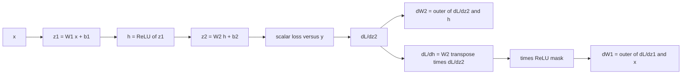

## Why this matters

A neural network is a composition of linear maps and elementwise nonlinearities. Without the nonlinearities it collapses into one linear map, which you already know how to fit. With them, depth builds hierarchical features: edges into parts into objects, characters into words into sentences. Backpropagation is how you compute the gradient of a scalar loss with respect to every weight without writing a separate derivative for the whole composition. It is the chain rule, cached from the forward pass, applied backward. Every framework you will use is a fast implementation of this lesson plus a memory manager.

If you can hand-derive a two-layer network on a single row, you can debug a silent shape error, a dead ReLU, and a loss that does not depend on a parameter. This lesson does that derivation and implements it in pure Python.

## Intuition

Think of the forward pass as an assembly line. The input vector is multiplied by the first weight matrix, shifted by a bias, and bent by an activation. That hidden vector is multiplied by the second matrix and bent into a prediction. The loss compares the prediction to the target and produces a single number. To train, you ask how the loss would change if each number on the assembly line were a tiny bit larger. Starting from the loss, you walk backward. At each station the local derivative turns an upstream sensitivity into a downstream one, and into a gradient for that station's weights. Nothing in the backward pass requires the whole formula at once. That locality is why automatic differentiation works on arbitrary graphs.

Activations are the bends. A sigmoid bends and then flattens, so a unit that saturates stops sending gradient. A ReLU is a hinge: the negative side is zero and sends no gradient, the positive side is the identity and sends gradient unchanged. A network of pure linear maps cannot bend, so it cannot solve XOR. One hidden layer with a nonlinearity can.

## Core concept in depth

### The computation

For one example, with input x, hidden width h, and a scalar output:

z₁ = W₁ x + b₁
h = φ(z₁)
z₂ = W₂ h + b₂
ŷ = z₂   (regression) or σ(z₂) (binary classification)

φ is the elementwise activation. The loss L is half a square for regression or binary cross-entropy for classification. W₁ is h by d, W₂ is 1 by h. Parameter count is h·d + h + h + 1, the last two being biases. A deep stack repeats the hidden step. Width and depth are the capacity knobs from the bias-variance lesson, now with a concrete function class.

### Activations you should know cold

Sigmoid σ(z) = 1 / (1 + e^(−z)) has derivative σ(z)(1 − σ(z)), which is at most 1/4 and near 0 when the unit saturates. Use it at the output when you need a probability. Avoid it as a hidden activation in a deep stack.

Tanh is a scaled and shifted sigmoid, zero-centered, with derivative 1 − tanh²(z). It saturates too, a little more gently for zero-mean inputs.

ReLU φ(z) = max(0, z) has derivative 1 for z > 0 and 0 for z < 0. At 0, either subgradient is fine. ReLU is cheap and usually works. Its failure mode is the dead unit: if a unit's pre-activation is negative for every example, the gradient stays zero and the unit never recovers. Leaky ReLU gives the negative side a small slope such as 0.01 so the unit can crawl back. GELU and Swish are smooth cousins used in transformers; they are not magic, they are smooth hinges with a bit of curvature near zero.

Softmax is the multiclass output activation. It is not usually used as a hidden activation. Its Jacobian times an upstream gradient simplifies dramatically when the loss is cross-entropy: the incoming gradient with respect to the logits is predicted probability minus target. Implement that fused form.

### Backprop through one hidden layer

Take regression, ŷ = z₂, L = 0.5 (ŷ − y)². Then ∂L/∂z₂ = ŷ − y. Because z₂ = W₂ h + b₂,

∂L/∂W₂ = (∂L/∂z₂) hᵀ
∂L/∂b₂ = ∂L/∂z₂
∂L/∂h = W₂ᵀ (∂L/∂z₂)

Through the activation, ∂L/∂z₁ = (∂L/∂h) ⊙ φ′(z₁), where ⊙ is elementwise. Then

∂L/∂W₁ = (∂L/∂z₁) xᵀ
∂L/∂b₁ = ∂L/∂z₁

That is the entire algorithm. For a minibatch, average or sum the outer products over rows. For logistic output, ∂L/∂z₂ = ŷ − y still holds when L is binary cross-entropy and ŷ is a sigmoid, which is the cancellation you already proved. For a deeper net you repeat: pull the hidden gradient back through the next Wᵀ, multiply by the local activation derivative, and form the outer product with whatever entered that layer.

### Initialization and the scale of the forward pass

If weights are too large, pre-activations explode and sigmoid units saturate, or ReLU outputs become huge. If they are too small, signal vanishes in a deep stack. Xavier initialization draws weights with variance 2 / (fan_in + fan_out) and suits tanh. He initialization uses variance 2 / fan_in and suits ReLU, compensating for the half of units that are zero. Biases often start at zero. Initialization is not a regularizer. It is a way to make the first forward pass have a sane scale so the gradient is informative.

### XOR, the existence proof

The four XOR points are not linearly separable. A hidden layer of two ReLUs can place the two positive points on one side of a second linear boundary and the two negative points on the other. You do not need a large network to leave the linear regime. You need one bend. Conversely, a very wide network with no activation, or with an activation that is itself linear, is still linear. Check that a bug which replaces ReLU with the identity does not "still train": on XOR it must fail.

## Diagram / flowchart



### Dry-run table

Scalar hidden layer, so every "matrix" is a number. x = 1, y = 1, W₁ = 0.5, b₁ = 0, W₂ = 1, b₂ = 0, ReLU, half-square loss. Forward: z₁ = 0.5, h = 0.5, ŷ = 0.5, residual ŷ − y = −0.5, loss = 0.125.

| Quantity | Value | Reason |
| --- | --- | --- |
| ∂L/∂z₂ | −0.5 | residual |
| ∂L/∂W₂ | −0.5 · 0.5 = −0.25 | residual times h |
| ∂L/∂h | 1 · (−0.5) = −0.5 | W₂ times residual |
| ReLU mask | 1 | z₁ > 0 |
| ∂L/∂z₁ | −0.5 | mask times ∂L/∂h |
| ∂L/∂W₁ | −0.5 · 1 = −0.5 | times x |

A learning rate of 0.1 would add 0.025 to W₂ and 0.05 to W₁, moving the prediction upward toward the label. If z₁ had been negative, the mask would be 0 and W₁ would not move. That is a dead ReLU on this example.

## Code

```python
import math


def relu(z: float) -> float:
    return z if z > 0 else 0.0


def relu_grad(z: float) -> float:
    return 1.0 if z > 0 else 0.0


def forward(x: float, w1: float, b1: float, w2: float, b2: float) -> dict[str, float]:
    z1 = w1 * x + b1
    h = relu(z1)
    yhat = w2 * h + b2
    return {"z1": z1, "h": h, "yhat": yhat}


def backward(x: float, y: float, w2: float, cache: dict[str, float]) -> dict[str, float]:
    residual = cache["yhat"] - y
    d_w2 = residual * cache["h"]
    d_b2 = residual
    d_h = w2 * residual
    d_z1 = d_h * relu_grad(cache["z1"])
    d_w1 = d_z1 * x
    d_b1 = d_z1
    loss = 0.5 * residual * residual
    return {"loss": loss, "d_w1": d_w1, "d_b1": d_b1, "d_w2": d_w2, "d_b2": d_b2}


def train_step(x: float, y: float, params: dict[str, float], lr: float) -> dict[str, float]:
    cache = forward(x, params["w1"], params["b1"], params["w2"], params["b2"])
    grads = backward(x, y, params["w2"], cache)
    return {
        "w1": params["w1"] - lr * grads["d_w1"],
        "b1": params["b1"] - lr * grads["d_b1"],
        "w2": params["w2"] - lr * grads["d_w2"],
        "b2": params["b2"] - lr * grads["d_b2"],
        "loss": grads["loss"],
    }


if __name__ == "__main__":
    params = {"w1": 0.5, "b1": 0.0, "w2": 1.0, "b2": 0.0}
    grads = backward(1.0, 1.0, params["w2"], forward(1.0, 0.5, 0.0, 1.0, 0.0))
    print({k: round(v, 4) for k, v in grads.items()})
    nxt = train_step(1.0, 1.0, params, lr=0.1)
    print("w1", round(nxt["w1"], 4), "w2", round(nxt["w2"], 4), "loss", round(nxt["loss"], 4))
```

The printed gradients match the table: loss 0.125, d_w1 −0.5, d_w2 −0.25. After the step, w1 is 0.55 and w2 is 1.025. Extend the same cache-and-multiply pattern to vectors by replacing products of scalars with outer products and elementwise masks. Do not invent a new algorithm for the vector case. It is the same chain rule.

## Complexity analysis

| Stage | Time | Memory | Bottleneck |
| --- | --- | --- | --- |
| Forward, one layer, batch B, d to h | Θ(B d h) | Activations Θ(B h) must be kept for the backward | GEMM |
| Backward, same layer | Θ(B d h) | Gradients of the weights Θ(d h) | Another GEMM, plus the mask |
| Full network, L layers | Sum of per-layer GEMMs | Sum of stored activations | Deep nets are memory-heavy because activations are stored |
| Finite-difference check of P parameters | Θ(P) forwards | Tiny | Debug only |

Training stores activations for every layer in the backward pass. That is why batch size hits GPU memory before it hits arithmetic throughput. Checkpointing trades compute for memory by recomputing some activations during the backward pass. Inference can discard activations as it goes and needs far less memory.

The width-depth trade-off is both statistical and computational. A wider layer is a bigger GEMM and more parameters. A deeper stack is more sequential and harder to parallelize, with more chances for the gradient product to vanish or explode. Residual connections, covered with architectures later, add a skip so the gradient has a path whose derivative is 1.

## Tricks, tips and patterns

- Cache the forward pre-activations. The backward mask depends on them, not only on the post-activation.
- Fuse softmax and cross-entropy. Do not backprop through a hand-written Jacobian unless you are learning.
- Initialize ReLU layers with He variance and tanh layers with Xavier. Start biases at 0, except sometimes a small positive bias on ReLU to reduce early dead units.
- Gradcheck a new layer on random tiny tensors before a long run. Central differences, relative tolerance.
- Watch the fraction of ReLU units that are dead on a batch. If it is near 100 percent, the learning rate or the initialization is wrong.
- Mean-center and scale inputs. The first linear map should not spend its capacity undoing a ridiculous feature range.
- Log the gradient norm. A sudden spike is an exploding product; a flat zero is a dead path.
- Shape-print W, x, h, and the gradient of W on one batch. The gradient of W has the same shape as W.

## Common mistakes and edge cases

- A network with no nonlinearity, proudly deep, secretly linear.
- Using sigmoid hidden units in a ten-layer stack and blaming the optimizer for a loss that barely moves.
- Backpropping through ReLU using the mask of the wrong tensor, so the gradient flows on the negative side.
- Forgetting to average the batch and then copying a learning rate from a paper that did average. The scale is wrong by a factor of B.
- Updating weights during the backward walk before the upstream gradient has been computed, so the next layer sees the new weights. Compute all gradients, then step.
- Dead ReLUs from a huge learning rate that kicks every pre-activation negative in one step.
- Softmax of extreme logits overflowing. Subtract the max.
- A bias gradient that is not reduced across the batch, so its shape is (B, h) and the add fails, or worse, broadcasts.

## Interview notes

Derive ∂L/∂W = (upstream) (input)ᵀ for a linear layer on the board. Then put a ReLU in front of it and multiply by the mask. If you can do that, you have backprop.

State the logistic cancellation: gradient with respect to the logit is prediction minus label. Mention why deep sigmoids vanish: the product of many factors each at most 1/4.

Explain a dead ReLU and one mitigation: leaky ReLU, a smaller learning rate, or He initialization. Explain why initialization variance depends on fan-in.

XOR is the standard "why nonlinear" question. Answer with linear separability, not with a product diagram you cannot finish. One hidden layer is enough for XOR. It is not enough for every function at a reasonable width, but universal-approximation theorems say a wide enough one-hidden-layer net can approximate continuous functions on a compact set. The theorem does not say you can train it with the data you have.

## Practice problems

1. [Stable Sigmoid](/practice/ml-sigmoid) — output activation and the derivative you already know (easy).
2. [One Linear Regression Step](/practice/ml-linreg-step) — the outer-product update without a hidden layer (medium).
3. [Softmax](/practice/ml-softmax) — multiclass output, before the fused cross-entropy gradient (medium).
4. Recompute the dry-run with z₁ forced negative (set W₁ = −0.5) and confirm d_w1 is 0.
5. Gradcheck relu_grad away from zero with a central difference. At exactly zero, note the subgradient choice.

## Summary / cheat sheet

- A layer is a linear map, a bias, and an elementwise nonlinearity. Stacking linear maps without a nonlinearity is still linear.
- Backprop applies the chain rule backward, using cached forward values. Weight gradients are outer products.
- Sigmoid derivatives vanish in the tails. ReLU passes gradient only on the positive side and can die.
- For sigmoid plus binary cross-entropy, and for softmax plus cross-entropy, the logit gradient is prediction minus target.
- He initialization suits ReLU. Xavier suits tanh. Both exist so the forward scale stays sane.
- Store activations to go backward. That memory, not the parameter count, often limits the batch.
- Gradcheck new code. Watch dead units and gradient norms. Then step the weights, after the full backward, not during it.

## Further reading

- [Deep Learning Book, Chapter 6 — feedforward networks](https://www.deeplearningbook.org/contents/mlp.html)
- [Stanford CS231n backpropagation notes](https://cs231n.github.io/optimization-2/)
- [3Blue1Brown — neural networks](https://www.3blue1brown.com/topics/neural-networks)
- [PyTorch autograd tutorial](https://pytorch.org/tutorials/beginner/blitz/autograd_tutorial.html)
- [He et al., Delving Deep into Rectifiers](https://arxiv.org/abs/1502.01852)
