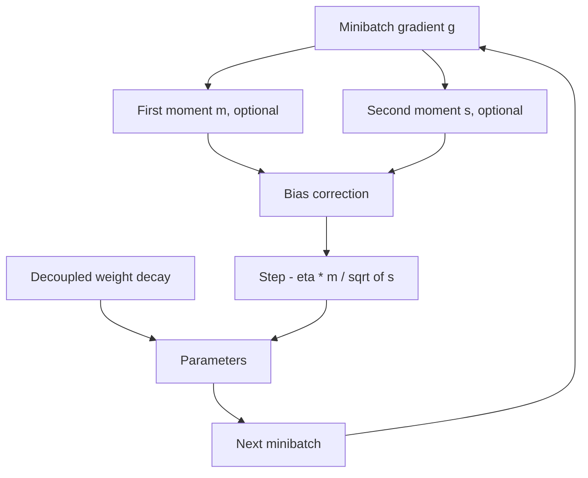

## Why this matters

Backprop hands you a gradient. An optimizer decides what to add to the weights. The wrong decision diverges in one step, crawls for a week, or converges to a sharp minimum that generalizes badly. SGD with momentum and Adam cover almost every training run you will launch. Learning-rate schedules, weight decay, gradient clipping, and batch size are not side quests; they are part of the optimizer. This lesson implements SGD, momentum, and Adam on a convex quadratic you can solve by hand, so the moving averages are not a black box, and then translates the same knobs to a deep net where the loss is not convex.

## Intuition

The gradient points uphill. Steepest descent steps downhill by a fixed fraction of that vector. If the bowl is a long thin valley, the gradient is huge across the valley and tiny along it, so a fixed step size zigzags and barely makes progress down the valley. Momentum keeps a velocity. Repeated small pushes along the valley add up, and the zigzags cancel because they reverse. Adam keeps a separate step size per coordinate, large where gradients have been small and noisy, small where they have been large. It is momentum plus a normalized scale. It often reaches a good training loss faster and is not automatically the best generalization choice. On some vision problems, carefully tuned SGD with momentum still generalizes better. Treat Adam as the strong default for transformers and as a hypothesis for everything else.

## Core concept in depth

### Batch, minibatch, and noise

The full gradient is the average of per-example gradients. Batch gradient descent uses all of them and is deterministic given the data. Stochastic gradient descent uses one example or a minibatch. The estimate is unbiased if the minibatch is a random sample, and its variance falls as the batch grows. A noisy gradient is not only a disadvantage. The noise helps leave sharp saddles and can act as a regularizer. Very large batches need a larger learning rate and often generalize slightly worse unless you compensate. Very small batches make the gradient too noisy to follow and underuse the GPU, which wants large dense multiplies.

Shuffle the training order every epoch. Do not feed the data in a fixed order that correlates with the label, or the gradient noise becomes a bias. That is the same leakage instinct as a bad split, one level down.

### SGD and momentum

The SGD step is w ← w − η g, with g the minibatch gradient. On a quadratic of curvature a along one axis, the error multiplies by (1 − η a) each step, so η must sit between 0 and 2/a. Momentum adds a velocity v ← β v + g, then w ← w − η v. Classical "heavy ball" momentum uses v ← β v + η g and subtracts v; the two conventions hide the learning rate in different places. Know which one your library implements. PyTorch's SGD applies weight decay and momentum in a documented order; mixing a paper's equation with a library's defaults without reading both is a reliable way to miss the paper's result by a factor of η.

With β = 0.9, the velocity has a memory of about 10 steps. Along a consistent direction the effective step is larger than η g by a factor on the order of 1/(1−β). Across a zigzag the memory cancels. That is the entire benefit.

### RMSProp and Adam

RMSProp tracks s ← ρ s + (1 − ρ) g², elementwise, and steps by g / (√s + ε). Coordinates with historically large gradients get small steps. Adam adds a momentum on the gradient, m ← β₁ m + (1 − β₁) g, and the same second moment with β₂, then bias-corrects both because they start at zero and would otherwise be too small in the first steps:

m̂ = m / (1 − β₁ᵗ)
ŝ = s / (1 − β₂ᵗ)
w ← w − η m̂ / (√ŝ + ε)

Default β₁ = 0.9, β₂ = 0.999, ε = 1e-8 work often enough that people forget they are hyperparameters. AdamW is Adam with decoupled weight decay: you subtract η λ w directly, rather than adding λ w into the gradient before the adaptive normalization. The difference matters. Adaptive methods shrink the effective penalty on coordinates with large ŝ, so L2-inside-Adam is not the same regularizer as weight decay. For transformers, AdamW is the usual correct choice.

### Schedules, clipping, and warmup

A constant learning rate is a blunt instrument. Step decay multiplies η by a factor after a plateau or at fixed epochs. Cosine decay anneals η toward zero over a planned budget. Warmup increases η from a small value over the first few thousand steps, which stops an adaptive optimizer from taking a huge step when the second-moment estimate is still noise. Linear warmup plus cosine decay is the transformer default.

Gradient clipping rescales a gradient whose norm exceeds a threshold, leaving its direction unchanged. It is a seatbelt against an exploding recurrent product or an unlucky batch, not a substitute for a sane learning rate. Clip the global norm, not each coordinate, unless you have a reason. Clipping every coordinate independently changes the direction of the step.

### Generalization is not the training loss

Adam often drives training loss down faster. The minimum it finds can be sharper. SGD with momentum and a long annealing schedule sometimes finds flatter minima that generalize better, especially in vision. You select by validation loss, not by loyalty to an optimizer brand. If you switch from Adam to SGD, retune η. A learning rate that was safe under Adam can diverge under SGD, and the reverse can stall.

## Diagram / flowchart



### Dry-run table

One coordinate, g = 2 at step t = 1, Adam with β₁ = 0.9, β₂ = 0.999, η = 0.001, ε = 0, starting from m = s = 0. This is illustrative; ε is never actually zero in code.

| Quantity | Calculation | Value |
| --- | --- | --- |
| m | 0.9·0 + 0.1·2 | 0.2 |
| s | 0.999·0 + 0.001·4 | 0.004 |
| m̂ | 0.2 / (1 − 0.9) | 2.0 |
| ŝ | 0.004 / (1 − 0.999) | 4.0 |
| step | 0.001 · 2 / √4 | 0.001 |

Bias correction is why the first step is not tiny. Without it, m and s are shrunk by β and the ratio is accidentally reasonable here but the early moments are biased toward zero. After many steps the correction factor goes to 1. The dry-run also shows Adam's first step on a constant gradient has size on the order of η, not on the order of η times a huge accumulated velocity. Momentum SGD would behave differently: the velocity would still be growing.

## Code

```python
import math


def sgd(w: float, g: float, lr: float) -> float:
    return w - lr * g


def momentum_step(w: float, v: float, g: float, lr: float, beta: float) -> tuple[float, float]:
    v = beta * v + g
    w = w - lr * v
    return w, v


def adam_step(
    w: float,
    m: float,
    s: float,
    g: float,
    t: int,
    lr: float = 1e-3,
    beta1: float = 0.9,
    beta2: float = 0.999,
    eps: float = 1e-8,
) -> tuple[float, float, float]:
    m = beta1 * m + (1 - beta1) * g
    s = beta2 * s + (1 - beta2) * (g * g)
    mhat = m / (1 - beta1**t)
    shat = s / (1 - beta2**t)
    w = w - lr * mhat / (math.sqrt(shat) + eps)
    return w, m, s


if __name__ == "__main__":
    print("sgd", sgd(0.0, 2.0, 0.1))
    w, v = 0.0, 0.0
    for _ in range(3):
        w, v = momentum_step(w, v, 2.0, lr=0.1, beta=0.9)
    print("momentum w", round(w, 4), "v", round(v, 4))
    w, m, s = adam_step(0.0, 0.0, 0.0, 2.0, t=1, eps=0.0)
    print("adam", round(w, 6), round(m, 4), round(s, 4))
```

SGD from 0 with gradient 2 and learning rate 0.1 lands at −0.2. Three momentum steps with a constant gradient build a velocity 2, then 2 + 0.9·2, then that plus another 0.9 times the previous velocity, and the weight runs negative faster than three plain SGD steps would. Adam's first step prints −0.001 when ε is 0, matching the table. Leave ε at 1e-8 in any real run so a zero second moment cannot divide by zero.

## Complexity analysis

| Optimizer | Extra memory | Extra compute per step | Sensitive knobs |
| --- | --- | --- | --- |
| SGD | None | One axpy | η, batch size |
| Momentum SGD | One velocity per parameter | One more axpy | η, β, batch size |
| Adam or AdamW | Two extra tensors the size of the weights | Elementwise, cheap next to the backward GEMM | η, β₁, β₂, ε, weight decay |
| Adagrad | One accumulator, monotone | Elementwise | η; the accumulator never forgets, so steps shrink forever |

Adam's memory is the cost people forget. A 7-billion-parameter model stores parameters, gradients, and two Adam states. In half precision with a few master copies, optimizer state dominates. SGD with momentum stores one extra tensor and is the reason some large vision runs still prefer it. The arithmetic of the optimizer is negligible next to backprop. The memory and the generalization are not.

Choosing a large batch raises throughput and lowers gradient variance. Past a point, wall-clock gains flatten because you must raise η and often warmup longer, and the number of updates per epoch falls. Measure time to a validation target, not steps per second.

## Tricks, tips and patterns

- Start with AdamW for transformers and language models, and with SGD+momentum if you are reproducing a classic vision recipe. Retune η when you switch.
- Use decoupled weight decay when you use Adam. Do not assume L2 in the loss is the same thing.
- Warm up, then decay. A cosine schedule with a stated budget is easier to reason about than a plateau schedule that depends on a noisy validation curve, though both work.
- Clip global gradient norm on recurrent nets and on unstable early runs. If you clip every step, your learning rate is a fiction; lower it.
- Log η, gradient norm, and update norm. If the update is orders of magnitude larger than the weights, you will diverge next.
- Shuffle each epoch. Do not tune β₁ on the test set.
- If loss is NaN, cut η by 10, check for a missing ε, and look for a log of zero in the loss before you invent a new architecture.
- Batch size and η move together. A common heuristic is to scale η linearly with batch size inside a limited range, after warmup. It is a heuristic, not a right.

## Common mistakes and edge cases

- Copying η = 0.1 from an SGD recipe into Adam. Adam steps are differently scaled; 0.1 is often enormous.
- Forgetting bias correction and judging Adam from the first 10 steps.
- Weight decay on the bias and the normalization parameters. Many recipes exempt them. Check.
- A schedule that decays to zero before the model has fit, because the budget was copied from a longer run.
- Gradient clipping that is so tight the model cannot move, reported as "training is stable."
- Not shuffling, so the last minibatches of every epoch are the same class and the accuracy oscillates.
- Comparing a tuned Adam to an untuned SGD and declaring a winner.
- ε so large that it dominates √ŝ and the adaptivity disappears. 1e-8 is small relative to typical moments; 1e-2 is not.

## Interview notes

Write the Adam update with bias correction. Explain, in one sentence, why the correction exists: m and s are exponentially weighted averages initialized at zero, so early values are biased down. Explain decoupled weight decay versus L2-in-the-gradient under an adaptive denominator.

On a quadratic, state the (1 − η a) stability condition for SGD. Give the valley intuition for momentum. You do not need a convergence proof.

Mention memory: Adam stores two extra tensors. For a large model that can be the reason you cannot increase batch size. Mention that the optimizer is selected by validation loss, and that faster training loss is not better generalization.

If asked what you would log when a run diverges: learning rate, gradient norm, update-to-weight ratio, and whether the loss became NaN in the forward pass before the step. The last one means the optimizer is not the culprit.

## Practice problems

1. [One Linear Regression Step](/practice/ml-linreg-step) — plain SGD on a single row (medium).
2. [Mean Squared Error](/practice/ml-mse) — the loss whose gradient you are stepping on (easy).
3. [Stable Sigmoid](/practice/ml-sigmoid) — a forward pass that can overflow and look like an optimizer bug (easy).
4. Recompute the Adam dry-run by hand and confirm the first step is −η.
5. Run three momentum updates with a constant gradient and compare the weight to three SGD steps of the same η. Momentum should have moved farther.

## Summary / cheat sheet

- SGD steps by −η g. Stability on curvature a requires η between 0 and 2/a.
- Momentum accumulates a velocity so consistent directions grow and zigzags cancel. Know your library's convention.
- RMSProp scales each coordinate by the root of a gradient second moment. Adam adds momentum and bias correction.
- AdamW decouples weight decay from the adaptive denominator. Use it for transformers.
- Warmup plus a decay schedule is part of the optimizer. Clipping is a seatbelt, not a plan.
- Adam uses more memory and often fits faster. It does not automatically generalize better. Select on validation.
- Shuffle, log gradient and update norms, and do not copy a learning rate across optimizer families.

## Further reading

- [Deep Learning Book, Chapter 8 — optimization](https://www.deeplearningbook.org/contents/optimization.html)
- [Kingma and Ba, Adam](https://arxiv.org/abs/1412.6980)
- [Loshchilov and Hutter, Decoupled Weight Decay Regularization (AdamW)](https://arxiv.org/abs/1711.05101)
- [PyTorch SGD and Adam docs](https://pytorch.org/docs/stable/optim.html)
- [Stanford CS231n optimization notes](https://cs231n.github.io/neural-networks-3/)
