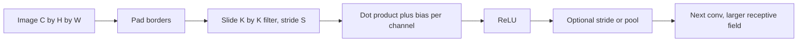

## Why this matters

A dense layer on a 224 by 224 RGB image would connect every pixel to every hidden unit and throw away the fact that a cat's ear is the same pattern in the top left and the bottom right. Convolutional networks bake in two inductive biases: locality, a unit looks at a small window, and weight sharing, the same filter slides across the image. Those biases cut the parameter count by orders of magnitude and make the detector equivariant to translation: shift the cat, and the activations shift. This lesson derives the output shape formula, implements a single-channel 1D and 2D convolution from scratch, and connects the layer to the backprop you already know. The computer-vision lesson later uses these layers as a pipeline rather than re-deriving them.

## Intuition

A filter is a small template. Convolution slides it across the image, and at each position writes down the dot product between the template and the patch underneath. A filter that is a vertical edge produces a strong response wherever a vertical edge occurs. A bank of filters produces a bank of response maps, one per filter, which the next layer treats as an image with many channels. Stacking layers grows the receptive field: a unit two layers up sees a wider region of the original pixels even though each filter is small. Pooling or a stride greater than 1 shrinks the map so deeper layers look at more of the scene per unit, at the cost of precise location.

Nothing here violates the earlier lessons. A convolution is a linear map with tied weights. The nonlinearity, the initialization, and the optimizer are unchanged. The structure is the only new idea, and it is a strong one.

## Core concept in depth

### Shapes

An input image has shape (C_in, H, W), channels first, which is the usual framework layout. A convolutional layer has C_out filters, each of spatial size K by K, spanning all input channels. The parameter count is C_out · C_in · K · K, plus C_out biases. It does not grow with H or W. That is the point.

With padding P on each side and stride S, the output spatial size is

floor( (H + 2 P − K) / S ) + 1

The same formula applies to W. "Same" padding chooses P so the output size equals the input size when S = 1, which for odd K is P = (K − 1) / 2. Valid padding is P = 0: the output shrinks, and the border pixels are seen by fewer filters. A stride of 2 roughly halves the map and is a learned alternative to a separate pooling layer.

A 1 by 1 convolution does not mix space. It mixes channels at each pixel, a position-wise dense layer. Networks use it to change channel count cheaply. A depthwise convolution applies a separate spatial filter per channel and does not mix channels; a pointwise 1 by 1 then mixes them. That pair is the depthwise-separable convolution, a parameter and compute saving used in mobile architectures.

### What the dot product sees

At output position (i, j), before the bias and the activation, the value in output channel o is the sum over input channels and over the K by K window of filter entries times input pixels. The window starts at (i·S − P, j·S − P) in the padded image. Pixels that fall outside the original image are the padding value, usually zero. Zero padding invents a dark border. Reflect padding invents a continuation. For a detector of fine structure at the border, the choice is visible in the output.

ReLU after the convolution is the default nonlinearity. Batch normalization, when you use it, usually sits between the convolution and the ReLU, and it has its own train-versus-eval behavior: training uses the batch statistics, evaluation uses a running average. Forgetting to switch modes is a classic bug and a classic interview anecdote.

### Receptive fields and downsampling

A stack of 3 by 3 convolutions with stride 1 grows the receptive field by 2 pixels of the previous map per layer. After several stride-2 downsamples, one unit on the deep map corresponds to a large patch of the input. Classification wants that: the last map can be pooled to a vector and fed to a linear layer. Detection and segmentation want the location back. They keep higher-resolution maps, use skip connections from early layers, or upsample with a transposed convolution that is the backward shape of a normal convolution. A transposed convolution with a bad stride and kernel paints checkerboard artifacts. It is a shape tool, not a sharpening tool.

### Residual connections

A residual block computes y = x + F(x), where F is two convolutions and a nonlinearity, and x is added if the shapes match. The skip gives the gradient a path of derivative 1, which is why very deep convolutional nets became trainable. If the channel count changes, the skip is a 1 by 1 convolution, not a magical broadcast. ResNets are the default family to know. You do not need to recite every variant. You need the skip and the shape rule.

### Backprop is a convolution too

The gradient with respect to the input of a convolution is itself a convolution of the upstream gradient with the filters, flipped in the spatial axes, because each input pixel affects every output position whose window covered it. The gradient with respect to a filter is a convolution of the input with the upstream gradient: each filter pixel's gradient sums the products of input pixels and upstream values over all positions where that filter pixel was applied. Frameworks do this with the same GEMM implementation as the forward, by lowering the windows into a matrix. You should know the parameter tying: one filter pixel has one gradient, the sum of its contributions everywhere it was used. If you implemented the forward as a dense matrix with tied weights and backpropped as if the ties did not exist, you would be wrong.

## Diagram / flowchart



### Dry-run table

One channel, 1D, so the arithmetic fits on a line. Input [1, 2, 3, 4], filter [1, 0, −1], stride 1, padding 0. Output length = 4 − 3 + 1 = 2.

| Output index | Window | Dot product |
| --- | --- | --- |
| 0 | 1, 2, 3 | 1·1 + 0·2 + (−1)·3 = −2 |
| 1 | 2, 3, 4 | 1·2 + 0·3 + (−1)·4 = −2 |

The filter is a discrete derivative. Both windows slope upward by the same amount per step, so both responses match. A constant input [5, 5, 5, 5] would produce zeros: an edge detector correctly stays silent on a flat field. With padding 1 and the same filter, the output length would be 4, and the border windows would include a zero. Those border dots are not the same operator as the interior ones. Say so if you are interpreting the first and last outputs.

## Code

```python
def conv1d(signal: list[float], kernel: list[float], stride: int = 1, pad: int = 0) -> list[float]:
    padded = [0.0] * pad + list(signal) + [0.0] * pad
    k = len(kernel)
    if stride < 1:
        raise ValueError("stride must be positive")
    out = []
    idx = 0
    while idx + k <= len(padded):
        window = padded[idx : idx + k]
        out.append(sum(a * b for a, b in zip(window, kernel)))
        idx += stride
    return out


def conv2d_single(image: list[list[float]], kernel: list[list[float]]) -> list[list[float]]:
    """Valid convolution, one channel, stride 1."""
    h, w = len(image), len(image[0])
    kh, kw = len(kernel), len(kernel[0])
    out = []
    for i in range(h - kh + 1):
        row = []
        for j in range(w - kw + 1):
            acc = 0.0
            for u in range(kh):
                for v in range(kw):
                    acc += image[i + u][j + v] * kernel[u][v]
            row.append(acc)
        out.append(row)
    return out


if __name__ == "__main__":
    print("conv1d", conv1d([1, 2, 3, 4], [1, 0, -1]))
    print("flat", conv1d([5, 5, 5, 5], [1, 0, -1]))
    img = [
        [1, 2, 3],
        [4, 5, 6],
        [7, 8, 9],
    ]
    # 2x2 box that sums the window.
    print("conv2d", conv2d_single(img, [[1, 1], [1, 1]]))
```

The 1D convolution prints [−2, −2] and the flat field prints zeros, with a trailing zero dropped only if the window does not fit; here two zeros appear because two full windows fit. The 2 by 2 sum-kernel on the 3 by 3 image produces a 2 by 2 map: top-left window sums to 1+2+4+5 = 12, and the other three windows follow by the same arithmetic. Count the output cells against the formula before you trust a framework shape error.

## Complexity analysis

| Layer | Parameters | Compute per image | Notes |
| --- | --- | --- | --- |
| Dense on H·W·C inputs to h units | (H W C) · h | Same order | Grows with pixels, no sharing |
| Conv, K by K, C_in to C_out, map H by W, stride 1 | C_out · C_in · K² | Θ(H W · C_out · C_in · K²) | Independent of a dense fan-out |
| Stride 2 | Same parameters | About 1/4 the spatial compute | Output map shrinks |
| Depthwise separable | About C_in · K² + C_in · C_out | Much smaller when C and K are large | The mobile-net trade |
| Pool 2 by 2 | None | Θ(H W C) | Loses spatial precision on purpose |

The compute sits in the spatial sliding of channel-mixing filters. Early layers have few channels and large maps. Later layers have many channels and small maps. Both can dominate, and a profiler will tell you which. Parameter count is small relative to a dense net of the same compute, which is why conv nets generalized from modest datasets in the first place: the hypothesis class is smaller in the directions the tying forbids.

Memory during training is the activation maps, especially the early high-resolution ones. A batch of large feature maps can outweigh the weights. Gradient checkpointing and mixed precision are the usual relief valves. Inference can stream a layer and free the previous map if no skip still needs it.

## Tricks, tips and patterns

- Write the output shape on paper before you launch a run. The floor formula is short and the framework error is not.
- Prefer 3 by 3 stacks over one giant kernel. Two 3 by 3 layers see 5 by 5 pixels with fewer parameters and an extra nonlinearity.
- Use padding that matches your intent. Same-padding preserves the map. Valid padding shrinks it and trims the border.
- A 1 by 1 convolution is the channel mixer. It is not a spatial feature.
- Residual skips need matching shapes. Project with 1 by 1 if the channel count changes.
- Put the network in eval mode so batch-norm uses running statistics. This single toggle has invalidated more benchmarks than architecture choice.
- Initialize conv weights with He initialization over fan-in equal to C_in · K · K.
- Look at the first-layer filters on natural images. They often become edges and colors. If they are noise, training did not happen.

## Common mistakes and edge cases

- Channels-last versus channels-first. A silent permute trains on nonsense and the loss may still decrease.
- Forgetting that stride applies to the formula, and building a decoder whose sizes never meet the skip connection.
- Padding that is not the same on both sides, so the output shifts by a pixel. Detection cares.
- A pooling layer that uses the same indices at train and test is fine; a dropout that stays on at test is not. Know which random layers must be frozen.
- Interpreting a large activation as "the network sees a cat" without a method. The later explainability lesson is the honest version. A filter visualization is a hint.
- Training with batch-norm and batch size 1. The batch statistics are noise. Use group norm or a larger batch.
- Counting parameters with the spatial size included. If your count grows with H, you counted a dense layer.

## Interview notes

Compute an output shape from H, K, P, and S on the board. Give the parameter count C_out · C_in · K · K and contrast it with a dense layer on the same image.

Explain weight sharing and translation equivariance in one sentence each. Equivariance means the output shifts when the input shifts. Invariance means the output does not change. Pooling over the whole map is what moves you toward invariance for classification.

Describe a residual block and why the skip helps gradients. Mention eval-mode batch-norm if the conversation turns to "it worked in training and failed in production." That is a gift of a question. Answer it with the running-statistic switch before you answer it with a data story.

## Practice problems

1. [Dot Product](/practice/ml-dot) — each window of a convolution is one (easy).
2. [One Linear Regression Step](/practice/ml-linreg-step) — a conv filter is a tied-weight linear map with the same kind of gradient (medium).
3. [Min-Max Scale](/practice/ml-minmax) — image nets expect a consistent input scale (easy).
4. Recompute the 1D dry-run, then add a padding of 1 and write the new length and the two border dots.
5. Count parameters for 16 filters, 3 by 3, 8 input channels, and compare with a dense layer from 32 by 32 by 8 to 16 units.

## Summary / cheat sheet

- A convolution slides a shared local filter. Parameters are C_out · C_in · K · K, independent of the image size.
- Output size is floor((H + 2P − K) / S) + 1. Write it down before the run.
- Stacking small kernels grows the receptive field and adds nonlinearities. Stride and pooling trade resolution for context.
- A 1 by 1 convolution mixes channels. Depthwise separable convolution is the cheap spatial-then-channel variant.
- Residual blocks add the input back. The skip is a gradient highway and a shape constraint.
- Backprop respects the tied weights: one filter pixel, one summed gradient.
- Batch-norm must switch to running statistics at evaluation time. Channels-first versus channels-last must be a choice, not an accident.

## Further reading

- [Stanford CS231n convolutional notes](https://cs231n.github.io/convolutional-networks/)
- [Deep Learning Book, Chapter 9 — convolutional networks](https://www.deeplearningbook.org/contents/convnets.html)
- [He et al., Deep Residual Learning](https://arxiv.org/abs/1512.03385)
- [PyTorch Conv2d documentation](https://pytorch.org/docs/stable/generated/torch.nn.Conv2d.html)
- [Dumoulin and Visin, A guide to convolution arithmetic](https://arxiv.org/abs/1603.07285)
