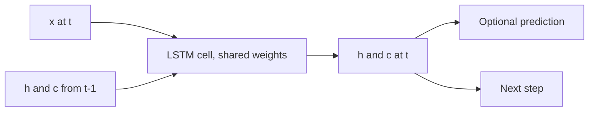

## Why this matters

Sequences have a length that is not fixed at model-design time: sentences, sensor traces, user event streams. A recurrent network applies the same cell at every step, carries a hidden state forward, and so uses a constant parameter count however long the input is. That sharing is the sequential cousin of a convolutional filter. It also creates the classic training failure: gradients that must travel back through many copies of the same matrix, and therefore vanish or explode. LSTMs and GRUs add gates so the model can keep a value in a cell across many steps without multiplying it by a small weight every time. Transformers have replaced RNNs for most language tasks. You still need this lesson, because the gating idea, the sequence-length cost, and the failure modes show up in time-series models, in streaming features, and in the interview question that asks why attention won.

## Intuition

Read a sentence one word at a time and keep a running summary. That summary is the hidden state. The next word updates the summary through a learned function that does not change from step to step. If the summary is a single vector that gets multiplied by the same matrix every step, information from the first word is filtered through that matrix as many times as there are remaining words. Eigenvalues smaller than 1 crush it. Eigenvalues larger than 1 explode it. A gate is a soft switch, between 0 and 1, that lets the model copy the summary forward unchanged when the new word is irrelevant, and rewrite it when the new word matters. The switch is itself a function of the new word and the current summary, so the model learns when to remember.

## Core concept in depth

### The vanilla recurrence

At step t, with input xₜ and previous hidden hₜ₋₁,

hₜ = tanh(W_x xₜ + W_h hₜ₋₁ + b)

The same W_x and W_h are used at every t. The output may be a prediction at every step (a language model, a frame label) or a prediction from the final hidden state (a sentence class). Parameter count does not grow with T. Compute and memory do. Backpropagation through time unrolls the steps and applies the chain rule from the loss at step T back to step 1. The gradient with respect to W_h accumulates contributions from every step, and each contribution is multiplied by the product of the intermediate Jacobians. If the spectral radius of those Jacobians is not near 1, the product vanishes or explodes exponentially in the number of steps.

Gradient clipping on the global norm is the practical seatbelt for explosions. It does not fix vanishing. Vanishing means the early inputs stop affecting the loss gradient, so the model cannot learn long-range dependencies even if the capacity is theoretically there. Truncated backprop through time stops the backward walk after k steps to save memory. It also means you will not learn dependencies longer than k. Say the truncation length when you report results.

### LSTM gates

An LSTM keeps a cell state cₜ as well as a hidden state hₜ. Four small networks, each a linear map of xₜ and hₜ₋₁ followed by a nonlinearity, produce:

- The forget gate fₜ = σ(·), which multiplies the old cell. Values near 1 copy the cell forward. Values near 0 erase it.
- The input gate iₜ = σ(·), which decides how much of a candidate update to write.
- The candidate gₜ = tanh(·), the proposed new content.
- The output gate oₜ = σ(·), which decides how much of the cell, after a tanh, to expose as hₜ.

The update is cₜ = fₜ ⊙ cₜ₋₁ + iₜ ⊙ gₜ, and hₜ = oₜ ⊙ tanh(cₜ). The additive path cₜ = f ⊙ c + … is the point. When f is near 1 and i is near 0, the cell is copied and the gradient with respect to c flows back with multiplier near 1, for as many steps as the gate stays open. The model can learn a dependency across a paragraph if the data supports it and the gates cooperate. It is not a guarantee. Gates can still saturate and forget.

A GRU merges the cell and the hidden state and uses fewer gates. It is often as good as an LSTM, with fewer parameters. Know that it exists; be able to derive the LSTM, which is the one interviewers ask for.

### Bidirectional and stacked nets

A bidirectional RNN runs one chain forward and one backward, and concatenates the states. Each position then depends on the whole sequence, which is appropriate for tagging a complete sentence and inappropriate for generation, where the future does not exist yet. Stacking RNNs feeds the hidden sequence of one layer to the next. Dropout between layers, not inside the cell in a sloppy way, is the usual regularizer. A model that is bidirectional in training and causal in production is a bug. The feature it used will be missing.

### Where RNNs still fit, and where they do not

Transformers look at every pair of positions and scale as T², with easy parallelism across positions. RNNs scale as T and are sequential, so they are painful to train on long texts and pleasant to run as a streaming state: one new event in, one state update, a prediction out. Time-series models, online scoring, and some speech stacks still use recurrent or convolutional-over-time alternatives for that reason. If your sequence is a sentence and you have the whole sentence, start with a transformer. If your sequence is a stream and latency requires a constant-size state, the recurrent formulation is still the right inductive bias.

## Diagram / flowchart



### Dry-run table

A toy forget-only update, scalars, no candidate. cₜ = fₜ · cₜ₋₁. Start with c = 1. The forget gate stays 1 for two steps and then drops to 0.

| Step | f | c before | c after |
| --- | --- | --- | --- |
| 1 | 1 | 1 | 1 |
| 2 | 1 | 1 | 1 |
| 3 | 0 | 1 | 0 |

The gradient of the step-2 cell with respect to the initial cell is the product of the forget gates along the way, which is 1. A vanilla RNN with a repeated multiplier of 0.5 would have contributed 0.25 after two steps and would be negligible after twenty. The table is the whole argument for an additive cell.

## Code

```python
import math


def sigmoid(z: float) -> float:
    if z >= 0:
        ez = math.exp(-z)
        return 1.0 / (1.0 + ez)
    ez = math.exp(z)
    return ez / (1.0 + ez)


def vanilla_step(x: float, h: float, wx: float, wh: float, b: float) -> float:
    return math.tanh(wx * x + wh * h + b)


def lstm_step_scalar(
    x: float,
    h: float,
    c: float,
    # Each gate is a scalar affine: weight_x, weight_h, bias. Order: forget, input, candidate, output.
    forget: tuple[float, float, float],
    inp: tuple[float, float, float],
    cand: tuple[float, float, float],
    out: tuple[float, float, float],
) -> tuple[float, float]:
    def affine(params: tuple[float, float, float]) -> float:
        wx, wh, b = params
        return wx * x + wh * h + b

    f = sigmoid(affine(forget))
    i = sigmoid(affine(inp))
    g = math.tanh(affine(cand))
    o = sigmoid(affine(out))
    c_new = f * c + i * g
    h_new = o * math.tanh(c_new)
    return h_new, c_new


if __name__ == "__main__":
    h = 0.0
    for x in (1.0, 1.0, 1.0):
        h = vanilla_step(x, h, wx=0.5, wh=0.5, b=0.0)
    print("vanilla h", round(h, 4))
    # Forget gate saturated on: wx=0, wh=0, bias large positive -> sigmoid ~ 1.
    # Input gate off: large negative bias. Candidate and output irrelevant if i ~ 0 and we only check c.
    h2, c2 = lstm_step_scalar(
        x=0.0,
        h=0.0,
        c=1.0,
        forget=(0.0, 0.0, 8.0),
        inp=(0.0, 0.0, -8.0),
        cand=(0.0, 0.0, 0.0),
        out=(0.0, 0.0, 8.0),
    )
    print("lstm c", round(c2, 4), "h", round(h2, 4))
```

The vanilla loop applies tanh three times to a growing pre-activation and stays bounded, which is tanh doing its job and also hiding gradient: the derivative 1 − tanh² is small once the state saturates. The LSTM cell stays near 1 because the forget bias is strongly positive and the input gate is shut. That is a hand-built memory, not a trained one, and it is the behavior you want to see in a unit test of the cell before you trust a training loop.

## Complexity analysis

| Model | Parameters | Train step | Long-range gradient |
| --- | --- | --- | --- |
| Vanilla RNN, hidden h, input d | Θ(d h + h²) | Θ(T h²) sequential | Product of T Jacobians, vanishes or explodes |
| LSTM | About 4 times a vanilla cell | Θ(T h²) sequential | Additive path when forget gates are open |
| Truncated BPTT, window k | Same | Backward only k steps | Dependencies longer than k are invisible |
| Transformer encoder | Attention plus feed-forward | Θ(T² d) parallel across positions | Direct edges between any pair, no product of T matrices |
| Streaming RNN inference | The state, Θ(h) | One cell per new token | Latency is one cell, not a full sequence recompute |

The sequential dependence is the wall. Training a recurrent net does not parallelize across time, so a long document underuses the GPU relative to a transformer of similar arithmetic. Inference of one new token, given the state, is cheap for the RNN and is also cheap for a transformer only if you cache the previous keys and values. Both families have a streaming mode. They are not as different at deployment as the training complexity suggests, once the cache exists. They are very different in what parallel hardware can do during training.

## Tricks, tips and patterns

- Clip global gradient norm when you train a vanilla RNN. Look at the clip rate. If it is 100 percent, lower the learning rate.
- Prefer LSTM or GRU over a vanilla cell when the dependency might exceed a dozen steps.
- Initialize forget-gate biases positive so the cell starts by remembering. This small choice speeds early training.
- Truncate BPTT on purpose and name the window. Do not discover it from an out-of-memory error.
- Match bidirectionality to the product. Tagging a full sentence can look both ways. Predicting the next event cannot.
- For a stream, persist the state. Recomputing from the beginning of time on every event is an RNN-shaped bug.
- Sort sequences into length buckets so padding does not dominate the batch. Mask the loss on pad positions.
- If the whole sequence is available and T is the bottleneck, try a temporal convolution or a transformer before you deepen the RNN.

## Common mistakes and edge cases

- Unrolling without sharing weights, so each step has its own W and the model is a wide feed-forward net that cannot score a longer sequence.
- Applying dropout to the recurrent state in a way that changes the memory randomly at every step, then being surprised the cell cannot hold a value. Use a consistent mask across time if you drop the state.
- Bidirectional features in an online scorer.
- A loss on padded timesteps, so the model is trained to predict the pad token and looks strong.
- Vanishing gradients diagnosed as "we need a bigger hidden size." Width does not fix a product of 0.5s.
- Forgetting to reset the state between unrelated sequences, so one user's history leaks into the next example in the batch.
- Evaluating a language-model RNN with teacher forcing and reporting that as free-running quality. The model saw the true previous token. Free-running feeds its own predictions back, and errors compound.

## Interview notes

Write the vanilla recurrence and explain vanishing gradients as a product of Jacobians. Then write the LSTM cell update c = f ⊙ c + i ⊙ g and point at the additive path. Mention a positive forget bias.

Contrast compute: RNN is O(T) and sequential, attention is O(T²) and parallel. Give one case for each: a stream versus a full document.

Mention truncated BPTT, state reset between sequences, and padding masks. These are the answers that show you have trained a sequence model rather than read the cell diagram.

If asked why transformers replaced RNNs for translation and language modeling, say parallelism and direct long-range edges, not "they are more modern." Then say what was lost: a constant-size state and linear scaling, which is why recurrent ideas keep returning in efficient sequence layers.

## Practice problems

1. [Stable Sigmoid](/practice/ml-sigmoid) — every LSTM gate except the candidate uses it (easy).
2. [One Linear Regression Step](/practice/ml-linreg-step) — each gate is an affine map with this kind of gradient (medium).
3. [Binary Cross-Entropy](/practice/ml-bce) — a sequence tagger's per-step loss (medium).
4. Multiply a scalar factor 0.5 by itself 10 times and compare to a forget gate that stays 1. That is the vanishing-gradient arithmetic.
5. Run the scalar LSTM step with forget bias −8 instead of +8 and confirm the cell is erased.

## Summary / cheat sheet

- An RNN shares one cell across time and carries a hidden state. Parameters do not grow with length. Compute does, and it is sequential.
- Backprop through time multiplies Jacobians. Vanilla RNNs vanish or explode. Clip explosions. Vanishing needs an architectural path.
- An LSTM cell adds a forget gate, an input gate, a candidate, and an output gate. The cell updates by addition, so an open forget gate copies gradient backward.
- Initialize forget biases positive. Reset state between sequences. Mask padding. Do not use a bidirectional net online.
- Truncated BPTT limits the dependency you can learn. Name the window.
- Transformers win on full sequences because they parallelize and connect distant positions directly. RNNs still fit streaming constant-state scoring.
- Teacher forcing is not free-running generation. Report the one you mean.

## Further reading

- [Deep Learning Book, Chapter 10 — sequence modeling](https://www.deeplearningbook.org/contents/rnn.html)
- [Olah, Understanding LSTM Networks](https://colah.github.io/posts/2015-08-Understanding-LSTMs/)
- [Hochreiter and Schmidhuber, Long Short-Term Memory](https://www.bioinf.jku.at/publications/older/2604.pdf)
- [PyTorch LSTM documentation](https://pytorch.org/docs/stable/generated/torch.nn.LSTM.html)
- [Jozefowicz et al., An Empirical Exploration of Recurrent Network Architectures](https://arxiv.org/abs/1502.02096)
