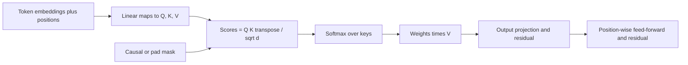

## Why this matters

Attention replaces the recurrent bottleneck with a direct weighted average. Every position can look at every other position in one step, the weights are a function of the data, and the computation across positions parallelizes. That is the architecture behind GPT-style decoders, BERT-style encoders, and vision transformers. The linear algebra is the scaled dot product you can implement in twenty lines. The systems cost is the T by T score matrix. This lesson builds a single-query attention from scratch, then the multi-head block, then the training masks that make a language model causal. The NLP module will use the block. It will not re-derive it.

## Intuition

A query asks a question. Each key advertises what a position contains. The dot product of query and key is a match score. Softmax turns the scores into a distribution, and the output is the weighted sum of value vectors. In self-attention the queries, keys, and values are all linear projections of the same sequence, so positions look at each other. In cross-attention the queries come from the decoder and the keys and values come from the encoder, which is how a translation decoder reads the source sentence.

The weights are not a fixed kernel like a convolution. They depend on the content. A pronoun can put nearly all of its mass on the noun three clauses back, in one step, without a product of recurrent Jacobians. The price is that every pair interacts, so doubling the sequence length quadruples the score matrix.

## Core concept in depth

### Scaled dot-product attention

Let Q, K, and V be matrices whose rows are query, key, and value vectors, each of dimension d. The attention is

softmax(Q Kᵀ / √d) V

The √d scale keeps the dot products from growing like d when the coordinates are order-1, which would push the softmax into a near one-hot and starve the gradient. You derived the single-query case in the practice problem: logits are q · k / √d, then a max-shifted softmax. The matrix form is that operation for every query at once.

A mask sets forbidden logits to a large negative number before the softmax, so those positions get weight near zero. A causal mask forbids attending to future positions. A padding mask forbids attending to pad tokens. Apply the mask to the logits, not to the weights after the softmax; zeroing weights after the fact leaves them unnormalized.

### Multi-head attention

One attention distribution can only represent one pattern of lookup. Multi-head attention runs h attentions in parallel on slices of the embedding, usually of dimension d/h each, then concatenates the outputs and mixes them with a linear map W_O. Heads often specialize — one tracks syntax, one tracks position — but you should not promise that they will. The parameter cost of the projections Q, K, V, and the output map is about 4 d² when the model width is d, independent of T. The compute that depends on T is the score matrix, Θ(T² d) across heads, and the multiplication by V, the same order.

### The block and the stack

A transformer block is attention, then a position-wise feed-forward network, each wrapped in a residual connection and a layer normalization. Two orders exist. Post-norm is the original: add, then normalize. Pre-norm normalizes the residual branch before the sublayer, which trains more stably at depth. Know which one you are copying. The feed-forward network is two linear layers with a nonlinearity between them, applied independently at each position, usually expanding the width by a factor of four and then projecting back. It is where a lot of the parameters live. Attention mixes information across positions. The feed-forward mixes features within a position.

Positional information has to be added because attention itself is permutation-equivariant: shuffle the tokens, shuffle the outputs. Sinusoidal encodings, learned absolute embeddings, and relative or rotary encodings are three answers. Rotary embeddings apply a position-dependent rotation to queries and keys so the dot product depends on relative offset. They are the current default in many language models. You do not need to memorize the trig identities. You need to know that without some position signal the model cannot tell "dog bites human" from "human bites dog."

### Encoder, decoder, and encoder-decoder

An encoder stack uses bidirectional self-attention. BERT is this, trained with a masked-token objective. A decoder stack uses causal self-attention so position t cannot see tokens after t. GPT is this, trained to predict the next token. An encoder-decoder, the original translation transformer, has both, plus cross-attention in the decoder. For a pure language model you do not need the encoder. For a model that must condition on a separate document, cross-attention or a prompt that simply concatenates the document are both used; concatenation is the simpler serving path and it spends sequence length.

### Training and the cache

Next-token training feeds the true prefix and predicts the following token at every position in parallel, which is why transformers train efficiently. At generation time you pick a token, append it, and predict again. Recomputing attention from scratch each time is wasteful. A key-value cache stores the keys and values of previous positions and only computes the new query against them. The cache grows with T and with the number of layers and heads, and it is often the memory bottleneck at long context, larger than the weights for a single request. Quantization, grouped-query attention (fewer key and value heads than query heads), and sliding-window attention are all responses to that growth.

## Diagram / flowchart



### Dry-run table

One query q = [1, 0], two keys that equal [1, 0] and [0, 1], d = 2, so √d = √2 ≈ 1.414. Values will not be needed to see the weights.

| Key | Dot q·k | Scaled logit | Softmax weight |
| --- | --- | --- | --- |
| [1, 0] | 1 | 1/1.414 ≈ 0.707 | about 0.67 |
| [0, 1] | 0 | 0 | about 0.33 |

The aligned key gets more mass, not all of it, because the logits are moderate. If you forgot the √d and the dimension were hundreds, the same geometry would push the softmax toward 1 and 0 and the gradient toward 0. A causal mask is vacuous here if both keys are in the past. If the second key were the future, its logit would be set to a large negative number and its weight would collapse.

## Code

```python
import math


def softmax(logits: list[float]) -> list[float]:
    m = max(logits)
    exps = [math.exp(z - m) for z in logits]
    total = sum(exps)
    return [e / total for e in exps]


def attention_weights(query: list[float], keys: list[list[float]]) -> list[float]:
    scale = math.sqrt(len(query))
    logits = [sum(q * k for q, k in zip(query, key)) / scale for key in keys]
    return softmax(logits)


def causal_mask(logits: list[float], query_index: int, key_indexes: list[int], neg: float = -1e9) -> list[float]:
    masked = []
    for logit, key_index in zip(logits, key_indexes):
        masked.append(logit if key_index <= query_index else neg)
    return masked


def combine(weights: list[float], values: list[list[float]]) -> list[float]:
    width = len(values[0])
    out = [0.0] * width
    for w, value in zip(weights, values):
        for i, component in enumerate(value):
            out[i] += w * component
    return out


if __name__ == "__main__":
    q = [1.0, 0.0]
    keys = [[1.0, 0.0], [0.0, 1.0]]
    w = attention_weights(q, keys)
    print("weights", [round(x, 3) for x in w])
    logits = [0.707, 0.0]
    print("masked", causal_mask(logits, query_index=0, key_indexes=[0, 1])[1])
    print("context", [round(c, 3) for c in combine(w, [[2.0, 0.0], [0.0, 4.0]])])
```

The weights print near 0.67 and 0.33. The masked future logit is the large negative sentinel, which a following softmax will nearly ignore. The context vector is the weighted sum of the two values, so the first value dominates in proportion to the first weight. Multi-head attention is this function on several projected slices, concatenated. If the single-query version does not match a hand calculation, the multi-head version will not either.

## Complexity analysis

| Piece | Time | Memory | Scales badly when |
| --- | --- | --- | --- |
| Projections Q, K, V | Θ(T d²) | Θ(T d) | d is large; this is a GEMM and it is healthy |
| Scores Q Kᵀ | Θ(T² d) | Θ(T²) if materialized | T grows; long context |
| Weights times V | Θ(T² d) | Θ(T d) | Same quadratic |
| Feed-forward, expansion 4 | Θ(T d²) | Θ(T d) | Dominates at short T |
| KV cache at decode | Θ(T d) per new token to attend | Θ(layers · T · d) | Many concurrent long requests |

At short sequences the feed-forward and the projections dominate, and they are friendly GEMMs. At long sequences the quadratic terms dominate and the score matrix may not fit. Flash-style kernels fuse the softmax and avoid storing the full matrix, cutting memory traffic without changing the math. They do not change the Θ(T² d) arithmetic. Linear-attention approximations change the math. Know which one you are using before you quote a complexity.

Grouped-query attention shares one key and value head across several query heads. It cuts cache size and often loses little quality. It is a systems modification of multi-head attention, not a new learning theory.

## Tricks, tips and patterns

- Scale by √d_head, not by the full model width, and not by d². The scale lives inside each head.
- Mask logits, then softmax. Do not zero rows of the weight matrix and hope they still sum to 1.
- Add a position signal. State which one. Rotary, learned absolute, and relative are not interchangeable checkpoints.
- Pre-norm is the safer default when you train a deep stack from scratch. Do not mix it with a pre-trained post-norm checkpoint.
- Cache keys and values during decoding. Free the cache between unrelated requests or you will mix users.
- Watch the entropy of the attention weights. All mass on the first token, for every head, means the model is ignoring content.
- Residual and layer-norm order must match the paper you think you implemented. Diff the block on one random tensor against a trusted library.
- For classification, a bidirectional encoder is natural. For generation, causal. Do not fine-tune a causal model with a bidirectional mask and expect the old weights to mean the same thing.

## Common mistakes and edge cases

- Forgetting the scale, especially in a from-scratch implementation that "works" on d = 4 and saturates on d = 64.
- A causal mask that is off by one, so the token can see itself when predicting itself, and the loss collapses because the label leaked into the input.
- Softmax in float16 overflowing before the max subtraction. Subtract the max in a wider type, or use a fused kernel.
- Padding positions that still receive attention and dilute the distribution.
- Absolute position embeddings longer than the training length, used at inference with no policy. The model has never seen those position ids.
- Sharing one cache across two users in a batch by mistake.
- Interpreting a single attention map as the explanation of the model. Heads disagree, and later layers mix the result. It is a clue, not a proof.

## Interview notes

Write softmax(Q Kᵀ / √d) V and justify the scale with the variance of a dot product. Then give the shapes: if Q is T by d and there are h heads, each head is T by d/h.

Explain a causal mask versus a padding mask. Explain the label-leak off-by-one. These are the questions that separate a diagram reader from someone who has trained a language model.

Compare cost to an RNN: quadratic and parallel versus linear and sequential. Mention the KV cache as the inference memory term.

Describe a block as attention plus feed-forward, residuals, and layer norm, and say that attention mixes positions while the feed-forward does not. Mention that self-attention is permutation-equivariant without positions.

## Practice problems

1. [Scaled Dot-Product Attention Weights](/practice/ml-attention-weights) — the single-query case of this lesson (hard).
2. [Softmax](/practice/ml-softmax) — the normalization, including the max shift (medium).
3. [Dot Product](/practice/ml-dot) — the match score before the scale (easy).
4. Recompute the dry-run weights by hand to two decimals and match the code.
5. Apply a causal mask that hides the second key and confirm the remaining weight is 1.

## Summary / cheat sheet

- Attention is a content-weighted average of values. Weights are a softmax of scaled query-key dots.
- Divide by √d per head. Mask forbidden logits with a large negative number before the softmax.
- Multi-head attention runs several patterns and mixes them with a linear map. Cost in parameters is Θ(d²). Cost in sequence length is Θ(T² d).
- A block is attention and a position-wise feed-forward, each with a residual and layer norm. Pre-norm and post-norm are different models.
- Without a position encoding, order is invisible. Causal masks are required for next-token training, and the token must not see the label it predicts.
- Decoding caches keys and values. The cache, not the arithmetic, often limits long-context serving.
- Encoders look both ways. Decoders look backward. Cross-attention lets a decoder read a separate sequence.

## Further reading

- [Vaswani et al., Attention Is All You Need](https://arxiv.org/abs/1706.03762)
- [The Illustrated Transformer](https://jalammar.github.io/illustrated-transformer/)
- [The Annotated Transformer](https://nlp.seas.harvard.edu/annotated-transformer/)
- [PyTorch scaled dot-product attention](https://pytorch.org/docs/stable/generated/torch.nn.functional.scaled_dot_product_attention.html)
- [Su et al., RoFormer (rotary embeddings)](https://arxiv.org/abs/2104.09864)
