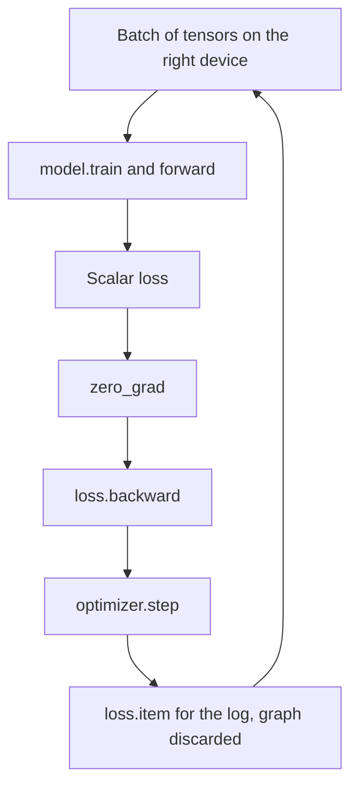

## Why this matters

The previous lessons computed gradients by hand so you would recognize them. PyTorch computes them for you by recording operations on tensors and playing the tape backward. That does not remove the need to understand shapes, devices, train versus eval, or the difference between a tensor that requires gradient and a numpy array you accidentally detached. Most "the loss is NaN" and "it does not learn" reports in framework code are the same bugs as in the from-scratch code, plus a few new ones: forgetting `zero_grad`, updating a copy, or leaving dropout on at test time.

This lesson maps the hand-written linear step onto a PyTorch training loop you can run on CPU. The same loop is what a SageMaker training container will execute later, with a GPU and a data loader instead of a list.

## Intuition

A tensor is an ndarray that remembers how it was built, if you ask it to. When you call `loss.backward()`, PyTorch walks that history and fills `.grad` on each leaf parameter. An optimizer then steps those parameters. The tape is freed after the backward unless you retain it, because keeping it would duplicate the activation storage you already met in the backprop lesson. Detach or `torch.no_grad` when you are only scoring a validation set; otherwise you store a graph you will not use and you may accidentally train on the validation batch.

Devices are part of the type. A tensor on CPU does not add to a tensor on GPU. Models and batches must move together. Dtypes are part of the type too: a float32 model and a float64 batch will either error or silently cast, depending on the operation, and mixed precision is a deliberate policy rather than a cast you hope for.

## Core concept in depth

### Tensors and parameters

`torch.tensor` copies values. `torch.zeros`, `torch.randn`, and `torch.as_tensor` cover the usual constructors. A parameter is a tensor wrapped so a module can find it. `nn.Linear(d, h)` holds a weight of shape (h, d) and a bias of shape (h,), and its forward computes `x @ W.T + b`. That transpose is the shape detail people get wrong when they reimplement the layer: the weight is stored as (out, in).

Indexing and broadcasting follow NumPy, with the same right-aligned rules. A view shares storage. `reshape` may copy. `contiguous` makes the stride dense before an operation that requires it. In-place ops ending in an underscore, such as `add_`, can corrupt the autograd tape if they overwrite a tensor that is needed for the backward. Prefer out-of-place math until you are profiling.

### The tape

Operations on tensors with `requires_grad=True` are recorded. The loss is a scalar tensor. `backward` accumulates into `.grad`; it does not overwrite. If you forget `optimizer.zero_grad()` or `param.grad = None`, the next step adds to the old gradient and the effective learning rate doubles every iteration. Zero the gradient after the step or before the next backward, and do it every time.

`loss.item()` pulls a Python float and must not be used as a node in the graph. Logging `loss` itself keeps the graph alive through the logger's history and leaks memory across steps. This is the most common training-loop leak.

A custom layer you write in Python is still recorded op by op. You do not need a custom `autograd.Function` unless you want a fused backward. If you do write one, gradcheck it against finite differences, the same discipline as the calculus lesson.

### A correct step

The order is fixed. Forward, compute loss, zero gradients, backward, step. Some code zeros at the start of the iteration instead of before backward; either is fine if it happens once per step. `model.train()` enables dropout and batch-norm updates. `model.eval()` plus `torch.no_grad()` is the validation and inference setting. Skipping `eval` is not a small mistake on a network with those layers.

Data stays in a `Dataset` and a `DataLoader` that shuffles and batches. The loader's workers are separate processes; tensors are the objects you pass, not CUDA tensors created in the parent and smuggled incorrectly. For this lesson a list of tensors is enough. The pattern is the same when the list becomes a distributed loader in SageMaker.

### Saving and reproducibility

`state_dict` is a map of parameter names to tensors. Save that, not the whole object, if you want a file you can load into a slightly refactored module. Load it with `load_state_dict`. Store the optimizer state too if you plan to resume, including the Adam moments; the weights alone resume the model and forget the optimizer's memory.

Seed `torch.manual_seed` and the NumPy and Python generators if you need a reproducible debug run. CUDA kernels can still be nondeterministic unless you ask for determinism and accept the slowdown. A seed is not a substitute for a validation set.

### Where people mix frameworks

NumPy code and PyTorch code meet at `.detach().cpu().numpy()` and `torch.from_numpy`. `from_numpy` shares memory. A later in-place NumPy write changes the tensor. Detach before you convert a training tensor to NumPy or you will error, because a tensor that requires grad refuses the conversion. Metrics belong in that detached world. The training step does not.

## Diagram / flowchart



### Dry-run table

A one-parameter model ŷ = w x, loss 0.5 (ŷ − y)², x = 2, y = 4, w = 0. The analytic gradient with respect to w is (ŷ − y) x = (0 − 4) · 2 = −8. A step with learning rate 0.1 adds 0.8 to w. This is the linear dry-run from the regression lesson, now owned by autograd.

| Step | Tensor op | Value |
| --- | --- | --- |
| Forward | w * x | 0 |
| Loss | 0.5 * (pred - y) ** 2 | 8 |
| Backward fills w.grad | (pred - y) * x | −8 |
| SGD step | w - 0.1 * grad | 0.8 |

If `.grad` came back as −16, the loss was summed without the 0.5 and also not averaged, or the backward ran twice without a zero. The table is your unit test for the loop.

## Code

```python
import torch


def train_linear_step(x: float, y: float, w: torch.nn.Parameter, lr: float) -> float:
    pred = w * x
    loss = 0.5 * (pred - y) ** 2
    if w.grad is not None:
        w.grad = None
    loss.backward()
    with torch.no_grad():
        w -= lr * w.grad
    return float(loss.detach())


def main() -> None:
    torch.manual_seed(0)
    w = torch.nn.Parameter(torch.tensor(0.0))
    loss = train_linear_step(2.0, 4.0, w, lr=0.1)
    print("loss", loss, "w", round(float(w.detach()), 4), "grad", float(w.grad))
    layer = torch.nn.Linear(2, 1, bias=True)
    opt = torch.optim.SGD(layer.parameters(), lr=0.1)
    xb = torch.tensor([[1.0, 0.0], [0.0, 1.0]])
    yb = torch.tensor([[1.0], [0.0]])
    layer.train()
    opt.zero_grad()
    pred = layer(xb)
    loss2 = torch.nn.functional.mse_loss(pred, yb)
    loss2.backward()
    opt.step()
    layer.eval()
    with torch.no_grad():
        held = layer(xb)
    print("mse", round(float(loss2.detach()), 4), "eval_shape", tuple(held.shape))


if __name__ == "__main__":
    main()
```

The scalar step prints loss 8 and weight 0.8, with the gradient left at −8 because this hand step does not clear it afterward. The `nn.Linear` loop is the same four beats — zero, forward, backward, step — on a batched mean squared error. `eval` plus `no_grad` produces a prediction whose graph is not stored. Read `layer.weight.shape` in a REPL and confirm it is (1, 2), out features by in features, before you write a custom initialization that assumes the transpose.

## Complexity analysis

| Concern | Cost | Failure if ignored |
| --- | --- | --- |
| Autograd storage | Activations kept until backward | Out of memory at a batch size the weights would have fit |
| `zero_grad` | Θ(parameters) | Gradients accumulate and the step explodes |
| Host-device copy | Bandwidth, often worse than the math | A batch pulled to CPU for a metric every step |
| DataLoader workers | Overlap CPU preprocess with GPU compute | GPU idle while you resize images in the training process |
| `loss.item` versus saving `loss` | A float versus a growing graph | Memory climbs linearly with the number of logged steps |
| `state_dict` checkpoint | Size of parameters plus optimizer state | A resume that retrains Adam from empty moments |

The compute of a step is still the GEMMs inside the modules. PyTorch's overhead matters when the layer is tiny and you call it from Python in a loop over sequence time. Batch the time axis, or accept the overhead for a clarity-first implementation and profile before you rewrite. Fusing the optimizer step into the backward, as some libraries do, is a memory optimization for large Adam states. It is not the first thing to write.

## Tricks, tips and patterns

- `zero_grad`, forward, `backward`, `step`, and log `loss.item()`. Same order every time.
- `train()` and `eval()` are part of the forward definition when dropout or batch-norm exist.
- Check `weight.shape` against the documentation, not against your memory of a textbook's (in, out) layout.
- Move the model and the batch to the same device at the boundary, not inside the math.
- Save `state_dict`. Load it. Resume optimizer state only if you intend to resume.
- Gradcheck a custom backward. The built-in layers have already had theirs checked.
- Detach before NumPy. Do not write in-place into a tensor that still needs its forward value.
- Seed a debug run. Do not expect bit-identical CUDA results unless you asked for determinism.

## Common mistakes and edge cases

- Forgetting `zero_grad`, so the first step is right and every later step is the sum of all past gradients.
- Calling `backward` on a non-scalar without a gradient argument. Sum the loss first.
- `model.to(device)` returns a module and also mutates in place for `nn.Module`, but a tensor's `.to` returns a copy unless you assign it. `x = x.to(device)`.
- Validation under `train()` mode, so dropout fires and batch-norm updates on the validation data.
- A learning-rate scheduler stepped twice per iteration, or never. Read the loop.
- Loading a `state_dict` with missing keys and `strict=False` by habit, then training a randomly initialized head you thought was warm.
- Sharing one tensor across examples and modifying it in place, so every row in the batch is the last row.
- Mixed precision without a loss scaler, so small gradients underflow to zero in float16. Use the library scaler or bfloat16.

## Interview notes

Write the four lines of a training step and say what happens if `zero_grad` is missing. State that `.grad` accumulates. Mention `eval` and `no_grad` as a pair for validation.

Explain `nn.Linear` weight shape (out, in) and the bias shape. Explain why logging the loss tensor leaks memory and `item` does not.

Describe `state_dict` versus pickling the module. Mention optimizer state if the question is about resuming a preempted cloud job, which is exactly a SageMaker spot interruption. You will want that answer again in the SageMaker module.

If asked how autograd relates to the hand-written backprop, say it records local derivatives and applies the chain rule backward. It does not finite-difference, and it does not remove shape errors.

## Practice problems

1. [One Linear Regression Step](/practice/ml-linreg-step) — the update autograd just reproduced (medium).
2. [Mean Squared Error](/practice/ml-mse) — the loss in the dry-run, up to the conventional factor one half (easy).
3. [Stable Sigmoid](/practice/ml-sigmoid) — compare against `torch.sigmoid` on a large positive and a large negative input (easy).
4. Run the scalar step twice without clearing the gradient and show that the second backward starts from −8 rather than from zero if you forgot to set `grad` to `None`.
5. Print `nn.Linear(3, 2).weight.shape` and state which axis is the output.

## Summary / cheat sheet

- Tensors plus a recorded tape. `backward` on a scalar fills `.grad` by accumulation.
- The loop is zero, forward, backward, step. Log `loss.item()`.
- `train` and `eval`, with `no_grad` for evaluation, change dropout and batch-norm behavior.
- `nn.Linear` stores weight as (out features, in features).
- Same device, same dtype, no surprise in-place writes on the tape.
- Save and load `state_dict`, including optimizer state when you resume.
- Autograd is backprop. It is not a license to skip shape checks, gradchecks of custom code, or a validation set.

## Further reading

- [PyTorch 60-minute blitz](https://pytorch.org/tutorials/beginner/deep_learning_60min_blitz.html)
- [PyTorch autograd tutorial](https://pytorch.org/tutorials/beginner/blitz/autograd_tutorial.html)
- [PyTorch nn.Linear](https://pytorch.org/docs/stable/generated/torch.nn.Linear.html)
- [PyTorch notes on saving and loading](https://pytorch.org/tutorials/beginner/saving_loading_models.html)
- [Deep Learning Book, Chapter 6, read next to the autograd essay](https://www.deeplearningbook.org/contents/mlp.html)
