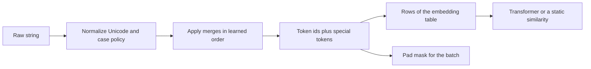

## Why this matters

A language model never sees words. It sees integers from a fixed vocabulary, and it looks those integers up in an embedding table. The tokenizer that produced the integers is part of the model. Change the tokenizer, or change a Unicode normalization, and the same string becomes a different sequence, the embeddings no longer mean what they meant, and a fine-tune appears to "forget English." Retrieval systems fail the same way when the query tokenizer and the document tokenizer disagree. This lesson builds a byte-pair tokenizer you can run on a handful of strings, then the embedding lookup and a skip-gram style training pair, so the pipeline from characters to vectors is yours before the BERT and GPT lesson stacks a transformer on top.

## Intuition

A vocabulary of whole words cannot name an unseen word, and a vocabulary of characters makes every sequence long and forces the model to relearn "the" as three steps. Subword tokenization sits in between. You start with characters, repeatedly merge the pair of symbols that appears most often, and stop at a budget. Frequent words become single tokens. Rare words become a few subwords. The model can still spell a new name from pieces it has seen.

An embedding is a learned vector for each token id. Similar contexts push vectors together because the training loss says "predict the neighbors." The geometry is the same dot-product geometry as the first math lesson. A sentence embedding, for retrieval, is some function of the token vectors — a mean, a special token, or a model trained to make matching sentences align. It is not a magical summary unless you trained it to be one.

## Core concept in depth

### Normalization before tokens

Decide the Unicode rules before you count pairs. Lowercasing English makes "Apple" the company and "apple" the fruit the same token, which may be wrong. Preserving case costs vocabulary. Unicode canonical composition stops two identical-looking strings from hashing differently because one used a combining accent. Strip or keep whitespace as a policy, and apply the same policy to train, eval, and serve. A tokenizer is a pure function. If it is not, you cannot cache it.

### Byte-pair encoding

Count adjacent pairs in a corpus of symbol sequences. Merge the most frequent pair into a new symbol. Repeat until you reach the vocabulary size. Encoding a new string is greedy: apply the merges in the order they were learned, which is not the same as "merge whatever pair is most frequent in this string." That distinction matters. A from-scratch toy often merges greedily per string and disagrees with the trained tokenizer. Production tokenizers store the merge list and apply it in rank order.

Byte-level BPE starts from bytes, not characters, so any Unicode string is representable and you never need an unknown token. The cost is that some tokens are ugly fragments. WordPiece, used by BERT, is a close cousin that scores merges with a likelihood rather than raw count. Unigram tokenizers, used by some SentencePiece setups, start large and prune. You should be able to say which family your checkpoint uses, because the detokenizer — gluing tokens back into a string, including the marker that a token continues a word — is family-specific. A wrong detokenizer looks like the model cannot spell.

Special tokens are ids too: beginning of sequence, end, pad, mask, and often a separator. They must sit in the embedding table. Padding exists so a batch can be rectangular. The attention mask from the transformer lesson must be false on those pads. A pad id that accidentally equals a real token silently corrupts the batch.

### Embeddings

The embedding table E has shape (vocabulary, d). The vector for id i is row i. Looking up a sequence is a gather, not a multiply, though it is equivalent to a multiply by a one-hot vector. Tying the embedding table to the output softmax weights, so the same matrix that maps ids to vectors also maps hidden states to logits, saves parameters and often helps. The output logit for token i is then the dot product of the hidden state with row i, sometimes plus a bias.

Skip-gram with negative sampling trains word vectors without a full softmax. For a center word and a true neighbor, you want the dot product of their vectors to be large. For a handful of noise words drawn from a smoothed unigram, you want the dot product to be small. The loss is binary cross-entropy on the pair label. It is the logistic regression lesson, with the features being "this word and this neighbor." The famous analogies — vector arithmetic that looks like king − man + woman — are a side effect of that geometry, not a guarantee, and they fail as often as demo notebooks suggest. Use them as intuition, not as a test suite.

Contextual embeddings are different. A transformer produces a vector per position that depends on the whole sequence. The same word token gets a different vector in a different sentence. Static word2vec vectors do not. When someone says "the embedding," ask which one. Retrieval over sentences usually wants a model trained with a contrastive loss so that dot products rank relevant documents, not a random layer of a language model. A random layer can be close. It is not the same objective.

### What you store

Store the tokenizer files with the weights: vocabulary, merges, normalization flags, special-token ids. A checkpoint without its tokenizer is an incomplete model. Version them together. If you add tokens for a fine-tune, you must resize the embedding matrix, initialize the new rows, and remember that the old rows are still the old vocabulary. Serving code that tokenizes with a library default and then indexes into your table is a training-serving skew of the worst kind, because it does not throw. It predicts from the wrong ids.

## Diagram / flowchart



### Dry-run table

Corpus of two strings already split into characters, with a space marker: `l o w _` and `l o w e r _`. Pair frequencies on the first iteration:

| Pair | Count |
| --- | --- |
| l o | 2 |
| o w | 2 |
| w _ | 1 |
| w e | 1 |
| e r | 1 |
| r _ | 1 |

Tie between `l o` and `o w`. A deterministic tokenizer breaks ties by a written rule, for example the lexicographic pair, and records that rule. Suppose we merge `l o` into `lo`. The first string becomes `lo w _`. The next round may merge `lo w` into `low`. Encoding "lower" after those merges yields a short id sequence rather than six characters. Decoding must invert the same merges, including whether `_` becomes a space. If decode inserts a space that encode did not, your generated text grows extra gaps and every benchmark drops for a reason that is not the loss.

## Code

```python
def pair_counts(corpus: list[list[str]]) -> dict[tuple[str, str], int]:
    counts: dict[tuple[str, str], int] = {}
    for symbols in corpus:
        for a, b in zip(symbols, symbols[1:]):
            counts[(a, b)] = counts.get((a, b), 0) + 1
    return counts


def merge_once(symbols: list[str], pair: tuple[str, str], joined: str) -> list[str]:
    out: list[str] = []
    i = 0
    while i < len(symbols):
        if i + 1 < len(symbols) and (symbols[i], symbols[i + 1]) == pair:
            out.append(joined)
            i += 2
        else:
            out.append(symbols[i])
            i += 1
    return out


def embed(ids: list[int], table: list[list[float]]) -> list[list[float]]:
    return [table[i] for i in ids]


def cosine(a: list[float], b: list[float]) -> float:
    import math
    dot = sum(x * y for x, y in zip(a, b))
    na = math.sqrt(sum(x * x for x in a))
    nb = math.sqrt(sum(y * y for y in b))
    return dot / (na * nb)


if __name__ == "__main__":
    corpus = [list("low_"), list("lower_")]
    counts = pair_counts(corpus)
    print("lo", counts[("l", "o")], "ow", counts[("o", "w")])
    merged = merge_once(list("lower_"), ("l", "o"), "lo")
    print("merged", "".join(merged))
    table = [[1.0, 0.0], [0.6, 0.8], [0.0, 1.0]]
    vectors = embed([0, 1], table)
    print("cosine", round(cosine(vectors[0], vectors[1]), 3))
```

The pair counts print 2 and 2, matching the tie in the table. Merging `l o` inside "lower_" produces `lo` followed by the remaining characters. The cosine of [1, 0] and [0.6, 0.8] is 0.6, the same geometry as the linear-algebra lesson, now indexed by token id. A real BPE loop would recompute counts after every merge and store the ranked list. The merge function is the piece that must stay identical between training and serving.

## Complexity analysis

| Stage | Cost | What grows |
| --- | --- | --- |
| Count pairs in a corpus of N symbols | Θ(N) per pass | Number of merge passes, often thousands |
| Encode one string with a naive merge list | Θ(merges · length) naive, faster with a trie | Vocabulary size |
| Embedding lookup, T tokens, width d | Θ(T d) | Vocabulary times d parameters, which can rival a small transformer |
| Full softmax over V | Θ(V d) per position | V of 50k to 200k; tied embeddings do not remove this cost |
| Negative sampling, K negatives | Θ(K d) | You trade a full softmax for bias in the samples |

The vocabulary is a parameter matrix you pay for even if some tokens are rare. A 100k by 4096 table is hundreds of millions of parameters, which is why people tie weights and why a carelessly large vocabulary hurts a small model. Encoding cost matters at ingestion time for a retrieval corpus: you will tokenize billions of tokens once, so a slow pure-Python merge is a batch-job problem, not a modeling insight. The modeling insight is that tokenization is many-to-one and not invertible in a unique way until you fix the merge order.

Negative sampling is biased by the noise distribution. A uniform noise distribution wastes samples on impossible words. A unigram raised to the 3/4 power, the word2vec default, is a compromise. It is not the data distribution, and the vectors are not probabilities.

## Tricks, tips and patterns

- Version the tokenizer with the weights. Load both or load neither.
- Fix Unicode normalization and write a golden test: this string must encode to these ids.
- Break pair-count ties deterministically and record the rule.
- Never let the pad id collide with a real token. Mask pads in the loss and in the attention.
- Prefer byte-level tokenizers if you need every string to be representable without an unknown bucket.
- Use contextual embeddings for sense-dependent tasks. Use a contrastive sentence model for retrieval, not an arbitrary hidden state.
- When you add special tokens, resize the embedding and the output layer together if they are tied.
- Detokenize with the matching rule and test round-trips on punctuation, not only on letters.

## Common mistakes and edge cases

- Training with one tokenizer and serving with another library's default.
- A greedy per-string merge that disagrees with the saved rank order.
- Unknown tokens that collapse every rare word to one id, so the model cannot distinguish names.
- Forgetting that " " and a word-boundary marker are different, and decoding smashed-together words.
- Padding without a mask, so the model attends to pads and the loss trains on them.
- Averaging token vectors and calling it a sentence embedding, then wondering why retrieval loses to a model trained to rank.
- A vocabulary that includes tokens never seen in training, still randomly initialized, still in the softmax.
- Case-folding a biomedical corpus and merging a gene name with an English word.

## Interview notes

Explain why subwords exist: open vocabulary, shorter sequences than characters, fewer rare-word parameters than a full lexicon. Walk one BPE merge on a tiny corpus and state the tie rule.

Contrast static embeddings and contextual embeddings. Say how skip-gram negative sampling relates to logistic regression. Do not claim vector arithmetic is a reliable reasoning engine.

The production question is the one to volunteer: tokenizer artifacts are part of the model artifact, golden-string tests belong in CI, and a mismatch fails silently. Mention pad masks in the same answer.

If asked about vocabulary size, mention the embedding parameter cost and the softmax cost, and the option to tie input and output matrices.

## Practice problems

1. [Cosine Similarity](/practice/ml-cosine) — compare two token vectors after lookup (easy).
2. [Dot Product](/practice/ml-dot) — the logit when embeddings are tied to the output layer (easy).
3. [Softmax](/practice/ml-softmax) — turn those logits into a next-token distribution (medium).
4. Merge `l o` in both corpus strings and recompute pair counts. Confirm `lo w` is now frequent.
5. Design a golden test: the ids for a string containing punctuation must be stable across two processes.

## Summary / cheat sheet

- Text becomes ids through a versioned tokenizer, then rows of an embedding table. The tokenizer is part of the model.
- BPE repeatedly merges frequent pairs in a recorded order. Ties need a rule. Encode and decode must match.
- Special tokens and pads are real ids. Mask pads in attention and in the loss.
- Static embeddings are one vector per type. Contextual embeddings depend on the sequence. Retrieval wants a model trained to rank, not an arbitrary layer.
- Skip-gram with negative sampling is logistic regression on word pairs.
- Embedding tables are large. Tied input and output weights save a matrix and do not remove the softmax over V.
- A silent tokenizer mismatch is training-serving skew. Golden strings catch it.

## Further reading

- [Sennrich et al., Neural Machine Translation of Rare Words with Subword Units](https://arxiv.org/abs/1508.07909)
- [SentencePiece](https://github.com/google/sentencepiece)
- [Mikolov et al., Distributed Representations of Words and Phrases (skip-gram)](https://arxiv.org/abs/1310.4546)
- [Hugging Face tokenizer summary](https://huggingface.co/docs/transformers/tokenizer_summary)
- [The Illustrated Word2vec](https://jalammar.github.io/illustrated-word2vec/)
