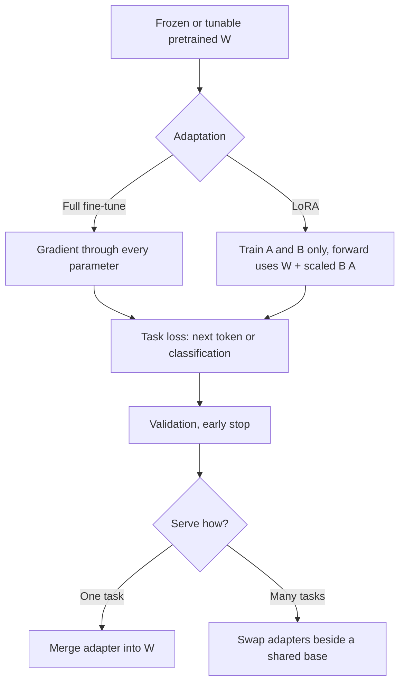

## Why this matters

Pretraining learns a general language representation from a huge corpus. Adaptation points that representation at your labels. BERT-style encoders and GPT-style decoders are pretrained with different masks and different losses, so they are not drop-in replacements. Full fine-tuning updates every weight and needs a copy of the model per task. Low-rank adaptation updates a thin factorization of the weight updates, which is often enough and is much cheaper to store and serve. Picking the wrong objective, or training LoRA at a rank and learning rate copied from a blog, is how teams spend a GPU week to get a model that loses to a linear classifier on a bag of words.

This lesson states the two pretraining objectives precisely, then implements the LoRA update formula so the parameter count is obvious.

## Intuition

A causal language model reads a prefix and predicts the next token. The training signal is everywhere: every position is a prediction, and the mask stops the position from seeing the answer. That model is a generator. You can also classify with it by reading the final hidden state, but the pretraining did not ask it to produce a label.

A masked encoder hides a few tokens and predicts them from both directions. It is not a generator of long text, because it was not trained to continue a prefix under a causal mask. It is a strong representation for classification and extraction when you put a small head on the special classification token or on the token positions you care about.

Fine-tuning continues training on your pairs, usually at a smaller learning rate. LoRA freezes the pretrained weights W and learns a low-rank update B A, with B and A thin. The forward pass uses W + B A. You store A and B per task, not a full copy of W. The inductive bet is that the useful update lives in a low-dimensional subspace. When the bet is wrong, raise the rank or fine-tune fully. The bet is often right for modest task shifts.

## Core concept in depth

### Causal pretraining

Given tokens x₁ … x_T, the loss is the average of −log p(xₜ given x₁ … xₜ₋₁). The distribution is a softmax over the vocabulary of a linear map of the hidden state at t. The attention mask is causal. At generation time you sample or search from that distribution, append, and repeat, using a key-value cache. Perplexity is the exponential of the mean negative log likelihood, in the same base as the log. A lower perplexity means less surprise on the held-out text. It does not mean the model tells the truth. It means the text looks like the pretraining distribution.

### Masked pretraining

BERT picks a subset of positions, replaces them with a mask token or sometimes a random token or the original, and predicts the original id from the bidirectional context. The loss is cross-entropy on the masked positions only, not on every token. A classification token is prepended so a downstream classifier has a place to read. Next-sentence objectives appeared in the original paper and are often dropped in later encoder recipes; do not assume your checkpoint used one. Because the mask is not causal, you cannot sample a continuation from BERT the way you sample from GPT without changing the model.

### Full fine-tuning

Start from the pretrained weights. Add a task head: a linear layer on the classification token for BERT, or a linear layer on the last non-pad token for a decoder used as a classifier, or no new head at all if the task is still next-token (instruction tuning). Train on your labeled set with a small learning rate, often an order of magnitude below pretraining, and a short schedule. The risk is catastrophic forgetting and overfitting. A few thousand examples can move a billion-parameter model into memorizing the set, because the capacity was never the constraint. Validation loss, early stopping, and a frozen test set still apply. So does label leakage in the prompt template: if the label word appears in the instruction in a way the model can copy, you have built a cheat.

Discriminative learning rates — smaller for the body, larger for a new head — are a useful default. The head is random. The body is already good. Hitting both with the same large rate destroys the body before the head learns.

### LoRA

For a frozen W of shape (out, in), choose rank r much smaller than either dimension. A is (r, in), B is (out, r), and the effective weight is W + (α / r) B A, where α is a scale. A is often Gaussian-initialized and B starts at zero, so the update starts at zero and training begins from the pretrained function. The extra parameters are r · (in + out) instead of in · out. For a 4096 by 4096 matrix and r = 8, that is about 65 thousand parameters against 16 million, per adapted matrix. You typically adapt the attention projections and sometimes the feed-forward projections, not every bias.

At serving time you can merge B A into W and pay no extra latency, at the cost of a merged copy per task, or you can apply B A on the side and swap adapters. Merging is simpler when one task owns the process. Dynamic adapters are how one base model serves many tenants. The rank, α, dropout on the adapter, and which matrices you adapt are hyperparameters. Validate them. A rank that memorizes a tiny set is still overfitting; it is just cheaper overfitting.

Quantized base weights plus LoRA (QLoRA) freeze a 4-bit base and train the adapter in higher precision. The forward pass dequantizes for the multiply. You save memory. You accept a quantization error in W that the adapter can only partly correct. Say so when you compare to a full-precision fine-tune.

### What not to mix

Do not take a causal checkpoint and fine-tune it with bidirectional attention and expect the pretrained features to remain valid. Do not evaluate a generative model with a single greedy decode and call it accuracy without a rubric. Do not compare a fully fine-tuned 7B model to a LoRA on a different data split. The adaptation method and the data are confounded. Hold the split fixed, and include the bag-of-words linear baseline from the classical module. On some classification sets it still wins, and it is the right embarrassment to schedule early.

## Diagram / flowchart



### Dry-run table

W is 2 by 2 identity. Rank r = 1, α = 1, so the scale α/r is 1. Let A be the row [1, 0] and B the column [0, 1], so B A is the matrix with a 1 at row 2, column 1 and zeros elsewhere.

| Object | Value |
| --- | --- |
| B A | [[0, 0], [1, 0]] |
| W + B A | [[1, 0], [1, 1]] |
| Applied to x = [1, 0] | [1, 1] |
| Plain W x | [1, 0] |

The adapter added the first input coordinate into the second output coordinate and left the pretrained diagonal in place. Parameter count of the adapter is 2 + 2 = 4, against 4 for W in this toy, which is not a savings. On a 4096-wide matrix the same rank-1 shape is 8192 parameters against about 16 million. The formula, not the toy's ratio, is the point. B = 0 at initialization would have left W unchanged, which is why training starts safe.

## Code

```python
def lora_forward(
    x: list[float],
    w: list[list[float]],
    a: list[list[float]],
    b: list[list[float]],
    scale: float,
) -> list[float]:
    """y = (W + scale * B A) x. A is r by in, B is out by r, W is out by in."""
    in_dim = len(x)
    rank = len(a)
    hidden = [sum(a[i][j] * x[j] for j in range(in_dim)) for i in range(rank)]
    out_dim = len(w)
    y = []
    for r in range(out_dim):
        base = sum(w[r][j] * x[j] for j in range(in_dim))
        delta = scale * sum(b[r][i] * hidden[i] for i in range(rank))
        y.append(base + delta)
    return y


def count_lora(in_dim: int, out_dim: int, rank: int) -> tuple[int, int]:
    full = in_dim * out_dim
    adapter = rank * (in_dim + out_dim)
    return full, adapter


if __name__ == "__main__":
    w = [[1.0, 0.0], [0.0, 1.0]]
    a = [[1.0, 0.0]]  # r by in
    b = [[0.0], [1.0]]  # out by r
    print("y", lora_forward([1.0, 0.0], w, a, b, scale=1.0))
    full, adapter = count_lora(4096, 4096, 8)
    print("full", full, "adapter", adapter, "ratio", round(adapter / full, 4))
```

The forward print is [1.0, 1.0], matching the table. The 4096-wide rank-8 adapter is 65536 parameters against 16777216, a ratio near 0.0039. That ratio is why you can keep one base model resident and attach task adapters. It is not why the task will succeed. Success is a validation metric against a baseline, at the rank you can afford.

## Complexity analysis

| Method | Train memory | Artifact per task | Inference cost |
| --- | --- | --- | --- |
| Full fine-tune | Optimizer state on all parameters | A full copy | The base model |
| LoRA, rank r, on a subset of matrices | Optimizer state on the thin factors, plus frozen base | r times the adapted dimensions | Base cost, or a small extra multiply if unmerged |
| QLoRA | 4-bit base plus adapter state | The adapter | Dequantize cost on the forward |
| Prompt or prefix tuning | Only the prompt vectors | Tiny | Occupies sequence length |
| Linear bag-of-words baseline | Negligible | A vector per class | One sparse dot |

Sequence length dominates fine-tuning cost once the model fits. Doubling the context doubles activation memory in a vanilla implementation and does worse if attention is quadratic and unfused. Gradient checkpointing trades a recompute for that memory. It does not change the LoRA parameter count. Choose rank by validation, not by the maximum that fits. A rank that fits and memorizes is a worse model than a rank that underfits honestly.

Catastrophic forgetting is a real cost of full fine-tuning on a narrow task. If you still need the original next-token behavior, mix in some pretraining-style data or keep the base and use an adapter you can remove. LoRA makes the second option natural.

## Tricks, tips and patterns

- Match the mask to the checkpoint. Causal stays causal unless you are deliberately retraining a new objective.
- Use a smaller learning rate for pretrained weights than for a new head. With LoRA, tune the adapter learning rate; the base is frozen.
- Initialize B at zero so the initial function matches the checkpoint.
- Merge adapters before serving a single-task process if you need the last bit of latency. Keep them unmerged if you swap tasks.
- Include a bag-of-words or linear baseline in the report. Beat it.
- Early-stop on validation. A tiny instruction set will be memorized by a large model.
- Save the tokenizer with the adapter. An adapter without the tokenizer version is not reproducible.
- If you quantize the base, evaluate the quantized model, not the full-precision sibling you wish you had deployed.

## Common mistakes and edge cases

- Fine-tuning a BERT checkpoint with a causal language-model loss and a decoder mask, then being surprised the numbers are bad.
- A prompt template that includes the answer, or a label word the model copies from the instruction.
- LoRA on the wrong matrices — only a tiny subset — plus a claim that "LoRA does not work for this task," when full fine-tuning of those same matrices was never tried.
- Forgetting the α/r scale and comparing two implementations that differ by a constant factor in the learning rate.
- Merging adapters in the wrong order when more than one is applied, or merging into a base that is not the one you trained against.
- Evaluating generation with exact string match on a task that has many valid phrasings.
- Updating the embedding of new tokens and forgetting the output projection, or the reverse, when they were supposed to be tied.
- Reporting training loss of a memorized 200-row set as task performance.

## Interview notes

Contrast BERT and GPT by the mask and the loss, not by the brand. State perplexity as an exponential of the mean token negative log likelihood, and state what it does not measure.

Write the LoRA forward as W x + scale · B A x, give the parameter count r·(in+out), and say why B starts at zero. Mention merge-versus-swap for serving.

Explain a discriminative learning rate. Explain why a large model overfits a small fine-tune set even when the training loss looks healthy. The validation split is the answer, same as in the classical module.

If asked about QLoRA, separate quantization error in the frozen base from the rank of the adapter. They are different limitations.

## Practice problems

1. [Scaled Dot-Product Attention Weights](/practice/ml-attention-weights) — the core of both architectures (hard).
2. [Binary Cross-Entropy](/practice/ml-bce) — the classification head you add on a frozen or tuned encoder (medium).
3. [Softmax](/practice/ml-softmax) — the next-token distribution (medium).
4. Compute r·(in+out) for r = 16, in = out = 1024, and compare to in·out.
5. Apply the dry-run matrix W + BA to x = [0, 1] and confirm the adapter does nothing to that axis.

## Summary / cheat sheet

- Causal models predict the next token under a backward-looking mask. Masked encoders predict hidden tokens from both sides. Do not swap their masks.
- Perplexity measures predictive surprise, not truthfulness.
- Full fine-tuning updates every weight and stores a copy per task. Use a small learning rate and a validation set.
- LoRA learns a low-rank update B A on a frozen W, usually scaled by α/r, with B initialized at zero.
- Adapter parameter count is r times (in + out) per matrix. Merge to erase inference overhead, or swap adapters to share a base.
- QLoRA quantizes the frozen base. Evaluate the thing you will serve.
- Beat a simple lexical baseline. A template that leaks the label is not a result.

## Further reading

- [Vaswani et al., Attention Is All You Need](https://arxiv.org/abs/1706.03762)
- [Devlin et al., BERT](https://arxiv.org/abs/1810.04805)
- [Radford et al., GPT-2 technical report](https://cdn.openai.com/better-language-models/language_models_are_unsupervised_multitask_learners.pdf)
- [Hu et al., LoRA](https://arxiv.org/abs/2106.09685)
- [Dettmers et al., QLoRA](https://arxiv.org/abs/2305.14314)
