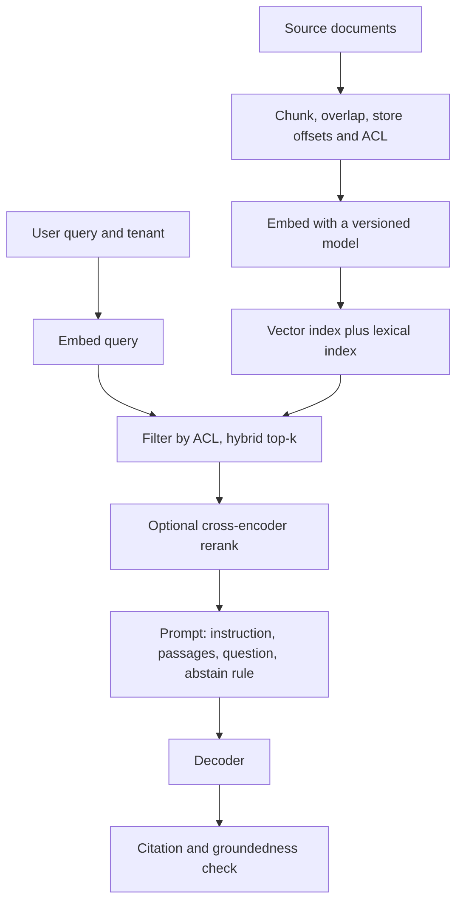

## Why this matters

A language model answers from its parameters. Those parameters are a lossy compression of the pretraining corpus, they go stale, and they do not know your private documents. Retrieval-augmented generation fetches passages at request time and asks the model to answer from those passages. Done well, it cites the policy you shipped last week. Done badly, it retrieves the wrong chunk, the prompt ignores the chunk, and the model answers fluently from memory anyway. The system, not the decoder, is the product. This lesson builds a tiny retriever — chunk, embed, cosine top-k — and the prompt contract around it. Evaluation of whether the answer was actually supported is the next lesson, together with agents and guardrails.

## Intuition

Treat the model as a reader, not as a database. You are responsible for putting the right page on the desk. A vector index is a fast way to find pages whose embeddings point the same direction as the query. It is not a keyword engine, and it is not a guarantee of relevance. Hybrid search uses both a lexical score and a vector score because rare identifiers — SKUs, error codes, statute numbers — are exactly what dense embeddings smear together, and exactly what a user types.

The prompt then has a job: tell the model to use the pages, to abstain when the pages do not contain the answer, and to quote the passage it used. Without the abstain instruction and a way to check it, retrieval quality and generation quality are entangled and you cannot fix either.

## Core concept in depth

### Chunking

Documents are too long for a prompt and too long for one embedding to summarize. Split them into chunks with overlap so a sentence that crosses a boundary still appears whole in one chunk. Chunk size is a trade-off. Short chunks retrieve precisely and lack context. Long chunks carry context and waste the top-k budget on one section. A few hundred tokens with a small overlap is a sane start, not a law. Keep the document id, the section title, and the character offsets with the chunk. You will need them for citations and for deleting a document later. A chunk without a source is a string you cannot audit.

Do not split in the middle of a table or a code block if you can detect them. Do not embed a chunk that is only a header. The embedding of "Chapter 4" is close to nothing useful and will still be retrieved sometimes.

### Embeddings and the index

A bi-encoder embeds the query and the chunk separately. The score is a dot product or a cosine, which is a dot product after normalization. You can precompute chunk vectors. A cross-encoder scores the pair jointly and is more accurate and too slow to run on the whole corpus; use it to rerank the top fifty from the bi-encoder. The embedding model is part of the index. If you change models, you must re-embed. There is no conversion.

An exact index scans every vector. An approximate nearest-neighbor index — HNSW is the common graph — trades a little recall for latency. Measure that recall on your queries. A missed chunk cannot be cited. Metadata filters (tenant, product, date) should apply so one customer never retrieves another's documents. Filtering after the nearest-neighbor search can empty the list if the index returned neighbors from the wrong tenant. Filtering inside the search, or partitioning an index per tenant, is the design that matches the threat.

### The prompt contract

A reliable pattern has four parts. A system instruction that states the task and the abstain rule. The retrieved passages, each labeled with a source id. The user question. A request for a short answer plus the source ids actually used. Tell the model what to do when the passages disagree: quote both, or prefer the newer source if you passed timestamps. Do not leave that implicit.

Put the passages before the question or after, and be consistent. Instructions at the very end are sometimes followed more reliably, and sometimes the model latches onto the first passage. Test both on your data. Keep the template in version control next to the index version. A prompt change is a model change.

Few-shot examples in the prompt teach a format. They also consume context and can be copied inappropriately. Use them for format, not as a substitute for retrieval. Chain-of-thought — asking the model to reason in writing before the answer — can help hard questions and can also produce confident fiction. If you need the reasoning for debugging, log it. If you show it to users, edit it. Do not assume the written reasoning is the cause of the answer.

### What fails in production

Stale index: the document changed, the vector did not. Schedule re-embeds on write, and delete vectors when the source is deleted. Query embedding mismatch: the query is a keyword salad and the chunks are prose, so cosine misses a page that BM25 would have found. Hybrid retrieval fixes this more often than a larger model. Context overflow: you stuffed too many chunks and the middle ones are ignored. Fewer, better chunks beat a full dump. Citation drift: the model names source 2 while using knowledge from pretraining. The next lesson's groundedness check exists for this. Empty retrieval: the abstain path must be tested, not only the happy path.

Access control is a retrieval problem. If the index contains rows the user cannot see, the model will quote them. Filter before the prompt is built. Do not rely on the model to "not mention" a passage you already showed it.

## Diagram / flowchart



### Dry-run table

Three chunks, already embedded in 2D, and a query. Cosine is the score. Top-2 will be passed to the prompt.

| Id | Vector | Cosine with query [1, 0] |
| --- | --- | --- |
| A | [1, 0] | 1.0 |
| B | [0.6, 0.8] | 0.6 |
| C | [0, 1] | 0 |

Top-2 is A then B. C is orthogonal and should not be in the prompt. If A is the wrong tenant, the filter must remove it before the top-2 cut, not after you have already dropped B to make room. Suppose A is forbidden and you only look at the raw top-2: you pass A and B, leak A, and never consider a hypothetical D that was third and legal. Filter first, then cut. The table is the incident report.

## Code

```python
import math


def cosine(a: list[float], b: list[float]) -> float:
    dot = sum(x * y for x, y in zip(a, b))
    na = math.sqrt(sum(x * x for x in a))
    nb = math.sqrt(sum(y * y for y in b))
    if na == 0 or nb == 0:
        return 0.0
    return dot / (na * nb)


def top_k(
    query: list[float],
    chunks: list[dict],
    k: int,
    tenant: str,
) -> list[dict]:
    allowed = [c for c in chunks if c["tenant"] == tenant]
    ranked = sorted(allowed, key=lambda c: cosine(query, c["vector"]), reverse=True)
    return ranked[:k]


def build_prompt(question: str, passages: list[dict]) -> str:
    lines = [
        "Answer using only the passages. If they do not contain the answer, say you do not know.",
        "Cite passage ids you used.",
    ]
    for p in passages:
        lines.append(f"Passage {p['id']}: {p['text']}")
    lines.append(f"Question: {question}")
    return "\n".join(lines)


if __name__ == "__main__":
    chunks = [
        {"id": "A", "tenant": "acme", "vector": [1.0, 0.0], "text": "Refunds take 5 days."},
        {"id": "B", "tenant": "acme", "vector": [0.6, 0.8], "text": "Shipping is free over 50."},
        {"id": "C", "tenant": "other", "vector": [1.0, 0.0], "text": "Internal margin targets."},
    ]
    hits = top_k([1.0, 0.0], chunks, k=2, tenant="acme")
    print([h["id"] for h in hits])
    print(build_prompt("How long do refunds take?", hits))
```

The hit list is A then B. C has the same vector as A and would have ranked first alongside A if the tenant filter were missing. The prompt contains the abstain rule, the passage texts, and the question. It does not contain C's internal sentence. That is the entire security property of this function, and it is easy to lose the moment someone "simplifies" the filter.

## Complexity analysis

| Stage | Cost | Scales badly when |
| --- | --- | --- |
| Chunk and embed a corpus | Θ(tokens) through the embedding model | You re-embed the world on every model tweak |
| Exact search | Θ(N d) per query | N is millions and d is thousands |
| HNSW search | Roughly logarithmic in friendly data, with a build cost | Recall target is very high or the graph is stale |
| Cross-encoder rerank of k | Θ(k) full pair encodings | You set k to the whole corpus |
| Prompt fill | Θ(k · chunk length) tokens | The decoder's context or its quadratic attention |
| Hybrid lexical plus vector | Two lists to merge | The fusion weights are untuned and one side always wins |

The expensive mistake is re-embedding a large corpus because a prompt changed. Prompts do not require re-embedding. Embedding-model changes do. Keep those versions separate so a copy edit does not launch a cluster job. The second expensive mistake is a cross-encoder on every document. Rerank a short list.

Approximate indexes need a recall test: of the true top-k by exact cosine, how many did the index return? If you never compute the exact top-k on a sample, you do not know. Latency without recall is a vanity metric.

## Tricks, tips and patterns

- Store source id, offsets, tenant, and embedding-model version on every chunk.
- Filter by access control before you cut top-k. Partition indexes if the filter would otherwise be a hope.
- Hybrid search for identifiers and rare strings. Dense search for paraphrases. Fuse on a validation set of real queries.
- Overlap chunks slightly. Do not embed headings alone.
- Put an abstain rule in the prompt and test questions whose answers are absent.
- Rerank with a cross-encoder only the candidates the first stage returned.
- Re-embed on document write and on embedding-model change, not on prompt change.
- Log retrieved ids with the answer. You cannot debug a citation you did not store.

## Common mistakes and edge cases

- One embedding for a 50-page PDF. The vector is a blur and retrieval is luck.
- Changing the embedding model and querying an old index.
- A metadata filter applied after a global top-k, leaking nothing only when you are lucky and dropping legal hits when you are not.
- Stuffing 30 chunks into the prompt and assuming the model read the middle.
- No abstain path, so every question gets a fluent answer from pretraining.
- Citations that name a passage while the sentence came from memory. Looks grounded, is not.
- Deleting a document in the CMS and leaving the vectors. The model will quote the deleted policy.
- Evaluating retrieval with the generator's answer quality only. A bad answer does not tell you whether the chunk was missing.

## Interview notes

Draw the pipeline: chunk, embed, filter, retrieve, optional rerank, prompt, generate, check. State which stages are versioned.

Explain bi-encoder versus cross-encoder and why you cascade them. Explain hybrid search with one example of a query dense search misses, such as an error code.

The access-control question is mandatory in any serious design interview. Answer with filter-before-cut or with an index partition, and say the model is not a security boundary.

Mention stale deletes, abstain tests, and the fact that prompt edits do not require re-embedding. Offer a recall-at-k of the retriever separate from the answer's correctness. The next lesson measures the second.

## Practice problems

1. [Cosine Similarity](/practice/ml-cosine) — the bi-encoder score (easy).
2. [Dot Product](/practice/ml-dot) — the same score after you normalize vectors (easy).
3. [k-NN Classify](/practice/ml-knn-classify) — the neighbor lookup, pointed at chunks instead of labels (medium).
4. Recompute the dry-run cosines and confirm C is excluded for tenant acme even though its vector matches the query.
5. Write two test questions: one answered by passage A, one answered by none of the passages. The second must abstain.

## Summary / cheat sheet

- RAG puts source passages on the desk and asks the model to read. The model is not the system of record.
- Chunk with overlap, keep source and ACL metadata, and embed with a versioned model.
- Bi-encoders make the index. Cross-encoders rerank a short list. Hybrid search catches rare strings.
- Filter by tenant and permission before top-k. The prompt is not an access-control layer.
- The prompt needs an abstain rule and source ids. A prompt change is not a re-embed.
- Log retrieved ids. Measure retriever recall separately from answer quality.
- Deletes and document updates must update the index. A stale vector is a stale policy quote.

## Further reading

- [Lewis et al., Retrieval-Augmented Generation](https://arxiv.org/abs/2005.11401)
- [Karpukhin et al., Dense Passage Retrieval](https://arxiv.org/abs/2004.04906)
- [Johnson, Douze, Jégou, Billion-scale similarity search with GPUs (Faiss)](https://arxiv.org/abs/1702.08734)
- [Hugging Face sentence-transformers documentation](https://www.sbert.net/)
- [Malkov and Yashunin, HNSW](https://arxiv.org/abs/1603.09320)
