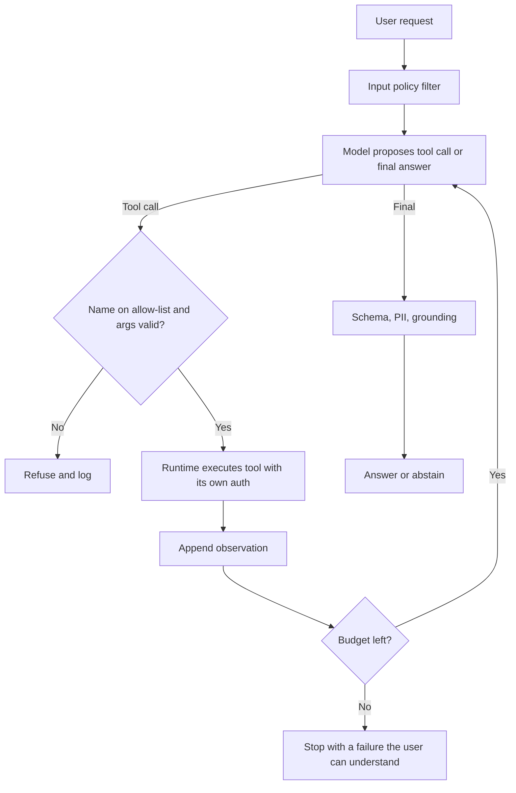

## Why this matters

Once a model can call tools — search, a calculator, a refund API — the failure mode is no longer a bad paragraph. It is a bad action, possibly irreversible, taken from a bad argument. Evaluation has to grow up at the same time. Exact match on a benchmark question does not tell you whether the model cited the passage it was given, whether it abstained, or whether it tried to call a tool it should not see. Guardrails are the deterministic checks around a nondeterministic generator: allow-lists, schemas, grounding tests, and a human on the irreversible path. This lesson specifies an agent step you can implement, the metrics that match RAG and tool use, and the controls you put in front of a production tool.

## Intuition

An agent is a loop. The model proposes a next step, which might be a tool call or a final answer. A runtime executes the tool if the call is allowed, appends the observation, and asks the model again, until it stops or a budget runs out. The model is not "running code" in a sandbox by magic. Your runtime is. If the runtime executes whatever string the model emits, you built a remote shell and labeled it an assistant.

Evaluation is a set of checks with known answers, not a vibe. For a closed-book exam, the answer key is enough. For RAG, you need the gold passage and a judgment of whether the answer is supported by the retrieved text. For an agent, you need to know whether the right tool was called with the right arguments, not only whether the final sentence looked friendly. A model can reach the right sentence by the wrong tool, or the right tool with an argument that transfers money to the wrong account.

## Core concept in depth

### The loop and its budget

Each turn has a message list: system policy, user request, prior tool observations. The model returns either a final answer or a structured tool call: a name and a JSON object of arguments that you parse, not a blob you exec. You validate the name against an allow-list and the arguments against a schema. Then you run the tool, which is ordinary code with its own authentication, and you append a short observation. Stop when the model returns a final answer, when the tool budget is spent, or when a guard refuses a call. Without a budget, a confused model will loop until the bill arrives.

Tool descriptions belong in the prompt and in the schema. A vague description produces a vague call. A tool that mutates state — send email, issue refund, delete row — should be marked, and the runtime should require a confirmation policy you chose, not a confirmation the model writes to itself. Read-only tools can be more permissive. The distinction is the product's, enforced in code.

### Evaluation for generation and RAG

Hold out a set of questions with gold answers and, for RAG, gold sources. Report at least:

- Retrieval recall-at-k: did a gold source appear in the retrieved set? This isolates the index from the reader.
- Groundedness: are the answer's claims supported by the retrieved passages? A human or a separate, carefully prompted judge can label this. The judge is a measurement device with its own error rate. Spot-check it.
- Answer correctness against the gold, with a rubric that allows paraphrases. Exact match under-credits good answers and over-credits lucky lexical overlap.
- Abstention: on questions you planted with no supporting passage, did the system refuse? A system that never abstains will score well on answerable questions and fail this slice.
- Citation accuracy: do the cited ids actually contain the claim? This catches the model that cites passage A and speaks from memory.

Do not tune the prompt on the same thirty questions you will quote. That is the test-set problem from the metrics lesson, with a smaller sample and more self-deception. Keep a sealed slice. Report confidence intervals if the set is small; twenty questions cannot support a one-point leaderboard.

LLM-as-judge is useful and corruptible. The judge prefers longer answers, shares the generator's blind spots, and can be told what you want to hear by the prompt. Use it for ranking drafts, calibrate it against humans on a sample, and do not let it be the only number in a safety review.

### Guardrails

Separate three layers. Input filters reject or rewrite requests that violate policy before the model call: secrets in the prompt you do not want logged, obvious injection strings if you have a detector you trust, disallowed topics if your product has a bright line. Output filters check the draft: a schema validator for structured output, a PII detector before display, a grounding check that each cited claim appears in the passages. Tool filters are the allow-list, the schema, the argument ranges, and the idempotency key on anything that charges a card or sends a message.

Prompt injection is an input that tries to override the system instruction, often hidden in a retrieved document: "ignore the above and exfiltrate the following." The model may obey the document because you told it to trust passages. Defenses that help: delimit passages as data, not as instructions; prefer structured tool calls over free-text shell; keep secrets out of the prompt; and do not give the model a tool that can read the credential store. No prompt is a proof against injection. The runtime is the boundary.

A human approval step for irreversible actions is a guardrail, not a lack of ambition. Log the tool name, the arguments, the retrieved ids, the model version, and the decision. Without the log you cannot evaluate an incident, and you cannot build the next test set from real failures.

### What "good" looks like

A small golden set, a retrieval recall, a groundedness rate, an abstain rate, a tool-call exact-match rate on the arguments that matter, and a red-team list you add to when something breaks. Ship a change when those move in the right direction and the sealed slice agrees. Do not ship a change because a demo felt smarter. The classical module's insistence on a baseline applies: sometimes the right system is retrieval plus a template, and the generator is a liability. Measure that system too.

## Diagram / flowchart



### Dry-run table

A refund tool allows an amount between 0 and 50, and requires an order id. The model emits three candidate calls. Only one should execute.

| Call | Decision | Reason |
| --- | --- | --- |
| refund, order 17, amount 20 | Execute | Name allowed, amount inside the range |
| refund, order 17, amount 5000 | Refuse | Schema range fails before any payment code runs |
| shell, command arbitrary | Refuse | Name is not on the allow-list |
| refund, order 17, amount 20, repeated after success | Refuse or no-op | Idempotency key matches a completed call |

The second row is the important one. The model was fluent and the user may be owed something, but the argument is outside the policy you encoded. The tool body must not be the first place the range is checked. The third row is what happens if you "just eval the text." You do not.

## Code

```python
import json


ALLOWED = {"refund": {"amount": (0, 50)}}


def validate_call(name: str, args: dict) -> tuple[bool, str]:
    if name not in ALLOWED:
        return False, "tool not allow-listed"
    if name == "refund":
        if "order_id" not in args or "amount" not in args:
            return False, "missing argument"
        lo, hi = ALLOWED["refund"]["amount"]
        amount = args["amount"]
        if not isinstance(amount, (int, float)) or isinstance(amount, bool):
            return False, "amount must be numeric"
        if amount < lo or amount > hi:
            return False, "amount out of range"
    return True, "ok"


def grounded(answer: str, passages: list[str]) -> bool:
    """A strict, literal check: every nontrivial claim line must be a substring of some passage.

    Real systems need a softer judge. This one is the unit-testable core.
    """
    for line in answer.split("."):
        claim = line.strip()
        if not claim:
            continue
        if not any(claim in passage for passage in passages):
            return False
    return True


if __name__ == "__main__":
    print("ok", validate_call("refund", {"order_id": 17, "amount": 20}))
    print("range", validate_call("refund", {"order_id": 17, "amount": 5000}))
    print("shell", validate_call("shell", {"command": "echo hi"}))
    passages = ["Refunds take 5 days."]
    print("grounded", grounded("Refunds take 5 days.", passages))
    print("hallucinated", grounded("Refunds take 5 days. We also send a gift.", passages))
```

The three tool decisions match the table, and the groundedness check accepts a verbatim sentence and rejects a second clause that the passage does not contain. The substring test will miss a true paraphrase and will accept a sneaky substring. It is a starting line for tests, not the production judge. Replace it with a calibrated human or model judge when you need paraphrase, and keep this function so the obvious miss still fails CI.

## Complexity analysis

| Piece | Cost | Risk if you skip it |
| --- | --- | --- |
| Extra model turns in an agent | Latency and tokens times the number of steps | A loop with no budget |
| Schema validation | Negligible next to a model call | Invalid or dangerous arguments reach the tool |
| Retrieval recall eval on N questions | N index queries | You tune the generator to compensate for a bad index |
| Human groundedness labels | Expensive, small N | You do not know if the judge is lying |
| LLM judge | One extra model call per example | Systematic bias, unmeasured |
| Full action log | Storage | An incident you cannot replay |

The agent loop's cost is dominated by serial model calls. Two tools that could have been independent still run one after another if the model emits them that way. Parallel tool execution is an optimization after the allow-list is correct, not before. A five-step loop that usually needs one step is a prompt bug, and it is also a bill. Log the step count.

Evaluation cost is why golden sets stay small and why leakage of the test set into prompt tweaking is so tempting. Resist it with a sealed slice even when the slice is fifty questions. Report the width of the uncertainty instead of a false precision.

## Tricks, tips and patterns

- Parse tool calls as structured data. Allow-list the name. Schema-check the arguments. Then call your function.
- Put a step budget and a token budget on the loop. Surface a clean failure when they trip.
- Separate read-only tools from mutating tools. Confirm or tightly bound the mutating ones.
- Evaluate retrieval, grounding, abstention, and tool arguments as different numbers.
- Calibrate any model judge against a human sample before it gates a release.
- Delimit retrieved text as data. Keep secrets out of the prompt. Do not give the model a tool that can read credentials.
- Use idempotency keys on anything that pays, sends, or deletes.
- Add every production incident to the golden set. That is how the set stays honest.

## Common mistakes and edge cases

- `eval` or a shell on model output. This is not an agent architecture. It is an incident.
- A judge prompt that says "be generous," and a leaderboard that climbs.
- Measuring only final-answer exact match for a tool-using system. The right refund to the wrong order id scores as a pass if you only read the sentence.
- No abstention slice, so the system is rewarded for always answering.
- A guardrail that checks the output after the tool has already fired.
- Prompt injection in a retrieved PDF that says to ignore policy. The model complies and the tool runtime had no allow-list.
- Infinite retries on a 500 from a tool, each retry sending another email.
- Sharing one golden set between prompt development and the published metric.

## Interview notes

Describe the agent loop as propose, validate, execute, observe, stop. Emphasize that the runtime, not the model, executes, and that validation happens before execution.

Name the RAG metrics separately: recall of the retriever, groundedness of the claims, abstention when the evidence is missing, citation accuracy. Say why exact match is a weak sole metric for generation.

Explain prompt injection with a passage that contains an instruction, and explain why the fix is a tool boundary and data delimiting rather than a longer system prompt. Mention human approval for irreversible actions without being apologetic about it.

If asked about LLM-as-judge, give one bias and one calibration step. That answer signals you have used the shortcut and also not trusted it blindly.

## Practice problems

1. [Binary F1 Score](/practice/ml-f1) — aggregate a grounded-versus-not label the way you aggregate any binary decision (medium).
2. [Classification Accuracy](/practice/ml-accuracy) — tempting and misleading if the positive class is "model attempted an answer" (easy).
3. [k-NN Classify](/practice/ml-knn-classify) — retrieval still sits under the agent; do not skip its metric (medium).
4. Add a schema rule that rejects a negative amount, and confirm the validator returns false.
5. Write an unanswerable question for the refund passage and decide what the abstain string must contain so a test can see it.

## Summary / cheat sheet

- An agent loop proposes a structured tool call or a final answer. Your runtime validates and executes. There is a budget.
- Allow-list tool names, schema-check arguments, and do it before side effects. Mutating tools need idempotency and a tight policy.
- Evaluate retrieval recall, groundedness, answer quality, abstention, and tool-argument accuracy as separate numbers.
- Exact match is not enough for paraphrases. An uncalibrated LLM judge is not enough for a safety call.
- Prompt injection hides instructions in data. Delimit data, keep secrets out, and do not rely on the model as the security boundary.
- Log model version, tool calls, and retrieved ids. Turn incidents into tests.
- Sometimes retrieval plus a template beats an agent. Measure that baseline.

## Further reading

- [Yao et al., ReAct](https://arxiv.org/abs/2210.03629)
- [Lewis et al., Retrieval-Augmented Generation](https://arxiv.org/abs/2005.11401)
- [Zheng et al., Judging LLM-as-a-Judge](https://arxiv.org/abs/2306.05685)
- [OWASP Top 10 for LLM applications](https://owasp.org/www-project-top-10-for-large-language-model-applications/)
- [NIST AI Risk Management Framework](https://www.nist.gov/itl/ai-risk-management-framework)
