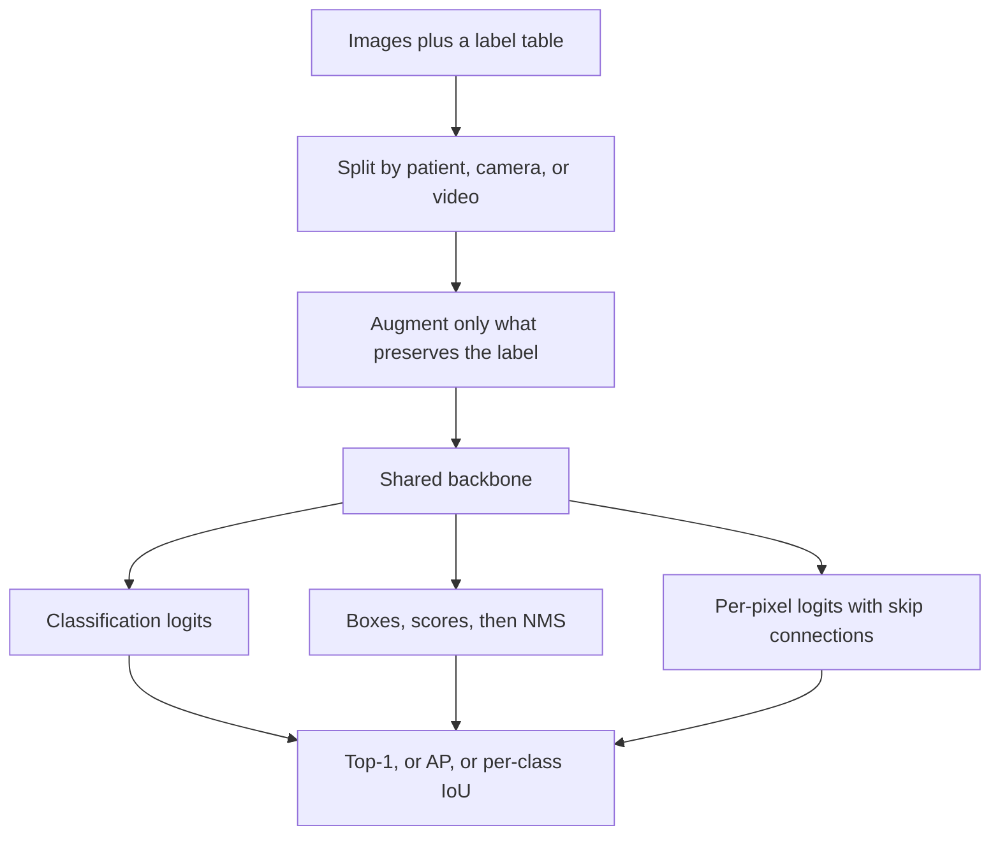

## Why this matters

Vision models fail in ways a leaderboard accuracy does not show: a classifier trained on daylight photos, a detector whose boxes are perfect on the validation camera and empty on the new one, a segmentation mask that leaks a patient id burned into the corner of the image. The convolutional layer from the deep-learning module is the feature extractor. This lesson is the pipeline around it — labels, augmentations that match reality, task heads, and metrics — so you can ship a vision system rather than a notebook that top-1s a benchmark.

## Intuition

An image is a grid of measurements, not a bag of objects. Classification assigns one label to the grid. Detection assigns boxes and labels, and must say "nothing" in most locations. Segmentation assigns a label to every pixel, or to every pixel of an instance. The supervision, the loss, and the metric all change with that choice. A classifier's softmax over breeds of dog is the wrong head for "find the tumors," and an intersection-over-union score is the wrong celebration for a camera that never saw night.

Augmentation is a claim about what changes you want the model to ignore: flips, small crops, brightness, if those preserve the label. A flip that turns a "left" lane into a "right" lane is not augmentation. It is label noise you introduced on purpose.

## Core concept in depth

### Data before architecture

Store images as files plus a label table, not as a giant array you cannot regenerate. Record the camera, the time, and the split. Split by source — by patient, by camera, by video — so adjacent frames of the same scene do not sit on both sides. A random split of frames from one video is leakage with a high score.

Labels need a guide. Detection boxes should say whether the box touches the object or includes the shadow. Segmentation needs a rule for boundaries. Two annotators will disagree; measure agreement on a sample before you treat the labels as truth. Class imbalance is the default: most pixels are background, most windows contain no defect. A loss that ignores that will predict background and look accurate.

Normalize pixels the way the backbone expects. A network pretrained on a standard mean and standard deviation will waste capacity if you feed it raw 0–255 in a different layout. Channels-first versus channels-last must match the code. Corrupt files and truncated downloads should fail the loader, not become a black tensor that trains.

### Classification

A backbone, convolutional or transformer, produces a vector. A linear layer maps it to class logits. The loss is softmax cross-entropy, with class weights or a sampled loss if the tail classes matter. Top-1 accuracy is the fraction of images whose highest logit is the true class. Top-5 is looser and is what you quote only if the product shows five guesses. Calibration still matters if the score triggers an action. A confidence of 0.99 on the wrong class is worse than a humble error.

Transfer learning freezes the backbone for a short head-only warmup, then unfreezes at a smaller learning rate. On a tiny dataset, a frozen backbone plus a linear head is the baseline to beat, and it is often the production model. Training a giant net from scratch on a thousand images is how you memorize the thousand images.

### Detection

A detector proposes boxes and class scores. One-stage detectors predict boxes densely across the image. Two-stage detectors propose regions and then classify them. Either way the matching rule matters: a prediction is a true positive if its intersection-over-union with a ground-truth box exceeds a threshold, often 0.5, and the class matches. Unmatched predictions are false positives. Unmatched ground truths are false negatives. Average precision integrates precision across recall for a class. Mean average precision averages that across classes and sometimes across IoU thresholds. A single mAP number hides whether you miss small objects. Report a slice by size.

Non-maximum suppression removes duplicate boxes that land on the same object. Its IoU threshold is a product knob: too low and you erase true neighboring objects, too high and you double-count. It is not trained. Do not forget it at inference and then compare to a paper that used it.

### Segmentation

Semantic segmentation labels pixels by class. Instance segmentation separates object A from object B of the same class. The loss is a pixel cross-entropy, often combined with a Dice term that cares about overlap rather than the dominant background. Mean intersection-over-union across classes is the usual summary. A model can have a lovely global IoU and systematically miss a rare class. Print per-class IoU.

Upsampling back to the input resolution uses skips from early high-resolution maps, as in a U-Net, so boundaries stay sharp. A decoder that only sees the deepest, smallest map will blob. For medical or industrial masks, a blurry boundary can be the whole error that matters. Look at the mask, not only the mean.

### Deployment realities

Images at serving time will have different resolution, compression, and color than the training set. Letterbox rather than warp if aspect ratio carries meaning, and be consistent. A detector trained at 640 pixels and served on a 200-pixel thumbnail is a different model. Latency is dominated by the backbone and by preprocessing on the CPU if you forget to pipeline it. Quantization and smaller input sizes are the levers, and each costs accuracy you should remeasure, not assume.

Privacy sits in the pixels. Faces, screens, and documents in the background are training data you may not have the right to keep. A model that needs those cues will fail when you blur them, which is something you want to discover offline.

## Diagram / flowchart



### Dry-run table

Two predicted boxes and one ground truth. IoU is intersection area divided by union area. A threshold of 0.5 decides the match.

| Box | Intersection | Union | IoU | At 0.5 |
| --- | --- | --- | --- | --- |
| Pred A vs truth | 6 | 10 | 0.60 | true positive if the class matches |
| Pred B vs truth | 1 | 9 | 0.11 | false positive |
| Truth with no better pred | — | — | — | would be a false negative if A were absent |

If A and B both exceeded 0.5, non-maximum suppression should have dropped the lower-score duplicate before matching, or the matcher should allow only one prediction per ground truth. Double-counting A and B as two true positives is a metric bug that inflates AP. Implement the match as a greedy one-to-one assignment.

## Code

```python
def iou(a: tuple[float, float, float, float], b: tuple[float, float, float, float]) -> float:
    """Boxes are x1, y1, x2, y2 with x2 > x1 and y2 > y1."""
    ax1, ay1, ax2, ay2 = a
    bx1, by1, bx2, by2 = b
    ix1, iy1 = max(ax1, bx1), max(ay1, by1)
    ix2, iy2 = min(ax2, bx2), min(ay2, by2)
    inter = max(0.0, ix2 - ix1) * max(0.0, iy2 - iy1)
    area_a = (ax2 - ax1) * (ay2 - ay1)
    area_b = (bx2 - bx1) * (by2 - by1)
    union = area_a + area_b - inter
    if union <= 0:
        return 0.0
    return inter / union


def greedy_match(preds: list[tuple[float, tuple]], truths: list[tuple], threshold: float = 0.5) -> tuple[int, int, int]:
    """preds are (score, box), highest score first. Returns tp, fp, fn."""
    used = [False] * len(truths)
    tp = 0
    for _, box in sorted(preds, key=lambda p: p[0], reverse=True):
        best_j, best = -1, threshold
        for j, truth in enumerate(truths):
            if used[j]:
                continue
            score = iou(box, truth)
            if score >= best:
                best, best_j = score, j
        if best_j >= 0:
            used[best_j] = True
            tp += 1
    fp = len(preds) - tp
    fn = used.count(False)
    return tp, fp, fn


if __name__ == "__main__":
    truth = (0.0, 0.0, 4.0, 4.0)  # area 16
    pred_a = (1.0, 1.0, 4.0, 4.0)  # inter 9, union 16+9-9 = 16, iou 9/16 = 0.5625
    pred_b = (10.0, 10.0, 12.0, 12.0)
    print("iou A", round(iou(pred_a, truth), 3))
    print("match", greedy_match([(0.9, pred_a), (0.8, pred_b)], [truth]))
```

IoU of A against the truth is 0.5625, above 0.5, and B does not overlap, so the match returns one true positive, one false positive, and zero false negatives. Change the threshold to 0.9 and A no longer matches: zero true positives, two false positives, one false negative. That sensitivity to the threshold is why mAP averages over thresholds instead of trusting a single cutoff you did not examine.

## Complexity analysis

| Task | Output size | Typical bottleneck | Metric cost |
| --- | --- | --- | --- |
| Classification | One distribution per image | Backbone | Θ(classes) |
| Detection | Many boxes per image | Backbone plus NMS, which is small next to the net until the box count explodes | Matching is Θ(preds · truths) per image |
| Segmentation | One label per pixel | Decoder activations at high resolution | IoU is a pass over the mask |
| Augmentation | A new tensor per view | CPU unless you do it on device | None, but it multiplies epoch time |
| Video, naive per frame | T times one image | You pay T backbones and flicker | Temporal consistency is a separate metric |

High-resolution segmentation is memory bound because the early maps and the output mask are large. Classification can use a smaller crop. Detection at high resolution is how you see small objects, and it is also how you run out of GPU memory. Tiling the image, running the model, and merging boxes across tiles works if you handle the seams; boxes cut by a tile boundary need overlap between tiles or they disappear.

A two-stage cascade — a cheap model that rejects easy background, an expensive model on the rest — is often the latency design that makes a detector deployable. Measure the cascade's recall, not only its average latency. The cheap stage can throw away the only defect in the batch.

## Tricks, tips and patterns

- Split by the unit that would leak: patient, camera, video, not by frame.
- Write the label guide down. Measure annotator agreement before you model the disagreement as noise.
- Augment only invariances that preserve the label. Test them by looking at pictures.
- Start from a pretrained backbone. Beat a linear head on frozen features before you train everything.
- Report detection by object size. Report segmentation by class. A mean can hide the class you care about.
- Apply NMS at inference if the training recipe assumed it. Match predictions one-to-one with truths.
- Letterbox, do not warp, unless distortion is the feature. Use the backbone's normalization.
- Look at failures. A confusion between two classes is a label problem or a data problem as often as it is an architecture problem.

## Common mistakes and edge cases

- Adjacent video frames in train and test. The score is a memory of the scene.
- Horizontal flips on data where left and right are the label.
- mAP computed with double-counted matches. AP becomes fiction.
- Ignoring small objects, then deploying a camera that sees them as ten pixels.
- Batch-norm in train mode at inference, or a preprocessing mean computed on 0–255 while the weights expect 0–1.
- A segmentation loss dominated by background, and a pretty accuracy that never paints the defect.
- Serving a different resolution than you validated, with no letterbox, and blaming the weights.
- Faces and on-screen text you had no right to train on, discovered by someone else.

## Interview notes

Distinguish classification, detection, and segmentation by the structure of the output and the metric. Define IoU and a true positive at a threshold. Mention one-to-one matching and NMS.

Explain a leakage-proof split for video or medical images. Explain an augmentation that would be illegal for the label.

Transfer learning: frozen head warmup, then a smaller learning rate. The baseline is a linear probe. If you cannot beat it, more architecture will not help until the data changes.

For deployment, mention resolution, normalization, and a cascade. Mention that you look at per-class and per-size slices rather than one mAP.

## Practice problems

1. [Classification Accuracy](/practice/ml-accuracy) — image top-1 is this metric (easy).
2. [Binary F1 Score](/practice/ml-f1) — a single-threshold detector summarized as a class decision (medium).
3. [Softmax](/practice/ml-softmax) — the classification head (medium).
4. Compute IoU for the dry-run boxes by hand and confirm the match counts at thresholds 0.5 and 0.9.
5. Name one augmentation that preserves a "cat versus dog" label and one that destroys a "left-facing versus right-facing" label.

## Summary / cheat sheet

- Classification labels the image, detection labels boxes, segmentation labels pixels. Losses and metrics follow the structure.
- Split by scene, not by neighboring frames. Agree on a label guide.
- Augmentation encodes invariances. Illegal flips are label noise.
- IoU is intersection over union. A true positive needs class agreement and an IoU threshold, matched one-to-one. NMS removes duplicate boxes.
- mAP and mean IoU hide size and class slices. Report the slice you will be fired for missing.
- Pretrained backbones plus a careful head beat from-scratch giants on small data.
- Serve the resolution and normalization you validated. The pixels contain privacy whether or not the label mentioned it.

## Further reading

- [Stanford CS231n detection and segmentation notes](https://cs231n.github.io/convolutional-networks/)
- [Lin et al., Microsoft COCO](https://arxiv.org/abs/1405.0312)
- [Ronneberger et al., U-Net](https://arxiv.org/abs/1505.04597)
- [PyTorch torchvision models](https://pytorch.org/vision/stable/models.html)
- [He et al., Deep Residual Learning](https://arxiv.org/abs/1512.03385)
