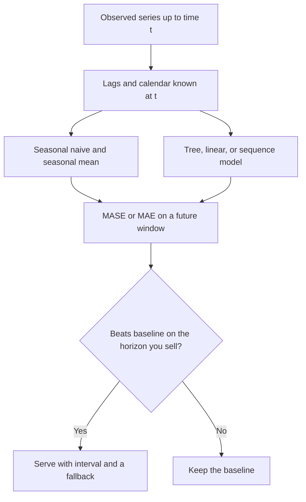

## Why this matters

Forecasting is supervised learning with a clock. The rows are not exchangeable, the future must not leak into the past, and a model that beats last week's value by a hair may not be worth serving. Most production series — demand, load, traffic — have trend, seasonality, and shocks. A deep sequence model can fit all three and still lose to a seasonal naive baseline if you set the problem up wrong. This lesson defines the forecast horizon, builds lag features without leakage, and implements the baselines you are required to beat before you reach for an LSTM or a transformer.

## Intuition

You stand at time t and may use anything known at t. You predict a value at t + h, the horizon. Predicting tomorrow's demand from today's demand is a different product from predicting next quarter. The further the horizon, the more the forecast shrinks toward a seasonal average, and the less a clever short-term model matters.

A seasonal naive forecast says "same as last week" or "same as last year." It is embarrassing when it wins, and it often wins on series that are mostly calendar. A drift or a linear trend on top of seasonality covers a surprising amount of demand planning. Only the residual is worth a heavy model. If you never fit the baseline, you will celebrate a network that learned the calendar and call it intelligence.

## Core concept in depth

### The decision and the split

Define the target: the value at horizon h, or the sum over the next h steps. Define what is known: lagged observations, calendar features, and any external series that is itself known in advance (a holiday) or that must be forecasted too (the weather). An external series you only know after the fact is leakage if you feed the future value.

Split by time. Train on the early window, validate on the next window, test on the last window. A random split of days puts Thursday's neighbors into training and asks you to "predict" Wednesday. Rolling origin evaluation refits or at least rescores at several cut dates, so one lucky month is not the whole story. If you have many related series — one per store — a split can also hold out entire series, which tests whether the model generalizes to a new store rather than to a new week of a known store. Those are different products. Do not mix up the scores.

### Features that respect the clock

Lags yₜ₋₁, yₜ₋₇, yₜ₋₃₆₅ are legal at time t. The target yₜ₊ₕ is not a feature. Rolling means must end at t. A rolling mean that includes t + 1 is leakage. Calendar features — hour, day of week, month, holiday — are legal if the calendar is known. Encode day of week as a category or a cyclical sin and cos pair so Sunday and Monday are not "far" in a linear sense only because their integers differ by 6 while Sunday is next to Monday. A tree does not care about that encoding. A linear model does.

Missing timestamps should be explicit. A gap filled by linear interpolation uses future points if you are not careful. Forward-fill uses only the past and is legal; it also hides outages. Keep a missingness indicator if an outage is informative. Do not drop the gap and then compute lags on a squeezed series whose "yesterday" is last Tuesday.

### Models, from baseline to sequence

Seasonal naive: ŷₜ₊ₕ = yₜ₊ₕ₋ₛ where s is the seasonal period, using the last observed season. Mean baseline: predict the training mean of that hour of week. Exponential smoothing and Holt-Winters add level, trend, and season with a handful of parameters and are strong, fast baselines. A gradient-boosted tree on lag and calendar features is the tabular approach and often the production winner when you have many related series and side features. An LSTM or a temporal convolution models the residual sequence directly. A transformer can attend across the lookback window. All of them must be judged against seasonal naive on a time split, in the metric the planner feels.

Direct forecasting trains a separate map for each horizon. Recursive forecasting predicts one step, feeds the prediction back as a lag, and rolls forward. Recursive forecasts compound errors. Direct forecasts do not share statistical strength across horizons unless you design them to. Multi-output models predict the whole horizon at once. Pick one and test it. Do not compare a direct model at h = 1 with a recursive model that has already rolled 24 noisy steps.

### Metrics and probabilistic forecasts

MAE treats each unit of demand equally. RMSE punishes spikes. MAPE divides by the actual and explodes when the actual is zero; do not use it on intermittent demand. A scaled error that divides by the seasonal naive's error, such as MASE, answers "did we beat the baseline" in one number. It is the metric to know.

Point forecasts hide uncertainty. A prediction interval or a quantile forecast — the 10th, 50th, and 90th percentiles — is what inventory decisions need. Pinball loss trains a quantile. Coverage of the interval on the test window should match the nominal level: a 90 percent interval that covers 60 percent of days is a confidence costume. Intervals should widen with the horizon. If they do not, you probably fit them on one-step residuals and applied them unchanged at h = 30.

### Drift and retrain

A forecaster goes stale when the process shifts: a new product, a price change, a pandemic. Monitor the error by segment and by horizon, not one global MAE. Retrain on a schedule, and keep the seasonal naive in the serving path as a fallback when the model is late, failed, or wildly worse than the baseline on the last window. Serving a stale neural forecast through a holiday it has started to miss is worse than serving last year's holiday curve.

## Diagram / flowchart



### Dry-run table

Weekly series, values 10, 12, 10, 12, 11. Seasonal period s = 2. Standing at the last observation, a seasonal naive one-step forecast copies the value from one season ago, which is the previous "type" of week. Here the pattern alternates. The last value is 11, one step before that is 12, two steps before is 10.

| Forecast | Rule | Value | Absolute error if the next point is 13 |
| --- | --- | --- | --- |
| Seasonal naive, s = 2 | copy yₜ₋₁ if we want the alternating slot? | Careful: ŷₜ₊₁ = yₜ₊₁₋₂ = yₜ₋₁ = 12 | error 1 |
| Last value | ŷ = yₜ | 11 | error 2 |
| Mean of history | (10+12+10+12+11)/5 = 11 | 11 | error 2 |

The seasonal naive uses y at t + 1 − 2, which is t − 1, the value 12. It beats the flat mean on this particular next point. One point is not a study. It is a unit test that your lag index is the horizon minus the period, not the target itself. Off-by-one lag bugs are the time-series version of the causal-mask bug: the feature contains the answer, the error is zero, and production will not be.

## Code

```python
def seasonal_naive(history: list[float], horizon: int, period: int) -> float:
    """Forecast y[t+horizon] from history that ends at t, using lag period."""
    if horizon < 1 or period < 1:
        raise ValueError("horizon and period must be positive")
    # Index of the source observation relative to the end of history.
    # y[t+horizon] copies y[t+horizon-period], which is (period - horizon) steps before the end
    # when horizon <= period.
    if horizon > period:
        raise ValueError("this toy only covers horizon within one period; roll the forecast for longer")
    source = history[-(period - horizon + 1)]
    return source


def rolling_mean_asof(history: list[float], window: int) -> float:
    """Mean of the last `window` observations. Does not look past the end."""
    if window < 1 or window > len(history):
        raise ValueError("window must sit inside the observed history")
    chunk = history[-window:]
    return sum(chunk) / len(chunk)


def mae(y_true: list[float], y_pred: list[float]) -> float:
    return sum(abs(a - b) for a, b in zip(y_true, y_pred)) / len(y_true)


if __name__ == "__main__":
    history = [10.0, 12.0, 10.0, 12.0, 11.0]
    print("seasonal", seasonal_naive(history, horizon=1, period=2))
    print("mean3", rolling_mean_asof(history, 3))
    print("mae", mae([13.0], [seasonal_naive(history, 1, 2)]))
```

The seasonal forecast prints 12, the last complete alternating partner, and the three-point trailing mean prints 11. The MAE against a fictional next point of 13 is 1. Extend the same indexing to a backtest: for each origin t in the validation range, call the function on history[:t] only. If a backtest function receives the full series and slices wrong, it will look brilliant. Test it on this five-point series where you can see the index.

## Complexity analysis

| Method | Fit | Predict one origin | Data requirement |
| --- | --- | --- | --- |
| Seasonal naive | None | Θ(1) | At least one period |
| Holt-Winters | Short iterative fit | Θ(1) | A few seasons |
| Boosted trees on lags | Standard tabular training | Θ(depth · trees) | Many series or a long history, plus side features |
| LSTM over lookback L | Θ(epochs · L · hidden²) sequential | Θ(L) | Long continuous history, careful state reset |
| Transformer over lookback | Θ(L²) attention | Θ(L²) or cached | Same, and it must beat the tree |
| Rolling-origin backtest, M origins | M fits if you refit | M forecasts | The honest eval, and the expensive one |

Refitting a heavy model at every origin of a backtest is the correct estimate and sometimes unaffordable. A compromise is a small set of origins, or a single fit with features that only use the past relative to each row, evaluated on the later rows. The compromise is biased if the fit saw those later rows. When in doubt, refit. When you cannot, do not call the number a rolling-origin score.

Trees on engineered lags parallelize and explain more easily than an LSTM. Sequence models earn their place when the residual structure is not well captured by a short list of lags, which you discover by seeing them win, not by preferring them in advance.

## Tricks, tips and patterns

- Write horizon, period, and "known at t" at the top of the notebook. Refuse features you cannot timestamp.
- Beat seasonal naive and a seasonal mean on a future window before you add a network.
- Use MASE or MAE. Do not use MAPE when zeros are real.
- Prefer a direct model or a clearly tested recursive one. Do not mix them in one chart.
- Encode calendars for linear models. Let trees split on raw day-of-week if you want, and still check Sunday wraps.
- Forward-fill only from the past. Keep a missingness flag.
- Publish a quantile or an interval if a human will hold inventory. Check coverage.
- Fall back to the baseline when the model is stale or its recent error is worse.

## Common mistakes and edge cases

- A lag that is zero steps at the horizon, also known as including the target.
- A random k-fold on time. The future trains the past.
- Interpolation across a gap using points from both sides, then forecasting as if you knew the future side.
- MAPE on intermittent demand, dominated by near-zero denominators.
- A one-step model rolled out 30 steps and compared to a direct 30-step baseline unfairly, or the reverse.
- Training across a regime change and testing inside it, so the score never sees the shift you will deploy into.
- Serving last month's model through a holiday it has already started to miss, with no baseline fallback.
- A global MAE that hides one store or one horizon where the error is operationally fatal.

## Interview notes

Define the horizon and the information set. Give the seasonal naive formula and say why it is mandatory. Sketch a time split versus a random split in one picture.

Explain leakage with a rolling mean that includes the future, and with an external regressor that is not known at decision time. Mention MASE as error relative to the seasonal naive.

Contrast direct and recursive multi-step forecasts and the error-compounding of the recursive path. Mention prediction intervals and coverage. If the interviewer works on demand, mention intermittent series and the failure of MAPE.

You do not need a novel architecture. You need the baseline, the clock, and the metric.

## Practice problems

1. [Compute Mean](/practice/ml-mean) — the trailing baseline and the training-mean forecast (easy).
2. [Mean Squared Error](/practice/ml-mse) — a spike-sensitive alternative to MAE (easy).
3. [Root Mean Squared Error](/practice/ml-rmse) — same ranking as MSE, in the units of the series (easy).
4. On the five-point series, compute the seasonal naive at horizon 1 and period 2 by hand and confirm it is 12, not 11.
5. Construct a one-row leak: include yₜ₊₁ as a feature and show the training error collapse. Then remove it.

## Summary / cheat sheet

- A forecast is a prediction at horizon h using only what is known at t. The split is temporal.
- Seasonal naive and seasonal means are the baselines. MASE reports whether you beat them.
- Lags and rolling windows end at t. Calendar features are legal. Future exogenous values are not, unless they are truly known.
- Direct, recursive, and multi-output horizons behave differently. Recursive errors compound.
- MAE is linear, RMSE punishes spikes, MAPE breaks on zeros. Intervals should cover what they claim, and widen with h.
- Trees on lags win more often than a slide about LSTMs suggests. Sequence models must earn the complexity.
- Monitor by horizon and segment. Fall back to the baseline when the model goes stale.

## Further reading

- [Hyndman and Athanasopoulos, Forecasting: Principles and Practice](https://otexts.com/fpp3/)
- [scikit-learn time series split](https://scikit-learn.org/stable/modules/generated/sklearn.model_selection.TimeSeriesSplit.html)
- [Taylor and Letham, Prophet paper](https://peerj.com/preprints/3190/)
- [Lim et al., Temporal Fusion Transformers](https://arxiv.org/abs/1912.09363)
- [Makridakis forecasting accuracy literature, via the M-competitions summary](https://www.sciencedirect.com/science/article/pii/S0169207019301876)
