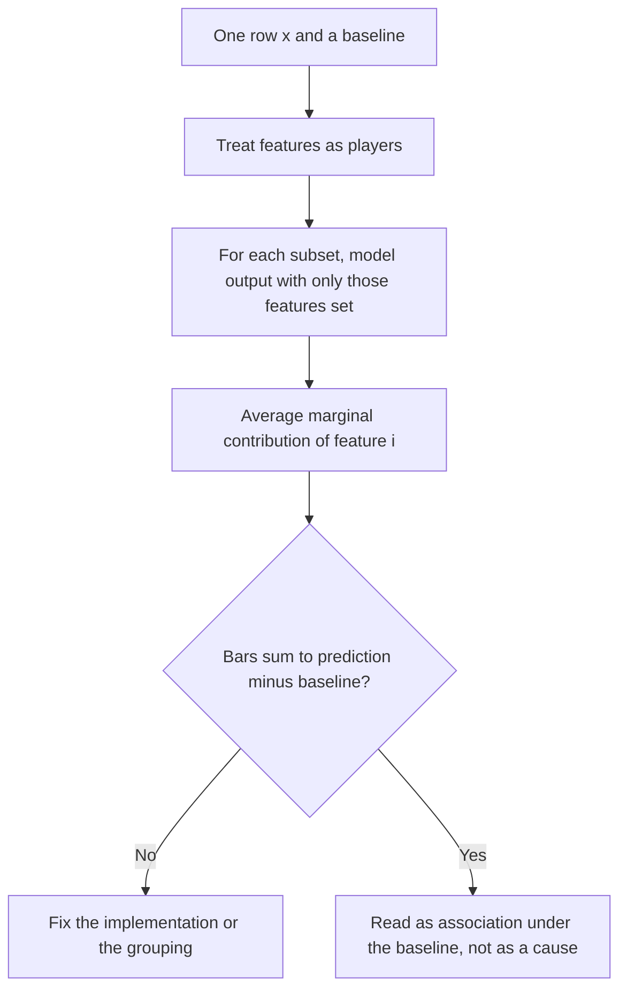

## Why this matters

A model that approves a loan, flags a transaction, or ranks a patient will be asked why. "The model said so" is not an answer a regulator, a customer, or a good engineer accepts. SHAP and LIME are two ways to attribute a single prediction to the input features. They are also easy to overread as causes. This lesson computes a tiny exact Shapley attribution and a tiny local linear surrogate, states the guarantees that actually exist, and lists the checks that stop you from narrating a correlated feature as the reason.

Global importance from the tree lesson is a different object. It summarizes the model. Local attribution explains one row. You usually need both, and you need the data dictionary so you do not explain a leaked column with a straight face.

## Intuition

Shapley values come from cooperative games. The features are players. The prediction is the payout. A player's fair share is the average, over every order the players could have arrived in, of how much the payout changed when that player joined. For a model, "joined" means "this feature took its actual value instead of a baseline value." The average marginal contribution is the attribution. The attributions plus the baseline sum to the prediction, which is why the story adds up. Computing every order is exponential in the number of features. Trees and linear models have shortcuts. Everything else uses approximations or sampling.

LIME does not average over coalitions. It perturbs the row, watches the model, and fits a simple interpretable model — usually a sparse linear one — in the neighborhood. The local coefficients are the explanation. They are faithful only where the local model fits. A jagged neural net can have a neighborhood in which the linear story is a lie. LIME tells you the fit quality if you look at it. People often do not look.

## Core concept in depth

### Shapley values for a function

Fix a row x and a baseline distribution, often the training set or a single baseline vector. For a subset S of features, define f_S as the model's expected output when features in S are held at x and the others are drawn from the baseline. The Shapley value of feature i is the weighted average of f(S union i) minus f(S) over subsets S that do not contain i. Weights are such that every feature order is equal. For an additive linear model f(x) = b + Σ wⱼ xⱼ with independent baseline features centered so their mean contribution is absorbed in b, the attribution of feature i collapses to wᵢ (xᵢ − baselineᵢ). That is the form you should be able to compute by hand. It is also the form people wrongly apply to a tree by multiplying "some importance" by "the value." Do not. Use the real formula or a library that implements it for the model class.

The efficiency property says the sum of attributions equals f(x) − f(baseline). If your dashboard's bars do not sum to the gap between the prediction and the base rate, the dashboard is wrong or it dropped a feature. Missingness, categoricals, and one-hot groups need a policy: a one-hot group is one player, not five players that each claim credit for a mutually exclusive level. Correlated features share credit in a way that depends on the order they are added. SHAP does not invent a unique causal parent. Two proxies of the same signal will both get partial credit. A causal claim needs an intervention you did not run.

TreeSHAP walks a tree and computes the exact Shapley values under a feature-independence or a path-dependent approximation, in time that is practical for forests. KernelSHAP samples coalitions and solves a weighted regression, which is model-agnostic and slower. Gradient-based methods for deep nets attribute through the computation graph and are not identical to Shapley values unless the method says they are. Read the name of the method before you put "SHAP" on the slide.

### LIME

Draw perturbed samples around x, weight them by proximity, and fit a sparse linear model to the black box's predictions on those samples. For images, the "features" are superpixels turned on and off. For text, they are words removed. The explanation is only as stable as the sampling. A different random seed can highlight a different word. Run it twice before you show a customer. If the local model's R² is poor, say the explanation is weak. A high-weight feature in a bad fit is not a reason.

LIME's neighborhood is a choice. A very small neighborhood on a discontinuous model is noisy. A large neighborhood averages over regions where the model behaves differently and the linear coefficient means nothing in particular. There is no universal width. Validate explanations against a few cases a domain expert can judge, the same way you validate a metric.

### What to explain, and what not to claim

Explain the model you serve, including calibration and the threshold. Attributing the probability and attributing the hard class decision can disagree near the boundary. Explain features the user can recognize. An attribution to a principal component is a math fact and a product failure. Group engineered features back to the source column when you can.

Do not use attributions to bless a leaked feature. If "number of fraud investigations" dominates a fraud model, the model may be reading the past decision of an analyst. The chart is correct and the feature is still illegal for the decision time. Explanations are not a leakage test. The timestamp is.

Use attributions to debug. If a vision model attributes a dog class to the copyright text in the corner, you have a spurious correlation. If a credit model attributes everything to a zip code that proxies for a protected attribute, you have a fairness investigation, not a finished explanation. The chart started the investigation. It did not end it.

### Stability and adversaries

A model can be accurate and unstable: two similar rows get opposite attributions because the model is a sharp tree. That is a property of the model, surfaced by the explanation. An adversary can also manipulate explanations in some settings, constructing a model that predicts well and attributes to an innocent feature. Do not treat a third-party model-plus-explanation bundle as audited because the bars look sensible. Audit the predictions on held-out data, and audit the features against the decision-time contract.

## Diagram / flowchart



### Dry-run table

A linear model f = 1 + 2 x₁ + 3 x₂. Baseline is (0, 0), where f = 1. The row is (1, 1), where f = 6. The gap is 5. Attributions for a linear model against a zero baseline are the weight times the feature value.

| Feature | Weight | Value minus baseline | Attribution |
| --- | --- | --- | --- |
| x₁ | 2 | 1 | 2 |
| x₂ | 3 | 1 | 3 |
| Sum | — | — | 5 = 6 − 1 |

If someone reports attributions 4 and 1, they do not sum to the gap and the report is arithmetically false, even if the bars look authoritative. This check is the first unit test of any explainability service. The second is a correlated-feature case: duplicate x₂ as x₃ with the same value and a model that uses only x₂. A good implementation should not claim x₃ is causal. It may still share credit depending on the background distribution. Be ready to say "shared credit, not cause."

## Code

```python
def linear_shap(weights: list[float], x: list[float], baseline: list[float]) -> list[float]:
    """Exact attributions for f = b + w·x when b is separate and features enter linearly.

    The baseline's contribution is not included; these are the feature shares of f(x) - f(baseline),
    and only if the model has no interactions.
    """
    return [w * (xi - bi) for w, xi, bi in zip(weights, x, baseline)]


def lime_weights(perturbed: list[list[float]], preds: list[float], proximity: list[float]) -> list[float]:
    """Weighted least squares for a local linear model with an intercept. Two features.

    Solves the normal equations for [intercept, w1, w2]. This is the LIME fit, not a sampler.
    """
    # Design rows: [1, x1, x2]
    dim = 3
    xtx = [[0.0] * dim for _ in range(dim)]
    xty = [0.0] * dim
    for row, y, p in zip(perturbed, preds, proximity):
        z = [1.0, row[0], row[1]]
        for i in range(dim):
            xty[i] += p * z[i] * y
            for j in range(dim):
                xtx[i][j] += p * z[i] * z[j]
    # 2x2-ish Gaussian elimination on a 3x3 system that is small and well-behaved in the demo.
    a = [xtx[i][:] + [xty[i]] for i in range(dim)]
    for col in range(dim):
        pivot = a[col][col]
        if abs(pivot) < 1e-12:
            raise ValueError("local design is singular; the neighborhood has no signal")
        for j in range(col, dim + 1):
            a[col][j] /= pivot
        for row in range(dim):
            if row == col:
                continue
            factor = a[row][col]
            for j in range(col, dim + 1):
                a[row][j] -= factor * a[col][j]
    return [a[i][dim] for i in range(dim)]


if __name__ == "__main__":
    phi = linear_shap([2.0, 3.0], [1.0, 1.0], [0.0, 0.0])
    print("shap", phi, "sum", sum(phi))
    # Neighborhood of the same linear function. Proximity all 1. Predictions match 1 + 2 x1 + 3 x2.
    rows = [[0.0, 0.0], [1.0, 0.0], [0.0, 1.0], [1.0, 1.0]]
    preds = [1 + 2 * r[0] + 3 * r[1] for r in rows]
    coef = lime_weights(rows, preds, [1.0, 1.0, 1.0, 1.0])
    print("lime intercept and weights", [round(c, 4) for c in coef])
```

The Shapley-style linear attributions print 2 and 3 and sum to 5, the gap between f(1, 1) = 6 and f(0, 0) = 1. The local linear fit recovers intercept 1 and weights 2 and 3, because the neighborhood is the true linear function and the design includes the basis vectors. On a nonlinear black box the recovered weights would be an approximation; print the local residual before you trust them. If the Gaussian elimination raises a singular-design error, the perturbations did not move both features and LIME has nothing to explain.

## Complexity analysis

| Method | Cost | Exact? | Model class |
| --- | --- | --- | --- |
| Linear closed form | Θ(d) | Yes for additive linear models | Linear, and some GLMs with care |
| Exact Shapley, all subsets | Θ(2ᵈ) model calls | Yes | Anything, and unusable past small d |
| TreeSHAP | Practical polynomial in trees and depth | Exact under its feature assumption | Trees and forests |
| KernelSHAP | Many coalitions times one model call | Approximate | Any black box |
| LIME | Perturbations times model calls, then a small regression | A local surrogate, not Shapley | Any black box |
| Gradient saliency | One backward pass | Not a Shapley value unless designed to be | Differentiable nets |

The exponential cost is why you do not sample all coalitions for a hundred-feature table. TreeSHAP is the default on the boosted trees you already serve. KernelSHAP on a deep model is a batch of forward passes; budget it, and cache it for the rows a human will actually review. Computing an explanation for every row of a million-row score and showing none of them is wasted compute. Computing none, and then needing one in an appeal, means you cannot reconstruct the answer unless you versioned the model and the baseline.

The baseline is part of the cost and the meaning. A baseline of all zeros on a one-hot encoding attributes to "not the other categories" in a way users misread. A baseline drawn from the training distribution answers "compared with a typical row." State which one you used in the same sentence as the bar.

## Tricks, tips and patterns

- Check that attributions sum to prediction minus baseline before you interpret a single bar.
- Group one-hot and repeated measures into one player so credit is not sliced into nonsense.
- Prefer TreeSHAP on tree models and a documented gradient or kernel method on nets. Name the method.
- For LIME, set a seed, report local fit quality, and rerun once to see if the top feature is stable.
- Explain the served model, including the threshold if the decision is a hard class.
- Use explanations to find spurious cues and leaked columns. Then fix the data. Do not stop at the chart.
- Version the explainer configuration with the model. A different baseline is a different story.
- Show a human a feature they can act on, or do not show them the raw vector.

## Common mistakes and edge cases

- Reading an attribution as a causal effect. Correlated proxies share credit.
- Bars that do not sum to the gap. The implementation is wrong and the meeting should stop.
- A one-hot group explained as five independent causes.
- LIME on a neighborhood so wide that the linear model averages two different regimes.
- An unstable LIME highlight treated as the reason in a customer email.
- Explaining a model that saw the label through a leaked feature, and calling the result fairness.
- Comparing attributions across two models with different baselines or different preprocessing.
- A saliency map on an image that lights up the corner watermark. The map is right. The model is wrong.

## Interview notes

Define a Shapley value as an average marginal contribution over feature orders, and state the efficiency property in words: the parts sum to the whole gap. Compute the linear case by hand, as in the dry-run.

Contrast LIME: a local weighted linear surrogate, faithful only when it fits, sensitive to the kernel width and the seed. Say you would check fit quality and stability.

Give the correlated-feature caveat without being asked. Give the leaked-feature caveat too: a correct explanation of a bad feature is still a bad feature. Mention TreeSHAP versus model-agnostic sampling and the cost difference.

If the question is regulatory, say you can provide a local reason and a global importance, you can log both, and you cannot honestly claim a unique cause from either.

## Practice problems

1. [One Linear Regression Step](/practice/ml-linreg-step) — the model class whose attributions are weight times deviation (medium).
2. [Mean Squared Error](/practice/ml-mse) — a loss you might explain indirectly by explaining the prediction, not the loss (easy).
3. [Gini Impurity](/practice/ml-gini) — tree training criterion, which is not the same object as a SHAP value (medium).
4. Change the dry-run baseline to (1, 0) and recompute the two attributions and the new gap.
5. Duplicate a feature, give it weight 0, and confirm linear SHAP assigns it 0 even if its value equals a feature that matters.

## Summary / cheat sheet

- Local attributions explain one prediction. Global importances summarize the model. Neither is a causal graph.
- Shapley values average a feature's marginal contribution over coalitions. They sum to prediction minus baseline.
- For a linear model the attribution is weight times the deviation from baseline. Use that as a unit test.
- TreeSHAP is the practical exact method for forests. KernelSHAP is the slow model-agnostic one. Do not mix the names.
- LIME fits a local sparse linear model to perturbations. Check the fit and the stability.
- Group one-hots. State the baseline. Explain the model you serve.
- A clear attribution to a leaked or proxy feature is a finding about the data, not a reason to ship.

## Further reading

- [Lundberg and Lee, A Unified Approach to Interpreting Model Predictions (SHAP)](https://arxiv.org/abs/1705.07874)
- [Ribeiro et al., "Why Should I Trust You?" (LIME)](https://arxiv.org/abs/1602.04938)
- [Molnar, Interpretable Machine Learning](https://christophm.github.io/interpretable-ml-book/)
- [TreeSHAP paper, Lundberg et al.](https://arxiv.org/abs/1802.03888)
- [scikit-learn permutation importance](https://scikit-learn.org/stable/modules/permutation_importance.html)
