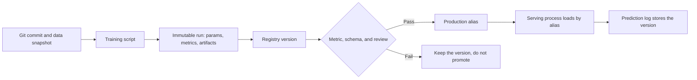

## Why this matters

A training run that lives in a notebook has no name, no parameters, and no artifact you can reload. The next person, often you, cannot tell which learning rate produced the number on the slide, and production cannot tell which file is the model. MLflow is a common answer because it separates three things teams otherwise mash together: the experiment log, the artifact store, and the registry that promotes a version through stages. The ideas matter even if you use a different tool. This lesson specifies what must be recorded, implements a tiny run record you can unit test, and describes promotion as a decision with a metric and a gate, not as a file copy.

## Intuition

An experiment is a table of runs. Each run has parameters you chose, metrics you measured, and artifacts you produced: the weights, the tokenizer, the feature list, the environment file. A run is immutable after it finishes. You do not edit last Thursday's accuracy. You log a new run.

The registry is a different table. It points at a run's artifact and gives it a version number and a stage: staging, production, archived. Production is a pointer. Moving it is a release. If you overwrite the file that production points at, you have destroyed the release. Object storage and content hashes exist so you do not do that.

## Core concept in depth

### What a run must contain

Parameters: data version or snapshot id, code version (a git commit), hyperparameters, random seed, and the split policy. Metrics: the validation number you actually selected on, the test number if you spent it, and enough slices to see a failure. Tags: the owner, the ticket, the hypothesis in one sentence. Artifacts: the model file, the preprocessing parameters, the tokenizer or vocabulary, a requirements or image digest, and a short model card. A weights file without the preprocessing is not a model. You learned that in the feature lesson. The registry is where the rule becomes operational.

Log metrics as steps if the run is long, so a crash still leaves a curve. Log the final metrics as their own keys so a comparison view does not have to guess which step was best. Do not log the test metric in a loop you then use to pick the best epoch. That is the sealed-test rule, enforced by what you are willing to write down.

### Stores

MLflow's tracking server holds the metadata. The artifact store is usually object storage. The database is not the place for a multi-gigabyte checkpoint. Configure the artifact URI explicitly. A default local `./mlruns` folder on a laptop is how experiments vanish when the laptop is reimaged. The tracking server should be reachable by both the training job and the human, with authentication. An open tracking server on the internet is a leak of your data schema and your metrics.

Compare runs on the parameters that matter. A UI full of default arguments hides the one flag you changed. Log less, but log the truth. Derived metrics can be recomputed from a confusion matrix artifact if you log the matrix. They cannot be recomputed from a single accuracy float.

### The registry and stages

Register a model by name. Each registration creates a version that points at a run id and an artifact path. Stages are a convenience pointer: one version is production. Some teams skip stages and use aliases (`champion`, `challenger`) so two versions can be live in a canary. The principle is the same. A human or a pipeline promotes a version after a check: validation metric above the baseline, schema of the input unchanged or explicitly migrated, evaluation slice signed off, load test passed. Automatic promotion on a single metric is how a leaked feature reaches production because its accuracy was excellent.

Model signatures declare input and output columns and types. They will not catch every bug. They will catch the column that disappeared. Use them. A signature that says "tensor of floats" and nothing else is a missed opportunity for tabular models and a reasonable minimum for images.

### Reproducibility is a degree

Bit-level reproducibility needs the code commit, the data snapshot, the image digest, the seed, and deterministic kernels. You rarely have the last one on a GPU. Business reproducibility needs enough to retrain within the noise of the metric and to reload the exact artifact that served traffic. Aim for the second always, and the first when you are debugging a specific claim. Write the training entrypoint as a script the tracker launches, not as cells you executed out of order. The commit hash should describe that script.

Lineage runs backward from a prediction. Given a request id, you should reach the model version, the run, the data snapshot, and the code. If any link is "whatever was in the folder," you cannot audit an incident. Store the model version on the prediction log. The MLOps drift lesson will need it.

## Diagram / flowchart



### Dry-run table

Two runs of the same script. Only the learning rate changes. The gate promotes a version if validation MAE is below the seasonal naive baseline of 10 and the feature list artifact is present.

| Run | Learning rate | Val MAE | Feature artifact | Promote? |
| --- | --- | --- | --- | --- |
| r1 | 0.1 | 8 | yes | yes, beats baseline and is complete |
| r2 | 0.5 | 7 | no | no, better metric, unusable model |
| r3 | 0.01 | 12 | yes | no, does not beat the baseline |

Run r2 is the trap in every auto-promote system. The number is better and the model cannot be served, or it can be served and will compute features differently from training. The gate is a conjunction, not a sort by one column.

## Code

```python
def promote(run: dict, baseline_mae: float) -> tuple[bool, str]:
    required = ("run_id", "val_mae", "git_sha", "feature_list")
    for key in required:
        if key not in run or run[key] in (None, "", []):
            return False, f"missing {key}"
    if run["val_mae"] >= baseline_mae:
        return False, "does not beat baseline"
    return True, "promote"


def prediction_record(request_id: str, model_version: str, features: dict, score: float) -> dict:
    if not model_version:
        raise ValueError("refusing to log a score without a model version")
    return {
        "request_id": request_id,
        "model_version": model_version,
        "features": features,
        "score": score,
    }


if __name__ == "__main__":
    runs = [
        {"run_id": "r1", "val_mae": 8.0, "git_sha": "abc", "feature_list": ["lag1"]},
        {"run_id": "r2", "val_mae": 7.0, "git_sha": "abc", "feature_list": []},
        {"run_id": "r3", "val_mae": 12.0, "git_sha": "def", "feature_list": ["lag1"]},
    ]
    for run in runs:
        print(run["run_id"], promote(run, baseline_mae=10.0))
    print(prediction_record("q1", "7", {"lag1": 1.0}, 0.2)["model_version"])
```

The gate accepts r1, rejects r2 for an empty feature list, and rejects r3 for losing to the baseline. The prediction record refuses to exist without a version. That one exception is the difference between a log you can audit and a pile of scores. Wire the same predicate into whatever UI you use. The brand of the tracker does not change the predicate.

## Complexity analysis

| Practice | Cost | Failure mode |
| --- | --- | --- |
| Log params and metrics | Negligible next to training | An irreproducible leaderboard |
| Store artifacts in object storage | Checkpoint size, and egress when you reload | A laptop `mlruns` directory that dies |
| Content-hash the artifact | One read at write time | Silent overwrite of a live version |
| Model signature checks | Θ(columns) at load | A missing column discovered at 3 a.m. |
| Prediction log with version id | Θ(requests) storage | Drift and incidents you cannot attribute |
| Bitwise reproducibility | Image pins, seeds, slower deterministic kernels | You usually do not need it, until a paper claims you do |

Retention is the hidden cost. Keeping every checkpoint of every epoch will fill the bucket. Keep the best and the last, or keep what the registry points at plus a defined window. Deleting a version that production still aliases is an outage. Delete through the registry, not through the bucket browser.

A tracking server is a dependency of training and of release. If it is down, decide whether jobs may run unlogged. The adult answer is no, they may not, unless you have a local buffer that syncs. An unlogged production training job is how you ship a model nobody can name.

## Tricks, tips and patterns

- Log the git commit, the data snapshot, the metric you select on, and the artifacts needed to serve. Do this in the training script, not from memory.
- Treat runs as immutable. Promote versions. Do not overwrite artifact paths.
- Gate promotion on the metric and on the presence of preprocessing, schema, and a real baseline comparison.
- Put the model version on every prediction. You will want it for drift and for incidents.
- Separate the tracking database from the artifact bucket. Authenticate both.
- Save a model card next to the weights: purpose, data, metric, slices, and known failures.
- Prefer a script entrypoint over a notebook for anything that might be promoted.
- Pin the training image digest in the run so "it worked in my environment" has a meaning.

## Common mistakes and edge cases

- A notebook run with no commit hash, registered anyway, unreproducible the day the cells change.
- Overwriting `model.pkl` in place so production's pointer now means a different file.
- Auto-promoting the best accuracy, which belongs to a run that trained on the test set.
- Logging secrets as parameters. The tracking UI is not a vault. Use a secret manager and log the secret's name.
- A signature that is never checked at load, so it is documentation theater.
- Comparing runs that used different data snapshots as if the metric difference were the learning rate.
- Deleting the artifact bucket lifecycle-wise while the registry still points at the objects.
- A prediction log that stores the score and not the version, then a week of drift you cannot assign.

## Interview notes

Separate the experiment log from the registry. Say what is immutable. Say how production points at a version. Give the promotion gate as metric plus completeness, and give the r2 counterexample: a better number with no feature list.

Mention lineage from prediction to version to data snapshot. Mention that you do not log the sealed test metric as a tuning signal.

If asked why not only Git, say Git versions code, not multi-gigabyte artifacts or a queryable metric table. If asked why not only object storage, say a bucket does not record parameters or a stage pointer. You want both, with hashes.

## Practice problems

1. [Mean Squared Error](/practice/ml-mse) — a metric worth logging beside the baseline (easy).
2. [Root Mean Squared Error](/practice/ml-rmse) — log units the stakeholder recognizes (easy).
3. [Classification Accuracy](/practice/ml-accuracy) — a metric that should not be the only thing you log (easy).
4. Add a gate condition that rejects a missing git sha, and confirm r1 still passes only because its sha is present.
5. Write the prediction record for two versions and show you can group scores by version later.

## Summary / cheat sheet

- A run records parameters, metrics, and artifacts and is immutable. A registry version points at a run and can be promoted.
- Log code commit, data snapshot, seed, the selection metric, and every file serving needs, including preprocessing.
- Do not overwrite artifacts. Hash them. Keep production as a pointer you move on purpose.
- Promote only if the metric beats the baseline and the artifact is complete. A better number with a missing feature list stays unpromoted.
- Put the model version on every prediction log.
- Notebooks are for exploration. Scripts with commits are for anything you might serve.
- The tracker is not optional infrastructure. An unlogged training job has no name.

## Further reading

- [MLflow tracking documentation](https://mlflow.org/docs/latest/tracking.html)
- [MLflow model registry](https://mlflow.org/docs/latest/model-registry.html)
- [Google Rules of ML](https://developers.google.com/machine-learning/guides/rules-of-ml)
- [DVC data versioning](https://dvc.org/doc/user-guide/data-management/versioning-data-and-models)
- [Hidden Technical Debt in Machine Learning Systems](https://papers.nips.cc/paper/5656-hidden-technical-debt-in-machine-learning-systems)
