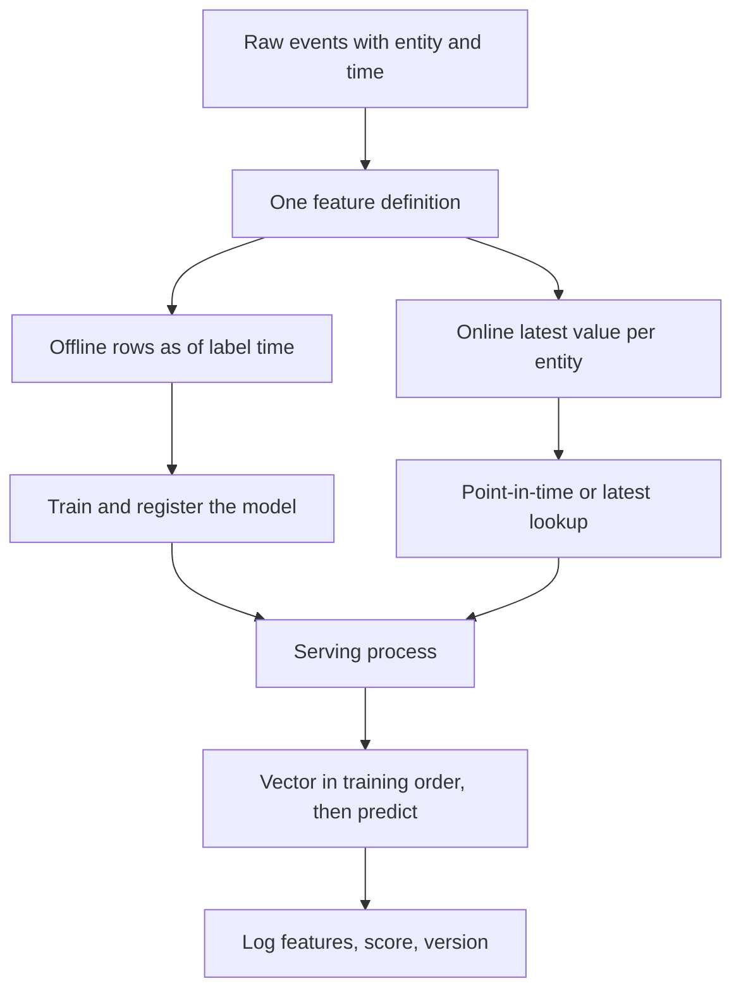

## Why this matters

Training computes a feature from a warehouse. Serving recomputes it in a microservice from a different join, a different null, and a different clock. The scores drift apart and the model is blamed. A feature store is a place where a feature has one definition, an offline table for training, and an online lookup for serving, both filled from that definition. Serving is the other half: load the registered model, fetch features by entity and time, score, and log. This lesson specifies the contract and implements a tiny as-of lookup plus a pure predict function. SageMaker Feature Store, later, is this contract on AWS, not a different idea.

## Intuition

Every feature is a function of raw events that produces a value for an entity at a time. "User's clicks in the last hour" is that function. Offline, you want a row per training example, computed as of the label's decision time, which is what the pandas lesson called an as-of join. Online, you want the same function's value for the user in front of you, in a few milliseconds, which means it was precomputed by a stream or a frequent batch and stored in a low-latency table. If those two paths diverge, you have two features that share a name.

Serving should be boring. Fetch the feature vector in the training column order, apply the saved preprocessing, run the model, return a score, log the vector and the version. Creativity in the serving code is how skew returns.

## Core concept in depth

### Offline and online, one definition

Write the feature as a transformation of raw data with an explicit entity key and event time. Backfill the offline store by running that transformation over history. Keep the online store fresh by running the same transformation on new events and upserting the latest value per entity, or the values a point-in-time query needs. "The same" means the same code, imported by both jobs, not a SQL query and a hand-translated Python function that someone promised matched. Share a test: given a fixed event log, both paths return the same value for an entity at a time.

Point-in-time correctness is the whole game. The offline row for a label decided at noon must not include the click at 12:01. The online read at noon must not include it either. If the online store only keeps the latest value, a backfill for training is not "read the online store tomorrow." Tomorrow's latest value has seen the future. Training reads the offline log as of the label time. Serving reads the online value as of now. They match when the definitions match, not when the storage system is the same product.

### Freshness, nulls, and defaults

Each online record has a timestamp. If the timestamp is older than the feature's allowed staleness, treat the value as missing and use the training-time default, or refuse to score. A stale click count that looks fresh will silently bias the score. Defaults must be the ones the model saw in training: 0 for a count, a missing indicator, the category `"unknown"`. A serving default of −1 that the model never saw is a new category you invented in production.

Entities with no row are not errors by default. They are cold starts. The feature vector should still have the right width. The model should have been trained with some cold-start rows, or it will do something arbitrary on its first real user.

### Serving patterns

Online synchronous serving sits on the request path. Latency budgets are tight. You cache hot entities, you do not recompute a 30-day window per request, and you size the model so the forward pass fits the budget. Batch serving scores a file of entities overnight and writes predictions to a table the product reads. That is the right pattern when the decision is a daily email or a ranking that can be minutes old. Streaming serving scores events as they arrive and writes a feature or a prediction downstream. Pick the pattern from the decision latency, not from the most impressive architecture.

Shadow mode scores a new model on live traffic and logs the output without showing it. Canary sends a slice of traffic. Both require the prediction log from the versioning lesson. A model that cannot be shadowed because scoring has a side effect is a model you should split: pure predict, then a separate action.

Preprocessing lives in one library used by training and serving, or it lives inside the model artifact as a saved pipeline. A third copy in the application repository will drift. Golden rows — raw input, expected vector, expected score — run in CI against the serving path.

### Schema and compatibility

Adding a feature is a new model version, not a quiet extra column. The server should reject a vector of the wrong width rather than let a library broadcast it into nonsense. Removing a feature is a new version too. During a migration, the feature store may compute both the old and the new feature, and each model version requests the list it was trained on. The store is allowed to hold columns the current champion does not use. The champion is not allowed to silently shift columns.

## Diagram / flowchart



### Dry-run table

Events for user 7: a click count was 2 at 10:00 and 5 at 13:00. A label decided at 12:00. An online request arrives at 14:00. Staleness limit is two hours.

| Read | As of | Value | Legal? |
| --- | --- | --- | --- |
| Training row | 12:00 | 2 | Yes, the 13:00 update is in the future |
| Online at 14:00 | latest is 13:00, age 1 hour | 5 | Yes, fresh |
| Online at 16:30 | latest is 13:00, age 3.5 hours | missing, use default | The value is stale |
| Training row that used 5 | 12:00 | 5 | Illegal leakage |

The illegal row is what you get if you join each user to their latest count in the warehouse without a time predicate. It will be the best model you ever train.

## Code

```python
def asof_value(history: list[tuple[float, float]], decision_time: float) -> float | None:
    """history is (timestamp, value), any order. Return the latest value at or before decision_time."""
    best_t = None
    best_v = None
    for ts, value in history:
        if ts <= decision_time and (best_t is None or ts > best_t):
            best_t, best_v = ts, value
    return best_v


def online_value(history: list[tuple[float, float]], now: float, max_age: float, default: float) -> float:
    value = asof_value(history, now)
    if value is None:
        return default
    # Freshness uses the timestamp of the value we selected.
    ts = max(t for t, _ in history if t <= now)
    if now - ts > max_age:
        return default
    return value


def score(features: list[float], weights: list[float], bias: float) -> float:
    if len(features) != len(weights):
        raise ValueError("feature width does not match the model")
    return sum(w * x for w, x in zip(weights, features)) + bias


if __name__ == "__main__":
    clicks = [(10.0, 2.0), (13.0, 5.0)]
    print("train as of 12", asof_value(clicks, 12.0))
    print("online at 14", online_value(clicks, now=14.0, max_age=2.0, default=0.0))
    print("online at 16.5", online_value(clicks, now=16.5, max_age=2.0, default=0.0))
    print("score", score([2.0, 1.0], [0.5, -1.0], bias=0.1))
```

Training as of 12 returns 2. Online at 14 returns 5. Online at 16.5 returns the default 0 because the 13:00 value is too old. The scorer rejects a width mismatch. Those three behaviors — point-in-time, staleness, width — are the contract. A feature platform that skips any of them will still demo well on a static CSV.

## Complexity analysis

| Path | Latency | Correctness risk | Scale lever |
| --- | --- | --- | --- |
| Offline backfill | Minutes to hours, throughput of the warehouse | Point-in-time bugs | Partition by date |
| Online lookup | Milliseconds | Stale or missing row | Key-value store, cache |
| On-request recompute of a long window | Often too slow, and inconsistent | A second definition | Do not, unless the window is tiny and shared in code |
| Batch scoring | Minutes, off the request path | Scoring yesterday's features for tomorrow's send | The right default for slow decisions |
| Shadow scoring | Double the forward cost | Log volume | Sample if you must |
| Golden-row CI | Negligible | None if the rows are real | The cheapest skew test you will ever write |

Online stores are key-value systems sized by entities times features times versions you keep. Keeping every historical value online so you can "train from the online store" is expensive and still wrong if the latest-value API is what training calls. Keep history offline. Keep the latest, or a short rolling state, online. The cost split follows the access pattern.

Model inference cost is the forward pass plus the feature fetch. A GPU is wasted on a linear model at a few hundred queries per second; a CPU and a vectorized batch will do. A large transformer on the request path is a different budget, and the feature fetch is no longer the bottleneck. Do not design the store as if every model were a linear scorer, and do not design the scorer as if every model were a language model.

## Tricks, tips and patterns

- One function, two materializations. Test them against the same event log.
- As-of for training. Latest-plus-staleness for online. Defaults for cold start and for stale keys.
- Freeze column order in the model artifact. Reject the wrong width.
- Precompute anything you cannot calculate in the latency budget. Do not reimplement it in the service.
- Shadow before canary, canary before full traffic, and only for models whose predict is pure.
- Golden rows in CI: raw events in, vector and score out.
- Log the features you scored, or a hash and the version, so you can reproduce a bad decision.
- A new feature is a new model version with a migration, not a surprise column.

## Common mistakes and edge cases

- Joining training labels to the latest online value and calling it a feature store.
- Two implementations, SQL and Python, kept "in sync" by vigilance.
- A stale key that still returns a number, so the model trusts last month's count.
- A default at serving time that was not in the training distribution.
- Column order taken from a dictionary that does not preserve order across processes. Use an explicit list.
- A serving path that recomputes a rolling window with a different timezone than training.
- Side effects inside predict, so you cannot shadow the model.
- Backfilling with a corrected event that did not exist at decision time. Point-in-time means the data as it was known, when that is the decision you are replaying. Be explicit about corrections.

## Interview notes

Define a feature as a function of raw data at an entity time. Explain offline as-of versus online latest, and why training on the online latest value leaks.

Give the stale-key and cold-start policies. Mention shared code and golden rows as the skew defense.

Contrast batch, online, and streaming serving by the decision latency. Mention shadow mode and the requirement that predict be pure.

If asked about SageMaker or Feast or Tecton, say the product fills this contract. The contract is the interview. The product is configuration.

## Practice problems

1. [Min-Max Scale](/practice/ml-minmax) — a preprocess that must be the same function online and offline (easy).
2. [Z-Score Standardization](/practice/ml-zscore) — fit offline, apply online, never refit on one request (easy).
3. [One Linear Regression Step](/practice/ml-linreg-step) — a predict path small enough to golden-test (medium).
4. Recompute the dry-run: as of 12 the value is 2, at 14 it is 5, at 16.5 it falls back to the default.
5. Pass a feature vector of the wrong length and confirm the scorer raises rather than returning a number.

## Summary / cheat sheet

- A feature has one definition, an offline as-of materialization, and an online low-latency materialization.
- Training on "latest" leaks the future. Online reads need a staleness limit and a training-time default.
- Serving fetches columns in the trained order, applies the saved preprocess, scores, and logs the version.
- Batch, online, and streaming serving follow the decision latency. Shadow mode requires a pure predict.
- Shared code plus golden rows catch skew. A second implementation will drift.
- Wrong width is an error. A new feature is a new model version.
- Cold starts are a defined vector, not a missing request.

## Further reading

- [Feast feature store concepts](https://docs.feast.dev/getting-started/concepts)
- [Google Rules of ML — training-serving skew](https://developers.google.com/machine-learning/guides/rules-of-ml)
- [MLflow models and signatures](https://mlflow.org/docs/latest/models.html)
- [Hidden Technical Debt in Machine Learning Systems](https://papers.nips.cc/paper/5656-hidden-technical-debt-in-machine-learning-systems)
- [AWS SageMaker Feature Store overview](https://docs.aws.amazon.com/sagemaker/latest/dg/feature-store.html)
