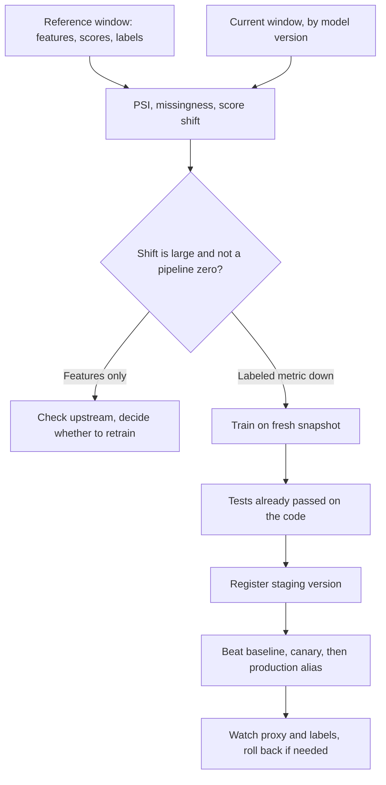

## Why this matters

A model is a function fitted to a distribution. Production traffic leaves that distribution. Sometimes the inputs move (data drift). Sometimes the relationship between inputs and the label moves (concept drift). Sometimes you simply stop receiving labels for a week and do not notice. CI/CD for ML is the other half of the same discipline: tests and promotions that stop you from shipping a training-code change the way you would not ship an untested payment change. This lesson defines the drifts, implements a population-stability check you can run on a feature, and specifies the pipeline gates between a merge and a production alias.

## Intuition

Data drift is "the questions changed." The distribution of a feature or of the score moved, regardless of whether the answers would have. Concept drift is "the answers changed." The same feature vector now maps to a different label. You can see data drift without labels, which is why it is the alarm you get to have continuously. You can see concept drift only when labels arrive, which may be late. A drop in a proxy metric — click rate, override rate, a downstream business number — often arrives before the official label and is worth a line on the same dashboard.

CI tests the training code and the feature code on every merge: unit tests, golden rows, a tiny training smoke run. CD does not retrain on every merge by default. It promotes an artifact that already passed evaluation, or it kicks a pipeline that retrains on a schedule and then waits for the same promotion gate as the versioning lesson. Retrain when the drift and the business metric say the model is stale, not because a calendar superstition said Tuesday.

## Core concept in depth

### Three drifts

Data drift, also called covariate shift: p(x) changed, and you hope p(y given x) did not. A new country appears. A sensor starts reporting in different units. The score distribution slides. Your model may still be right on each row and wrong in aggregate because the mix changed, or it may be extrapolating. Check per-feature distributions and the score distribution against a reference window, usually the training window or a recent stable production window.

Label drift: p(y) changed. More fraud this month. The base rate moved. A classifier's threshold is now too sensitive or not sensitive enough even if the ranking is fine. This is why you reexamine thresholds, not only weights.

Concept drift: p(y given x) changed. The same email text is now spam because the campaign changed, or the same credit file is riskier because the economy changed. Accuracy computed on new labels is the direct measurement. It lags. Do not pretend a feature-histogram alarm is a concept-drift proof. It is a reason to look.

### Metrics that fit a dashboard

For a numeric feature, compare a reference histogram to a current histogram. The population stability index buckets both, then sums (current share − reference share) times the log of their ratio, with a floor so empty buckets do not explode. A near-zero PSI means the mass did not move. A large PSI means it did. The thresholds you have heard — 0.1 mild, 0.25 serious — are heuristics from credit scoring, not laws. Calibrate them on a feature that you know moved, and on one that did not, or you will page yourself nightly.

The Kolmogorov–Smirnov statistic is the maximum gap between two cumulative distribution functions. It is a single number without arbitrary bins, and it is sensitive. Use it as a companion, not as a pager by itself, on large samples where tiny gaps become "significant." Statistical significance is cheap when n is a million. Practical significance is a shift that changes decisions. Alert on a shift that moves the score enough to change the threshold behavior, or on a PSI you have calibrated, and attach a slice: which country, which app version.

Missingness and zero-rates deserve their own series. A feature that becomes 40 percent null will move PSI and will also tell you the pipeline broke, which is not drift of the world. Distinguish pipeline health from population shift. A sudden drop to zero requests is an outage. A gradual slide in a feature is drift.

### Labels, delay, and retraining

When labels arrive late, score them against the prediction log joined by request id and model version. A single accuracy on a mix of versions is not interpretable. Delay means the most recent week may look fine only because the labels have not come in. Plot the metric by decision time, not by label-arrival time, or you will "see" a phantom improvement that is just censoring.

Retrain when the labeled metric has degraded past the value of a new model, and when you have enough new labels to matter. Retrain on a schedule only if the schedule matches the drift speed: a daily retail model, a quarterly credit model. Every retrain goes through the promotion gate. Automatic rollback if the new version's online proxy is worse after a canary. Keep the previous version loaded or quickly reloadable.

### CI and CD

On each pull request: lint and type checks, unit tests of feature functions including an as-of test, golden-row tests of the serving preprocess, and a schema check that the training script's feature list matches the store. A one-epoch smoke train on a fixture catches a broken loss. It does not estimate quality.

On merge to the training branch: a pipeline runs a real train on the current snapshot, logs the run, and registers a version in staging. Promotion to production is a separate step with the metric gate, an approval if the domain requires it, and a deploy of the serving config to the new version. Infrastructure for the endpoint is code. The model bytes are the artifact. Do not bake the weights into a container image on every train if a volume or a model pull will do; images that contain weights become huge and slow. Do pin the image that contains the runtime.

A model change and a feature-definition change are different diffs. Shipping both on the same day makes the incident report guess. Prefer one variable at a time unless they are inseparable, and then say so in the change record.

## Diagram / flowchart



### Dry-run table

A binary feature was true 10 percent of the time in reference and is true 40 percent of the time now. Two buckets, false and true. PSI adds both buckets' contributions. Shares must be floored in real code; here both are safely nonzero.

| Bucket | Reference share | Current share | Contribution (c − r) log(c / r) |
| --- | --- | --- | --- |
| False | 0.90 | 0.60 | (0.60 − 0.90) · log(0.60 / 0.90) ≈ 0.122 |
| True | 0.10 | 0.40 | (0.40 − 0.10) · log(0.40 / 0.10) ≈ 0.416 |
| PSI | — | — | ≈ 0.538 |

That is a large shift by any credit-style rule of thumb. It might be a real population change or a Boolean that flipped meaning in an upstream release. The metric cannot tell you which. The release calendar and the feature definition can. Page a human with the number and the feature name, not with a bare "drift detected."

## Code

```python
import math


def psi(reference: list[float], current: list[float], eps: float = 1e-6) -> float:
    """PSI from aligned bucket shares. Caller builds the buckets."""
    if len(reference) != len(current) or not reference:
        raise ValueError("bucket shares must align")
    total = 0.0
    for r, c in zip(reference, current):
        r = min(max(r, eps), 1.0)
        c = min(max(c, eps), 1.0)
        total += (c - r) * math.log(c / r)
    return total


def should_retrain(labeled_metric: float, baseline: float, psi_value: float, psi_limit: float) -> str:
    """A deliberately conservative policy. Tune the numbers, keep the shape of the decision."""
    if labeled_metric > baseline:
        return "retrain: labeled metric lost to the baseline"
    if psi_value > psi_limit:
        return "investigate: feature shift without a labeled failure yet"
    return "hold"


if __name__ == "__main__":
    value = psi([0.90, 0.10], [0.60, 0.40])
    print("psi", round(value, 3))
    print(should_retrain(labeled_metric=0.8, baseline=0.7, psi_value=value, psi_limit=0.25))
    print(should_retrain(labeled_metric=0.6, baseline=0.7, psi_value=0.05, psi_limit=0.25))
```

The PSI prints about 0.538, matching the table's addition of roughly 0.122 and 0.416. The policy function distinguishes "labels got worse, retrain" from "features moved, go look" from "hold." Wire the look-path to a person or to a ticket, not to an automatic retrain, until you have evidence that this feature's PSI predicts a real labeled drop. Automatic retrains on every twitch are how you overfit the recent week and skip the promotion gate in spirit.

## Complexity analysis

| Control | When it runs | Cost | What it will not catch |
| --- | --- | --- | --- |
| Unit and golden tests | Every pull request | Seconds to minutes | A world that changed but a code path that is correct |
| Smoke train | Pull request or nightly | One small job | Generalization |
| Full train and register | Schedule or drift trigger | The real training bill | A bad promotion gate if you skip it |
| PSI and missingness | Hourly or daily on production logs | A scan of the window | Concept drift with stable x |
| Labeled metric | When labels land | A join to the prediction log | The last week, if labels are delayed |
| Canary | After promotion of a candidate | Duplicate scoring on a slice | Rare slices you did not include |

The expensive loop is full retraining. The cheap loop is distribution monitoring. Spend engineering on making the cheap loop trustworthy — right windows, right units, pipeline health separated from drift — before you spend it on a fancier detector. A KS test on every feature every hour without a multiple-comparison budget will train the on-call to ignore you, which is worse than no monitor.

Canary cost is serving cost. For a large model, shadow a sample. For a linear scorer, shadow everything. Rollback must be faster than the damage. If rollback is a three-hour bake of a container, keep two versions warm.

## Tricks, tips and patterns

- Monitor features, scores, missingness, and pipeline volume separately. They are different incidents.
- Join labels back on request id and model version. Plot by decision time.
- Calibrate PSI thresholds on a known incident and a known quiet month. Do not worship 0.25.
- Retrain when labels degrade and you have data, then pass the same promotion gate as a hand-built model.
- Keep CI on the code and CD on the artifact. A merge is not automatically a production model.
- Change the feature definition and the model in separate releases when you can.
- Rollback to the previous registry version. Do not hotfix weights in place.
- Write the monitor's reference window down. "Versus training" and "versus last week" answer different questions.

## Common mistakes and edge cases

- A million-row KS test that pages on a meaningless gap.
- PSI with a bucket that has zero reference mass and a naive log of zero. Floor the shares.
- Calling every input shift concept drift. You do not know until you have labels.
- Retraining nightly on a sliding window so small the model forgets the holidays.
- A canary that only measures latency, not the decision metric.
- CI that retrains on production data inside the pull request and leaks the evaluation into the author cycle.
- Mixing model versions in one accuracy number after a rollout.
- An alert with no feature name, no slice, and no runbook.

## Interview notes

Define data drift, label drift, and concept drift. Say which ones you can compute before labels arrive. Give PSI in words and the caveat on borrowed thresholds.

Describe a promotion pipeline: tests on the request, train and register on merge or on schedule, gate, canary, rollback. Mention that the model version has to be in the prediction log or the labeled metric is mush.

Explain why you would not auto-retrain on a single feature's PSI. Explain delayed labels and decision-time plots.

If asked about SageMaker Model Monitor specifically, say it schedules baseline statistics and constraint violations on captured data. The concepts in this lesson are what you are looking for in its reports. The product lesson comes later.

## Practice problems

1. [Classification Accuracy](/practice/ml-accuracy) — recompute it per model version when labels arrive (easy).
2. [Mean Squared Error](/practice/ml-mse) — a labeled regression metric for the retrain decision (easy).
3. [Z-Score Standardization](/practice/ml-zscore) — a transform whose parameters also drift if you refit them by accident (easy).
4. Recompute the two-bucket PSI by hand and confirm it is far above 0.25.
5. Invent a feature that goes from 0 percent null to 50 percent null with the same conditional mean. Say which alarm should fire, and why it might be a bug not a market shift.

## Summary / cheat sheet

- Data drift is p(x) moving. Label drift is p(y) moving. Concept drift is p(y given x) moving. Only the last one is "the mapping broke," and it needs labels.
- PSI compares bucket shares. Floor empty buckets. Treat published cutoffs as heuristics you calibrate.
- Separate pipeline outages and missingness spikes from population shift.
- Join outcomes to the model version. Plot by decision time, because labels arrive late.
- CI tests code and golden rows. CD promotes artifacts through a metric gate, a canary, and a rollback.
- Do not auto-retrain on every distribution twitch. Do retrain when the labeled metric loses to the baseline and the new run passes the gate.
- One change at a time: feature definition, then model, unless you enjoy ambiguous incidents.

## Further reading

- [Hidden Technical Debt in Machine Learning Systems](https://papers.nips.cc/paper/5656-hidden-technical-debt-in-machine-learning-systems)
- [scikit-learn Kolmogorov–Smirnov via scipy](https://docs.scipy.org/doc/scipy/reference/generated/scipy.stats.ks_2samp.html)
- [Google Rules of ML](https://developers.google.com/machine-learning/guides/rules-of-ml)
- [MLflow model registry](https://mlflow.org/docs/latest/model-registry.html)
- [AWS SageMaker Model Monitor](https://docs.aws.amazon.com/sagemaker/latest/dg/model-monitor.html)
