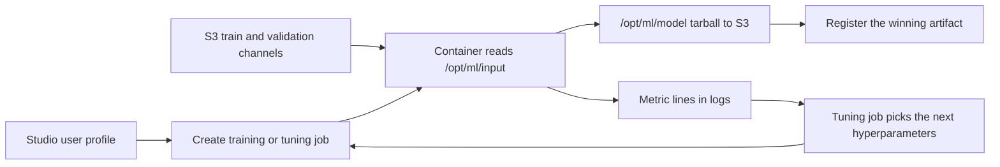

## Why this matters

A laptop train does not become a production train by wishing. SageMaker training jobs package your code, pull data from S3, run it on an instance you chose, and write artifacts back to S3, under an IAM role that is not your personal user. Studio is the notebook surface on top of that account. Built-in algorithms skip the container when a standard trainer is enough. Hyperparameter tuning jobs launch many training jobs and pick a winner by a metric you named. This lesson is the path from a script to a tracked training job. Pipelines and endpoints come next. If you skip the job boundary and keep training in a notebook kernel, you will not have a reproducible artifact when the kernel dies.

## Intuition

Separate three identities. You, the human, use Studio with a user profile and a role that can start jobs and read certain buckets. The training job uses an execution role that can read the training prefix and write the output prefix, and nothing else you can avoid. The data never needs to live on the notebook volume. The notebook sends a pointer. The job streams the data, trains, and uploads `model.tar.gz`. Spot instances cut the bill if your script checkpoints and can resume. A job that cannot be interrupted is a job you pay full price for, and also a job you cannot retry cleanly.

A tuning job is a loop around that contract. Each trial is a training job with a different hyperparameter dictionary. The objective is a metric the container prints in a format SageMaker can regex out of the logs, or a metric you log explicitly. The tuner is not a second model. It is a scheduler with a search strategy.

## Core concept in depth

### Studio without the mystery

Studio runs JupyterLab in a managed environment attached to a VPC of your choosing, or to SageMaker's default networking if you accept the trade. User profiles isolate storage and, with the right IAM, which users can assume which roles. A shared studio user with administrator credentials is a shared password. Give each person a profile and a role that can launch training jobs and cannot read every bucket in the account.

Notebook instances and Studio kernels are for exploration and for launching jobs. They are a poor place to run the only copy of a twelve-hour train. The kernel will idle-timeout, the disk is small, and the experiment will not exist as a job your colleague can open. Use the kernel to debug on a sample, then start a training job for the real run.

### Training jobs and channels

A training job has a container image, an entrypoint, hyperparameters, input channels, an output path, an instance type and count, and a maximum runtime. Input channels are named S3 prefixes. Your script reads them from the directories SageMaker sets, conventionally under `/opt/ml/input/data/` plus the channel name, and writes the model to `/opt/ml/model`. SageMaker tars that directory to the S3 output path. Hyperparameters arrive as command-line arguments or a JSON file, depending on the toolkit. Do not hardcode bucket names in the script. Read the channel directories and the output path from the environment so the same script runs in a local test and in a job.

Instance choice follows the workload. A CPU tree model does not need a GPU. A transformer fine-tune does, and it needs enough GPU memory for the batch, or a smaller batch, or a method such as QLoRA. Multi-instance training is data parallel or model parallel; it is not "set count to 4 and hope" unless the framework is already set up to rendezvous. Start with one instance. Add more when a profiler says the data or the gradient sync is the bottleneck.

Spot training uses spare capacity at a discount and can be reclaimed. Checkpoint to S3 on a schedule. On restart, load the checkpoint. If you do not checkpoint, spot saves money until the interruption throws away the run, which is a false saving. Set a stopping condition so a diverged job does not burn the max runtime.

### Built-in algorithms and script mode

SageMaker ships algorithms such as XGBoost, linear learner, and a handful of others, plus containers for scikit-learn, PyTorch, TensorFlow, and Hugging Face. A built-in algorithm is a container and a documented hyperparameter set. You point it at data in the format it demands — often CSV or a recordio variant — and you do not bring training code. Use it when the algorithm matches and the format is acceptable. Do not warp a problem into an awkward format to avoid a fifty-line script.

Script mode is the default you should be comfortable writing. You bring a Python file. The managed container provides the framework. The file reads channels, trains, and saves the artifact. Dependencies beyond the container belong in a `requirements.txt` you actually pin, or in a custom image. An unpinned install at job start is a build that changes under you. Local mode, or a simple local run that sets the same directory contract, catches path bugs before you pay for an instance.

The artifact must include everything serving needs: weights, feature column order, preprocessing state, tokenizer. A job that uploads only `weights.bin` will train successfully and fail at deploy. Log the validation metric in the form your later tuning job expects, and log it once at the end with a clear name.

### Hyperparameter tuning

A tuning job defines ranges: continuous, integer, or categorical. It defines an objective metric to maximize or minimize, and a strategy. Bayesian optimization spends trials where the model of the metric surface is promising. Random search is a strong baseline and is easier to reason about. Grid search explodes. Do not grid a dozen continuous parameters.

Early stopping kills trials that are clearly worse, if your script reports the metric at intervals. That requires the metric to be comparable across trials at the same step, so log it on a schedule. The best trial is a training job with an artifact. Register that artifact, do not copy its hyperparameters into a notebook and retrain by hand unless you have a reason. The tuning job already spent the money.

Hold the data split fixed across trials. A tuner that sees the test set will overfit the search to the test set. Cap the parallel jobs so you do not exhaust the account's instance quota or the budget. A tuning job is the easiest way to accidentally spend more than the rest of the project combined.

## Diagram / flowchart



### Dry-run table

A small grid, objective validation RMSE, lower is better. Maximum parallel jobs is two. Early stopping is off so the arithmetic stays visible.

| Trial | max_depth | learning_rate | Val RMSE | Keep? |
| --- | --- | --- | --- | --- |
| 1 | 3 | 0.10 | 0.42 | current best |
| 2 | 8 | 0.10 | 0.55 | no, overfit relative to trial 1 |
| 3 | 3 | 0.01 | 0.40 | new best |
| 4 | 8 | 0.01 | 0.47 | no |

The winner is trial 3, not the most complex tree. Register trial 3's artifact. A human who "prefers" trial 2 because the training loss was lower is ignoring the objective they told the tuner to use. Write the objective down so the argument does not restart after the bill arrives.

## Code

```python
def best_trial(trials: list[dict], mode: str = "min") -> dict:
    if not trials:
        raise ValueError("no trials")
    reverse = mode == "max"
    return sorted(trials, key=lambda t: t["metric"], reverse=reverse)[0]


def local_channel_paths(root: str, channels: list[str]) -> dict[str, str]:
    """Mirror the /opt/ml/input/data contract so a script can be tested without a job."""
    return {name: f"{root}/input/data/{name}" for name in channels}


def estimate_spot_savings(on_demand_hourly: float, spot_hourly: float, hours: float, interruptions: int, lost_hours_each: float) -> dict:
    on_demand = on_demand_hourly * hours
    # Interrupted time is re-run and still billed at spot until you checkpoint well.
    spot = spot_hourly * (hours + interruptions * lost_hours_each)
    return {"on_demand": round(on_demand, 2), "spot": round(spot, 2)}


if __name__ == "__main__":
    trials = [
        {"name": "t1", "metric": 0.42, "max_depth": 3},
        {"name": "t2", "metric": 0.55, "max_depth": 8},
        {"name": "t3", "metric": 0.40, "max_depth": 3},
        {"name": "t4", "metric": 0.47, "max_depth": 8},
    ]
    print("winner", best_trial(trials)["name"])
    print("channels", local_channel_paths("/opt/ml", ["train", "validation"]))
    print("cost", estimate_spot_savings(4.0, 1.2, hours=5, interruptions=2, lost_hours_each=1))
```

The winner is t3. The channel map shows the script where to read, which is the contract to honor in both a unit test and a container. The cost sketch says a five-hour on-demand run at 4 dollars an hour is 20 dollars, and a spot run at 1.2 dollars that loses two hours to interruptions is 8.4 dollars. If those lost hours were uncheckpointed full restarts of a five-hour job, the formula would be different and spot might lose. Checkpointing is the assumption in the small `lost_hours_each`. Do the arithmetic for your job, not for a blog's discount percentage.

## Complexity analysis

| Choice | Time or money | Risk |
| --- | --- | --- |
| Notebook-only train | Human time, and a single machine's disk | No artifact, no retry, no IAM boundary |
| One training job | Instance hours plus S3 | A bad instance type wastes the hours |
| Spot with checkpoints | Lower hourly rate, some restarts | Useless without checkpoints |
| Built-in algorithm | Less code, rigid data format | You bend the problem to the container |
| Script mode | Your code, managed image | Unpinned dependencies |
| Tuning, N trials | About N times one job, minus early stopping | The largest surprise bill in the account |
| Multi-instance | Faster steps if the framework scales | Queue time, network, a job that does not actually scale |

Tuning dominates cost because it multiplies. Put a budget cap and a maximum number of training jobs on the tuning definition. Prefer a coarse random search to locate a region, then a smaller search, rather than one enormous Bayesian run you cannot interpret. Instance start time is minutes; a flood of tiny trials spends more on startup than on gradient steps. Make each trial long enough to mean something, or use early stopping so the hopeless ones die.

Quota is a complexity constraint. GPU families have account limits. A tuning job that requests twenty `p4d` instances will sit in pending and still surprise you when the quota is raised. Ask for quota before the demo day.

## Tricks, tips and patterns

- Debug on a sample in Studio. Train the real run as a job. Do not bet the project on a kernel session.
- Read data from channel directories. Write the model to the directory SageMaker will tar. Keep buckets out of the script.
- Include preprocessing, feature order, and tokenizer in the artifact.
- Pin dependencies. Prefer the managed framework image plus a small requirements file.
- Checkpoint if you use spot. Set a max runtime either way.
- Tune on the validation metric you will use to promote. Freeze the split. Cap the number of jobs.
- Log the metric in a line the tuner can parse, at intervals if you want early stopping.
- Register the winning job's artifact. Do not retrain it by hand from memory.

## Common mistakes and edge cases

- A training role that can read the whole account, copied from a tutorial.
- Hardcoded `/home/ec2-user` paths that exist on a notebook and not in the container.
- Uploading weights without the feature list, then failing at deploy.
- Tuning against the test set because it was mounted as a channel named validation.
- A Bayesian search over eight hyperparameters with six trials. There is not enough signal. Use random search or fewer knobs.
- Spot without checkpoints, marketed as a discount.
- Forgetting the metric regex, so every trial "succeeds" and the objective is missing, and the tuner cannot rank them.
- Local CSV files that never make it to S3, and a job that trains on an empty channel.

## Interview notes

Describe a training job's inputs and outputs: S3 channels in, tarball out, metrics in logs, an execution role that is not the human's daily role. Mention the `/opt/ml` directory contract.

Contrast built-in algorithms and script mode. Give one reason to choose each. Mention pinned dependencies.

Explain a tuning job as many training jobs plus a search strategy and an objective. Say where the data split lives. Say you would cap parallelism and budget. Mention spot and checkpoints if the conversation turns to cost; the dedicated cost lesson goes deeper.

If asked about Studio, say it is the workspace, not the training runtime. Jobs outlive the notebook.

## Practice problems

1. [Root Mean Squared Error](/practice/ml-rmse) — an objective a tuner can minimize (easy).
2. [Mean Squared Error](/practice/ml-mse) — log it per epoch if you want early stopping (easy).
3. [Z-Score Standardization](/practice/ml-zscore) — fit this on the training channel only, and save the statistics into the artifact (easy).
4. Rank the dry-run trials by validation RMSE and confirm the shallow, slower-learning tree wins.
5. List the files that must be inside the model tarball for a logistic regression you intend to serve.

## Summary / cheat sheet

- Studio is where you work. A training job is where the real run happens, under an execution role, with S3 in and a tarball out.
- Script mode uses your code in a managed container. Built-in algorithms skip the code when the format fits.
- Read channel paths, write `/opt/ml/model`, pin dependencies, and pack preprocessing with the weights.
- Spot is cheaper if you checkpoint. A max runtime bounds the damage either way.
- Tuning launches trials against one validation objective on a frozen split. Cap the bill. Register the winning artifact.
- Multi-instance and GPU choices follow measurement and memory, not optimism.
- A notebook kernel is not an audit trail. A job is.

## Further reading

- [SageMaker training jobs](https://docs.aws.amazon.com/sagemaker/latest/dg/how-it-works-training.html)
- [SageMaker built-in algorithms](https://docs.aws.amazon.com/sagemaker/latest/dg/algos.html)
- [SageMaker Python SDK estimators](https://sagemaker.readthedocs.io/en/stable/overview.html)
- [SageMaker automatic model tuning](https://docs.aws.amazon.com/sagemaker/latest/dg/automatic-model-tuning.html)
- [SageMaker Studio](https://docs.aws.amazon.com/sagemaker/latest/dg/studio.html)
