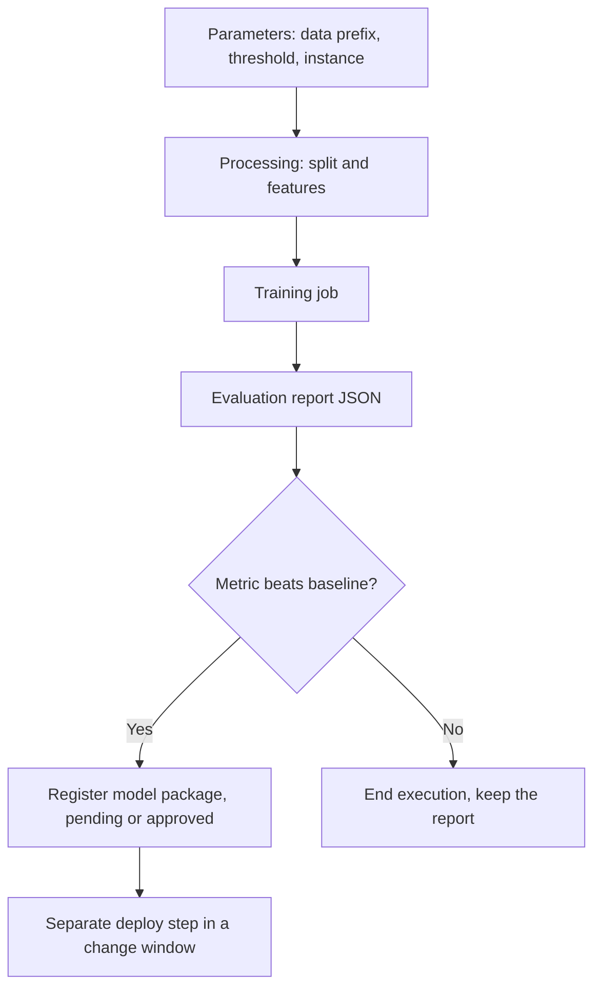

## Why this matters

A training job you start by hand will be started differently next month. SageMaker Pipelines turns the steps — process, train, evaluate, register — into a graph you can execute again with new parameters and the same structure. The Model Registry holds the output as a model package version with an approval status. Production endpoints should pull an approved version, not whatever tarball someone last uploaded. This lesson connects the training job you already understand to a promotion decision you can audit.

## Intuition

A pipeline is a function from parameters to artifacts. Parameters are the input data prefix, the instance type, the approval threshold, the learning rate. Steps are nodes. Data flows along edges as pipeline properties, not as files you scp. If a step fails, the execution has a name and a log. You fix the step and start a new execution. You do not patch a half-written S3 prefix and hope.

The registry is the gate at the end of the graph. A step can register a model package in PendingManualApproval, or it can approve it only when an evaluation step produced a metric above a threshold. Humans still belong on that gate when the cost of a mistake is high. The pipeline's job is to make the evidence identical every time, not to remove judgment.

## Core concept in depth

### Steps you actually need

A processing step runs a container on a dataset and writes a training set, a validation set, and a test set to S3, split by the policy you chose in the metrics lesson. This is where the as-of feature join belongs. A training step is the training job from the previous lesson, with inputs wired to the processing outputs. An evaluation step loads the artifact, scores the test or validation split you designated, and writes a JSON report: the metric, the baseline, the slice numbers. A condition step branches. If the metric beats the baseline, a register step creates a model package. If it does not, the execution ends without registration, or it registers in a rejected state so the failure is visible.

Optional steps earn their place. A tuning step instead of a single training step, when you truly need a search. A transform step for a batch score. A fail step with a clear message when the data check finds a schema break. Do not build a twenty-step graph you cannot draw. Four steps that match the promotion gate are better than a cathedral.

### Parameters, caching, and retries

Parameters keep the graph reusable: the same pipeline definition runs for a new date prefix. Do not clone the definition per run. Cache a processing step when the inputs and the code hash are unchanged, so a retry of a later failure does not recompute a clean split. Do not cache the training step if the point of the execution is to train. Retry transient capacity errors a small number of times. Do not retry a step whose metric was honestly bad; that is not a transient error.

Each execution should log the pipeline version, the parameter values, and the step outputs. The model package should record the execution ARN so you can walk from a production model back to the split that trained it. That is the lineage the MLOps lesson asked for, implemented with AWS identifiers instead of a spreadsheet.

### The model package

A model package group is a named line of models, such as `demand-forecaster`. Each version contains the inference specification — container image and artifact URL — and metadata: metrics, the approval status, a customer metadata map for the git SHA and the data snapshot. Approval statuses are Rejected, PendingManualApproval, and Approved. Endpoints and batch jobs that you care about should require Approved. Pending is the inbox. Rejected is the memory of a version that lost, which you keep so nobody "rediscovers" it.

Registering is not deploying. A common and correct pipeline ends at Approved or Pending. A separate deployment pipeline, or a later step with a manual gate, updates the endpoint config to the new version. Coupling them means a metric glitch redeploys production at 2 a.m. Decoupling them means a human or a change window does the last step. Prefer decoupling until the canary and rollback from the CI/CD lesson are automated and trusted.

### What the evaluation step must not do

It must not tune on the test report it is about to use as a gate. The threshold is a parameter chosen before the execution, or the gate uses a validation metric and the test metric is only recorded. It must use the same preprocess as serving. It must compare to a baseline number stored with the pipeline parameters, not to a number someone remembers. It must fail the branch when the report is missing. A condition that treats a missing metric as zero will reject. A condition that treats it as success will promote an empty model. Test the condition with a fixture that omits the key.

## Diagram / flowchart



### Dry-run table

Baseline validation RMSE is 0.50. The gate promotes to PendingManualApproval only when the report exists and the metric is strictly better. Approval is still a human step in this table.

| Execution | Report RMSE | Report present | Register? | Status |
| --- | --- | --- | --- | --- |
| e1 | 0.41 | yes | yes | PendingManualApproval |
| e2 | 0.63 | yes | no | not registered |
| e3 | missing | no | no | failed condition, not a quiet success |

e1 is eligible for a human to approve after reading slices. e2 trained and lost. e3 is a broken evaluation step, which must not look like a pass. The pipeline definition is the place you encode that, not the meeting after the incident.

## Code

```python
def gate(report: dict | None, baseline: float) -> tuple[str, str]:
    if not report or "rmse" not in report:
        return "reject", "evaluation report missing"
    if report["rmse"] < baseline:
        return "register", "PendingManualApproval"
    return "reject", "does not beat baseline"


def package_metadata(execution_id: str, git_sha: str, data_snapshot: str, metric: float) -> dict:
    if not execution_id or not git_sha or not data_snapshot:
        raise ValueError("lineage fields are required")
    return {
        "execution_id": execution_id,
        "git_sha": git_sha,
        "data_snapshot": data_snapshot,
        "metric": metric,
    }


if __name__ == "__main__":
    print("e1", gate({"rmse": 0.41}, 0.50))
    print("e2", gate({"rmse": 0.63}, 0.50))
    print("e3", gate(None, 0.50))
    print(package_metadata("exec-1", "abc123", "s3://bucket/snap/2026-11-01", 0.41))
```

The three gates match the table, including the missing report. The metadata helper refuses to build a package record without lineage. In SageMaker those fields belong in the model package's customer metadata or in the metrics list. The status string PendingManualApproval is the registry's, and a deploy role should filter on Approved only. If your deploy script lists versions and takes the latest regardless of status, the gate you just wrote is theater.

## Complexity analysis

| Design | Repeatability | Cost | Operational risk |
| --- | --- | --- | --- |
| Hand-launched notebook | Low | Person hours, hidden compute | Unauditable |
| Single training job script | Medium | One job | Split and eval still manual |
| Pipeline, four steps | High | Processing plus train plus a small eval job | A graph nobody can read if you add every idea |
| Cached processing | High, and cheaper retries | Pay when inputs change | A cache key that ignores the code hash serves stale splits |
| Registry with approval | The deploy boundary | Pennies next to training | A deploy role that ignores status |
| Combined train-and-deploy graph | Faster, and sharper edges | Same | A bad metric ships at night |

Evaluation cost should be a small instance. Training cost is the training instance. The pipeline service itself is not the bill; the jobs it starts are. Tag executions with the project so cost allocation works. A pipeline that launches a tuning job of fifty trials needs the budget cap from the previous lesson inside the definition, not in a comment.

Cold starts of every step add minutes. Caching the processing step and keeping the container small enough to pull quickly matters more than micro-optimizing the evaluator's Python. A custom image that is 15 GB will dominate wall time on short steps.

## Tricks, tips and patterns

- Draw four steps before you add a fifth: process, train, evaluate, conditional register.
- Parameters for data prefix, threshold, and instance type. One definition, many executions.
- Cache processing only when the cache key includes the code and the input snapshot.
- Register with lineage: execution id, git SHA, data snapshot, metric.
- Keep deploy out of the training pipeline until rollback is automated.
- Deploy reads Approved only. Pending is not production.
- Fail closed when the evaluation JSON lacks the metric.
- Store the pipeline definition in git. The console is a viewer, not the source of truth.

## Common mistakes and edge cases

- A condition that treats a missing metric as success because the comparison defaulted to zero on a maximize objective, or the reverse.
- Test data used both to tune inside the pipeline and to gate the pipeline.
- The latest model package deployed, including rejected ones.
- A cached processing step that does not hash the feature code, so a bugfix never reaches the split.
- Lineage fields left blank because they were optional in the API. Make them required in your wrapper.
- A pipeline per environment copy-pasted until the prod threshold drifts from staging.
- Retrying a failed metric gate until a flaky evaluator passes.
- An execution role that can approve its own package and deploy it, with no second person and no second role.

## Interview notes

Walk the graph: processing split, training job, evaluation report, condition, registry. State that register is not deploy.

Name the approval statuses and which one an endpoint may use. Mention lineage back to the execution and the data snapshot.

Explain caching and the failure mode of a cache key that ignores code. Explain fail-closed evaluation.

If asked about multi-account setups, say the registry often lives in a shared services account and the prod account deploys from an approved package it can pull. You do not need the full landing-zone diagram to show you understand the boundary.

## Practice problems

1. [Root Mean Squared Error](/practice/ml-rmse) — the gate metric in the dry-run (easy).
2. [Mean Squared Error](/practice/ml-mse) — log it in the evaluation JSON beside RMSE (easy).
3. [Classification Accuracy](/practice/ml-accuracy) — a maximize gate needs the opposite comparison from RMSE (easy).
4. Change the gate to a maximize metric and confirm a missing report still rejects.
5. List the metadata fields you would require on a model package before a deploy role may see it.

## Summary / cheat sheet

- A pipeline is a versioned graph: process, train, evaluate, conditionally register. Parameters change per execution. The structure does not.
- The evaluation report is an artifact. The condition fails closed if the metric is missing or loses to the baseline.
- The registry stores model package versions with an approval status. Production deploys Approved, not "latest."
- Lineage is the execution id, the git SHA, and the data snapshot, written on the package.
- Keep deployment in a separate step until canary and rollback are real.
- Cache processing steps only with a key that includes code and data. Do not cache your way around a bugfix.
- The console is not the source of truth. The pipeline definition belongs in git.

## Further reading

- [SageMaker Pipelines overview](https://docs.aws.amazon.com/sagemaker/latest/dg/pipelines.html)
- [SageMaker Model Registry](https://docs.aws.amazon.com/sagemaker/latest/dg/model-registry.html)
- [Pipeline steps and conditions](https://docs.aws.amazon.com/sagemaker/latest/dg/build-and-manage-steps.html)
- [MLflow model registry, for the concept beside the AWS product](https://mlflow.org/docs/latest/model-registry.html)
- [AWS SageMaker MLOps project templates](https://docs.aws.amazon.com/sagemaker/latest/dg/sagemaker-projects-templates.html)
