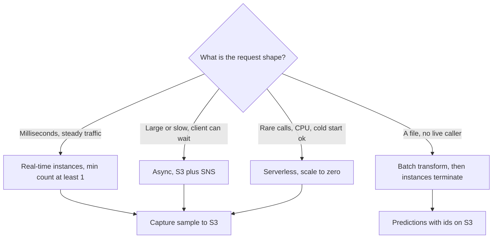

## Why this matters

A registered model does not answer requests until something loads it. SageMaker offers four serving patterns that are easy to confuse because they all "run the container." Real-time endpoints keep instances warm and answer in milliseconds. Serverless endpoints scale to zero and charge per request, with a cold start. Asynchronous endpoints accept a large payload via S3 and call you back. Batch transform scores a dataset and writes S3, with no endpoint left running. Picking real-time for a nightly file is how the bill arrives. Picking batch for an interactive click is how the product feels broken. This lesson maps the decision and the operational details that differ: autoscaling, variants, timeouts, and what you log.

## Intuition

The model container is the same idea in every pattern. It loads the tarball, implements a predict function, and speaks the serving protocol. What changes is the front door. A real-time endpoint is a load balancer in front of instances that stay up. Serverless is a load balancer in front of capacity that may be at zero. Async is a queue in front of instances, because the work is too big or too slow for a synchronous HTTP timeout. Batch transform is a finite job: start instances, read input objects, write predictions, terminate instances.

If predict is pure, you can put the same artifact in any of the four. If predict sends email, none of the four will save you. Fix that before you argue about serverless.

## Core concept in depth

### Real-time endpoints

You create a model that points at the registry artifact and the inference image, an endpoint configuration that names instance types and counts and production variants, and an endpoint that applies the configuration. Variants let you split traffic by weight between two models, which is the canary. Autoscaling policies target invocations per instance or latency. Scale-in should be slower than scale-out so a brief quiet does not thrash.

The container must respond inside the timeout. Load the model in the startup hook, not on the first request, or the first user pays the load and the instance looks unhealthy. Health checks hit a ping path. If your ping loads the model lazily and the load exceeds the check, the instance is killed in a loop. Log the model version at startup so the prediction log and the process agree.

Multi-model endpoints load several artifacts onto one instance and cache them. They fit when you have many small models and a tolerable cold load when a rare model is requested. They do not fit a single huge GPU model. Do not choose them to avoid thinking about ten endpoints until you have measured the cache miss.

### Serverless endpoints

You set memory and a maximum concurrency. SageMaker scales the copies with traffic and to zero when idle. You pay for compute time while a request is handled, not for an idle hour. Cold starts load the container and the model. A large model can cold-start for seconds to minutes, which is unacceptable for an interactive UI and fine for an internal tool used a few times a day. There is no GPU on the serverless inference option you should assume in designs; if you need a GPU, you are back to a provisioned real-time endpoint. Confirm the current service limits when you design, and design as if the cold start will happen, because after a quiet hour it will.

Serverless is a poor fit for steady high traffic. A warm instance that is busy is cheaper and more predictable than thousands of billed seconds with cold starts. Compare the hourly instance price to the expected serverless bill before you commit. The comparison is the design.

### Asynchronous inference

The client uploads the payload to S3 or passes an S3 location, calls the endpoint, and receives a 202. The container processes the object. On completion, SageMaker writes the output to S3 and can notify an SNS topic. The request can run much longer than a synchronous timeout, and the payload can be large. You still provision instances, or a scaling policy that can go to zero if you accept queueing. Use this for video, large documents, and batches of a few hundred that are still "online" from a user's point of view if they can wait a minute. Use batch transform when the work is a table of millions and nobody is waiting on a callback.

Idempotency matters. A retried async invocation should not run the side effect twice. Key off the input object hash or a client token. Dead letters belong on the SNS or queue path so a poison payload does not block the worker forever.

### Batch transform

A transform job points at a model and an input S3 prefix, starts instances, distributes files or splits a file across instances, writes predictions beside the input or to another prefix, and shuts the instances down. There is no idle cost after the job. Join the output back to the input by line order or by an id column you included. A transform that returns only a score, without the id, cannot be joined safely once anything is reordered. Include the id.

This is the default for nightly scoring, backfills, and evaluating a new model on a large holdout. It is the wrong default for a shopping-cart request. Instance count trades money for wall time. A one-instance transform of a terabyte is a weekend. A fifty-instance transform is a bill and a queue for capacity. Test on a shard first.

### Data capture

Real-time and async endpoints can capture a sample of requests and responses to S3. That feed is what Model Monitor and your own drift jobs should read. Capture enough to estimate a distribution, not necessarily 100 percent, unless the volume is small or the regulation says every decision. The capture includes the payload you sent. If the payload contains secrets or personal data, the capture bucket's policy matters as much as the endpoint's. The IAM and cost lesson returns to that bucket.

## Diagram / flowchart



### Dry-run table

Four products, one model artifact, four doors. Cost shape is the point, not a quote.

| Product | Pattern | Idle cost | Tail latency |
| --- | --- | --- | --- |
| Checkout fraud score | Real-time, two instances for HA | Pay for both all month | Low, if the model stays warm |
| Analyst tool used twice a day | Serverless | Near zero | Cold start on the first call after a gap |
| Ten-minute video moderation | Async | Instances if you keep a floor, else queue delay | The job time, not an HTTP timeout |
| Nightly propensity file | Batch transform | Zero after the job | The job's wall time, offline |

High availability for real-time means at least two instances in distinct zones, or you accept that a single instance's replacement is an outage of a few minutes. Serverless spreads that concern into the platform's concurrency limit instead. Say which limit you are depending on.

## Code

```python
def choose_serving(latency_ms_budget: int | None, payload: str, calls_per_day: int) -> str:
    if payload == "dataset":
        return "batch-transform"
    if latency_ms_budget is not None and latency_ms_budget > 60000:
        return "async"
    if calls_per_day < 50 and payload == "small-cpu":
        return "serverless"
    return "real-time"


def join_keys(input_ids: list[str], output_ids: list[str]) -> bool:
    """A batch output is usable only if every input id came back exactly once."""
    return sorted(input_ids) == sorted(output_ids) and len(input_ids) == len(set(input_ids))


if __name__ == "__main__":
    print("checkout", choose_serving(80, "small-cpu", calls_per_day=100000))
    print("analyst", choose_serving(2000, "small-cpu", calls_per_day=2))
    print("video", choose_serving(600000, "large", calls_per_day=100))
    print("nightly", choose_serving(None, "dataset", calls_per_day=1))
    print("join", join_keys(["a", "b"], ["b", "a"]))
    print("lost", join_keys(["a", "b"], ["a"]))
```

The four product choices print real-time, serverless, async, and batch-transform. The join check accepts a permutation and rejects a missing id. Use that check at the end of every transform job before a downstream system consumes the file. A job that "succeeded" and dropped a shard is a success at the API and a failure in the warehouse.

## Complexity analysis

| Pattern | Cost driver | Latency | Scale limit |
| --- | --- | --- | --- |
| Real-time | Instance hours, 24x7, times the minimum count | Milliseconds to a warm model | Quota and autoscaling policy |
| Serverless | Compute-seconds and memory, plus cold starts | Cold start plus predict | Concurrency quota, CPU only in the usual offering |
| Async | Instance hours while work exists, S3, SNS | Queue plus predict, long allowed | Backlog if instances are too few |
| Batch transform | Instance hours for the job only | Offline | Input shard design and quota |
| Multi-model real-time | One instance fleet, cache misses | Extra load time on a miss | Memory for the hot set |
| Data capture | S3 writes proportional to sample rate | Negligible on the request | A bucket you must secure and expire |

Autoscaling is not instantaneous. A traffic spike faster than scale-out is an outage or a latency spike. Set a minimum count for real-time if the product cannot absorb that, and accept the idle bill. Scale-to-zero is the explicit statement that a cold start is acceptable. Write that sentence in the design doc so finance and the product owner have agreed to the same latency.

Payload size limits differ. A fat JSON body on a real-time call will be rejected or slow. Put large objects in S3 and pass a pointer, which is the async and batch pattern even when the caller is online.

## Tricks, tips and patterns

- Choose the door from latency, payload, and idle traffic. Revisit the choice when traffic grows.
- Load the model at container start. Make the health check cheap after that.
- Canary with variant weights. Keep the previous variant until the new one has a clean window.
- Capture a sample for drift. Expire it. Do not capture secrets you do not need.
- Batch outputs must carry ids. Verify the join before you trust the job status.
- Async work needs idempotency and a dead-letter path.
- Two instances is the start of high availability for a real-time endpoint you promised would stay up.
- Pin the model package version in the endpoint config. Do not point production at a moving alias you also use for experiments, unless the alias update is the deploy.

## Common mistakes and edge cases

- A real-time endpoint left at one instance over a weekend, then surprise that a replacement is downtime.
- Serverless for a GPU model, or for a checkout path that cannot cold-start.
- Batch transform scores without ids, joined by line number after a retry reordered a shard.
- A ping handler that loads the model and times out, crash-looping the instance.
- Data capture of a full payment payload into a bucket the analytics role can read.
- Async retries that send two emails.
- Autoscaling on a metric that does not move until you are already in trouble, with a cooldown of half an hour.
- Deploying PendingManualApproval because the script took the max version number.

## Interview notes

Name the four patterns and the idle-cost difference. Give one product example each. Mention cold start for serverless and the lack of a GPU as a planning assumption you would verify against current docs.

Explain canary variants, minimum instance count, and why ping must be cheap. Explain batch join keys.

Mention data capture as the input to drift monitoring, and the privacy of that bucket. Mention idempotency for async.

You are not expected to recite API parameter names. You are expected to refuse the wrong door for the latency and the bill.

## Practice problems

1. [Classification Accuracy](/practice/ml-accuracy) — compute it from a batch output joined by id, not from an unordered file (easy).
2. [Binary F1 Score](/practice/ml-f1) — the same join, then a threshold (medium).
3. [Mean Squared Error](/practice/ml-mse) — a batch regression score against labels that arrive later (easy).
4. Classify four of your own product flows with the chooser function and write down the idle-cost consequence.
5. Explain why a successful transform job with a missing id is still a failed delivery.

## Summary / cheat sheet

- Real-time keeps instances warm. Budget a minimum count if you need high availability. Canary with variants.
- Serverless scales to zero and cold-starts. It fits rare CPU calls, not steady interactive GPU traffic.
- Async takes large or slow work through S3 and notifies on completion. Make the work idempotent.
- Batch transform scores a dataset and terminates. Carry ids, and verify the join.
- Load models at startup. Keep health checks cheap. Capture a privacy-aware sample for drift.
- The registry version in the endpoint config is the deploy. Latest is not a strategy.
- Predict stays pure so the same artifact can move between doors as the product changes.

## Further reading

- [SageMaker real-time inference](https://docs.aws.amazon.com/sagemaker/latest/dg/realtime-endpoints.html)
- [SageMaker serverless inference](https://docs.aws.amazon.com/sagemaker/latest/dg/serverless-endpoints.html)
- [SageMaker asynchronous inference](https://docs.aws.amazon.com/sagemaker/latest/dg/async-inference.html)
- [SageMaker batch transform](https://docs.aws.amazon.com/sagemaker/latest/dg/batch-transform.html)
- [SageMaker autoscaling](https://docs.aws.amazon.com/sagemaker/latest/dg/endpoint-auto-scaling.html)
