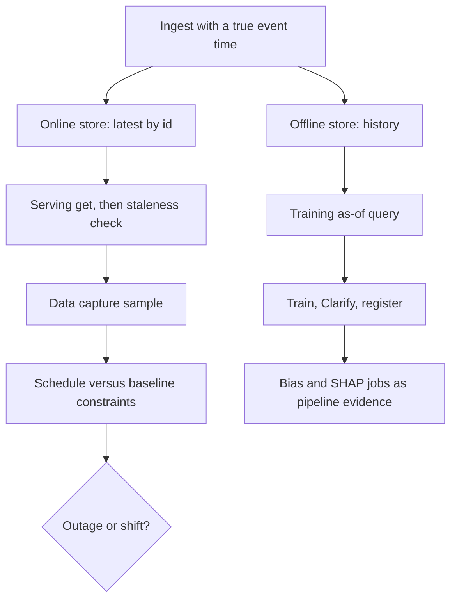

## Why this matters

The feature-store and drift lessons defined the contracts. SageMaker's implementations are Feature Store, Clarify, and Model Monitor. They do not replace the contracts. They fail in the same ways if you point them at the wrong timestamp, the wrong baseline, or a capture stream you never turned on. This lesson maps each product to the contract, the records you must write, and the reports you must not overread. A green monitor with a bad baseline is a green light on the wrong road.

## Intuition

Feature Store keeps a feature group: a schema of features for one entity, an online store for low-latency gets, and an offline store in S3 that accumulates history. Ingest writes a record with an event time. Training queries the offline store as of a label time. Serving gets the latest online record and you still have to decide if it is stale.

Clarify runs two kinds of jobs. Bias jobs compare statistics across groups you define, before training or after, on tabular data. Explainability jobs compute feature attributions, typically SHAP, for a model against a baseline. They are batch jobs, not a magic property of the endpoint. Model Monitor schedules a comparison of captured live data, or of predictions, against a baseline of statistics and constraints. It writes violations to S3 and can raise them through CloudWatch. If you never enabled data capture, the schedule has nothing to chew on.

## Core concept in depth

### Feature groups

A feature group has a record identifier, an event time feature, and the feature definitions with types. The online store is optional and costs money to keep warm. The offline store is an S3 table you query with Athena or Glue, and it is not optional if you intend to train with point-in-time correctness. Ingest can come from a pipeline processing step, from a stream, or from a batch put. Each record's event time is the time the value became true, not the time you happened to upload it. Backfilling with "now" as the event time destroys history. You will train on a fiction in which every past customer had today's click count.

The offline store is eventually consistent relative to the online put. A record you just put may not appear in the next Athena query for a short while. Do not build a test that assumes a synchronous mirror. Do build a test that a historical as-of query returns the earlier event and not the later one. That test is the product.

Online gets are by record id and return the latest record. They are not as-of queries. Training must not "get" from the online store in a loop and call it a dataset. Use the offline store and an as-of join. Serving uses the online store, then applies the staleness rule from the feature-store lesson, which Feature Store will not invent for you. A timestamp in the record is necessary and not sufficient. Your code compares it to now.

Deletion and GDPR-style erasure have to hit both stores. A feature you deleted online and left in the offline history will reappear in the next train. Plan the tombstone.

### Clarify bias and explanations

Pre-training bias metrics look at labels and facets before a model exists. A facet is a column such as a demographic group, and you should be careful and legal about which facets you are allowed to compute. Class imbalance and differences in positive-label rate across facets are descriptive. They do not by themselves prove a model is unfair, and a model can be unfair on a facet you did not measure. Post-training metrics look at predictions versus labels across facets: differences in false-negative rates are often the number a domain cares about. Pick the metric when you pick the cost ratio. Do not dump every Clarify metric into a slide and hope.

Explainability jobs need a baseline, a model, and a sample of rows. The output is attributions. Read them with the SHAP lesson's caveats: they sum to a gap under the method's assumptions, they are not causes, and correlated features share credit. A Clarify job that attributes a leaked feature is a successful job and a failed model. Fix the feature, do not screenshot the bar.

Clarify does not block a deploy unless you put a threshold in your pipeline and enforce it. The product computes. Your gate decides. A pipeline step that registers the model only if a chosen disparity stays under a limit you wrote down is the integration that matters.

### Model Monitor

Enable data capture on the endpoint first. Then create a baseline from a dataset that represents good traffic or from the training features, in the same order and units as the payload. The baseline job writes statistics and constraints: ranges, distributions, and inferred or declared types. A monitoring schedule runs hourly or daily, compares the latest capture window to the constraints, and writes violations.

Constraint files are editable. The inferred ones are a starting point. A feature with a legal range of 0 to 1 should say so, even if the baseline sample never exceeded 0.8. A feature that is allowed to be null should say so, or every cold start is a violation. Too-tight constraints page you. Too-loose constraints never page you. Calibrate them the way you calibrated PSI.

Monitor types differ. Data quality monitor watches input features. Model quality monitor watches accuracy or related metrics and therefore needs labels joined in. Bias drift monitor watches facet metrics over time. Feature attribution drift watches whether SHAP importances moved. You do not need all four on day one. You need data quality plus a path to model quality when labels exist. A dashboard of unused monitors is not a program.

Violations land in CloudWatch. Page on pipeline-breaking violations — type changes, all-null columns, score collapse — with a runbook. Ticket the slower distribution shifts. The drift lesson's distinction between an outage and a population shift is exactly the triage here.

## Diagram / flowchart



### Dry-run table

Two ingested records for user 9. A training label decided at 12:00. A serving request at 15:00 with a one-hour staleness limit.

| Event time | Feature clicks | Visible to train at 12:00 | Visible online at 15:00 |
| --- | --- | --- | --- |
| 09:00 | 1 | yes, and it is the latest as of 12:00 | superseded |
| 14:30 | 4 | no, it is in the future relative to the label | yes, age 30 minutes, under the limit |

A buggy backfill that stamps both records with event time "upload time" of 16:00 makes the 09:00 value invisible to every historical label and makes the online record look fresh when its content might be old. The event time is the feature's clock, not the ETL job's clock.

## Code

```python
def latest_asof(records: list[dict], decision_time: float) -> dict | None:
    eligible = [r for r in records if r["event_time"] <= decision_time]
    if not eligible:
        return None
    return max(eligible, key=lambda r: r["event_time"])


def serving_value(records: list[dict], now: float, max_age: float, default: float) -> float:
    current = latest_asof(records, now)
    if current is None or now - current["event_time"] > max_age:
        return default
    return float(current["clicks"])


def violation_is_page(kind: str) -> bool:
    """Page on broken payloads. Ticket the slower statistical shifts."""
    return kind in {"type_change", "all_null", "score_collapse"}


if __name__ == "__main__":
    rows = [
        {"event_time": 9.0, "clicks": 1},
        {"event_time": 14.5, "clicks": 4},
    ]
    print("train", latest_asof(rows, 12.0))
    print("serve", serving_value(rows, now=15.0, max_age=1.0, default=0.0))
    print("page type", violation_is_page("type_change"))
    print("page psi-like", violation_is_page("distribution_shift"))
```

The training as-of read returns the 09:00 record. The serving read returns 4 because 14:30 is only half an hour old at 15:00. A distribution-shift violation does not page in this policy; a type change does. Encode that split in the alarm, or the on-call will disable Model Monitor entirely after a week of histogram noise.

## Complexity analysis

| Capability | What you pay | What you must still build |
| --- | --- | --- |
| Online feature store | Store hours and request rate | Staleness and defaults |
| Offline store | S3 and queries | As-of joins, not latest-only SQL |
| Ingest lag | Seconds to minutes of inconsistency | Tests that do not assume a synchronous mirror |
| Clarify job | A processing cluster for the sample | A gate and a legal choice of facets |
| Data capture | S3 proportional to sample rate | A bucket policy and retention |
| Monitor schedule | A processing job per run | Edited constraints and a runbook |
| Model quality monitor | The same, plus label joins | Labels, request ids, version ids |

Clarify and Monitor are batch compute. They will not catch a bad deploy in the first second. Canaries and health checks do that. Monitors catch the hour and the day. Feature online gets sit on the request path, so a store outage is a scoring outage unless you have a default you can live with. Decide that default before the outage, and make sure the model was trained to see it.

Retention of the offline store is a cost and a compliance choice. Keeping every event forever makes beautiful as-of queries and a large bill. A defined history window must still exceed your longest training lookback, or the next backfill silently shortens the features.

## Tricks, tips and patterns

- Stamp event time as the time the fact was true. Never stamp the batch job's clock on a historical backfill.
- Train from the offline store with an as-of query. Serve from the online store with a staleness check.
- Expect ingest lag. Do not require the offline query to see a write that happened a second ago.
- Start Monitor with data quality and a capture sample. Add model quality when labels join cleanly.
- Edit constraints. Inferred ranges are not a policy.
- Page on type changes, all-null features, and score collapse. Ticket mild distribution shift.
- Put one Clarify metric you understand into the pipeline gate, not twenty you do not.
- Plan deletes for both stores. A half-delete will train the secret back in.

## Common mistakes and edge cases

- Using the online get API to build a training set.
- Event times of "now" on a backfill, so history collapses to a single instant.
- A monitor baseline taken from a bad week, forever defining "normal."
- Constraints so tight that null cold starts page every hour.
- Data capture disabled, and a schedule that reports nothing and looks healthy.
- Clarify SHAP charts used as causal proof in a credit decision letter without a reason code a human can audit.
- A facet you are not allowed to store, computed because the tool made it easy.
- Online and offline schemas that diverged after someone added a feature in only one path.

## Interview notes

Explain Feature Store as an online latest value plus an offline history, and the event-time rule. Give the 09:00 versus 14:30 example briefly.

Contrast Clarify bias metrics and explainability jobs. Say you would gate on a predeclared disparity, not on the existence of a report. Repeat that SHAP is not a cause.

Explain Model Monitor as baseline constraints versus captured traffic, and the prerequisite of data capture. Separate paging violations from ticketed shifts.

Mention eventual consistency of the offline store and the staleness policy the product does not apply for you. Those two sentences distinguish someone who has operated the service from someone who has read the product page.

## Practice problems

1. [Z-Score Standardization](/practice/ml-zscore) — statistics you might baseline in Monitor and must not refit on a single request (easy).
2. [Classification Accuracy](/practice/ml-accuracy) — a model-quality monitor metric once labels arrive (easy).
3. [Min-Max Scale](/practice/ml-minmax) — another transform whose drift means the serving parameters moved (easy).
4. Recompute the dry-run as-of at 12:00 and the serving value at 15:00 with a one-hour limit.
5. Name one Monitor violation that should page immediately and one that should not.

## Summary / cheat sheet

- Feature groups have an id, an event time, an online latest value, and an offline history. Event time is the fact's clock.
- Train with as-of queries on the offline store. Serve with online gets plus your own staleness and default rules.
- The offline store lags the put. Test history, not a same-second mirror.
- Clarify computes bias metrics and SHAP-style attributions. You choose the gate. Attributions are not causes.
- Model Monitor compares captured traffic to a baseline. Turn capture on, edit the constraints, and page only the violations that mean the pipe is broken.
- Deletes must cover both stores. A feature added on one path only is a schema bug.
- Canaries catch bad deploys in minutes. These jobs catch drift in hours. You want both.

## Further reading

- [SageMaker Feature Store](https://docs.aws.amazon.com/sagemaker/latest/dg/feature-store.html)
- [SageMaker Clarify](https://docs.aws.amazon.com/sagemaker/latest/dg/clarify-configure-processing-jobs.html)
- [SageMaker Model Monitor](https://docs.aws.amazon.com/sagemaker/latest/dg/model-monitor.html)
- [Lundberg and Lee, SHAP](https://arxiv.org/abs/1705.07874)
- [AWS data capture for real-time endpoints](https://docs.aws.amazon.com/sagemaker/latest/dg/model-monitor-data-capture.html)
