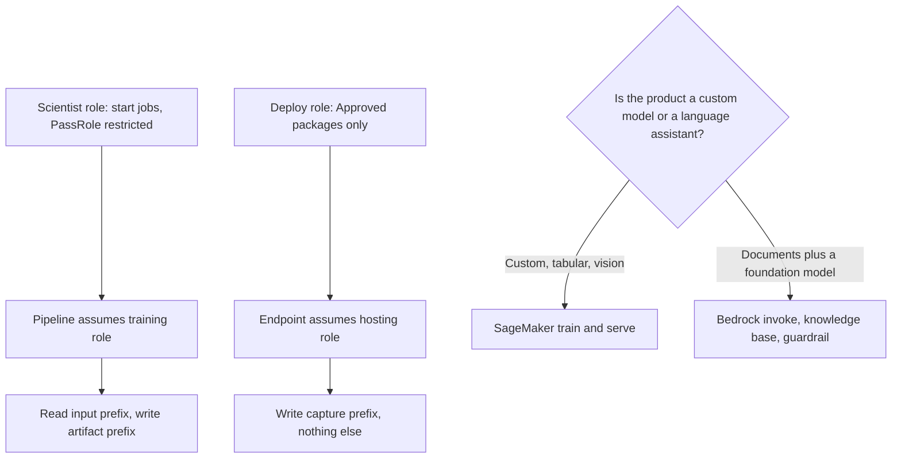

## Why this matters

The fastest way to fail a SageMaker rollout is an execution role that can read every bucket, an endpoint left running for a demo, or a foundation-model use case you tried to fine-tune from scratch because the tutorial was about training jobs. IAM decides who can start a job and what the job can touch. Cost is mostly instance hours, idle endpoints, and tuning fan-out. Bedrock is the managed API for foundation models: invoke a model, attach a knowledge base, apply a guardrail, without operating a training cluster. This lesson draws the boundaries so the architecture in the earlier lessons stays deployable and affordable.

## Intuition

Give people permissions to start work. Give jobs permissions to do one piece of work. A human role can create a training job and pass a specific execution role. The execution role can read one input prefix and write one output prefix. It cannot read the capture bucket full of customer payloads, and it cannot approve its own model package and deploy it, if you have split those duties. This is the same least-privilege story as any AWS design. Machine learning does not earn an exception because the SDK examples use `AmazonSageMakerFullAccess`.

Money follows what is running. A training job costs for its life and then stops. An endpoint costs until you delete it. A serverless endpoint costs when it is invoked. A Studio kernel costs while the app is running. The bill you did not expect is the endpoint from a finished experiment and the tuning job that launched forty GPU instances. Tag everything. Delete from a list, not from memory.

Bedrock is appropriate when the value is a strong general model plus your data at request time, or a small customization the service supports, and inappropriate when you need a classical tabular model, a custom architecture, or weights you must fully control. Many products need both: SageMaker for the ranker or the forecaster, Bedrock for the assistant that explains the result.

## Core concept in depth

### Roles

At least four roles keep the blast radius small. A data scientist role can open Studio, start pipelines, and read non-production prefixes. A training execution role can be passed to training jobs and can touch training inputs, the model output prefix, and the logs. A hosting role can be assumed by the endpoint and can read the model artifact and write capture. A deploy role, ideally not the same human who authors the model, can update an endpoint config to an Approved package. Pipeline steps assume the execution role. They should not assume a human's role with broad console rights.

`iam:PassRole` is the sharp edge. If a human can pass any role to SageMaker, they can make a job run as an administrator. Restrict PassRole to the specific execution role ARNs, with the service condition that the passer is SageMaker. Bucket policies should agree with the role, not contradict it. Encryption with a customer-managed key means the role also needs key grants. A job that fails on `kms:Decrypt` is a role bug, not a modeling bug.

VPC mode for training and hosting keeps the elastic network interfaces off the public internet. Use it when the data policy says so. It requires subnets, security groups, and VPC endpoints for S3, the SageMaker API, and CloudWatch, or the job cannot fetch its data. A VPC-attached job with no S3 endpoint and no NAT is a job that hangs until the max runtime. Test the network before the full train.

### Buckets

Separate prefixes or buckets for raw data, training snapshots, model artifacts, and capture. Lifecycle rules expire capture and intermediate splits. They must not expire a model artifact that an Approved package still references; the registry will not save you from a lifecycle rule. Block public access. Access logs on the artifact bucket help after an incident. Versioning on the artifact bucket protects against an overwrite; it does not replace the discipline of unique keys per training job.

Do not put production feature data and scratch notebooks in one prefix with a wildcard policy. The training role for project A should not list project B. Prefix conditions in IAM are the tool.

### The bill

Training: instance type times hours, times the count, including time spent downloading data and pulling images. Spot reduces the rate if you checkpoint. Tuning multiplies training. Failed jobs still cost the hours they ran. Set maximum runtime.

Hosting: the real-time instance price times hours times count, including nights and weekends. Two instances for high availability double it. GPUs left attached to a demo endpoint dominate a small account. Delete endpoints, or scale the minimum to zero only if you moved to serverless or async and accepted cold starts. Studio apps and kernel gateways also bill; shut them down.

Storage: EBS for the job, S3 for data and capture, and the online feature store. Capture sampled at 100 percent on a chatty endpoint is a storage product. Sample, expire, and do not capture fields you do not monitor.

Track cost per training job and per endpoint with tags: project, environment, owner. A monthly review that sorts by endpoint name will find the orphan. An untagged account will not.

### Bedrock beside SageMaker

Bedrock exposes foundation models through an API. You send a prompt or messages and receive a completion. You pay per token, input and output, which is a different shape from instance hours: idle costs nothing, a long context costs a lot, and a retry loop can multiply tokens the way a tuning job multiplies GPUs. Guardrails configure denied topics, filters, and word policies on the Bedrock request so the check is not only in your prompt text. Knowledge Bases are a managed RAG path: ingest documents, embed them, retrieve, and ground a model. They implement the RAG lesson's shape with less infrastructure and less control over the chunker and the index. Use them when the managed behavior matches. Use your own index when you need a custom hybrid retriever, a strict tenant filter you can test, or an embedding model Bedrock is not using.

Customization options such as continued pre-training or fine-tuning exist for some models and are not the same as training an arbitrary PyTorch model in SageMaker. Read the current model card for what a given model allows. Do not design a 2024 architecture diagram as if every model supported every customization.

Agents on Bedrock orchestrate tools the way the agent lesson described. The same rules apply: schema, allow-list, no secrets in the prompt, human approval for irreversible tools. The service does not repeal prompt injection. It gives you a place to attach a guardrail and a trace.

Choose Bedrock when the core asset is language understanding over your documents or a tool-using assistant, and you can accept the model's availability and data-handling terms. Choose SageMaker when the core asset is a model you trained on tabular or vision data, a custom container, or a feature pipeline tied to your warehouse. A churn classifier does not belong on a foundation-model API just because the API is newer. A policy assistant does not belong on a three-layer network you train from scratch.

## Diagram / flowchart



### Dry-run table

A month in a small account, illustrative prices so the comparison is the point.

| Resource | Assumption | Monthly shape |
| --- | --- | --- |
| Real-time endpoint, 2 x small CPU | left running | about 730 hours times 2 times the hourly price |
| Same traffic, serverless, 200 short calls a day | scale to zero | 200 times 30 times seconds of compute, plus cold starts |
| Forgotten GPU endpoint | one demo, never deleted | the largest single line, and no traffic |
| Tuning, 30 GPU trials, 20 minutes each | one search | 10 GPU-hours, easy to exceed the endpoint if you repeat it weekly |
| Bedrock assistant | 2 million input tokens, 0.5 million output | token invoice, zero when nobody chats |

The forgotten GPU endpoint is the cultural lesson. The tuning line is the technical lesson. Put a budget alarm on the account and a maximum job count on the tuner before either line is a surprise. Token budgets on Bedrock retries belong in the same review.

## Code

```python
def training_role_allows(action: str, resource: str) -> bool:
    """A tiny model of a tight training role. Deny by default."""
    rules = {
        ("s3:GetObject", "arn:aws:s3:::acme-train/*"),
        ("s3:PutObject", "arn:aws:s3:::acme-artifacts/*"),
        ("logs:PutLogEvents", "*"),
    }
    if action.startswith("s3:") and resource.endswith("/*"):
        return (action, resource) in rules
    return (action, resource) in rules or (action, "*") in rules and action.startswith("logs:")


def monthly_endpoint_hours(instances: int, hours_per_day: float = 24) -> float:
    return instances * hours_per_day * 30


def pick_platform(task: str) -> str:
    custom = {"tabular-churn", "demand-forecast", "image-defect"}
    language = {"policy-assistant", "ticket-draft"}
    if task in custom:
        return "sagemaker"
    if task in language:
        return "bedrock"
    raise ValueError("classify the task before you pick a platform")


if __name__ == "__main__":
    print("read train", training_role_allows("s3:GetObject", "arn:aws:s3:::acme-train/*"))
    print("read capture", training_role_allows("s3:GetObject", "arn:aws:s3:::acme-capture/*"))
    print("hours", monthly_endpoint_hours(2))
    print("churn", pick_platform("tabular-churn"))
    print("assistant", pick_platform("policy-assistant"))
```

The training role can read the train prefix and cannot read the capture prefix. Two always-on instances are 1440 instance-hours a month before you multiply by price. Churn stays on SageMaker. The policy assistant goes to Bedrock. The classifier raises on an unknown task so a design review cannot shrug. These are models of the decision, not substitutes for an IAM simulator. Run the real simulator on the role you intend to ship. The point of the small function is to notice that deny-by-default is the structure, and that platform choice follows the task.

## Complexity analysis

| Control | Effort | What slips through if you skip it |
| --- | --- | --- |
| Separate roles and PassRole restriction | A day of IAM, then peace | A job that runs as admin |
| Prefix-scoped buckets and lifecycle | A naming scheme | Public leftovers, expired production artifacts, or immortal capture |
| Budget alarms and job caps | An hour | A tuning loop over a weekend |
| Endpoint inventory | A weekly look | The forgotten GPU |
| VPC endpoints | Network design | Jobs that hang, or data on the public path |
| Bedrock guardrails and token caps | Configuration on the client | A retry storm and an unfiltered completion |
| Tags | A required field in the launcher | A bill you cannot attribute |

IAM changes are cheap compared with GPU hours and expensive compared with a demo if you leave them until the end. The role that cannot read the input bucket will fail the first job, which is the right failure. Fix the prefix. Do not attach full access to get unblocked and leave it there. The second outcome is the one audits find.

Bedrock token cost scales with context. Stuffing fifty RAG chunks into every call is a cost bug and a quality bug, which the RAG lesson already argued. A cache for repeated system prompts, where the API supports it, changes the bill. Measure tokens per successful task, not tokens per call alone, or you will optimize the wrong ratio.

## Tricks, tips and patterns

- Four roles: scientist, training, hosting, deploy. Restrict PassRole to the job roles.
- Prefixes for raw, snapshots, artifacts, and capture. Lifecycle only what is safe to lose.
- Unique artifact keys per job. Do not let a lifecycle rule delete an approved model.
- Tag project and environment. Alarm on monthly spend and on GPU hours.
- Delete endpoints that have no traffic. Prefer serverless or batch when idle cost dominates.
- Cap tuning jobs. Set max runtime. Checkpoint spot training.
- Use Bedrock for language products that fit a managed model, with a guardrail and a knowledge base or your own index.
- Use SageMaker when you train and own the weights. Do not fine-tune a giant model because the tabular baseline was boring.
- Simulate the IAM policy. Deny by default in your head before you read the JSON.

## Common mistakes and edge cases

- `AmazonSageMakerFullAccess` attached to a human and passed into the training job.
- PassRole on `*`.
- A lifecycle rule that expires the artifact prefix in thirty days, and an endpoint that breaks on day thirty-one when a new instance pulls the model.
- Capture data in the same bucket policy as the data-science sandbox.
- A Studio GPU kernel left running over a holiday.
- Bedrock retries with a growing transcript, so each failure costs more than the last.
- A knowledge base that ingested a confidential prefix because the data source was the whole bucket.
- Choosing Bedrock for a deterministic price model that should be a three-feature regression.

## Interview notes

Draw the four roles and what each can touch. Mention PassRole as the privilege escalation. Mention that the endpoint role and the training role are different.

Walk the cost drivers: training hours, idle endpoints, tuning multipliers, capture storage, Bedrock tokens. Give the forgotten-endpoint example.

State when you pick Bedrock versus SageMaker. Mention guardrails and knowledge bases as managed versions of the guardrail and RAG lessons, with less control over the index. Mention that VPC endpoints are part of a private training job, not an optional extra, when the data cannot hit the public internet.

You will not be asked to recite a policy document. You will be asked what you would remove from a tutorial role before production.

## Practice problems

1. [Mean Squared Error](/practice/ml-mse) — a metric cheap enough that you should not spend a tuning fortune on noise (easy).
2. [Cosine Similarity](/practice/ml-cosine) — the retrieval score inside a knowledge base you might otherwise treat as magic (easy).
3. [Binary Cross-Entropy](/practice/ml-bce) — the loss of a tabular model that should stay on SageMaker (medium).
4. Compute monthly instance-hours for two always-on instances and compare the shape to 100 serverless calls a day.
5. List three S3 prefixes and which role may read each. Confirm the training role cannot read capture.

## Summary / cheat sheet

- Humans start work. Jobs run with narrow roles. PassRole is limited to those roles. Buckets are split by purpose.
- Training bills hours and then stops. Real-time endpoints bill until you delete them. Tuning multiplies hours. Tag and alarm.
- Spot, max runtime, capture sampling, and serverless or batch choices are the cost tools that match the architecture lessons.
- Do not lifecycle-expire a live model artifact. Do expire capture and scratch.
- Bedrock is token-priced foundation-model inference, plus guardrails, knowledge bases, and optional customization.
- SageMaker is where you train, version, and serve your own models. Pick by the task, not by novelty.
- A full-access tutorial policy is a starting point for a sandbox and a defect in production.

## Further reading

- [SageMaker security and IAM](https://docs.aws.amazon.com/sagemaker/latest/dg/security-iam.html)
- [SageMaker pricing](https://aws.amazon.com/sagemaker/pricing/)
- [Amazon Bedrock user guide](https://docs.aws.amazon.com/bedrock/latest/userguide/what-is-bedrock.html)
- [Bedrock knowledge bases](https://docs.aws.amazon.com/bedrock/latest/userguide/knowledge-base.html)
- [Bedrock guardrails](https://docs.aws.amazon.com/bedrock/latest/userguide/guardrails.html)
