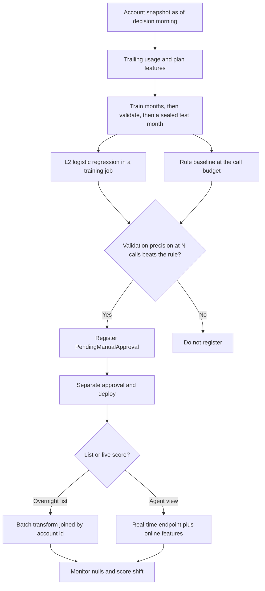

## Why this matters

Churn is the project companies assign when they want "an ML model" and have a warehouse of accounts. It is also a project that leaks, flatters accuracy, and leaves an endpoint running. This capstone puts the course in one pipeline: a decision time, features known at that time, a majority-class baseline, a logistic regression you can explain, a promotion gate, a real-time or batch door chosen on purpose, and a monitor that knows the difference between a broken feature and a changed market. The artifact is not a notebook accuracy. It is a model package you could hand to a deploy role.

## Intuition

An account is observed on a decision day, usually a billing day or the day a contract is up for renewal. The label is whether the account cancels within a horizon, say 30 days, without using information from inside those 30 days except the outcome itself. Features are trailing usage, tickets, and plan attributes as of the morning of the decision. A model that sees "cancellation requested" as a feature will score perfectly and deploy uselessly. The honest model beats the base rate by enough, on a later month, to pay for the retention offer you will actually make. If it does not, you ship the base rate and a rule, and you say so.

## Core concept in depth

### Population, label, and split

The entity is the account. The decision time is the snapshot date. The label is 1 if the account's cancellation timestamp falls in (decision time, decision time + 30 days], else 0. Accounts already cancelled are not in the population. Accounts too new to have a usage history take the cold-start vector and remain in the population, because production will see them.

Split by time: train on snapshot dates in months one through six, validate on month seven, test on month eight. Do not randomly split accounts across months if the feature includes a global campaign that changed; the time split is the one that resembles next month. If a large parent company has many accounts that churn together, also keep the parent on one side, or the model memorizes the parent through account-level rows.

The base rate will be small. Accuracy will look wonderful for a model that never predicts churn. The operating point is a budget: the retention team can call N accounts. You select the threshold that maximizes precision at that capacity, or expected value if you know the margin and the offer cost. Log loss still trains the model. The budget picks the threshold on the validation month only.

### Features

Trailing 7-day and 28-day active days, a ratio of recent to longer usage, ticket count, plan tier as a category, tenure in days, and a missingness indicator for brand-new accounts. All windows end at the decision time. The feature definition is one function used by the offline backfill and, later, by the online store. Target encoding of a high-cardinality sales-rep id is allowed only out of fold and only if the rep will exist at serving time. A rep id that is really "the person who already started the save process" is leakage wearing a badge.

Standardize numeric columns with training-month statistics. One-hot the plan tier with an other-bucket. Save the statistics and the column order into the model artifact.

### Model and baseline

The baseline predicts the training base rate for everyone and, at the operating point, ranks nobody: it spends the call budget on a random sample, or on the single best rule you already know (for example, "no login in 28 days"). The learned model is L2-regularized logistic regression. A gradient-boosted tree is the challenger if the linear model cannot use an interaction you refuse to encode. The capstone does not start with the tree. If the linear model plus two interactions matches the tree on the validation month, ship the linear model. It is cheaper to explain, and Clarify's attributions will match the weights times the deviations.

Train as a SageMaker script-mode job so the artifact is a tarball, not a notebook variable. The pipeline processes the snapshot, trains, evaluates on month seven, and registers PendingManualApproval only if precision at the call budget beats the rule baseline by a margin you set before looking at month eight. Month eight is reported once, after the gate.

### Serving and monitoring

If the retention list is built overnight, use batch transform and join on account id. If an agent should see a score while viewing the account, use a real-time endpoint with the online feature store, a staleness limit on usage counts, and the cold-start default. Do not stand up a GPU. Log the model version, the feature vector, and the score. Capture a sample for Model Monitor. Baseline the constraints on the training snapshot's feature distributions. Page if usage counts become all null. Ticket a slow PSI increase, and do not retrain until the next month's labels say the precision at capacity actually fell.

A canary is a second batch file or a variant with a small traffic weight. Rollback is the previous Approved version. The deploy role cannot approve the package. The training role cannot read the capture bucket.

## Diagram / flowchart



### Dry-run table

Five validation accounts. The call budget is two. The rule "no login in 28 days" flags accounts 1 and 2, and only account 1 churns. The model ranks 1, 3, 2, 5, 4 and the top two are 1 and 3, both churners in this toy.

| Account | Logins 28d | Label | Rule calls | Model top-2 |
| --- | --- | --- | --- | --- |
| 1 | 0 | 1 | yes | yes |
| 2 | 0 | 0 | yes | no |
| 3 | 4 | 1 | no | yes |
| 4 | 20 | 0 | no | no |
| 5 | 3 | 0 | no | no |

| Policy | Precision at 2 calls | Recall |
| --- | --- | --- |
| Rule | 1/2 = 0.5 | 1/2 = 0.5 |
| Model | 2/2 = 1.0 | 2/2 = 1.0 |

The toy is kinder than any real month. The shape is the point: same budget, compare precision, do not compare accuracy. Account 3 is why a model can beat a single threshold on logins. If month eight fails to repeat even a small lift, you do not tell the story of account 3.

## Code

```python
def precision_at_k(labels_by_score: list[tuple[float, int]], k: int) -> float:
    if k <= 0:
        raise ValueError("k must be positive")
    ranked = sorted(labels_by_score, key=lambda pair: pair[0], reverse=True)
    top = ranked[:k]
    if not top:
        return 0.0
    return sum(label for _, label in top) / len(top)


def rule_flags(logins_28d: list[int]) -> list[int]:
    return [1 if n == 0 else 0 for n in logins_28d]


def logistic_score(features: list[float], weights: list[float], bias: float) -> float:
    z = bias + sum(w * x for w, x in zip(weights, features))
    if z >= 0:
        ez = pow(2.718281828, -z)
        return 1.0 / (1.0 + ez)
    ez = pow(2.718281828, z)
    return ez / (1.0 + ez)


if __name__ == "__main__":
    # scores invented to match the ranking 1, 3, 2, 5, 4 and labels 1,0,1,0,0 in account order 1..5
    model = [(0.9, 1), (0.2, 0), (0.8, 1), (0.1, 0), (0.3, 0)]
    print("model p at 2", precision_at_k(model, 2))
    rule_scores = [(1.0 if f else 0.0, y) for f, y in zip(rule_flags([0, 0, 4, 20, 3]), [1, 0, 1, 0, 0])]
    # Rank flagged accounts first; precision among the two flags.
    print("rule p at 2", precision_at_k(rule_scores, 2))
    print("cold start score", round(logistic_score([0.0, 1.0], [0.4, -0.2], bias=-1.0), 4))
```

Model precision at two calls is 1.0. The rule ranks the two zero-login accounts first and its precision is 0.5. The cold-start score is a finite probability from a two-feature logistic, which is what the endpoint must return for a new account instead of throwing. Replace the invented scores with `logistic_score` on real rows in the pipeline's evaluation step, and write the JSON the gate reads. Do not hand-edit the JSON after looking at the test month.

## Complexity analysis

| Stage | Dominant cost | What makes it wrong |
| --- | --- | --- |
| As-of backfill | Warehouse scan of usage | A latest-value join |
| Training job | One CPU instance, minutes to hours | A notebook that never became a job |
| Tuning | Optional, easy to overspend | Searching a tree before the linear baseline |
| Batch nightly | Short CPU transform | Output without account ids |
| Real-time path | Feature get plus a tiny dot product | A GPU endpoint |
| Monitor | One scheduled job | Constraints copied from a bad week |
| Human call budget | The real money | A model that fills the budget with false positives |

The model compute is the cheap part. The retention offer and the data engineering are the expensive parts. A 2-point precision gain at a budget of 200 calls is four extra true churners if the base of the list was half right — compute it, do not adjective it. If the warehouse cannot produce an as-of usage feature, stop and fix that. A more complex model on a leaked feature will not survive contact with next month.

## Tricks, tips and patterns

- Write decision time, horizon, and the call budget on the first page of the design.
- Beat a simple rule at that budget on a later month. Report precision and the positive count.
- Keep a linear model if it matches the tree. Save weights, means, and column order together.
- Prefer batch if the action is a morning list. Use real-time only if an agent is waiting.
- Cold start is a defined vector. Stale usage is a missing value, not a confident zero from last quarter, unless zero is the true default you trained.
- Separate approve and deploy roles. The test month is sealed.
- Page on all-null usage. Do not auto-retrain on a single PSI blip.
- Delete the endpoint if you chose batch. Do not leave both running "just in case" without a reason.

## Common mistakes and edge cases

- Label leakage from a cancellation-request flag, or from tickets filed after the decision.
- Accuracy as the headline metric on a 3 percent base rate.
- A random split of rows from the same week.
- Threshold chosen on the test month.
- An endpoint without the feature store, and a service that recomputes "28 days" in a different timezone.
- Batch scores with no account id.
- A monitor baseline taken from the week the pipeline was broken.
- Calling the model a success because training log loss fell, while the rule still fills the call list better.

## Interview notes

Present this capstone as a decision, a budget, a time split, a baseline, and a gate. Offer the architecture diagram. Mention why logistic regression is the default and what would make you switch to a tree.

Explain as-of features with one usage event after the snapshot. Explain batch versus real-time with the morning list versus the agent screen.

Mention approval versus deploy, capture, and the all-null page. If the interviewer asks about fairness, say which facets you are allowed to measure, that Clarify can compute a disparity, and that a disparity threshold belongs in the gate before you look at the test month.

Do not claim a production lift you only saw on the toy table. Say how you would estimate the value of four additional true positives.

## Practice problems

1. [Binary F1 Score](/practice/ml-f1) — related, but not a substitute for precision at a fixed call budget (medium).
2. [Binary Cross-Entropy](/practice/ml-bce) — the training loss, not the operating metric (medium).
3. [Z-Score Standardization](/practice/ml-zscore) — fit on the training months only (easy).
4. Recompute both precisions at k = 2 from the dry-run table.
5. Add an event at day 31 that reveals cancellation, and show it cannot be a feature for a 30-day label decided on day 0.

## Summary / cheat sheet

- Churn is a decision-time classification with a delayed label. Features end when the decision starts.
- Optimize and report precision at the real call budget. Accuracy will lie.
- Beat an explicit rule on a later month. A regularized logistic regression is the first model, not the last resort.
- Train as a job, gate on the validation month, seal the test month, register, then deploy in a separate step.
- Batch for a morning list, real-time plus an online feature read for an agent. Include cold starts.
- Monitor for broken features. Retrain when the next labeled month says the lift died.
- The expensive parts are the offer and the data, not the dot product.

## Further reading

- [SageMaker Pipelines](https://docs.aws.amazon.com/sagemaker/latest/dg/pipelines.html)
- [SageMaker batch transform](https://docs.aws.amazon.com/sagemaker/latest/dg/batch-transform.html)
- [scikit-learn logistic regression](https://scikit-learn.org/stable/modules/linear_model.html#logistic-regression)
- [Google Rules of ML](https://developers.google.com/machine-learning/guides/rules-of-ml)
- [SageMaker Model Monitor](https://docs.aws.amazon.com/sagemaker/latest/dg/model-monitor.html)
