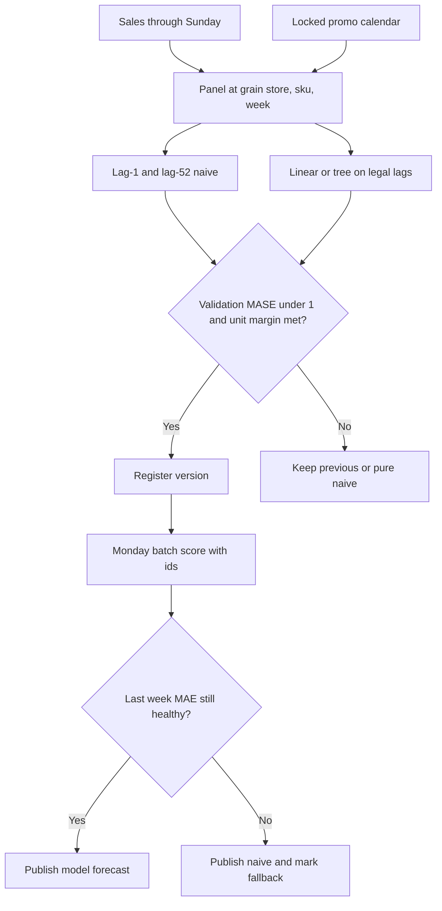

## Why this matters

Demand forecasts become purchase orders. A model that looks clever and loses to "same as last week" will order the wrong inventory with confidence. This capstone is the time-series lesson deployed: one horizon the business actually buys, a seasonal naive baseline, lag features that end at the origin, a SageMaker pipeline that trains and gates, batch transform that writes store-level predictions with ids, and an automatic fallback when the new model loses the latest week. It is also a cost design. The model is a boosted tree or even a linear model on lags, not a GPU sequence model, unless the sequence model wins the gate.

## Intuition

Every Monday morning the planner needs next week's demand for each store and sku that is still active. The information set is sales through Sunday, the known promo calendar for next week, and prices already set. It is not next week's actual sales, and it is not a promo flag someone types on Wednesday. The horizon is one week. The metric is MAE or a pinball loss if the planner buys to a quantile. The baseline copies the appropriate lag: last week, or last year's same week if yearly seasonality dominates. You ship a model only when the MAE on a held-out set of recent origins is better than that copy by enough to matter in units, not in a leaderboard percentage nobody can feel.

## Core concept in depth

### Grain, horizon, and legal columns

The row is store, sku, week. The target is units sold in week t + 1. Features known at the end of week t: lags 1, 2, 4, and 52 if you have the history, a trailing 4-week mean ending at t, the promo flag for week t + 1 if the promo calendar is locked before Monday, price for week t + 1 if it is already set, and store and sku identifiers. The promo flag for a promotion that was decided after the forecast ran is not legal. Missing weeks stay in the panel as explicit zeros or explicit nulls according to the business meaning — a stockout zero is not a demand zero. If you cannot tell stockout from zero demand, say so in the model card and do not pretend the target is pure demand.

New skus have no lag 52. They use a shorter lag set and a cold-start flag, or they inherit a category baseline. Dropping them from training and then crashing on them in production is the usual bug.

### Split and baseline

Origins are weeks. Train on origins up to T − 8, validate on the next four origins, test on the last four. Each origin's features use only weeks at or before that origin. The seasonal naive prediction for weekly data with a strong weekly pattern and yearly seasonality should be declared: this capstone uses lag 1 as the naive forecast when the recent level matters more, and you must also report lag 52. Whichever naive wins on validation is the baseline you have to beat. Do not pick the naive that loses so the model looks good.

MASE divides the model's MAE by the naive MAE. A MASE above 1 means you lost. Report MAE in units as well, by store cluster, so a national win that destroys one region is visible.

### Model

Start with the naive. Then a linear model on lags and promo. Then a gradient-boosted tree if interactions between promo and sku category are obvious and the linear model leaves them on the table. An LSTM is allowed only as a challenger that clears the same gate on the same origins. In most weekly panels it will not clear it by enough to pay for the operational cost. The capstone's default artifact is the tree or the linear model, saved with the feature list.

Training is a pipeline: build the panel in a processing step, train, evaluate MASE on the validation origins, register if MASE is under 1 and MAE beats the naive by a predeclared unit margin. The test origins are scored once for the model card. Refitting on train plus validation before the final artifact is allowed if you then only quote the test origins, and you do not retune depth on those origins.

### Serving, fallback, and drift

Monday's job is a batch transform or a batch container that reads the latest legal features, scores every active store-sku, and writes store, sku, week, prediction, model version. The planner's table joins on those ids. If the job fails, or if last week's MAE was worse than the naive by the rollback margin, the job writes the naive forecast instead and marks the version as fallback. A silent failure that repeats last month's file is worse than an explicit fallback. Compute last week's MAE from actuals that have now landed, joined by id and model version.

Monitor lag features for all-null weeks, which means the panel job broke, and monitor the promo flag's rate against the calendar so a stuck flag is visible. Retrain weekly or monthly depending on how fast promo behavior moves, always through the gate. Do not retrain every night on a window so short the holiday season cannot fit.

Quantile forecasts are the upgrade when the buyer needs a high percentile for a service level. Train pinball loss or a quantile gradient booster, and check coverage on the test origins. A point forecast MAE can be excellent while the 90th percentile is badly calibrated. If the buyer uses the point forecast as if it were a guarantee, the model card should say it is not.

## Diagram / flowchart



### Dry-run table

One sku, weekly units: 10, 12, 11, 13, 12. Stand at the last point and forecast the next week. Lag-1 naive predicts 12. A model that predicts 13 is being scored against an actual of 14 in this illustration.

| Forecast | Value | Absolute error vs 14 |
| --- | --- | --- |
| Lag-1 naive | 12 | 2 |
| Lag-4, if used as a seasonal guess | 12 | 2 |
| Model | 13 | 1 |

One origin does not promote a model. Four validation origins where the mean absolute error falls from 2.0 to 1.6 might, if the unit margin was 0.3 and the cost of being wrong is linear. If the buyer's pain is the one week you miss by 40 units, MAE will hide it and you should look at the worst origins before you approve. The table's job is to show the naive is a forecast with an id, an error, and a place in the output file, not a strawman.

## Code

```python
def lag_forecast(history: list[float], lag: int) -> float:
    if lag < 1 or lag > len(history):
        raise ValueError("lag is not available for this series")
    return history[-lag]


def mae(actual: list[float], pred: list[float]) -> float:
    return sum(abs(a - b) for a, b in zip(actual, pred)) / len(actual)


def mase(model_mae: float, naive_mae: float) -> float:
    if naive_mae <= 0:
        raise ValueError("naive MAE must be positive to scale")
    return model_mae / naive_mae


def choose_publish(model_pred: float, naive_pred: float, last_week_model_mae: float, last_week_naive_mae: float) -> dict:
    if last_week_model_mae > last_week_naive_mae:
        return {"prediction": naive_pred, "source": "fallback-naive"}
    return {"prediction": model_pred, "source": "model"}


if __name__ == "__main__":
    history = [10.0, 12.0, 11.0, 13.0, 12.0]
    naive = lag_forecast(history, 1)
    print("naive", naive, "abs", abs(14.0 - naive))
    print("mase", round(mase(1.6, 2.0), 3))
    print("publish", choose_publish(13.0, naive, last_week_model_mae=3.0, last_week_naive_mae=2.0))
    print("keep", choose_publish(13.0, naive, last_week_model_mae=1.5, last_week_naive_mae=2.0))
```

The naive forecast is 12 and the absolute error against 14 is 2. MASE of 1.6 over 2.0 is 0.8, a win. The publish helper falls back when last week's model MAE lost to the naive, and keeps the model when it won. Wire that helper to actuals joined by store, sku, and week. A fallback that uses a global flag and blanks every sku because one region failed may be what you want; a fallback that can run per series is kinder and more code. Choose explicitly. The capstone default is per series, so a broken sku does not drag the healthy ones back to last week unless their own error says to.

## Complexity analysis

| Piece | Cost | Risk |
| --- | --- | --- |
| Panel build | Warehouse job, weekly | Illegal columns, missing weeks squeezed out |
| Naive forecast | Trivial | Still the thing you might ship |
| Tree training | CPU hours | Depth tuned on the test origins |
| LSTM challenger | GPU hours and a sequential train | Usually loses, sometimes wins on long dense series |
| Monday batch | CPU, scales with store-sku count | Missing ids, no fallback |
| Backtest over many origins | Multiplies training if you refit | A single fit that peeked |
| Quantile upgrade | Similar train cost | Coverage unchecked |

The panel and the Monday join dominate engineering time. The model is a CPU job. Spending a week on a transformer before the naive MASE exists is the failure mode this capstone is designed to prevent. If the active store-sku count is in the millions, partition the batch and still write one schema. Do not pull the panel into a notebook.

A refit at every backtest origin is the honest variance estimate and is expensive. Four origins, refit, is enough to see a holiday. One origin is a story. Document which you did.

## Tricks, tips and patterns

- Declare the horizon and the two naive lags before you train. The better naive on validation is the baseline.
- MASE under 1 is the minimum bar. Also report units of MAE by region.
- Promo and price features must already be decided at run time. Audit that with a timestamp.
- Keep stockout nulls explicit. A zero can mean two things.
- Register only if the validation gate passes. Publish the naive under an explicit fallback flag when last week lost.
- Batch outputs carry store, sku, week, prediction, and source.
- Retrain on a cadence that can see seasonality. Gate every time.
- Leave the GPU alone until a challenger wins the same table.

## Common mistakes and edge cases

- Using week t + 1 sales as a lag because the join was off by one.
- A random split of weeks.
- MAPE on a sku that sometimes sells nothing.
- Dropping new skus in training and erroring on Monday.
- A fallback that is a stale file from last month with no flag, so the planner thinks it is this week's model.
- Tuning tree depth on the four test origins and then quoting those origins.
- A national MAE that hides a warehouse you consistently miss.
- Treating a point forecast as a service-level guarantee.

## Interview notes

Open with the decision: Monday, next week's units, legal information set, naive baseline, MASE. Draw the pipeline and the fallback. Mention ids on the batch file.

Explain why a tree on lags is the default and an LSTM has to win a gate. Explain stockouts versus zeros. Explain why lag 52 and lag 1 can disagree and why you report both.

If asked about uncertainty, describe a quantile forecast and a coverage check. If asked about SageMaker, name the processing job, the training job, the registry gate, and batch scoring. The endpoint is not required.

Say what you would do if the model wins nationally and loses in one region: do not average that away, and consider a fallback at region or series grain.

## Practice problems

1. [Compute Mean](/practice/ml-mean) — the trailing-mean feature, computed only through week t (easy).
2. [Root Mean Squared Error](/practice/ml-rmse) — a spike-sensitive companion to MAE, not a replacement for MASE (easy).
3. [Mean Squared Error](/practice/ml-mse) — what you optimize only if large misses dominate the business cost (easy).
4. Compute lag-1 and the absolute error against 14 on the dry-run history.
5. Construct a promo flag that is not known on Monday and show why the Monday job cannot use it.

## Summary / cheat sheet

- Forecast next week from data known this Monday. The row is store, sku, week, and the output has those ids.
- The baseline is the better of lag 1 and lag 52 on validation. MASE under 1 is the bar, with MAE in units beside it.
- Features are lags, trailing means, and promos or prices already locked. Stockouts are not silent zeros.
- A linear model or a tree is the default artifact. A sequence model must clear the same gate.
- The pipeline registers only on a win. Monday's batch falls back to the naive, per series, when last week lost.
- Do not tune on the final origins. Do not hide a region inside a national average.
- This system is a CPU batch plus a warehouse panel. It is not an always-on GPU endpoint.

## Further reading

- [Hyndman and Athanasopoulos, Forecasting: Principles and Practice](https://otexts.com/fpp3/)
- [SageMaker Pipelines](https://docs.aws.amazon.com/sagemaker/latest/dg/pipelines.html)
- [SageMaker batch transform](https://docs.aws.amazon.com/sagemaker/latest/dg/batch-transform.html)
- [scikit-learn histogram gradient boosting](https://scikit-learn.org/stable/modules/ensemble.html#histogram-based-gradient-boosting)
- [Google Rules of ML](https://developers.google.com/machine-learning/guides/rules-of-ml)
