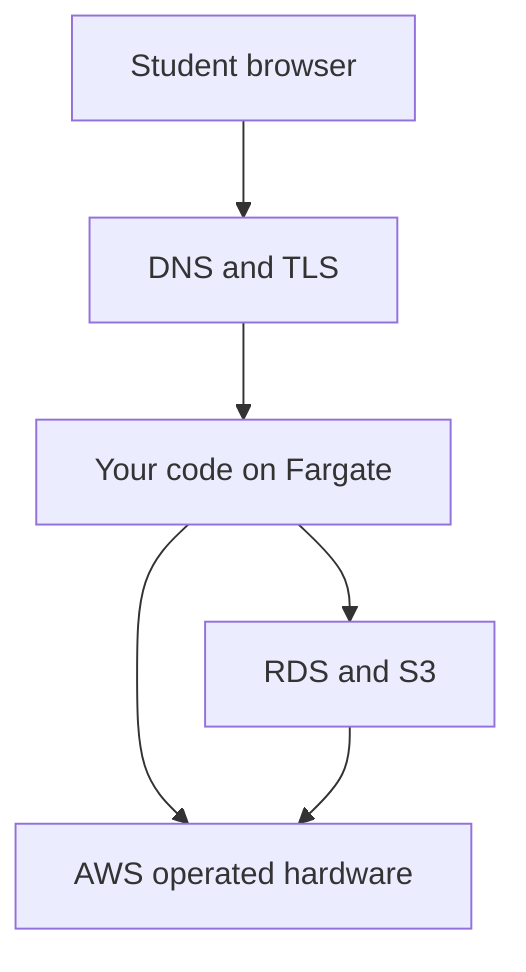

## Why this matters

The rest of this course names services. This lesson is the map those names sit on. If you cannot say whether a piece of CodeCraft is a virtual machine, a managed container, a database you do not SSH into, or a vendor API, every later design discussion turns into product trivia. Cloud is someone else's computer with an API, a bill, and a shared-responsibility line. The skill is choosing the line on purpose.

CodeCraft today runs as three containers on your laptop: a Next.js frontend, a FastAPI backend, and a sandbox image that the API starts through the Docker socket. Production is not "the same Compose file on a big VM." Production is a set of AWS services that replace the socket, the local Postgres you might add, and the public ports, while keeping the same two processes.

## Intuition

IaaS hands you machines and networks. You install the OS packages and you patch them. EC2 and a VPC are IaaS.

PaaS hands you a place to run your code. You still own the application. You do not own the host. ECS on Fargate, RDS, and S3 sit here for our purposes. The vendor patches the platform. You patch the image and the schema.

SaaS hands you a finished product. GitHub, a managed identity provider, and this academy itself once it is deployed are SaaS from the student's point of view. You configure them. You do not deploy their binaries.

AWS is a catalog, not a single computer. You pick a region. You call APIs. The console is a client of those APIs, same as Terraform. If the console can do it and Terraform cannot explain it, you do not understand it yet.

## Core concept in depth

### What you are renting

| Layer | You get | You still do |
| --- | --- | --- |
| Region and account | A blast-radius boundary and a bill | Choose the region, lock the account |
| VPC | An IP network | Design subnets and routes |
| Compute | CPU and memory for your process | Package the process, scale it, give it a role |
| Data | Durable disks or a managed engine | Model, back up, and restrict |
| Edge | A nearby cache or DNS | Decide what is cacheable |
| Identity | A way to say who can call an API | Write the smallest policy |

Nothing in that table is free of operations. Managed means the pager for the hypervisor is not yours. The pager for a bad deploy, a public bucket, or a missing index still is.

### How CodeCraft maps

| Local Compose | Production default in this course |
| --- | --- |
| `frontend` on port 3000 | Fargate service behind the ALB, or static assets on CloudFront if you split them |
| `backend` on port 8000, `/health` | Fargate service, private, only the load balancer can call it |
| `content` bind mount, read only | Image bake or a private S3 bucket the task reads. Not a host path. |
| Docker socket into the backend | Gone. The sandbox does not run as a sibling container on the API host. |
| `NEXT_PUBLIC_API_URL` pointing at localhost | The public API origin the browser can reach |
| Postgres, when you add it | RDS in private subnets, password in Secrets Manager |

Lambda is a real AWS compute option and a poor home for this API. The backend is a long-lived FastAPI process with a health check, dependency injection, and a sandbox integration that must not run inside a 15-minute function with a cold start. API Gateway is the same story for the main site: the ALB already speaks HTTP to the containers. Use API Gateway later for a webhook with a sharp edge, not as a second front door you have to explain.

### Accounts and APIs

An account is a hard boundary for IAM and for many blast radiuses. A learning account and a production account should not be the same account once money or student data exists. This course talks about one production-shaped account so the diagrams stay readable. The habit is still: separate accounts before you separate "environments" with name prefixes only.

Every service is regional or global. IAM users are global to the account. A VPC is regional. An S3 bucket name is global and the bucket lives in a region. You will mix those up once. The regions lesson is the cure. For now, pick one region and stay there until you can say why you left.

The API shape you will repeat: an action (`Create`, `Put`, `Describe`), a resource ARN, and an IAM decision. CLI, console, Terraform, and the SDK are four clients. Production changes go through Terraform so the next person can read the plan.

### What this course will build in your head

You will learn the network (VPC, load balancer, DNS, TLS), the compute (containers more than instances), the data (RDS, S3, and when DynamoDB is the better fit), the identity (roles, not keys), the delivery (GitHub Actions, images in a registry), and the bill. The last module deploys this repository's architecture, not a generic three-tier drawing with no relation to `docker-compose.yml`.

## Diagram / flowchart



### Dry-run: where does this concern live?

| Concern | Owner |
| --- | --- |
| Hypervisor, rack, power | AWS |
| Which region and which subnets | You |
| FastAPI routes and Next.js pages | You |
| Patching the Fargate host OS | AWS |
| Patching `python:3.12-slim` in your image | You |
| A public security group | You |
| RDS engine failover you configured | AWS performs it. You configured Multi-AZ. |

### Local versus cloud

| Compose habit | Cloud translation |
| --- | --- |
| `ports: 8000:8000` | ALB listener, not a public task IP |
| Bind mount of the repo | Image contents or object storage |
| `docker.sock` | A separate isolated runner, or no sandbox on the API task |
| One bridge network | Subnets and security groups |
| `.env` file | Secrets Manager and a task definition |

## Code

See the account and the region before you create anything. These calls are read-only and should become muscle memory.

```bash
aws sts get-caller-identity
aws ec2 describe-availability-zones --region us-east-1 --query "AvailabilityZones[].ZoneName"
```

`get-caller-identity` tells you the account and whether you are a user or a role. If the account id surprises you, stop. Creating a VPC in the wrong account is a cleanup project.

A tiny Terraform root that only pins the provider teaches the same fact: the region is an input, not a default you discover later.

```hcl
provider "aws" {
  region = "us-east-1"
}
```

Do not apply this in a hurry against a personal account that already holds unrelated resources. The deploy module shows a real root. This snippet exists so the region is visible in Git.

## Complexity analysis

| Choice | What you take on | Fit for CodeCraft |
| --- | --- | --- |
| One EC2 box and Compose | Patching, one AZ, the Docker socket | A demo. Not the course default. |
| Fargate plus RDS plus S3 | IAM, networking, image builds | The default |
| Kubernetes you operate | A platform team | Only after the app is boring on Fargate |
| Lambda for the API | Time limits, cold starts, a rewrite | Not for this process |
| SaaS "website builder" | Speed, and a ceiling | Cannot run the sandbox or the API you have |

The expensive complexity is usually identity and networking, not the application code you already run locally. Budget study time there.

## Tricks, tips and patterns

- Say IaaS, PaaS, or SaaS out loud when you pick a service. If you cannot, you do not know who patches it.
- One region until the design forces a second.
- Terraform for anything you hope to rebuild. The console is for inspection.
- Map every Compose service to a cloud substitute before you draw boxes.
- The Docker socket is a local convenience and a production incident.
- Read `aws sts get-caller-identity` when a command hits the wrong account.
- Prefer managed data stores over disks you snapshot by hand.

## Common mistakes and edge cases

- Calling Fargate "serverless so there is no ops." You still own the image, the IAM role, the scaling policy, and the bill.
- Lifting the Compose file onto one instance and calling it a cloud migration. You moved a pet.
- Using the root user because the tutorial said "sign in as root" once.
- Mixing regions: the bucket in one region, the task in another, the latency and the data-transfer line item unexplained.
- Assuming the console's default VPC is a design. It is a shortcut with a wide default security group.
- Treating the sandbox like a sidecar that can share the task role. It must not.

## Interview notes

**What is the difference between IaaS and PaaS?**
IaaS gives you compute and network primitives you administer. PaaS runs your application on a platform the vendor administers. EC2 is IaaS. Fargate is closer to PaaS. You still own the container image in both cases if you bring one.

**Why not run this API on a single VM?**
One VM is one AZ, one patch story, and often one Docker socket. The academy needs a private database, a load balancer, and a way to replace tasks. A VM can do that with an ASG. It is more work than Fargate for this shape, and it is a fine answer only if you needed the host.

**What does managed not cover?**
Your schema, your IAM, your public endpoints, your application bugs, and your decision to turn off backups. Managed covers the engine's availability features you enabled.

**Console, CLI, or IaC?**
CLI to inspect, Terraform to change, console to understand a screen. Production drift starts when the console is the only place the change exists.

**Name a service this app should not start on.**
Lambda for the main FastAPI process, and API Gateway as a required front door in front of the ALB. Both are useful AWS tools. They are the wrong default here.

## Practice problems

1. Classify ECR, RDS, and EC2 as IaaS or a managed platform, and say who patches the operating system in each case.
2. Take the Compose `backend` service. List what must change so it does not publish port 8000 on a public IP.
3. A teammate wants the sandbox to keep using the Docker socket on the API container in production. Explain the trust boundary that breaks.
4. `get-caller-identity` shows an account you do not recognize. What do you do before `terraform apply`?
5. Why is "we are on AWS" not an answer to "where does the content directory come from?"

## Summary / cheat sheet

- Cloud is an API, a region, an account, and a bill. The console is one client.
- IaaS: you run the OS. PaaS: you run the app. SaaS: you use the product.
- CodeCraft's default is Fargate, a private RDS, S3, a load balancer, and Secrets Manager.
- Lambda and API Gateway stay off the main request path.
- The Docker socket and the bind mount do not survive the move.
- One region, Terraform for changes, roles instead of the root user.
- Managed services move the pager. They do not move the design review.
- Later lessons fill in IAM, the VPC, and the pipeline. This lesson is the legend.

## Further reading

- [AWS Well-Architected overview](https://docs.aws.amazon.com/wellarchitected/latest/framework/welcome.html)
- [Shared Responsibility Model](https://aws.amazon.com/compliance/shared-responsibility-model/)
- [AWS global infrastructure](https://docs.aws.amazon.com/whitepapers/latest/aws-overview/global-infrastructure.html)
- [Amazon ECS on Fargate](https://docs.aws.amazon.com/AmazonECS/latest/developerguide/AWS_Fargate.html)
- [Terraform AWS provider](https://registry.terraform.io/providers/hashicorp/aws/latest/docs)
