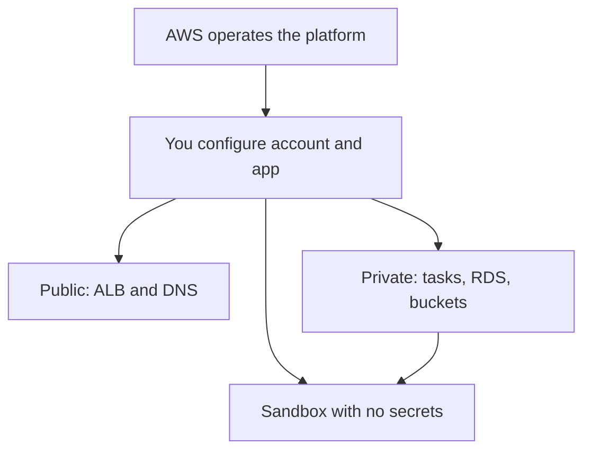

## Why this matters

"AWS is secure" is true about the hardware and false as a deployment plan. The shared responsibility model is the list of jobs that stay with you after you swipe a card for the account. Every public bucket, open security group, and long-lived access key in the news was on the customer side of that line. CodeCraft handles lesson content, and it can execute student code in a sandbox. Those are two different trust levels. Mixing them is the failure mode this lesson exists to prevent.

## Intuition

AWS secures the cloud: buildings, hypervisors, the managed service's underlying hosts. You secure what you put in the cloud: accounts, data, network rules, and application behavior. The line moves when you pick a higher-level service. On EC2 you patch the guest OS. On Fargate you patch the image and AWS patches the host. On RDS you do not patch the database host, and you still design the schema, the users, and the backups.

Security is a set of defaults you can explain. Private unless a listener must be public. Roles instead of keys. Encryption as the boring path. Logs you can actually read. A sandbox that cannot see production secrets even if the student code is hostile, because student code is hostile.

## Core concept in depth

### The line for this stack

| Piece | AWS | You |
| --- | --- | --- |
| Fargate host | Patch, isolate | Image contents, task role, desired count |
| ALB | Appliance availability | Listeners, TLS cert choice, which targets |
| RDS | Engine host, disk encryption support, Multi-AZ mechanism | Private placement, password, backups you verify, parameter group |
| S3 | Durability of stored objects | Block public access, bucket policy, versioning, lifecycle |
| IAM | The evaluation engine | Every policy you attach |
| CloudTrail | The service, if you turn it on and protect the logs | Enabling it, retaining it, alarming on it |
| Student sandbox | Nothing, until you design it | Isolation, no socket, no database, no role |

If a row's "you" column is empty, you have not looked hard enough.

### Identity first

The root user creates the account and then stops being a daily tool. MFA on root. No access keys for root. Humans use Identity Center. Services use roles. GitHub Actions uses OIDC. A static key in a GitHub secret is the old path and it leaks in the same ways other secrets leak.

Least privilege is a list of actions and ARNs, not a mood. The API task reads one secret and maybe writes one S3 prefix. The execution role pulls images and writes logs. The sandbox role does not exist.

### Network exposure

Private subnets for tasks and databases. The load balancer is the public HTTP surface. Security groups allow the smallest path: the internet to the listener, the listener to the task port, the task to the database port. A security group of `0.0.0.0/0` on the database is the customer side of the shared model failing in one line.

The Compose file publishes `3000` and `8000` because your laptop is the network. Production does not publish the task. The health check stays. The world does not get a path around the load balancer.

### Data

Encryption at rest is table stakes: RDS storage, S3 default encryption, EBS if any instance remains. Encryption in transit is TLS on the public edge and TLS to RDS when the engine supports it and you turn it on. Secrets Manager holds the password. The task definition injects it. The git repo does not.

Backups are a security control. A snapshot you have never restored is a hope. RDS automated backups and S3 versioning on state and content are the minimum. A lifecycle rule that expires the content bucket is an availability incident you caused yourself.

### The sandbox is a different trust zone

Student code is untrusted input that happens to be a program. On the laptop, the backend mounts the Docker socket so it can start `codecraft-sandbox`. That socket is root-equivalent on the Docker host. In AWS, the API task must not mount a socket, must not run privileged, and must not carry the database secret into the sandbox process. If code execution moves to production, it moves as a separate, locked-down runner with no route to RDS and no task role that can read secrets. Turning `SANDBOX_DISABLED` on in CI is the test equivalent: unit tests do not need a live executor. Production needs an executor that cannot become the API.

### Detection

CloudTrail logs API calls. VPC flow logs show accepted and rejected connections when you enable them. Container logs go to CloudWatch. None of that helps if the log group retention is one day and nobody alarms on `AuthorizeSecurityGroupIngress` to the world or on a trail being stopped. The monitoring module builds the alarms. This lesson only insists they are in scope for "secure," not a later luxury.

## Diagram / flowchart



The last arrow is the one to delete. The sandbox does not get a path into the private data.

### Dry-run: a finding and whose job

| Finding | Customer job |
| --- | --- |
| Bucket lists to the internet | Block public access, fix the policy |
| CVE in your base image | Rebuild and redeploy |
| CVE in the Nitro hypervisor | AWS, unless you pinned something unusual |
| Database open to the VPC CIDR | Tighten the security group |
| Student code reads `DATABASE_URL` | You injected the secret into the wrong process |
| Trail disabled | You, and it is an incident |

### Laptop versus production

| Local risk | Production rule |
| --- | --- |
| Docker socket on the backend | Not mounted |
| Content bind mount | Baked or private object storage |
| CORS allows localhost | CORS allows the real site origin only |
| Secrets in a `.env` | Secrets Manager |
| Tests hit a real sandbox | CI sets the sandbox to disabled |

## Code

Block public access is the S3 half of "we meant private." Run it on every bucket this project creates.

```bash
aws s3api put-public-access-block \
  --bucket codecraft-media \
  --public-access-block-configuration \
  BlockPublicAcls=true,IgnorePublicAcls=true,BlockPublicPolicy=true,RestrictPublicBuckets=true
```

Confirm the caller is not root before you keep working:

```bash
aws sts get-caller-identity
```

The ARN should be a role or an IAM user you can name, not the root account. If it is root, stop and switch.

A task definition fragment shows the secret entering the API container and not a sandbox container. The sandbox, if present, is a different task with no `secrets` block.

```json
{
  "name": "api",
  "secrets": [
    {
      "name": "DATABASE_URL",
      "valueFrom": "arn:aws:secretsmanager:us-east-1:123456789012:secret:codecraft/db"
    }
  ]
}
```

## Complexity analysis

| Control | Cost to skip | Cost to do |
| --- | --- | --- |
| MFA and no root keys | Account loss | Minutes |
| Private subnets | A public database | A NAT or endpoints |
| Separate sandbox | Student code becomes prod | Another task definition |
| CloudTrail | You cannot investigate | A cheap log bucket if you lifecycle it |
| Image rebuilds | Known bugs in the base | CI time |
| Customer-managed KMS everywhere | You may not need the audit | Extra decrypt IAM and cost |

Do the first three before you debate key policies.

## Tricks, tips and patterns

- Ask "who patches this?" for every box in the diagram.
- Public surface is the load balancer and DNS. Everything else is private.
- One secret store. No passwords in task definition environment plaintext if you can inject them.
- The sandbox is untrusted code. No role, no database route, no socket.
- Turn on CloudTrail in every account and protect the bucket.
- Block public access on S3 as a default resource, not a review comment.
- CORS and security groups are different doors. Lock both.

## Common mistakes and edge cases

- Copying a tutorial IAM policy with `Action` star and `Resource` star "until it works."
- Believing RDS "private" because the checkbox says not publicly accessible, while the security group allows the world. The checkbox removes the public address. The security group is still the firewall.
- Putting the database password in `NEXT_PUBLIC_` environment variables. Those ship to the browser.
- Enabling encryption and also logging the secret on startup to "verify the inject."
- Treating shared responsibility as a compliance PDF. It is the design review checklist.
- A forked pull request workflow that can assume the deploy role. The trust policy is a security control.

## Interview notes

**State the shared responsibility model for Fargate.**
AWS runs and patches the data plane hosts. You own the image, the IAM roles, the network placement, the application, and the data you store. A vulnerable pip package is yours. A failed hypervisor is theirs.

**What is the first identity rule?**
No daily root, MFA everywhere humans sign in, roles for workloads, no long-lived keys in the repo or in GitHub.

**Why is the Docker socket a security bug in production?**
Whoever can talk to the socket can start privileged containers and talk to the host. Student code must not sit behind that socket. The API process should not either.

**Name two controls that are entirely the customer's job on S3.**
Block public access and the bucket policy. Durability of a correctly stored object is AWS. Public listing is you.

**How do you keep the sandbox from reading the database?**
Do not put the secret in its environment, do not give it a task role that can read the secret, and do not give its security group a path to the database port.

## Practice problems

1. Sort these into AWS or customer: patching Amazon Linux on EC2, patching the RDS host, deciding Multi-AZ, rotating the app password.
2. The Compose backend mounts the Docker socket. Write the production rule in one sentence and the reason.
3. A bucket is encrypted and also public. Which control failed, and does encryption fix it?
4. CI currently disables the sandbox. Why is that not the same as a safe production sandbox?
5. A developer uses root access keys "just for Terraform." Replace that with the principal you want.

## Summary / cheat sheet

- AWS secures the platform. You secure configuration, data, identity, and the app.
- Fargate moves OS patching to AWS and leaves the image with you.
- Private network, smallest security groups, block public S3.
- Roles and OIDC. Root locked. No secrets in git or in `NEXT_PUBLIC_` variables.
- The sandbox is hostile code: no socket, no database, no task role.
- CloudTrail on. Alarms when the trail or the public exposure changes.
- Encryption is the default, not the whole program.
- If you cannot name the owner of a control, it will be nobody.

## Further reading

- [Shared Responsibility Model](https://aws.amazon.com/compliance/shared-responsibility-model/)
- [IAM best practices](https://docs.aws.amazon.com/IAM/latest/UserGuide/best-practices.html)
- [S3 Block Public Access](https://docs.aws.amazon.com/AmazonS3/latest/userguide/access-control-block-public-access.html)
- [ECS security](https://docs.aws.amazon.com/AmazonECS/latest/developerguide/security.html)
- [CloudTrail concepts](https://docs.aws.amazon.com/awscloudtrail/latest/userguide/cloudtrail-concepts.html)
