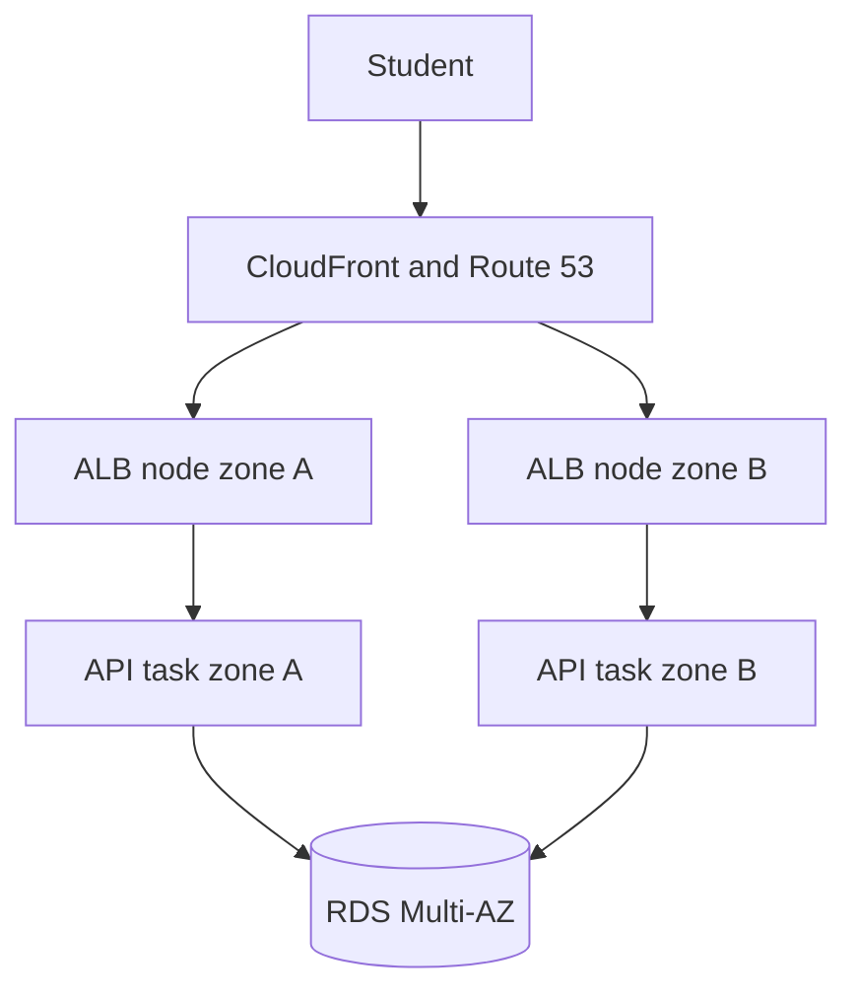

## Why this matters

A region is a physical and legal place. An Availability Zone is an isolated building group inside that region. The edge is a cache close to the student. CodeCraft will be slow, expensive, or down if you treat those three as one "AWS cloud." The API and the database must share a region. The site must run in at least two zones. The CDN must not cache authenticated API responses. Those three sentences are the design.

## Intuition

Regions are far apart. Crossing them costs latency and data-transfer money, and it is a feature when you want disaster recovery. Zones inside a region are close enough for synchronous database replication and far enough that a power failure should not take all of them. Edge locations are neither a region nor a zone. They store copies of objects you mark as cacheable. They do not run your FastAPI process unless you deliberately pick an edge compute product, which this course does not.

If a resource does not say which zone it is in, assume it dies with one zone until you have checked. A single Fargate task, a single NAT gateway, and a single-AZ RDS instance are three ways to build a region-shaped diagram that still fails on one building.

## Core concept in depth

### Picking the region

Pick for latency to your users, for the services you need, and for data residency if student data has a legal home. `us-east-1` has every new feature first and also the noisiest failure stories. A region closer to the students is often the better product. This course's examples use `us-east-1` because documentation and IAM certificate requirements for CloudFront line up there. Change the region as a variable, not as a string scattered through the repo.

Stay in one region for the ALB, the tasks, the RDS instance, and the buckets the tasks read. A bucket in another region "because it was the console default" adds a cross-region hop on every content read. CloudFront is the exception: it is global, and the origin stays in your region. ACM certificates used by CloudFront must be in `us-east-1` even when the origin is elsewhere. That is a footgun worth memorizing.

Some controls are global in the account: IAM, CloudFront distributions, and Route 53 hosted zones. A global service still has a home for its data and its API endpoint. "Global" does not mean "immune to a region failure." Route 53 is designed to survive a regional event. Your ALB in one region is not.

### Zones and the minimum bar

Use two zones from the start. Public subnets in each for the load balancer. Private subnets in each for tasks. Database subnets in each so Multi-AZ has somewhere to fail over. Fargate can place tasks in the subnets you list. If you list one subnet, you have one zone.

RDS Multi-AZ keeps a standby and fails the endpoint over. It is not a read replica. A read replica is an extra instance you query on purpose, and it can sit in another region if you are doing disaster recovery, with replication lag you must design for. Do not send the API at the primary and "also" at a replica without knowing which writes you just lost.

NAT gateways are zonal. One NAT in zone A means zone B tasks need a route to it, and when zone A dies those tasks lose the internet path. Interface endpoints are another way to reach AWS APIs without that dependency.

### The edge

CloudFront terminates TLS near the student and fetches the origin on a miss. Lesson images and other public immutable assets belong there. HTML that changes every deploy can be cached with a short TTL or invalidated. API responses that depend on the logged-in student do not belong in a shared cache. A cache key that forgets the cookie will serve one student's page to another. The safe default in this course: CloudFront in front of public media, the ALB in front of the API, and no behavior that caches `/api`.

Route 53 alias records point the apex domain at the ALB or at CloudFront without a fake A-record IP you have to update. Health checks hit `/health` on the API. A health check against `/` on a frontend that returns 200 even when the API is dead will keep sending students to a broken site.

### Failure you are actually buying

| Event | What survives if you did the minimum |
| --- | --- |
| One zone down | ALB in the other zone, tasks replaced, RDS Multi-AZ failover |
| Whole region down | Nothing in this course's default. You would need a second region and a drill. |
| Edge location down | CloudFront routes around it. Your origin must still be up. |
| Bad deploy | A second zone does not help. Rollback does. |

Multi-AZ is not multi-region. Say which one you sold.

## Diagram / flowchart



### Dry-run: zone A is gone

| Resource | What you want to see |
| --- | --- |
| ALB | Still serving from zone B subnets |
| ECS service | Replaces the lost task in zone B |
| NAT only in zone A | Zone B tasks cannot pull images or call the public internet |
| RDS single-AZ in zone A | Database down until restore |
| RDS Multi-AZ | Failover. Brief errors. Endpoint stays the same. |
| CloudFront cache | Still serves cached media. API calls fail if the origin is dead. |

### What is global and what is not

| Name | Scope |
| --- | --- |
| VPC, ALB, ECS service, RDS | One region |
| S3 bucket | One region, global name |
| IAM role | Account-global |
| CloudFront | Global edge, origin in a region |
| ACM cert for CloudFront | Must be requested in `us-east-1` |
| Route 53 public zone | Global DNS |

## Code

List zones before you hard-code them. Zone names such as `us-east-1a` are not the same physical building in every account.

```bash
aws ec2 describe-availability-zones \
  --region us-east-1 \
  --query "AvailabilityZones[].ZoneName" \
  --output text
```

Pin the region in the environment you deploy from so a laptop profile does not surprise you.

```bash
aws configure get region
```

A health check should call the API health path, not a cached homepage.

```bash
curl -fsS https://academy.example.com/health
```

The backend container already exposes that path for Compose. The load balancer target group should use it too. A 200 from the CDN on `/` is not a database check.

## Complexity analysis

| Design | Survives | You pay |
| --- | --- | --- |
| One zone, one task, one NAT | A process restart | The least, and a zone event is an outage |
| Two zones, Multi-AZ RDS, two NAT gateways | A zone event | NAT hours and cross-AZ data |
| Two zones, one NAT | A zone event for the app, not for egress | A documented egress dependency |
| Second region, warm standby | A region event | Double the floor cost, plus replication lag drills |
| CloudFront for media | Edge blips, and you shed origin reads | Invalidations and cache bugs if you cache the API |

For this academy, two zones in one region is the honest default. A second region is a later decision with a runbook, not a checkbox.

## Tricks, tips and patterns

- One region for the data path. Write it at the top of the design.
- Subnets in at least two zones for public, app, and data tiers.
- Multi-AZ RDS is standby failover, not a second writer.
- NAT and interface endpoints are zonal stories. Count them.
- CloudFront for public assets. Do not cache the API.
- ACM in `us-east-1` for the distribution, even if you later move the origin.
- Health checks hit `/health`.
- Region failure is a different product from zone failure. Do not claim both.

## Common mistakes and edge cases

- Hard-coding `us-east-1a` in a second account and assuming it is the same building.
- Cross-region S3 by accident, then blaming the API for latency.
- Caching `Set-Cookie` responses at the edge.
- A Multi-AZ database with tasks only in one zone. The database fails over and the compute does not.
- Route 53 health check in the same broken region with no thought about what "healthy" means.
- Deploying the ALB to two subnets that are actually in the same zone because the names looked different.

## Interview notes

**Region versus Availability Zone?**
A region is a cluster of zones in a geography. Zones have independent power and network. You place subnets in zones. You pick the region for latency, features, and data rules.

**What does Multi-AZ buy you?**
Automatic failover of the database endpoint to a standby in another zone. You do not get a second region, and you do not get a read scaling replica unless you created one.

**Why not cache the API at CloudFront?**
Responses are personalized and dynamic. A shared cache will leak or stale them. Cache immutable media. Send API traffic to the load balancer.

**What fails if the whole region fails?**
The default design in this course. Multi-AZ does not help. You need a second region, replicated data, and DNS you have practiced.

**Why are zone names per account?**
The suffix is remapped. `us-east-1a` in your account may be a different zone from a partner's `us-east-1a`. Use the zone id when the physical identity matters.

## Practice problems

1. The API is in `us-east-1` and the content bucket is in `eu-west-1`. What do users feel, and what do you change?
2. NAT lives only in zone A. Zone A fails. Tasks in zone B are running. Why can they not pull a new image?
3. CloudFront sits in front of the ALB and a student sees another student's lesson progress. What did the cache key ignore?
4. You turned on Multi-AZ and left the ECS service in one subnet. Which failure still takes the site down?
5. The CloudFront certificate request fails in your origin region. Where must the certificate live?

## Summary / cheat sheet

- Region: latency, residency, service availability. Stay on one data path.
- Zone: place every tier in two of them.
- Multi-AZ RDS fails over. It is not a read replica and not a second region.
- NAT is zonal. One NAT is a choice, not a default you hide.
- Edge caches public bytes. It does not run the API and must not cache it.
- CloudFront certificates are requested in `us-east-1`.
- Health checks use `/health`.
- Say zone failure and region failure as different claims.

## Further reading

- [Regions and Availability Zones](https://docs.aws.amazon.com/AWSEC2/latest/UserGuide/using-regions-availability-zones.html)
- [AWS global infrastructure whitepaper](https://docs.aws.amazon.com/whitepapers/latest/aws-overview/global-infrastructure.html)
- [RDS Multi-AZ](https://docs.aws.amazon.com/AmazonRDS/latest/UserGuide/Concepts.MultiAZ.html)
- [CloudFront cache behavior](https://docs.aws.amazon.com/AmazonCloudFront/latest/DeveloperGuide/DownloadDistS3AndCustomOrigins.html)
- [Route 53 health checks](https://docs.aws.amazon.com/Route53/latest/DeveloperGuide/dns-failover.html)
