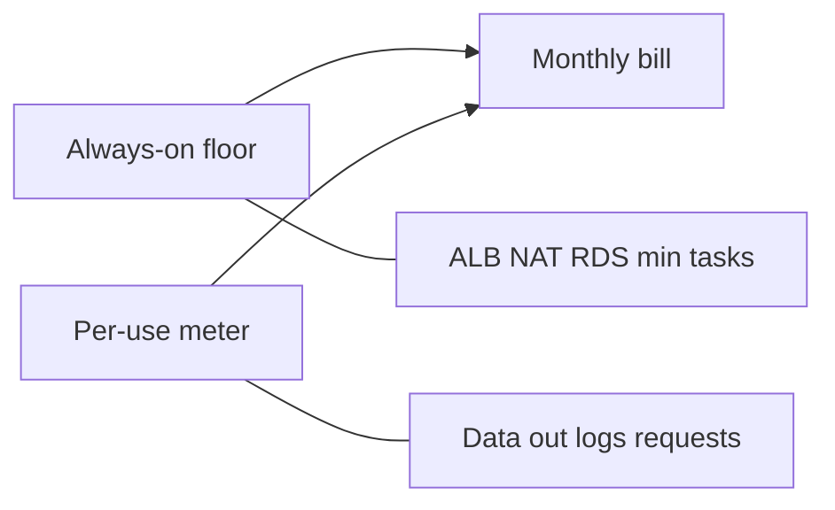

## Why this matters

A correct architecture you cannot afford will be "temporarily" replaced by a public EC2 instance. The people who do that are not bad at math. They never named the meters. This lesson is the habit of naming them before Terraform, using CodeCraft's real shape: two Fargate services, a load balancer, a NAT, a small RDS instance, a few buckets, and a log group that will surprise you.

Prices move. The model does not. Something is billed per hour whether anyone visits. Something is billed per request or per gigabyte. Something is free until the dimension you forgot, like cross-AZ traffic or CloudWatch ingestion. Design reviews should include the meter, not a screenshot of the pricing page you will not reread.

## Intuition

Fixed floor versus variable meter. The floor is what the empty staging environment costs at 3 a.m.: load balancer, NAT gateways, the smallest RDS instance, and the Fargate tasks you set as the minimum. The meter is what students cause: request counts, data out to the internet, log lines, and image pulls.

Cheap and chatty beats cheap and idle when the floor is the problem. A NAT gateway is the classic floor. It costs money while it sits there, and then it costs more when bytes flow. A single task on a public subnet avoids the NAT and creates a security problem. The grown-up move is a NAT you meant to buy, or VPC endpoints for the AWS APIs you actually call, with the hourly endpoint price written down.

Free tier is a training wheel with an expiry date. Do not architect a business on it. Do use it to learn, and set a budget alarm on day one so the lesson has a ceiling.

## Core concept in depth

### The CodeCraft floor

| Line | Why it bills while idle |
| --- | --- |
| ALB | Hourly, plus LCUs as traffic arrives |
| Fargate minimum tasks | vCPU and memory per second, times desired count, times two services if both stay up |
| RDS | Instance hours, storage, backups beyond the free backup allotment |
| NAT gateway | Hours per NAT, plus gigabytes processed |
| Public IPv4 | Addresses you hold, even on a quiet load balancer |
| Secrets and KMS | Pennies, until you decrypt in a tight loop |
| CloudWatch | Ingestion and storage of logs you never read |

Two NAT gateways are the honest Multi-AZ egress design and can cost more than the API tasks in a quiet academy. One NAT is a documented risk. Zero NAT plus endpoints trades one floor for another. Pick with a calculator, not a slogan.

### The meters students create

Data transfer out to the internet is the one that shows up in blog postmortems. CloudFront in front of media can be cheaper than every student hitting S3 or the ALB directly, because the edge price and the cache hit ratio beat repeated origin reads. It can also be a new bill if you cache nothing and double-pay. Cache immutable assets. Do not pay CloudFront to proxy uncacheable API calls unless you have a reason.

Cross-AZ traffic inside the region is easy to ignore. A task in zone A talking to a database in zone B all day is a meter. Multi-AZ RDS replication has its own cost, and it is the cost of the failover story. That one is worth paying.

Logs are a meter. A FastAPI app that logs every request body at debug, times every student, times a 30-day retention you copied from production, will cost more than RDS. Log the health of the system. Drop noisy lines. Set retention on purpose. The same warning applies to VPC flow logs and ALB access logs: invaluable during an incident, pricey if you enable every field forever with no lifecycle.

### Purchasing and waste

On-demand is the right default until the floor is stable. Savings Plans and reserved instances pay off for RDS and for a Fargate baseline you truly run all month. They are a trap for a spike you have not measured. Do not buy a reservation on week one of a course project.

Right-size after you have metrics. A task with 2 vCPU that sits at 5 percent is a donation. A task that is too small and restarts is more expensive in engineering time than the next size up. RDS storage grows and often does not shrink. Allocate what you need and alarm on free space. Do not allocate a terabyte "so we never think about it."

Garbage is a line item. Unattached addresses, old load balancers, log groups from deleted services, snapshots of experiments, and buckets of CI artifacts with no lifecycle. Tag resources with the app name. A monthly "what is still running" pass beats a heroic cost incident.

### Budgets as code-adjacent practice

Create a budget alert at a number you would actually notice. 50 dollars and 80 percent of that number are more useful than a 10,000 dollar budget that never fires. Alerts to an email a human reads. The cost lesson in the monitoring module goes further. Here, the point is that an alert is part of the design, not a finance afterthought.

## Diagram / flowchart



### Dry-run: a quiet month versus a lab week

| Line | Quiet month | Lab week with debug logs |
| --- | --- | --- |
| Two NAT gateways | Dominates | Still there, plus bytes |
| One small RDS | Steady | Steady, unless you resized in a panic |
| Fargate at minimum 1 and 1 | Steady | Grows if you scaled and forgot |
| CloudWatch | Small | Can exceed compute |
| Data out | Small | Grows with video and images if uncached |
| NAT | The surprise | The same surprise, louder |

### Levers that usually matter here

| Lever | Effect |
| --- | --- |
| One environment, not three forgotten stacks | Removes whole floors |
| Artifact lifecycle on the CI bucket | Stops silent storage growth |
| Log retention 30 days or less in staging | Caps ingestion storage |
| CloudFront for media only | Cuts repeated origin reads |
| Right-sized tasks | Cuts the Fargate floor |
| No public IPv4 on tasks | Removes addresses you do not need |

## Code

Create a budget so the first experiment cannot become a quiet invoice. Amounts are an example. Pick your own ceiling.

```bash
aws budgets create-budget \
  --account-id 123456789012 \
  --budget file://budget.json \
  --notifications-with-subscribers file://notify.json
```

`budget.json` sets a monthly cost budget. The notification fires at 80 percent forecasted. Keep the JSON in the repo next to the rest of the account bootstrap if you do not yet model budgets in Terraform.

See what is already running before you add a second NAT. This lists NAT gateways, which are a frequent forgotten floor.

```bash
aws ec2 describe-nat-gateways \
  --query "NatGateways[?State=='available'].[NatGatewayId,SubnetId]" \
  --output table
```

An available NAT you cannot tie to this project is a clue. Delete experiments. Do not "stop" a NAT. You delete it. Stopping is an EC2 idea.

Set log retention when you create the group, not after the first invoice. Fourteen or thirty days is plenty for a course environment.

```bash
aws logs put-retention-policy \
  --log-group-name /ecs/codecraft-api \
  --retention-in-days 30
```

## Complexity analysis

| Habit | Bill shape |
| --- | --- |
| Always-on staging plus prod, two NATs each | Predictable and easy to overbuild |
| Prod only, one NAT, endpoints for S3 | Lower floor, egress risk in one zone |
| Debug logs forever | Variable and spiky |
| Uncached media from the API task | Data processing and data out together |
| Reserved RDS too early | You pay for an instance size you will change |
| No tags and no budget | You notice on the invoice |

Cost and reliability trade. Two NATs cost more and fail less. Write the trade in the design doc so a later "optimization" does not delete the only NAT in the surviving zone and call it savings.

## Tricks, tips and patterns

- Name the floor and the meter before you add a service.
- NAT, ALB, RDS, and minimum tasks are the floor for this app.
- Logs and data out are the meters to watch first.
- Lifecycle rules on artifact buckets. Retention on log groups.
- Tag everything. Delete experiments the same week.
- Budget alarm on day one. Free tier is not a control.
- Right-size with metrics, then consider a Savings Plan for the stable floor.
- CloudFront for cacheable media, not as a default proxy for the API.

## Common mistakes and edge cases

- Leaving a second environment up after a demo. The floor does not sleep.
- Enabling flow logs on every subnet at full detail, forever.
- A CloudWatch Logs Insights query habit that ingests huge lines you could have dropped.
- Cross-region replication "for safety" with no restore drill and a constant replication bill.
- Public IPv4 on every task plus a NAT. You pay for both and you weakened the network.
- Assuming Fargate is billed like Lambda. You pay for the task while it runs, including idle CPU you reserved.
- Glacier transitions for tiny CI logs. Minimum storage durations can cost more than deletion.

## Interview notes

**What is the difference between a floor and a meter?**
The floor bills while the system is idle: load balancer, NAT, database instance, minimum tasks. The meter bills with use: requests, bytes, log ingestion. You cut them with different moves.

**Why do NAT gateways dominate small bills?**
Each gateway has an hourly price and a data-processing price. Two of them, always on, dwarf a small Fargate task. Endpoints or a single NAT are the alternatives, with different failure stories.

**How can logs cost more than compute?**
You pay to ingest and store them. Verbose request logging at high traffic with long retention beats a right-sized container. Retention and log levels are cost controls.

**When do Savings Plans make sense?**
After the floor is stable for a service you will run continuously. Not for a weekend experiment and not for a size you have not measured.

**Where does CloudFront pay off for this app?**
Public, cacheable media. Cache hits avoid origin reads and can reduce data-transfer cost. It does not pay off as a pass-through for uncacheable API responses.

## Practice problems

1. List the idle monthly floor for one environment with an ALB, one NAT, one small RDS instance, and two minimum Fargate services. You do not need today's prices. You need the meters.
2. Debug logging was left on for a week. Which bill line moves, and what is the first control to change?
3. Someone deletes the NAT to save money and tasks stop pulling images. What did the savings remove?
4. Media is served from the API container. Students re-download the same diagram every page view. Which cache would cut the meter, and what must you not cache?
5. A CI bucket has no lifecycle and is three years old. Why is that a cost bug and a safety bug at once?

## Summary / cheat sheet

- Price is a design input. Name floor versus meter.
- This app's floor: ALB, NAT or endpoints, RDS, minimum Fargate, public IPv4 you forgot.
- This app's meters: data out, logs, requests, cross-AZ bytes.
- Retention and lifecycle are cost tools.
- Budget alarm before the experiment, not after the invoice.
- Do not reserve capacity you have not measured.
- Two zones cost more than one. That cost is the reliability you claimed.
- Cache media at the edge. Keep the API off that cache.

## Further reading

- [AWS pricing](https://aws.amazon.com/pricing/)
- [NAT gateway pricing](https://docs.aws.amazon.com/vpc/latest/userguide/vpc-nat-gateway.html)
- [CloudWatch pricing](https://aws.amazon.com/cloudwatch/pricing/)
- [Fargate pricing](https://aws.amazon.com/fargate/pricing/)
- [AWS Budgets](https://docs.aws.amazon.com/cost-management/latest/userguide/budgets-managing-costs.html)
