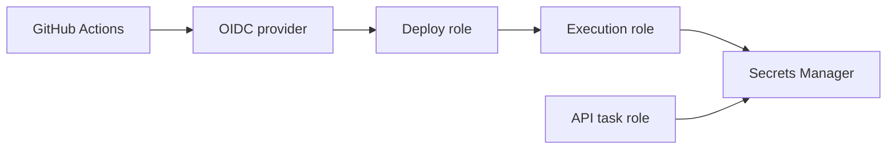

## Why this matters

IAM is the control plane for every other lesson. A task role that can read every secret, a CI user with an access key in GitHub, or a bucket policy that allows `*` is how a small app becomes a large incident. CodeCraft has a few principals that should exist and many that should not. Name them. Write the actions. Stop there.

AWS evaluates identity policies and resource policies together. You can pass a unit test of "the role allows it" and still be denied by the bucket, the key, or a permission boundary. You can also be allowed by a resource policy you forgot. Read both sides.

## Intuition

A user is a person. A role is a hat a person, a service, or a CI job assumes for a while. Prefer roles. An access key on a user is a password that does not expire until you rotate it. People commit those keys. Roles give temporary credentials.

A policy is a list of statements: allow or deny, actions, resources, and optional conditions. Deny wins. An explicit deny in any applicable policy beats an allow. The default is deny. If no allow matches, the call fails.

Least privilege means the API task can read the database secret and nothing else, the execution role can pull the image and write logs, and the sandbox role does not exist because the sandbox has no AWS credentials.

## Core concept in depth

### Principals for this project

| Principal | Type | Allows |
| --- | --- | --- |
| Human admins | SSO or IAM Identity Center, not a shared root | Administrator only for the people who need it, with MFA |
| CI deploy | Role assumed via GitHub OIDC | Apply a scoped Terraform role, or deploy ECS only |
| Task execution role | ECS task execution | Pull from ECR, write logs, read the secrets the task definition names |
| API task role | ECS task role | Read the app secret if the SDK needs it, maybe `s3:PutObject` on the submissions prefix |
| Frontend task | Task role | Often empty. The browser talks to the API. |
| Sandbox | None | No task role, no instance profile, no keys |

The execution role is not the task role. Mixing them means the process inside the container inherits image-pull and log permissions it does not need, and a bug in the app can call those APIs. Split them.

Root is for billing setup and break-glass you hope not to use. MFA on root. No access keys on root. No daily work as root.

### Policy shape

Actions are service prefixes like `s3:GetObject`. Resources are ARNs. `*` on both is an admin policy. `s3:GetObject` on one bucket ARN is a useful policy. Conditions tighten further: `aws:SourceVpc`, `s3:prefix`, or a GitHub OIDC `sub` that matches only `repo:ORG/Code-Craft-Academy:ref:refs/heads/main`.

Managed policies are convenient and broad. `AmazonS3FullAccess` on the API task is a bug. Write a customer-managed policy you can diff in Git.

Identity-based policies attach to the role. Resource-based policies attach to the bucket, the secret, or the queue. Both must allow a cross-account or a service access pattern. For same-account S3, an identity allow is enough if the bucket is not explicit-deny. Still set the bucket to block public access so a mistake in the identity policy is not a public bucket.

Permission boundaries cap what a role can ever allow. They matter when CI can create roles. Without a boundary, a deploy role that can `iam:PassRole` and `iam:CreateRole` can create an admin role and assume it. Scope `PassRole` to the task roles this service uses.

### OIDC for GitHub Actions

The workflow requests an identity token from GitHub. AWS STS exchanges it for temporary credentials if the trust policy matches the repo and the branch. No `AWS_ACCESS_KEY_ID` in the repository secrets. The trust policy is the lock. A condition on the subject that allows every branch lets a pull request from a fork workflow, if you misconfigure GitHub, become your cloud. Restrict the subject. Do not grant the deploy role `*` just because the trust looks tight.

### Evaluation order you should remember

1. Explicit deny.
2. Service control policies and boundaries, if they exist, as a maximum.
3. Identity allow and resource allow as required by the service.
4. Default deny.

You do not need to recite the full policy evaluation chart. You need to check the role policy, the resource policy, the boundary, and the organization guardrail before you add another `*`.

## Diagram / flowchart



### Dry-run: task cannot read the secret

| Layer | What you check |
| --- | --- |
| Task definition | The secret ARN is listed under container secrets, so the execution role reads it at start |
| Execution role | `secretsmanager:GetSecretValue` on that ARN, and `kms:Decrypt` if the key is customer managed |
| Task role | Needed only if application code calls Secrets Manager itself |
| Resource policy | The secret allows the role if you set one |
| Boundary | The boundary includes the action |

### Dry-run: who should not get the database secret

| Principal | Verdict |
| --- | --- |
| API task | Yes, via injection or a narrow get |
| Frontend task | No |
| Sandbox | No |
| CI unit tests | No. Tests use fakes. |
| Every developer | No. A break-glass role, audited, if you must. |

## Code

Task role for submissions uploads only:

```hcl
data "aws_iam_policy_document" "api_task" {
  statement {
    actions   = ["s3:PutObject"]
    resources = ["arn:aws:s3:::codecraft-submissions/uploads/*"]
  }
}

resource "aws_iam_role_policy" "api_task" {
  name   = "submissions-put"
  role   = aws_iam_role.api_task.id
  policy = data.aws_iam_policy_document.api_task.json
}
```

Trust policy for GitHub Actions. The subject condition is the point.

```hcl
data "aws_iam_policy_document" "gha_trust" {
  statement {
    actions = ["sts:AssumeRoleWithWebIdentity"]
    principals {
      type        = "Federated"
      identifiers = [aws_iam_openid_connect_provider.github.arn]
    }
    condition {
      test     = "StringEquals"
      variable = "token.actions.githubusercontent.com:aud"
      values   = ["sts.amazonaws.com"]
    }
    condition {
      test     = "StringLike"
      variable = "token.actions.githubusercontent.com:sub"
      values   = ["repo:example-org/Code-Craft-Academy:ref:refs/heads/main"]
    }
  }
}
```

Replace `example-org` with the real org. Do not use a subject of `repo:example-org/*`.

Check what a role can do before you widen it:

```bash
aws iam simulate-principal-policy \
  --policy-source-arn arn:aws:iam::123456789012:role/codecraft-api-task \
  --action-names s3:PutObject s3:GetObject secretsmanager:GetSecretValue
```

A denied `GetSecretValue` on the task role is acceptable if the execution role injects the secret as an environment variable. A denied `PutObject` means the upload feature will fail. Read the result. Do not attach `AdministratorAccess` to see the feature work.

## Complexity analysis

| Choice | Blast radius | Ops |
| --- | --- | --- |
| SSO groups and roles | A person assumes a role for an hour | The right human path |
| IAM user with keys | Keys live until leaked | Avoid for this project |
| One admin role for ECS | The container is admin | Unacceptable |
| Split execution and task roles | App bugs do not pull arbitrary images' permissions | Two policies to read |
| OIDC deploy role | No static key. Trust policy is the new secret. | Must scope `sub` |
| `iam:PassRole` on `*` | CI can attach admin to a task | Scope the role ARNs |
| Permission boundary on CI-created roles | Caps a confused deputy | Extra policy to maintain |

## Tricks, tips and patterns

- Roles for services and CI. Identity Center for people. No root keys.
- One policy per job. Name the ARNs.
- Split execution role and task role.
- `PassRole` only for the roles ECS is supposed to use.
- OIDC subject pinned to the repo and `main`.
- Simulate or use Access Analyzer before you ship a broader policy.
- CloudTrail stays on. A surprise `CreateUser` is an incident.
- MFA for humans. Short sessions.

## Common mistakes and edge cases

- Access keys in the Compose file so "AWS works locally," then the file is committed.
- `Resource: "*"` copied from a tutorial for a single bucket.
- Task role and execution role combined "to save a resource."
- Trust policy allows `sts:AssumeRole` from the whole account, so any role can become the deploy role.
- Forgetting `kms:Decrypt` and staring at an AccessDenied that names KMS, then adding `s3:*` anyway.
- A resource policy on the secret left from a demo that allows `Principal: "*"`.
- Wildcard in the OIDC subject that includes pull request workflows you did not harden.

## Interview notes

**User, role, or both?**
People use Identity Center. Services and CI assume roles. Long-lived keys are a last resort for a tool that cannot assume a role, and this project is not that case.

**Why does least privilege fail in practice?**
Teams grant `*` to unblock a deploy and never walk it back. The fix is a policy in Git, a simulator check, and a deploy that fails closed.

**Execution role versus task role?**
Execution role is used by ECS to start the task: image, logs, secrets in the definition. Task role is the credentials inside the process. The app should not hold the execution permissions.

**What does an explicit deny do?**
It overrides allows. Use it for guardrails such as "nobody deletes CloudTrail," not as the everyday way to express least privilege. Everyday least privilege is a short allow list.

**How should GitHub Actions authenticate?**
OIDC into a role whose trust policy pins the repository and branch. No stored access keys. The role's permissions are still least privilege. A tight trust with an admin policy is still admin.

## Practice problems

1. The API can upload to any bucket. Which part of the policy is wrong, the action or the resource?
2. CI uses an access key in GitHub secrets. Replace that design with a trust policy constraint you would write.
3. The container can call `ecr:GetAuthorizationToken` and you did not mean it to. Which role is attached wrong?
4. `GetSecretValue` is allowed on the role and the call still fails with a KMS deny. What is missing?
5. A pull request workflow assumed the production deploy role. Which trust condition was too wide?

## Summary / cheat sheet

- Default deny. Explicit deny wins. Allows are specific.
- Humans via Identity Center. Root locked down. No access keys for the app.
- ECS: execution role for start, task role for the process. Split them.
- Sandbox: no AWS credentials.
- Policies name actions and ARNs. No `FullAccess` on the task.
- GitHub OIDC, subject pinned to this repo and `main`.
- Scope `PassRole`. Consider a boundary if CI creates roles.
- Simulate the actions you care about. Read CloudTrail when something assumes a role you did not expect.

## Further reading

- [IAM identities](https://docs.aws.amazon.com/IAM/latest/UserGuide/id.html)
- [Policy evaluation](https://docs.aws.amazon.com/IAM/latest/UserGuide/reference_policies_evaluation-logic.html)
- [ECS task IAM roles](https://docs.aws.amazon.com/AmazonECS/latest/developerguide/task-iam-roles.html)
- [GitHub OIDC on AWS](https://docs.github.com/en/actions/security-for-github-actions/security-hardening-your-deployments/configuring-openid-connect-in-amazon-web-services)
- [IAM Access Analyzer](https://docs.aws.amazon.com/IAM/latest/UserGuide/what-is-access-analyzer.html)
