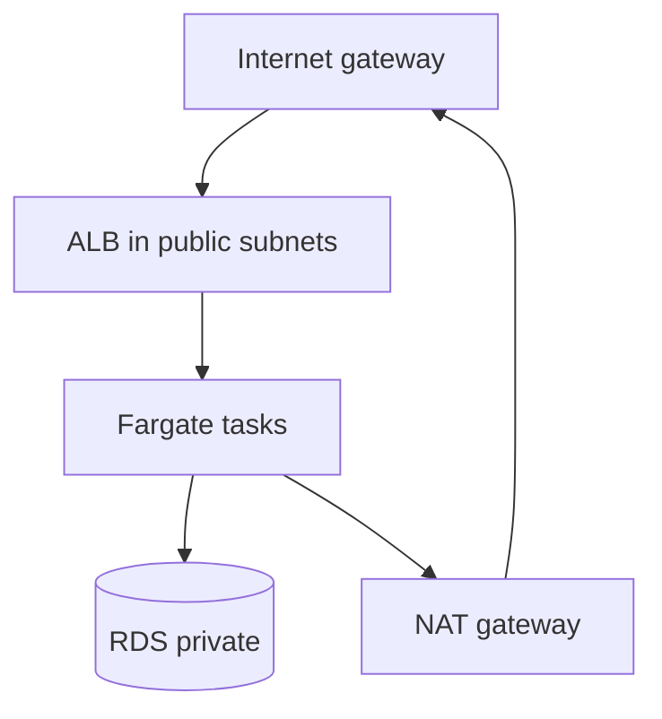

## Why this matters

Every private resource in this course sits in a VPC. RDS without a public IP is useless if the task cannot reach it, and it is dangerous if the whole internet can. The VPC is the map: which subnet, which route, which security group. People debug "the task cannot connect" for hours when the route table or the security group is the whole bug. Draw the map before you launch anything.

## Intuition

A VPC is a private IP space you choose, for example `10.0.0.0/16`. Subnets are slices of that space, each in one Availability Zone. A route table says where packets go next: local, an internet gateway, a NAT gateway, or a VPC endpoint. A security group is a stateful firewall on the elastic network interface. A network ACL is a stateless filter on the subnet and is usually left default until you have a reason.

Public means "this subnet's route table sends `0.0.0.0/0` to an internet gateway," not "this subnet is unsafe by magic." Private means the default route goes to NAT or nowhere. A public IP on an instance in a private subnet does not work if there is no route to the internet gateway.

## Core concept in depth

### The CodeCraft layout

Two AZs minimum.

| Subnet | Route | What lives there |
| --- | --- | --- |
| public | `0.0.0.0/0` to the internet gateway | ALB, NAT gateway |
| private app | `0.0.0.0/0` to NAT, or no default route if endpoints cover AWS | Fargate tasks |
| private data | local only | RDS. No path to the internet. |

The ALB needs a public subnet in each AZ you use. Fargate tasks in the private app subnets. RDS in the data subnets. The database security group allows the database port only from the task security group, not from the VPC CIDR and not from the ALB.

### NAT versus endpoints

Tasks pull images from ECR, write logs to CloudWatch, and read secrets. Those calls can go out through a NAT gateway, which is billed per hour and per gigabyte, or through interface and gateway endpoints inside the VPC. A gateway endpoint for S3 is cheap and is the right default for a private bucket. Interface endpoints for ECR, CloudWatch Logs, and Secrets Manager remove the NAT dependency for those APIs. NAT still matters if the task calls a third-party HTTPS API.

One NAT per AZ avoids a cross-AZ dependency. One NAT for the VPC is cheaper and dies with that AZ. For a learning account, one NAT is a cost choice you write down. For production, match NAT to the AZ story you claimed.

### Security groups

Security groups are stateful. If you allow the request out, the response is allowed back. You do not add a rule for the return traffic. Reference other security groups instead of CIDRs when the source is "the ALB" or "the tasks." A CIDR rule of the whole VPC is how a compromised sandbox task would reach the database if you had placed them together. They should not be together. The sandbox, if it runs at all in AWS, gets its own security group with no path to RDS.

Default security group: do not use it. It allows traffic from itself. Create explicit groups with names.

NACLs are stateless. An allow inbound on 443 needs an allow outbound for the ephemeral ports, or return traffic dies. Leave NACLs default unless a control requires them. Debugging "security group looks right" when a NACL is the deny is a rite of passage you can skip by not adding custom NACLs on day one.

### Addresses

The VPC CIDR must not overlap a network you will peer or VPN to. `10.0.0.0/16` is fine until the office uses it too. Plan before you peer.

Private subnets do not auto-assign public IPs. Public subnets for the ALB do, or the ALB gets addresses from the subnet. Tasks do not get public IPs. `assignPublicIp` disabled on the Fargate service is part of the same decision.

DNS hostnames in the VPC should be enabled so RDS endpoints and endpoints resolve.

## Diagram / flowchart



### Dry-run: task cannot reach RDS

| Check | Healthy |
| --- | --- |
| Task subnets | Private app subnets in the VPC |
| RDS subnets | Private data subnets, no public access |
| RDS security group | Inbound database port from the task security group only |
| Task security group | Egress to the RDS security group or to the port |
| Route | Local route covers both CIDRs. No NAT required for this hop. |
| NACL | Default allow, or explicit ephemeral return if you customized it |

### Dry-run: task cannot pull from ECR

| Path | Failure mode |
| --- | --- |
| NAT | No default route, or NAT in one AZ and the task in the other with no route |
| Endpoints | Missing `ecr.api` and `ecr.dkr`, or the endpoint security group denies 443 from the task |
| S3 gateway | Image layers sit in S3. The gateway endpoint route is missing. |
| Public IP on the task | You "fixed" it by making tasks public. Remove that fix. |

## Code

A minimal mental model in Terraform. Real modules split files. The shape is the lesson.

```hcl
resource "aws_vpc" "main" {
  cidr_block           = "10.40.0.0/16"
  enable_dns_support   = true
  enable_dns_hostnames = true
}

resource "aws_subnet" "public_a" {
  vpc_id                  = aws_vpc.main.id
  cidr_block              = "10.40.0.0/24"
  availability_zone       = "us-east-1a"
  map_public_ip_on_launch = true
}

resource "aws_subnet" "app_a" {
  vpc_id            = aws_vpc.main.id
  cidr_block        = "10.40.10.0/24"
  availability_zone = "us-east-1a"
}

resource "aws_security_group" "tasks" {
  name   = "codecraft-tasks"
  vpc_id = aws_vpc.main.id
}

resource "aws_security_group" "db" {
  name   = "codecraft-db"
  vpc_id = aws_vpc.main.id
}

resource "aws_vpc_security_group_ingress_rule" "db_from_tasks" {
  security_group_id            = aws_security_group.db.id
  referenced_security_group_id = aws_security_group.tasks.id
  ip_protocol                  = "tcp"
  from_port                    = 5432
  to_port                      = 5432
}
```

Repeat subnets for a second AZ. Point the private route table at the NAT. Point the public route table at the internet gateway. Associate each subnet with the right table. A subnet associated with the wrong table is a public database.

CLI checks:

```bash
aws ec2 describe-route-tables --filters Name=vpc-id,Values=vpc-0123456789abcdef0
aws ec2 describe-security-groups --group-ids sg-0123456789abcdef0
```

Read the default route and the ingress source. Do not guess from the console diagram alone.

## Complexity analysis

| Design | Cost | Failure |
| --- | --- | --- |
| One AZ, one NAT | Lowest | AZ loss takes the site and egress |
| Two AZs, one NAT | Medium | The other AZ loses egress, not local RDS |
| Two AZs, NAT each | Higher | Matches the Multi-AZ claim |
| Endpoints, no NAT | Interface hourly cost | No path to arbitrary internet. Often what you want. |
| Public tasks | NAT avoided | Tasks are on the internet. Reject this. |
| DB open to the VPC CIDR | Easy rules | Any ENI in the VPC can try the port |

## Tricks, tips and patterns

- Draw subnets, routes, and security groups before Terraform.
- Two AZs. Public for the load balancer. Private for tasks. Private and isolated for data.
- Security group to security group, not wide CIDRs, for east-west traffic.
- Do not use the default VPC for this project. Its defaults are convenient and loose.
- Gateway endpoint for S3. Interface endpoints when NAT cost or NAT failure matters.
- Flow logs to CloudWatch or S3 when you are debugging drops. Turn them on before the incident if you can pay for them.
- Name every subnet and group. `public-a` beats `subnet-0abc`.

## Common mistakes and edge cases

- RDS `publicly_accessible` true because the laptop could not connect. Use a bastion or SSM, or connect from a task. Do not publish the database.
- Task has no route to ECR and the deploy hangs on image pull.
- Security group allows the ALB to the task port, and nothing allows the task to RDS. Health checks pass and logins fail.
- Custom NACL without ephemeral ports. Half the flows die.
- Overlapping CIDR discovered the week you peer to the office.
- IPv6 left half-configured so some routes exist and some do not. Either design it or leave it off.
- NAT in a private subnet. NAT must sit where it can reach the internet gateway.

## Interview notes

**What makes a subnet public?**
Its route table sends the default route to an internet gateway, and the instance or load balancer has a public address. The subnet name does nothing.

**Stateful versus stateless?**
Security groups are stateful. You allow the forward path. NACLs are stateless. You allow the return ephemeral ports too.

**How do private tasks reach S3?**
A NAT gateway, or an S3 gateway endpoint with a route in the private table. The gateway endpoint is the better default for S3.

**Why not one security group for everything?**
A shared group becomes "allow the whole app." The database should accept the task group only. The load balancer should accept the world on 443 only. The sandbox should accept neither.

**What breaks in a single AZ?**
The NAT, the tasks, and the subnets in that AZ. RDS Multi-AZ fails over to the other AZ only if you actually have a subnet there and the tasks can be replaced there.

## Practice problems

1. Tasks time out pulling an image. NAT is in AZ A and the service only placed tasks in AZ B. What route is missing?
2. The database security group allows `10.40.0.0/16` on 5432. Why is that weaker than the task security group, given a sandbox in the same VPC?
3. Health checks pass and the API cannot open Postgres. Which path is not the ALB path?
4. You added a NACL allow on 443 inbound only. Why do clients hang?
5. Explain why a public IP on a Fargate task is not the fix for a missing NAT.

## Summary / cheat sheet

- VPC CIDR, subnets per AZ, route tables, internet gateway, NAT or endpoints.
- Public subnets: ALB and NAT. Private app: tasks. Private data: RDS.
- Security groups stateful, referenced by group id. NACLs stateless and default unless required.
- No public database. No public tasks.
- S3 gateway endpoint. ECR and logs endpoints if you want to drop NAT.
- Two AZs or you do not have a Multi-AZ story.
- Flow logs when packets vanish.
- The map is the design. Read the route table.

## Further reading

- [VPC subnets](https://docs.aws.amazon.com/vpc/latest/userguide/configure-subnets.html)
- [Route tables](https://docs.aws.amazon.com/vpc/latest/userguide/VPC_Route_Tables.html)
- [Security groups](https://docs.aws.amazon.com/vpc/latest/userguide/vpc-security-groups.html)
- [NAT gateways](https://docs.aws.amazon.com/vpc/latest/userguide/vpc-nat-gateway.html)
- [VPC endpoints](https://docs.aws.amazon.com/vpc/latest/privatelink/vpc-endpoints.html)
