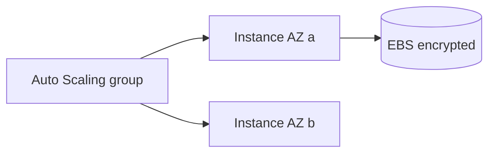

## Why this matters

EC2 is a virtual machine: an AMI, an instance type, a subnet, and a security group. You patch it, you SSH or SSM into it, and you are responsible for the OS. Fargate removed that for the API. You still need EC2 for the mental model of AZs, for a bastion or a runner that must live in the VPC, and for any workload that does not fit a container. Interviews start here even when the job is containers.

## Intuition

An instance is a billed computer in one AZ. If the AZ fails, that instance fails. An AMI is the disk image you boot. User data is a script that runs on first boot and is not a configuration management system. Instance store disks die with the instance. EBS volumes can survive if you asked them to.

The instance metadata service is a link-local endpoint the instance calls to learn its id and, if you are careless, its credentials. Those credentials are the instance profile. Anything that can reach metadata from the instance, including a server-side request forgery bug, can become the role.

## Core concept in depth

### Types and purchasing

The type is a shape: burstable `t` instances earn CPU credits and then throttle. A `t` instance for a steady API looks cheap until the credits run out and latency jumps. A fixed-performance type is more honest for a constant load. Fargate's fixed CPU is the container version of the same choice.

On-demand is the default. Savings Plans cover a baseline. Spot is spare capacity that can disappear. Use Spot for interruptible batch, not for the only API node.

### AMIs and boot

Start from a maintained AMI: Amazon Linux or Ubuntu LTS, pinned by id, not "whatever the console suggested last year." Bake images with the agent you need, or configure with user data that is idempotent. A user-data script that is not idempotent will not survive a reboot cleanly.

IMDSv2 requires a token hop. Require it. IMDSv1 is a one-request credential theft via SSRF. Set the hop limit to 1 so a container on the host does not easily reach the host credentials. This matters if you ever run Docker on EC2.

### Storage

Root EBS should be encrypted. Delete on termination is fine for a stateless node and wrong for a disk that holds the only copy of data. Data does not belong only on a single instance disk. Put it in RDS or S3.

Separate volumes for data if you must use a disk, and snapshot them. A snapshot is crash-consistent enough for many apps and not a substitute for a database backup of a live write-heavy store.

### Access

No SSH from the internet. Use SSM Session Manager so the instance role allows `ssmmessages` and you do not open port 22. A bastion, if you still have one, is in a public subnet with tight security groups and no private keys on laptops that are shared. The API instances, if they exist, are in private subnets.

Security groups are stateful allow lists. Default deny. The instance does not need a public IP to call AWS if a NAT or a VPC endpoint exists.

### When EC2 is the wrong default

The CodeCraft API and frontend on Fargate do not need an AMI, a patch window, or SSH. An EC2 ASG is justified for the ECS container instances if you leave Fargate, for a GitHub runner inside the VPC, or for a one-off migration box you terminate. A single EC2 instance with compose and the Docker socket is the development security lesson's warning, not the production design.

## Diagram / flowchart



### Dry-run: AZ failure

| Setup | Result |
| --- | --- |
| One instance | The site is down until you launch another |
| ASG min 2 in two AZs behind an ALB | The other instance keeps serving. ASG replaces the lost one. |
| Data only on instance store | Data is gone |
| Data in RDS Multi-AZ | Data fails over. The instance was stateless. |

### Metadata

| Call | Risk |
| --- | --- |
| IMDSv2 with hop limit 1 | Normal. The instance SDK works. |
| IMDSv1 left on | SSRF can fetch the role credentials |
| Hop limit high | A container can reach the host role |
| No instance profile | The instance cannot call AWS. Good if it should not. |

## Code

Launch is better as a launch template than a one-off `run-instances`. A template you can read:

```bash
aws ec2 create-launch-template \
  --launch-template-name codecraft-runner \
  --launch-template-data file://template.json
```

`template.json` sets the AMI id, instance type, security group, subnet via the ASG, IMDSv2 required, encrypted EBS, and an instance profile for SSM. It does not embed a password.

Require IMDSv2 in the metadata options:

```json
{
  "HttpTokens": "required",
  "HttpPutResponseHopLimit": 1,
  "HttpEndpoint": "enabled"
}
```

Connect without SSH:

```bash
aws ssm start-session --target i-0123456789abcdef0
```

If this fails, the instance has no SSM agent, no route to the SSM endpoints, or no role. Do not open port 22 as the fix until those are checked.

Patch with a maintenance window or replace instances with a new AMI. Replacing is cleaner than apt-get on a pet. The ASG instance refresh rolls the group.

## Complexity analysis

| Choice | Ops load | Fit for the API |
| --- | --- | --- |
| One EC2, compose | You own everything | A demo that will be compromised or forgotten |
| ASG, golden AMI, ALB | Patch and capacity | Fine, more work than Fargate |
| Fargate | Task defs and IAM | The course default |
| Spot ASG for the API | Interruptions | Poor unless the fleet is large |
| `t` instance for steady CPU | Credits | Throttling later |
| Instance store for content | Fast local disk | Data loss on stop |

## Tricks, tips and patterns

- Pin AMI ids. Refresh them on purpose.
- IMDSv2 required, hop limit 1.
- SSM, not public SSH.
- Encrypt EBS. Stateless root disk. Data in RDS or S3.
- Two AZs if the instance is a dependency.
- Instance profile least privilege. The role is the credential.
- User data idempotent and logged.
- Terminate one-off boxes. Tag the owner.

## Common mistakes and edge cases

- Port 22 open to the world with a key pair named `prod`.
- IMDSv1 and an app that fetches arbitrary URLs.
- A `t3.micro` build server that feels fine until credits hit zero during a release.
- Snapshot missing and the only data was on the disk you terminated.
- User data that fails silently. Check the system log.
- Public IP on a private workload because the subnet auto-assigns one.
- Assuming stop/start keeps a public IP. It often does not, unless you allocated an Elastic IP. DNS to a public IP will break.

## Interview notes

**What do you still own on EC2?**
The OS, patching, the AMI, security groups, and the data on disks you chose. AWS owns the hypervisor. Shared responsibility is concrete here.

**Why IMDSv2?**
It blocks the simplest SSRF credential theft. Hop limit 1 keeps a container from using the host role. The instance profile is a credential.

**How does this relate to Fargate?**
Fargate runs the container without an instance you patch. EC2 remains for nodes, runners, and special hardware. The API default in this course is Fargate.

**How do you survive an AZ loss?**
At least two instances in two AZs behind a load balancer, stateless, with data in a Multi-AZ store. One instance is a planned outage.

**SSM versus SSH?**
SSM uses IAM and does not need an open port. SSH needs a key and a path. Prefer SSM. If SSH exists, it is not open to the world.

## Practice problems

1. A `t` instance is slow only in the afternoon. What budget ran out, and what type avoids it?
2. An SSRF bug hits the metadata IP. What setting reduces the blast, and what does the attacker get if it is off?
3. You terminated an instance and lost the content uploads. Which storage choice caused it?
4. SSM session fails and someone wants port 22 open to `0.0.0.0/0`. What do you check first?
5. Explain why a single EC2 compose host fails the Multi-AZ story even if the process is healthy.

## Summary / cheat sheet

- EC2 is an AMI plus a type plus a subnet plus a role.
- Patch by replacing AMIs. Do not pet a snowflake.
- IMDSv2 and hop limit 1. The instance profile is a secret.
- SSM over public SSH. Private subnets.
- EBS encrypted. Do not keep the only data on one disk.
- Two AZs and a load balancer if users depend on the instance.
- Burstable CPUs run out. Spot goes away.
- The API belongs on Fargate unless you have a reason to own the OS.

## Further reading

- [EC2 concepts](https://docs.aws.amazon.com/AWSEC2/latest/UserGuide/concepts.html)
- [IMDSv2](https://docs.aws.amazon.com/AWSEC2/latest/UserGuide/configuring-instance-metadata-service.html)
- [SSM Session Manager](https://docs.aws.amazon.com/systems-manager/latest/userguide/session-manager.html)
- [EBS encryption](https://docs.aws.amazon.com/ebs/latest/userguide/ebs-encryption.html)
- [Launch templates](https://docs.aws.amazon.com/AWSEC2/latest/UserGuide/ec2-launch-templates.html)
