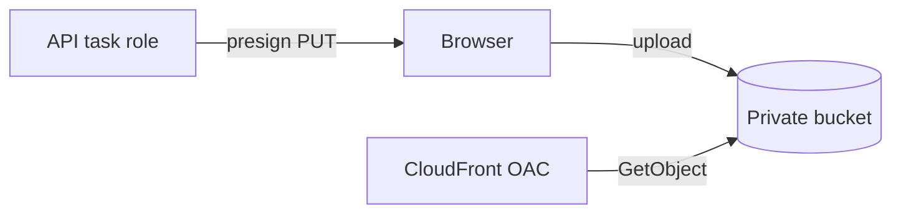

## Why this matters

S3 is where artifacts, lesson media, and maybe the content tree live. It is durable object storage, not a filesystem. A public bucket is still how companies leak data. Versioning, lifecycle, and presigned URLs are the three features people name in interviews and then misconfigure. This lesson makes each one concrete for this project.

The bucket is not a CDN. CloudFront sits in front if users fetch the objects often. The bucket policy decides who can skip the CDN.

## Intuition

An object is bytes plus a key in a bucket. The key looks like a path and is not a directory. There is no rename, only copy and delete. Reads and writes are HTTP APIs. Consistency for overwrite PUT and DELETE is strong: a successful write is what the next read sees.

Block Public Access is a set of account and bucket switches that stop public ACLs and public policies. Turn them on. Then grant CloudFront or the task role. A bucket that must be public is a rare exception you document, not the default for "it did not work."

## Core concept in depth

### Layout for CodeCraft

| Bucket | Contents | Public? |
| --- | --- | --- |
| artifacts | CI builds, short-lived | No |
| content or media | Lesson assets | No at S3. CloudFront OAC reads them. |
| submissions | Student source, if you store it | No. Short lifecycle. |
| tf-state | State | No. Versioning and KMS. |

Separate buckets so a lifecycle rule cannot expire lessons and artifacts together. Prefixes are a weaker boundary. A bug in a prefix filter is a data loss bug. Buckets are the stronger blast wall.

### Versioning

Versioning keeps old copies when you overwrite or delete. A delete adds a delete marker. The object looks gone and the bytes remain until you expire versions. That is how you undo a bad deploy of a static file, and how a bucket grows forever if you never expire noncurrent versions.

MFA delete exists and is easy to lock yourself out of. Prefer IAM and versioning plus a lifecycle on noncurrent versions for this project.

Replication copies to another region and is not a backup against a bad write. The bad write replicates. Versioning plus a delay before you expire is the undo. Replication is for region loss and for a bucket you might lock with object lock if you have a compliance need.

### Lifecycle

Transition objects to a colder class after a time, and expire them. Infrequent access has a retrieval fee and a minimum storage duration. Moving CI logs to Glacier on day one can cost more than leaving them in standard until they expire. For artifacts, expire after 30 days. For submissions, expire quickly and do not transition through three classes. For lesson media, do not expire.

A lifecycle on the state bucket must not expire current state. Expire old versions if at all, and only after you understand the window you can roll back.

### Presigned URLs

A presigned URL is a grant, signed with credentials, that lets the holder GET or PUT one object until it expires. The API can mint a PUT URL so a browser uploads a submission straight to S3. The task role needs `s3:PutObject` on that prefix. The browser does not get the role.

Expiry should be minutes, not days. A URL in a log or a chat is a bearer token until it expires. Do not presign a `GetObject` on a secret and paste it into an issue. Scope the key prefix in the role so a bug cannot presign the state bucket. Different roles.

Presigning with long-lived access keys in the app is worse than presigning with the task role. The role credentials rotate. A key in an environment variable does not, until you rotate it by hand.

### Encryption and ownership

SSE-S3 is the simple default. SSE-KMS lets you control the key and audit decrypts, and every decrypt can cost and can throttle. Use KMS for state and for submissions if you need the audit. Use SSE-S3 for public-via-CloudFront media if KMS adds friction with CloudFront and you do not need a customer key.

Bucket owner enforced disables ACLs. The bucket owner owns the objects. Turn it on so a writer cannot attach an ACL that fights the policy.

## Diagram / flowchart



### Dry-run: overwrite a media file

| Versioning | What a GET returns | Undo |
| --- | --- | --- |
| Off | The new bytes. Old bytes are gone. | A backup you may not have |
| On | The new current version | Copy the previous version id back |
| On, plus a delete | A delete marker hides the object | Delete the marker |
| Lifecycle expired noncurrent versions immediately | Nothing to restore | The lifecycle was too aggressive |

### Presign lifetime

| Use | Lifetime |
| --- | --- |
| Browser upload | Minutes |
| Staff download of one submission | Minutes |
| Permanent public lesson | Do not presign. Use CloudFront. |
| URL stored in the database as the file location | Store the key, not the URL |

## Code

Block public access and turn on versioning. Terraform:

```hcl
resource "aws_s3_bucket_public_access_block" "media" {
  bucket                  = aws_s3_bucket.media.id
  block_public_acls       = true
  block_public_policy     = true
  ignore_public_acls      = true
  restrict_public_buckets = true
}

resource "aws_s3_bucket_versioning" "media" {
  bucket = aws_s3_bucket.media.id
  versioning_configuration {
    status = "Enabled"
  }
}
```

Lifecycle for the artifact bucket only:

```hcl
resource "aws_s3_bucket_lifecycle_configuration" "artifacts" {
  bucket = aws_s3_bucket.artifacts.id
  rule {
    id     = "expire-artifacts"
    status = "Enabled"
    filter { prefix = "ci/" }
    expiration { days = 30 }
    noncurrent_version_expiration { noncurrent_days = 7 }
  }
}
```

Presign a PUT with the task role. The SDK uses the role. You set the content type and the expiry.

```python
url = s3.generate_presigned_url(
    "put_object",
    Params={"Bucket": "codecraft-submissions", "Key": key, "ContentType": "text/plain"},
    ExpiresIn=300,
)
```

Reject keys that do not start with the user's prefix. A client-supplied key of `../` or an absolute other bucket is a bug you must not pass through. S3 keys are not filesystem paths, but a naive concatenation still lets a user overwrite another user's object if the role is broad.

CLI check:

```bash
aws s3api get-public-access-block --bucket codecraft-media
aws s3api get-bucket-versioning --bucket codecraft-media
```

Both should show the locked-down, enabled state. A missing public access block is a finding, not a style nit.

## Complexity analysis

| Choice | Durability story | Footgun |
| --- | --- | --- |
| Versioning on | Overwrites are recoverable | Storage grows. Expire noncurrent versions. |
| Versioning off | Cheaper | A bad upload is permanent |
| Lifecycle expire | Bounds cost | Wrong bucket deletes lessons |
| Presign | Browser uploads without the role | A leaked URL works until expiry |
| Public bucket | Simple URLs | The internet can list or get, depending on the policy |
| CloudFront OAC | Private origin, public edge | Bucket policy must allow the distribution only |
| One bucket for everything | Fewer names | One lifecycle or one policy mistake hits state and lessons |

S3 durability is high for a single object stored as designed. Your lifecycle rule is not AWS failing. It is you deleting data on a schedule. Review rules like you review `DROP TABLE`.

## Tricks, tips and patterns

- One purpose per bucket. Block public access. Bucket owner enforced.
- Version data you might overwrite. Expire noncurrent versions on purpose.
- Do not lifecycle the content or state the way you lifecycle CI artifacts.
- Presign for minutes. Store keys, not URLs.
- Prefix per user on submissions. Role scoped to that pattern if you can.
- SSE-KMS for secrets-bearing buckets. SSE-S3 for ordinary media.
- CloudFront in front of hot public reads. The bucket stays private.
- Enable access logs or CloudTrail data events on the state bucket.

## Common mistakes and edge cases

- `s3:*` on `*` for the task role so presigns work. Scope the bucket and the action.
- A presigned URL with `ExpiresIn` of a week, committed in a test fixture.
- Lifecycle prefix `""` that matches everything.
- Assuming folders exist. Clients that "create a folder" just put a zero-byte key.
- Eventual myths. Overwrite visibility is strong. Listing prefixes has its own pagination. Do not invent a consistency bug for a missing key that was never written.
- Delete marker confusion: the console shows the object gone and versioning still stores it. Expire markers or you pay forever.
- Public access block off "temporarily" during a debug, left off.

## Interview notes

**What does versioning change about delete?**
A delete writes a delete marker. The bytes remain as a previous version until lifecycle or a version delete removes them. You can restore by removing the marker or copying the old version.

**How do presigned URLs work?**
The server signs a request with credentials that have permission. The holder performs that one operation until expiry. The permission of the signing principal still applies. A broad role means a broad presign.

**How should lesson images be served?**
A private bucket, CloudFront with origin access control, and a cache policy for static objects. Not a public ACL.

**Why separate lifecycle rules from the content bucket?**
Expire rules are easy to point at the wrong prefix. A separate artifacts bucket makes "delete in 30 days" impossible to apply to lessons.

**Strong consistency?**
After a successful PUT or DELETE, reads and lists see that result. You still paginate lists. You still have versioning and delete markers. Consistency is not a reason to skip versioning.

## Practice problems

1. A bad media upload replaced `lesson-1.png`. Versioning is on. How do you restore the previous bytes?
2. Design the presigned PUT for a submission: expiry, key prefix, and the IAM action.
3. A lifecycle meant for `ci/` expired lessons. What bucket layout would have prevented it?
4. The bucket is private and CloudFront returns 403. What grant is missing, and why is "make it public" the wrong fix?
5. A presigned URL leaked in a log. What limits the damage, and what would have made it worse?

## Summary / cheat sheet

- Objects in buckets. Keys are not directories. Block public access.
- Versioning keeps overwrites and turns deletes into markers. Expire old versions on purpose.
- Lifecycle expires artifacts and submissions, not lessons or current state.
- Presign short-lived PUT or GET. Store the key. Scope the role.
- Separate buckets by blast radius.
- CloudFront OAC for public reads of private objects.
- Encryption on. Owner-enforced ACLs off.
- A lifecycle is a scheduled delete. Review it like one.

## Further reading

- [S3 versioning](https://docs.aws.amazon.com/AmazonS3/latest/userguide/Versioning.html)
- [S3 lifecycle](https://docs.aws.amazon.com/AmazonS3/latest/userguide/object-lifecycle-mgmt.html)
- [Presigned URLs](https://docs.aws.amazon.com/AmazonS3/latest/userguide/using-presigned-url.html)
- [Block Public Access](https://docs.aws.amazon.com/AmazonS3/latest/userguide/access-control-block-public-access.html)
- [CloudFront OAC](https://docs.aws.amazon.com/AmazonCloudFront/latest/DeveloperGuide/private-content-restricting-access-to-s3.html)
