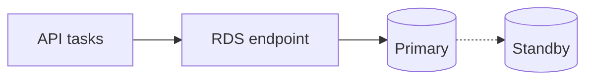

## Why this matters

If CodeCraft stores users, progress, or run status, that data needs a transactional store. RDS is managed Postgres or MySQL: AWS patches the engine, you still design connections, backups, and failover. A single-AZ database in a public subnet with a security group open to the world is a tutorial default and a production incident. Multi-AZ is a failover story, not a performance story. A read replica is a read-scaling story, not a backup.

The content MDX can live on disk or S3. The database is for facts that must not be lost when a task dies.

## Intuition

RDS gives you an endpoint hostname, not a promise that the IP never changes. Applications connect to the hostname. A Multi-AZ deployment keeps a standby in another AZ and fails the endpoint over when the primary dies. The failover is minutes, not zero. In-flight transactions fail. Clients must reconnect. A replica you can read from is a different instance with lag. You do not fail writes over to it by wishing.

Storage, IOPS, and max connections are the ceilings people hit before CPU. A connection per request from every task will exhaust `max_connections` while CPU looks idle. Use a pool.

## Core concept in depth

### Placement and access

Private subnets only, in at least two AZs so Multi-AZ has a home. The security group allows 5432 from the API security group, not from `0.0.0.0/0` and not from the whole VPC if you can avoid it. The sandbox security group is not a source. Student code does not open Postgres.

Public accessibility off. No public IP. Admins connect through a bastion or SSM port forwarding, not through an open port.

The master password lives in Secrets Manager, as the secrets lesson said. The application uses the hostname from an output or a parameter, not a hardcoded IP.

### Multi-AZ, replicas, and backups

| Feature | Protects | Does not |
| --- | --- | --- |
| Multi-AZ standby | Instance or AZ failure. Automatic failover of the endpoint. | A bad migration. The standby has the same data, including the bug. |
| Automated backups | Point-in-time restore to a new instance | The live endpoint. Restore is a new database you cut over to. |
| Snapshot | A moment you can copy | Continuous history between snapshots |
| Read replica | Read traffic, a promotion you do yourself | Writes. Lag means stale reads. |
| Delete protection | Accidental API delete | A determined admin |

Turn on deletion protection in prod. Set a backup retention of days, not zero. Test a restore. An untested backup is a checkbox.

Failover drops connections. The app must retry with backoff and must not cache the old IP forever. Use the RDS hostname. JDBC and libpq honor DNS if you do not pin the IP.

### Parameters and storage

Parameter groups change engine settings. Some apply immediately, some on reboot. A reboot is downtime even on Multi-AZ if it restarts the primary. Plan it.

gp3 storage with a baseline IOPS is the usual start. Burst credits on older gp2 surprise you when the burst runs out and latency jumps. Watch `ReadLatency`, `WriteLatency`, and `DiskQueueDepth`. Storage autoscaling prevents a full disk, which is an outage, and it does not shrink. Set a max so a bug cannot grow the volume without bound.

`max_connections` is tied to instance memory. More tasks times pool size must fit. A pool of 20 on 10 tasks is 200 connections. A `db.t4g.micro` will not take that. Lower the pool or raise the class. PgBouncer is the next step when the application pool is already tight and you still have too many clients.

### Migrations

Schema changes are expand and contract, from the deployment lesson. RDS will not make a drop-column migration safe. Take a snapshot before a risky migration. Prefer a change you can roll forward. Restoring a snapshot over the live instance is a long outage.

### What the app should do

Connect with TLS. Set a statement timeout so a runaway query does not hold a connection. Retry transactions that fail with a serialization or a connection reset, and do not retry a constraint violation. Log the SQL state, not the password in the connection string.

## Diagram / flowchart



### Dry-run: primary AZ fails

| Time | What users see |
| --- | --- |
| Failure | Errors on queries. Tasks are still up. |
| DNS endpoint moves to the standby | New connections succeed after reconnect |
| Pools that do not reconnect | Continued errors until the process restarts |
| Data | The committed transactions that had reached the standby. Not a replica lag story. Multi-AZ is synchronous. |

Read replicas are asynchronous. Do not describe Multi-AZ as "a bit stale."

### Sizing signals

| Symptom | Likely knob |
| --- | --- |
| DatabaseConnections near max | Pool size or instance class |
| DiskQueueDepth and latency high | Storage IOPS or a missing index |
| CPU high | A query, not automatically a bigger class |
| FreeStorageSpace falling | Autoscale max, then find the write bug |
| Tasks cannot resolve the hostname | Private DNS or security group. The engine may be fine. |

## Code

A Terraform sketch. Password is a reference, not a literal.

```hcl
resource "aws_db_instance" "app" {
  identifier             = "codecraft-prod"
  engine                 = "postgres"
  engine_version         = "16"
  instance_class         = "db.t4g.micro"
  allocated_storage      = 20
  storage_type           = "gp3"
  multi_az               = true
  db_subnet_group_name   = aws_db_subnet_group.app.name
  vpc_security_group_ids = [aws_security_group.db.id]
  username               = "codecraft"
  password               = var.db_password
  backup_retention_period = 7
  deletion_protection    = true
  skip_final_snapshot    = false
  publicly_accessible    = false
}
```

`var.db_password` must come from a secret, and Terraform state will still contain it if you pass it this way. Prefer `manage_master_user_password` so RDS stores the secret and Terraform keeps the ARN. Use that in prod.

Connect from a task, not from a laptop:

```bash
psql "host=codecraft-prod.xxxx.ap-south-1.rds.amazonaws.com port=5432 dbname=codecraft user=codecraft sslmode=require"
```

If this times out, check the security group and the route before you reboot the database. If it refuses, the engine is up and you are blocked or the port is wrong.

Snapshot before a migration:

```bash
aws rds create-db-snapshot \
  --db-instance-identifier codecraft-prod \
  --db-snapshot-identifier codecraft-prod-before-migration
```

## Complexity analysis

| Choice | Availability | Cost and complexity |
| --- | --- | --- |
| Single-AZ | Maintenance and AZ loss are downtime | Cheaper. Fine for dev. |
| Multi-AZ | Failover of the same data | About twice the instance. Prod default. |
| Read replica | Scale reads, extra failure mode | Lag and a second engine to patch |
| Public instance | Easy from home | Exposed database. Never for this app. |
| One connection per request | Simple code | Falls over at low traffic |
| Pool | Stable connection count | Must size it against max_connections |
| Restore as the only undo | Possible | Slow. Not a deploy strategy. |

Dev can be single-AZ and stopped at night. Prod Multi-AZ is the reliability purchase from the cost lesson. Do not "optimize" it away in a review without changing the SLO.

## Tricks, tips and patterns

- Hostname, TLS, private subnets, deletion protection, backups on.
- Pool connections. Multiply by max tasks before you pick an instance class.
- Snapshot before schema changes. Expand and contract.
- Retry reconnects after failover. Do not cache the IP.
- Sandbox cannot route to port 5432.
- Watch connections, storage, and latency, not only CPU.
- `manage_master_user_password` beats a password in state when you can use it.
- Test a restore into a new instance once.

## Common mistakes and edge cases

- Security group allows the VPC CIDR and the sandbox shares the VPC. Tighten to the API security group.
- Multi-AZ described as a read replica. They are different.
- Backup retention 0 to save money, discovered during a bad migration.
- Storage full. Writes fail. Autoscale was off.
- A parameter change that reboots at 14:00 because apply immediately was set.
- Application logs the connection URL with the password.
- Promoting a lagged replica and losing writes that were only on the old primary. Promotion is a planned failover with a process, not a button during panic unless you accept the lag.

## Interview notes

**What does Multi-AZ give you?**
A synchronous standby and an automatic endpoint failover. It does not scale reads and it does not undo a bad write. Both copies have the bad data.

**How should the API connect?**
To the hostname with TLS, through a pool, from a security group that is allowed on 5432. Retry new connections after failover. Never from the sandbox.

**Backups versus replicas?**
Backups and snapshots are for restore. Replicas are for read scale or a manual promotion. A replica is not the backup of record.

**The database is slow and CPU is low.**
Look at connections, disk queue, and the query. A missing index and a connection storm are the common causes. A larger class is the last guess.

**How do you change a column safely?**
Expand and contract across deploys. Snapshot first. Do not drop the old shape while old tasks are running.

## Practice problems

1. Failover happened and the API keeps erroring until restart. What did the pool cache?
2. Ten tasks with a pool of 30 against a small instance. What limit do you hit, and what two knobs exist?
3. A security group allows 5432 from the VPC. Why is the sandbox a problem, and how do you scope the rule?
4. Explain to a reviewer why deleting Multi-AZ in prod is an SLO change, not a cost tidy-up.
5. You must roll back a migration that already dropped a column. What restore path exists, and why is it not `kubectl rollout undo`?

## Summary / cheat sheet

- RDS is managed Postgres. You still own schema, pools, and restore tests.
- Private subnets, no public access, API security group only, TLS.
- Multi-AZ fails over the endpoint. It is synchronous. It is not a read replica.
- Backups are for point-in-time restore to a new instance. Test them.
- Pool connections. Size them against `max_connections` and max tasks.
- Storage and IOPS cause outages that look like "the app got slow."
- Secrets Manager holds the password. Snapshots precede risky migrations.
- The sandbox does not get a route to the database.

## Further reading

- [RDS Multi-AZ](https://docs.aws.amazon.com/AmazonRDS/latest/UserGuide/Concepts.MultiAZ.html)
- [RDS backups](https://docs.aws.amazon.com/AmazonRDS/latest/UserGuide/USER_WorkingWithAutomatedBackups.html)
- [Postgres on RDS parameters](https://docs.aws.amazon.com/AmazonRDS/latest/UserGuide/USER_WorkingWithDBInstanceParamGroups.html)
- [RDS security groups](https://docs.aws.amazon.com/AmazonRDS/latest/UserGuide/Overview.RDSSecurityGroups.html)
- [IAM database authentication](https://docs.aws.amazon.com/AmazonRDS/latest/UserGuide/UsingWithRDS.IAMDBAuth.html)
