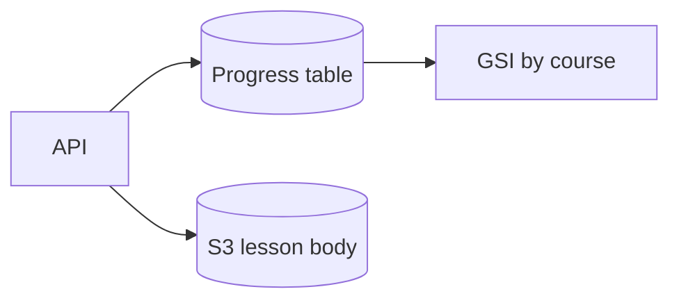

## Why this matters

DynamoDB is a managed key-value and document store with single-digit-millisecond reads at a scale RDS will not match without work. It is also easy to paint yourself into a table that cannot answer the query you remembered after launch. You design the keys from the access patterns, not from a normalized diagram you then hope to join.

CodeCraft's lesson catalog and a user's progress might fit. A reporting query across every student will not, unless you stored that pattern on purpose. This lesson is the model, the capacity traps, and the decision versus RDS.

## Intuition

An item is a row with a primary key. The partition key decides which shard holds the item. A sort key orders items inside that partition and lets you query a range. There are no joins. If the screen needs user plus progress plus last run, you either store them together, query several tables, or duplicate data on purpose.

A global secondary index is another key over the same items, with its own throughput. It exists because you cannot query by an arbitrary attribute efficiently. Local secondary indexes share the partition key and are chosen at table creation. Most designs use GSIs.

Capacity is either on-demand (pay per request) or provisioned (you set read and write units). A hot partition is one key that gets a disproportionate share. The table can be huge and still throttle if every student writes the same partition.

## Core concept in depth

### Access patterns first

Write the queries before the table.

| Screen | Query | Key that serves it |
| --- | --- | --- |
| One user's progress | All lessons for user id | Partition `USER#id`, sort `LESSON#slug` |
| One lesson's status for that user | One item | Same key, one sort value |
| Leaderboard | Not this table unless you stored a rank item | A different pattern or a different store |
| Full text search of lessons | Do not use DynamoDB as the search engine | OpenSearch or the static index you already have |

If you cannot name the query, you are not ready to pick a partition key.

### Keys and items

Partition keys should spread. User id is a good spread if traffic follows users. A partition key of the literal `progress` for every item is a single hot key. Sort keys let you `begins_with` a prefix: all lessons for a user, without a scan.

Use a scan only for rare admin jobs. A scan reads the table. It is the wrong path for a user request.

Item size is capped at 400 KB. A lesson's MDX body does not belong in the item. Store the body in S3 and the pointer in the item. Student source for a run is the same: object storage, key in the item, short TTL on the object.

### Consistency

A strongly consistent read returns the latest committed write and costs more. The default is eventually consistent. For "did my progress save," strongly consistent or a conditional write the client can see is the right call. For a view that can be a second behind, eventual is fine. Do not promise strong consistency across a GSI. GSIs are always eventual.

Conditional writes (`attribute_not_exists`, version numbers) are how you get idempotency. A retry of "create this run" must not create two items. The condition is the lock.

### Capacity and throttling

On-demand is the right start for a spiky learning site. Provisioned plus autoscaling is cheaper when traffic is steady and you understand the units. A throttle on one partition does not mean the whole table is out of capacity. Look at the key.

Adaptive capacity helps with uneven keys and is not a license to use one key. Design for spread first.

TTL deletes items you mark with an epoch attribute. It is eventually deleted, not a precise timer. Good for session rows and run status you do not need forever. Not a backup strategy.

### Streams

DynamoDB Streams can trigger a Lambda when an item changes. That is a solid way to update a projection. It is another consumer that must be idempotent. Do not put the only copy of a fact solely in a stream consumer's memory.

### Versus RDS for CodeCraft

Use RDS when you need ad hoc SQL, multi-row transactions that span a real schema, or the team thinks in joins. Use DynamoDB when the access patterns are known, the scale is spiky, and you will not add a surprise query later. Progress-by-user is a DynamoDB-shaped pattern. "Average score by course by week, filtered by cohort" is a warehouse query. Do not force it through a scan.

You can use both. RDS for accounts and transactions. DynamoDB for high-churn run state. Do not duplicate without a clear owner of each fact.

## Diagram / flowchart



### Dry-run: save progress twice

| Call | Condition | Result |
| --- | --- | --- |
| First put of `USER#1` / `LESSON#dns` | Item did not exist | Stored |
| Retry of the same put, condition attribute_not_exists | Item exists | Conditional check failed. Client treats it as success. |
| Update with a version number | Version matches | New progress |
| Update with a stale version | Mismatch | Client reloads |

### Hot key

| Partition key | Traffic | Result |
| --- | --- | --- |
| User id | Spread across students | Healthy |
| Today's date only | Everyone writes one key | Throttle on that partition |
| Lesson slug for a viral lesson | One popular item updated constantly | Hot item. Shard or move the counter. |

## Code

Create a table with on-demand billing and a composite key.

```bash
aws dynamodb create-table \
  --table-name codecraft-progress \
  --attribute-definitions \
      AttributeName=pk,AttributeType=S \
      AttributeName=sk,AttributeType=S \
  --key-schema \
      AttributeName=pk,KeyType=HASH \
      AttributeName=sk,KeyType=RANGE \
  --billing-mode PAY_PER_REQUEST
```

A conditional put in Python with boto3. The real code catches `ConditionalCheckFailedException` and treats a replay as success.

```python
def put_progress(table, user_id: str, lesson: str, status: str) -> None:
    table.put_item(
        Item={
            "pk": f"USER#{user_id}",
            "sk": f"LESSON#{lesson}",
            "status": status,
        },
        ConditionExpression="attribute_not_exists(pk)",
    )
```

Query one user's lessons with a key condition, not a filter on a scan. A filter still reads the items. The key condition reduces what is read.

TTL attribute `expires_at` on run rows, enabled in the table's TTL settings. The attribute is a number, unix time. Deletion may lag. Do not promise the row vanishes at that second.

IAM: the task role can `GetItem`, `PutItem`, `Query` on this table ARN and not on `*`. No `Scan` in the app role if you can avoid granting it.

## Complexity analysis

| Choice | Fits | Hurts |
| --- | --- | --- |
| On-demand | Spiky, early | Unit cost at steady high traffic |
| Provisioned | Predictable | Throttles if you guess low |
| Single table, careful keys | One place, cheap queries you designed | Hostile to surprise queries |
| One table per screen, no thought | Looks like SQL | You will scan |
| GSI for a real second access pattern | Extra query shape | Extra cost, eventual consistency |
| Scan for the user page | None | Latency and bill |
| RDS instead | Ad hoc SQL, transactions | You operate connections and failover |

DynamoDB's operational burden is lower than Postgres until the model is wrong. A wrong model is an application rewrite. Spend the design time up front.

## Tricks, tips and patterns

- List access patterns in the design doc before you create the table.
- Partition keys spread. Sort keys group the items you query together.
- Conditional writes for idempotency.
- Bodies in S3. Items hold keys and small fields.
- On-demand until you can see a baseline.
- TTL for ephemeral run rows. Know it is lazy.
- IAM on the table ARN. No scan in the request path.
- Strong reads only where the product needs them.

## Common mistakes and edge cases

- A GSI that is a copy of the base table "just in case." You pay for writes twice.
- FilterExpression on a scan and calling it a query.
- Hot partition on a status value like `PENDING` that every run writes.
- Item bigger than 400 KB because the source code was embedded.
- Assuming a GSI read is strongly consistent.
- TTL as a security control. The item can remain until the sweeper runs.
- Using DynamoDB transactions to pretend you have arbitrary SQL. Transactions exist and they have limits. Read them before you depend on a multi-item story.
- No conditional write, so retries duplicate progress rows that are not keyed uniquely.

## Interview notes

**How do you design a DynamoDB table?**
From the access patterns. The partition key spreads load and selects the shard. The sort key supports the range query the screen needs. You do not normalize and join.

**What is a hot partition?**
One partition key receives too much traffic and throttles even when the table's total capacity looks fine. Fix the key design. Do not only raise provisioned capacity.

**Query versus scan?**
Query uses the key. Scan reads everything and then maybe filters. User requests should query.

**When would CodeCraft stay on RDS?**
When the team needs SQL, multi-row relational integrity, and ad hoc reports. Progress-by-user can be DynamoDB. A flexible gradebook report is a poor DynamoDB surprise.

**How do you make a retried put safe?**
A primary key that is the natural id, plus a condition that fails if the item already exists, and client logic that treats that failure as success on retry.

## Practice problems

1. Write the partition and sort key for "all lesson progress for one user" and the query that must not be a scan.
2. Every run writes `pk=RUNS`. What breaks at peak, and what key spreads better?
3. A lesson body of 2 MB is stored in the item. What limit fails, and where does the body go?
4. A GSI is eventually consistent. Which user-facing read should use the base table with a strong read instead?
5. Compare on-demand and provisioned for a site that is idle at night and busy during a class hour.

## Summary / cheat sheet

- Design keys from queries. No joins.
- Partition key spreads. Sort key ranges. Query, do not scan.
- GSIs serve a second key and are eventually consistent.
- Conditional writes are your idempotency.
- On-demand to start. Watch hot keys, not only table averages.
- 400 KB items. Big blobs live in S3.
- TTL is eventual deletion.
- RDS remains the right tool for relational and ad hoc queries. Say so explicitly.

## Further reading

- [DynamoDB core components](https://docs.aws.amazon.com/amazondynamodb/latest/developerguide/HowItWorks.CoreComponents.html)
- [Partitions and data distribution](https://docs.aws.amazon.com/amazondynamodb/latest/developerguide/HowItWorks.Partitions.html)
- [Secondary indexes](https://docs.aws.amazon.com/amazondynamodb/latest/developerguide/SecondaryIndexes.html)
- [Read consistency](https://docs.aws.amazon.com/amazondynamodb/latest/developerguide/HowItWorks.ReadConsistency.html)
- [TTL](https://docs.aws.amazon.com/amazondynamodb/latest/developerguide/TTL.html)
